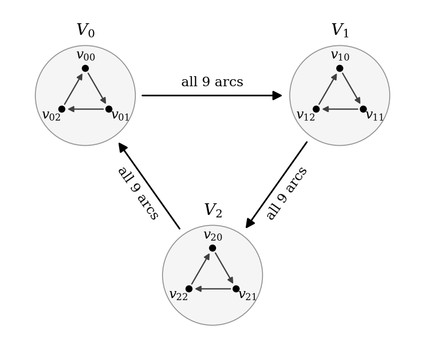
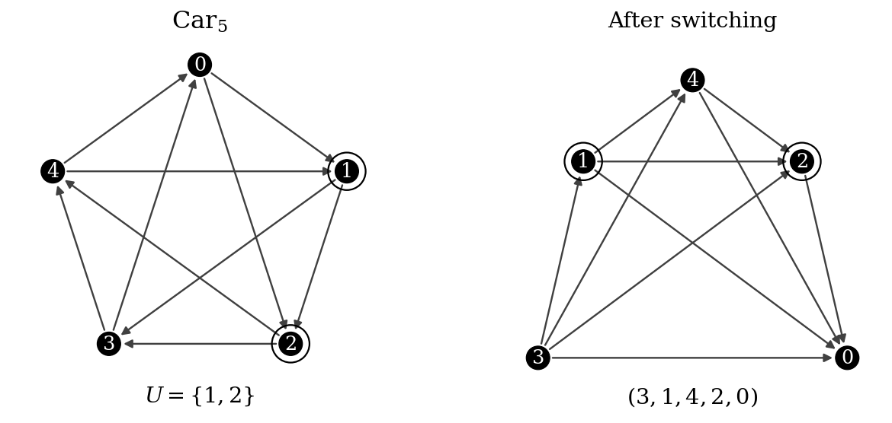

# Wormald 角函数的 Hessian 及其在竞赛图吹胀中的应用

刘星辰

2026年10月28日

## 摘要

Wormald 对竞赛图随机吹胀的计数公式含有一个由隐式角函数定义的 Hessian，并以其非退化为条件。本文直接计算这个矩阵，将它表示为正则基图符号矩阵的有理函数，由此证明正定性及相关平方根的有理性，回答其猜想 6。模型的期望常数也可直接由 Divoux–Wang 的加权圈计数公式得到；本文给出这一代入，并说明它与原 Hessian 计算的关系。结合 Fang–Huang 的等号分类及非正则基图的指数损失，得到圆环基图在充分大块阶下的唯一期望极值。圆环常数的闭式已见于 Divoux–Wang；其严格单调性由显式谱推出，渐近展开则由该闭式计算。

## 1. 引言

Wormald [1] 对竞赛图随机吹胀的研究留下了一个具体的矩阵问题：其计数公式中的角 Hessian 是否总非退化，公式所给的平方根又为何在算出的例子中都是有理数？本文从定义角函数的隐式方程出发，计算整个 Hessian，而后讨论这一公式在吹胀模型中的应用。

记 $C(T)$ 为不区分循环起点的有向 Hamilton 圈数，$H(T)$ 为按顶点顺序计数的有向 Hamilton 路径数。对 $N\ge3$，记 $\nu_N=(N-1)!/2^N$、$\mu_N=N!/2^{N-1}$，并置 $L=\cosh1/\cos1$。对于奇数 $d$，$\mathrm{Car}_d$ 的顶点为 $\mathbb Z/d\mathbb Z$，边方向由差值 $1,\ldots,(d-1)/2$ 决定。

固定奇数 $d\ge3$ 及一个 $d$ 阶基图 $T^*$，将每个顶点替换为 $m$ 个顶点，块间所有边的方向由 $T^*$ 决定。若各内部块独立取均匀随机竞赛图，记所得模型为 $\mathcal T(T^*,m)$；若各块独立取均匀随机正则竞赛图，记为 $\mathcal R(T^*,m)$，此时要求 $m$ 为奇数。总阶数为 $N=dm$。以下圈数和路径数分别以 $\nu_N$ 和 $\mu_N$ 归一化。

为计算这些模型的期望，Wormald 把 Hamilton 圈投影为基图上的闭游走，而圈在各块内留下覆盖该块的有向路径森林。他以矩阵逆为闭游走的生成函数；计入块内森林后，圈期望化为一个多元有理函数的对角系数。对于正则基图，他在对称点应用 Pemantle–Wilson 的光滑奇点渐近公式，得到含角 Hessian 行列式的计数首项，其中保留了 Hessian 非退化的条件。

Wormald 的定理 1 已经给出正则内部块的修正因子 $e^{1/d}$，定理 5 已经包含相应的路径结论。他的猜想 6 问及上述 Hessian 的非退化性与平方根的有理性；猜想 1、2 则分别涉及固定阶基图的期望极值，以及圆环正则吹胀常数随基图阶数变化时的极限。这几个问题在现有文献中的位置并不相同。

Divoux–Wang [4] 已证明全体竞赛图的 Hamilton 圈与路径的归一化渐近极值均为 $\cosh1/\cos1$。更具体地，他们的 Proposition 5.1 给出一类双随机矩阵的加权 Hamilton 圈渐近式。将正则基图吹胀的期望邻接矩阵代入，就得到本文使用的模型常数，无须经过 Wormald 的角函数。该常数的谱上界及圆环上的闭式也已见于 [4, 第 7、9 节]。因此，模型常数、圆环的谱极大性及其极限均应视为已有结果的应用；第 5.1 节写出这一应用的具体计算。

这些计数结论本身没有给出 Wormald 原角函数的 Hessian，也不能在未证明非退化之前反过来使用他的条件渐近式确定 Hessian。本文的主要计算针对这一原始对象。随后保留谱比较中的等号条件，并估计非正则基图，以说明已有计数理论如何给出固定基图阶数下的唯一期望极值。

{width=78%}

对每个正则基图，Hessian 可由下列公式统一计算。

**定理 1.1。** 设 $T^*$ 为正则竞赛图，$A$ 为其邻接矩阵。令 $S=A-A^T$、$C=S/d$ 及 $E=(e_1-e_d,\ldots,e_{d-1}-e_d)$。Wormald 角函数在原点的 Hessian $\mathbf H$ 为正定矩阵，且

$$
\mathbf H=E^T(I+C^2)(I-C^2)^{-1}E,\qquad
\mathcal H=d\,\frac{\det(I+C^2)}{\det(I-C^2)}>0,
$$
$$
\sqrt{d/\mathcal H}=\rho_d(S)
:=\frac{\det(I+S/d)}{\det(I+iS/d)}\in\mathbb Q_{>0}.
$$

这里 $\mathcal H=\det\mathbf H$，平方根取正值。角函数的定义见第 3 节。结合 Wormald [1] 的定理 1、4、5，固定 $d$ 后，模型 $\mathcal T(T^*,m)$ 的归一化圈、路径期望均趋于 $\rho_d(S)$，模型 $\mathcal R(T^*,m)$ 的相应极限均为 $e^{1/d}\rho_d(S)$。

Divoux–Wang 的谱比较表明这个行列式比值在圆环基图上达到最大值。结合 Fang–Huang [2] 的等号分类，正则基图中只有圆环取等。再排除归一化期望指数衰减的非正则基图，便得到下列推论。

**推论 1.2。** 对每个固定奇数 $d\ge3$，存在 $M_d$，使所有 $m\ge M_d$ 时，$\mathrm{Car}_d$ 在同构意义下唯一最大化两个模型的 Hamilton 圈数和路径数期望。对于 $\mathcal R(T^*,m)$，只考虑奇数 $m$。

Divoux–Wang [4, 第 7、9 节] 已给出圆环谱比值的下述闭式。乘上 Wormald 的正则块因子后，Fang–Huang [2, Lemma 4.2] 的显式谱还给出严格单调性。

**推论 1.3。** 置

$$
r_d=\frac{(1+1/d)^d+(1-1/d)^d}{(1+i/d)^d+(1-i/d)^d},
\qquad \mathfrak r_d=e^{1/d}r_d.
$$

沿奇数 $d\ge3$，$\mathfrak r_d$ 严格递增并趋于 $L$。

猜想 2 所问的极限存在性由这个已有闭式立即得到。严格单调性可由频率逐项比较证明；第 5.3 节先给出这一短证明，再保留实函数微分的另一证明。第 5.4 节把闭式展开到 $d^{-5}$ 项，余项为 $O(d^{-6})$，并说明一次项、三次项的消失及五次项的来源。这里始终先固定基图阶数令块阶趋于无穷，再讨论所得常数随基图阶数的变化。

### 1.1 Hessian 的计算与基图比较

我们直接计算 Wormald 原角函数的 Hessian。正则性给出一个常数方向，将这一方向与其正交补分开后，Schur 补把行列式的零点方程化为标量方程。对它求两次导数，再消去最后一个坐标，所得二次型可写为归一化符号矩阵的有理函数。反对称矩阵的二维标准形随即给出正定性；压缩行列式中的坐标因子则给出定理 1.1 的显式公式。这样，Wormald 渐近式中的非退化条件对每个正则基图都成立，而平方根的有理性来自两个有理行列式之比。

谱比较部分沿用 Fang–Huang [2] 与 Divoux–Wang [4] 的论证。前者证明了向量乘积的弱主序不等式及四次矩的等号分类，后者由此控制全部偶次奇异值矩，并将正系数级数用于谱比值。沿这一比较保留等号，即可从比值取等推得四次矩取等，因而符号矩阵与传递矩阵带符号相似。正则基图的零行和条件再确定允许的符号，所得竞赛图恰为圆环。这一步把已有矩阵等号分类转成通常图同构意义下的唯一性。

非正则基图需要另行估计，因为正则基图的 Hessian 公式不适用于这一情形。我们用出度控制永久式：在内部边独立的模型中，先对期望邻接矩阵使用行和取整和 Brégman 不等式；在内部块正则的模型中，则对每个样本使用其确定的行和。非正则性使归一化行和的几何平均严格小于一，从而产生随块阶指数衰减的因子。路径计数在添入一个辅助顶点后得到相同的损失。对固定基图阶数，正则基图之间的严格常数差与非正则基图的指数损失合在一起，给出两种模型共同的充分大块阶阈值。

### 1.2 本文安排

第 2 节约定记号和模型，第 3 节完成原角函数的 Hessian 计算。第 4 节复述所需谱比较并追踪等号，第 5 节说明模型常数与已有结果的关系，随后讨论圆环闭式的单调性和展开。第 6 节处理非正则基图，第 7 节合并这些估计，得到期望极值推论。所有模型渐近式均先固定基图阶数。

## 2. 预备知识与随机模型

记 $H(G)$、$C(G)$ 分别为路径数与圈数，$\mu_N=N!/2^{N-1}$、$\nu_N=(N-1)!/2^N$ 为相应随机期望尺度。矩阵转置记为 $T$，$I,J,\mathbf1$ 分别表示相应维数的单位矩阵、全一矩阵和全一向量。所有 $m\to\infty$ 均固定奇数 $d\ge3$，正则内部块仅取奇数 $m$。路径按有向排列计数，圈按循环起点识别，同构均指通常的图同构。

## 3. 原角函数的 Hessian

### 3.1 角函数与 Hessian 公式

本节仍用 $I_r,J_r,\mathbf1_r$ 表示单位矩阵、全一矩阵和全一列向量，省略下标时阶数由上下文确定。

**定义 3.1 (符号矩阵与原始角函数).**

令$d\ge3$为奇数，$A$为$d$阶正则竞赛图的邻接矩阵，

$$
S=2A+I-J,\quad S^T=-S,\quad S\mathbf1=0,\qquad
C=S/d,\quad P_0=J/d.
$$

以下 $\operatorname{diag}(a_1,\ldots,a_r)$ 表示以 $a_1,\ldots,a_r$ 为对角元的对角矩阵。

设

$$
B(y)=I-(A+\tfrac12I)\operatorname{diag}(y_1,\ldots,y_d),
\quad K(y)=\det B(y),\quad z=2/d.
$$

复对数均取下文指定的局部解析分支，并在正实轴上与自然对数一致。

在 $y=z\mathbf1$ 附近，由 $K(y)=0$ 解出 $y_d=h(y_1,\ldots,y_{d-1})$。Wormald 考虑的角函数为

$$
\widetilde f(\theta)=\log h(ze^{i\theta_1},\ldots,ze^{i\theta_{d-1}})
$$

$e_j$为第$j$个标准基列向量。

记 $\mathbf H=\nabla^2\widetilde f(0)$，$\mathcal H=\det\mathbf H$。这里 $C=S/d$ 始终表示矩阵。

**定理 3.2 (Hessian 公式).**

函数 $h$ 及上述对数分支在相应点的邻域内解析，且

$$
{
\mathbf H=E^T(I+C^2)(I-C^2)^{-1}E,\qquad
E=(e_1-e_d,\ldots,e_{d-1}-e_d).}
$$

因此

$$
{
\mathcal H
=d\,\frac{\det(I+C^2)}{\det(I-C^2)}>0,\qquad
\sqrt{\frac d{\mathcal H}}
=\frac{\det(I+C)}{\det(I+iC)}=:\rho_d(S).}
$$

右边是正有理数，因而上述恒等式证明猜想6。

### 3.2 谱隙、常数方向与限制行列式

**证明。**

由竞赛图的定义及正则性，

$$
A+A^T=J-I,\qquad
A\mathbf1=\frac{d-1}{2}\mathbf1,
$$

$$
S^T=2A^T+I-J
=2(J-I-A)+I-J=-S,
$$

$$
S\mathbf1
=2\frac{d-1}{2}\mathbf1+\mathbf1-d\mathbf1=0.
$$

我们先估计 $C$ 的谱半径。

记实向量$v=(v_1,\ldots,v_r)^T$的欧氏范数为$\|v\|_2=(\sum_{j=1}^r v_j^2)^{1/2}$。

对实矩阵$M$，两种范数分别为

$$
\|M\|_F^2=\sum_{j,k}M_{jk}^2,\qquad
\|M\|_{\rm op}=\sup_{v\ne0}\frac{\|Mv\|_2}{\|v\|_2}.
$$

由于 $S$ 的 $d(d-1)$ 个非对角元 $s_{ij}$ 均为 $\pm1$，

$$
\|S\|_F^2=\sum_{i\ne j}s_{ij}^2=d(d-1),
\qquad \|C\|_F^2=\frac{d-1}{d}.
$$

对归一化的实反对称矩阵$C$作正交基变换。其标准形由零块及二维块

$$
J_\lambda=\begin{pmatrix}0&\lambda\\-\lambda&0\end{pmatrix}
$$

组成。每个二维块对Frobenius范数平方贡献$2\lambda^2$。于是每个频率都满足

$$
2\lambda^2\le\sum_{\text{全部二维块}}2\lambda_j^2
=\|C\|_F^2=\frac{d-1}{d},
$$

$$
\|C\|_{\rm op}^2=\max_j\lambda_j^2
\le\frac{d-1}{2d}<\frac12.
$$

令 $u=\mathbf1/\sqrt d$，$P_0=uu^T=J/d$，$\Pi=I-P_0$。于是

$$
u^Tu=1,\quad P_0^2=P_0,\quad
\Pi^2=I-2P_0+P_0^2=\Pi,
$$

$$
Cu=0,\qquad u^TC=-(Cu)^T=0,
\qquad CP_0=(Cu)u^T=0,\quad P_0C=u(u^TC)=0.
$$

又有

$$
P:=\frac{2A+I}{d}=P_0+C,\qquad
Pu=P_0u+Cu=u.
$$

若$u^Tv=0$，则$P_0v=u(u^Tv)=0$，所以$Pv=Cv$。在展开点，

$$
B(z\mathbf1)=I-P=\Pi-C,\qquad
B(z\mathbf1)u=0.
$$

$u^\perp$是与实向量$u$正交的子空间，$\det_{u^\perp}$表示限制到该不变子空间后、在正交单位基中计算的行列式。

在$u^\perp$上，该矩阵是$I-C$。若$x\in u^\perp$满足$(I-C)x=0$，则

$$
0=x^T(I-C)x=\|x\|_2^2-x^TCx=\|x\|_2^2,
$$

其中$x^TCx=-x^TCx$给出$x^TCx=0$。故$x=0$，限制矩阵可逆。

在二维块上，

$$
\det(I-J_\lambda)
=\det\begin{pmatrix}1&-\lambda\\\lambda&1\end{pmatrix}
=1+\lambda^2>0.
$$

$I-C$在常数方向上的特征值为1，所以

$$
q:=\det_{u^\perp}(I-C)
=\det(I-C)
=\prod_j(1+\lambda_j^2)>0.
$$

转置给出

$$
\det(I+C)=\det((I+C)^T)=\det(I-C)=q.
$$

### 3.3 对数变量、分块矩阵与Schur消元

为计算角函数的导数，先引入原点附近的对数变量 $t\in\mathbb C^d$，令 $y_j=ze^{t_j}$。此时

$$
\mathscr B(t)=B(ze^{t_1},\ldots,ze^{t_d})
=I-P\operatorname{diag}(e^{t_1},\ldots,e^{t_d}).
$$

取$u^\perp$的一组正交单位基作为$V$的列。矩阵$O=(u,V)$满足

$$
V^TV=I_{d-1},\quad V^Tu=0,\quad VV^T=\Pi,
\quad O^TO=OO^T=I_d.
$$

在这个基中写成

$$
O^T\mathscr B(t)O=
\begin{pmatrix}a(t)&b(t)\\c(t)&D(t)\end{pmatrix},
$$

$$
a=u^T\mathscr Bu,\quad b=u^T\mathscr BV,\quad
c=V^T\mathscr Bu,\quad D=V^T\mathscr BV.
$$

其中 $a$ 为标量，$b,c$ 分别为 $1\times(d-1)$ 和 $(d-1)\times1$ 矩阵，$D$ 为 $(d-1)$ 阶方阵。由反对称性还得到

$$
u^TP=u^T(P_0+C)=u^Tuu^T+u^TC=u^T+0=u^T.
$$

因为$\det(O)^2=1$，这次基变换不改变行列式。在$t=0$时，

$$
a(0)=0,\quad b(0)=0,\quad c(0)=0,
\qquad D(0)=V^T(I-C)V.
$$

由第 3.2 节，$\det D(0)=q>0$。连续性保证 $D(t)$ 在原点的某个邻域内可逆。

记 $\operatorname{adj}D$ 为 $D$ 的伴随矩阵，即 $(\operatorname{adj}D)_{ij}=(-1)^{i+j}\det D^{(j|i)}$，其中 $D^{(j|i)}$ 删去第 $j$ 行和第 $i$ 列。行列式展开给出 $D\operatorname{adj}D=(\det D)I$，从而

$$
D(t)^{-1}=\frac{\operatorname{adj}D(t)}{\det D(t)}
$$

该式同时说明 $D(t)^{-1}$ 的各元素在这个邻域内解析。

作分块消元，

$$
\begin{pmatrix}1&-bD^{-1}\\0&I\end{pmatrix}
\begin{pmatrix}a&b\\c&D\end{pmatrix}
=
\begin{pmatrix}a-bD^{-1}c&0\\c&D\end{pmatrix}.
$$

左乘矩阵的行列式为1，右端为分块三角矩阵。因此，定义

$$
\psi(t)=a(t)-b(t)D(t)^{-1}c(t)
$$

后，得到精确恒等式

$$
\det\mathscr B(t)=\det D(t)\,\psi(t).
$$

在上述邻域内，$\det\mathscr B(t)=0$与$\psi(t)=0$等价，因为因子$\det D(t)$不为零。

### 3.4 一阶和二阶导数

对标量函数$F(t_1,\ldots,t_d)$，下标$F_j,F_{jk}$分别表示$\partial F/\partial t_j$和$\partial^2F/(\partial t_j\partial t_k)$；对矩阵或行、列向量逐元求导。若原变量是$y$，则写$K_{y_j}$以区分。

$\nabla^2F$表示由$F_{jk}$组成的矩阵。

$\delta_{jk}$在$j=k$时为1、否则为0。

记$F_j=e_je_j^T$，$R(t)=D(t)^{-1}$。指数矩阵只在第$j$列依赖$t_j$，故在原点

$$
\mathscr B_j=-PF_j,\qquad
\mathscr B_{jk}=-\delta_{jk}PF_j.
$$

对 $DR=I$ 求导两次，得到

$$
D_jR+DR_j=0,\qquad R_j=-RD_jR,
$$

$$
R_{jk}=RD_kRD_jR-RD_{jk}R+RD_jRD_kR.
$$

这些恒等式在 $D$ 可逆的邻域内成立。

由$u^TP=u^T$及$e_j^Tu=1/\sqrt d$，

$$
a_j(0)=-u^TPF_ju=-u_j^2=-1/d,
\qquad a_{jk}(0)=-\delta_{jk}/d.
$$

乘积法则给出

$$
\partial_j(bRc)=b_jRc+bR_jc+bRc_j.
$$

再对 $t_k$ 求导，

$$
\begin{aligned}
\partial_k\partial_j(bRc)
={}&b_{jk}Rc+b_jR_kc+b_jRc_k\\
&+b_kR_jc+bR_{jk}c+bR_jc_k\\
&+b_kRc_j+bR_kc_j+bRc_{jk}.
\end{aligned}
$$

在原点处 $b=c=0$，因而含有未求导因子 $b$ 或 $c$ 的七项均消失，只剩

$$
\partial_k\partial_j(bRc)(0)=b_j(0)R(0)c_k(0)+b_k(0)R(0)c_j(0).
$$

现在计算这些因子：

$$
b_j(0)=-u^TPe_je_j^TV
=-\frac1{\sqrt d}e_j^TV,
$$

$$
c_k(0)=-V^TPe_ke_k^Tu
=-\frac1{\sqrt d}V^TCe_k,
$$

这里由 $V^Tu=0$ 得到 $V^TP=V^TC$。令 $U=(I-C)^{-1}$。因为 $C$ 保持 $u^\perp$，有 $(I-C)V=VD(0)$；在两侧分别乘以 $U$ 和 $R(0)$，并使用 $\Pi C=C$，得到

$$
(I-C)V=VD(0),\qquad UV=VR(0),
$$

$$
UC=U\Pi C=UVV^TC=VR(0)V^TC.
$$

因此，

$$
VR(0)V^TC=UC.
$$

于是两个二次乘积分别为

$$
b_jR(0)c_k=\frac1d e_j^TUC e_k=\frac{(UC)_{jk}}d,
$$

$$
b_kR(0)c_j=\frac1d e_k^TUC e_j=\frac{(UC)_{kj}}d.
$$

一次乘积导数在原点为0，因此

$$
\psi_j(0)=-1/d,\qquad
\psi_{jk}(0)=-\frac{\delta_{jk}+(UC)_{jk}+(UC)_{kj}}d.
$$

$C(I-C)=(I-C)C$，左右乘逆矩阵可得$CU=UC$。又

$$
(UC)^T=C^TU^T=-C(I+C)^{-1}.
$$

两个逆的差逐步化为

$$
\begin{aligned}
(I-C)^{-1}-(I+C)^{-1}
&=(I-C)^{-1}[(I+C)-(I-C)](I+C)^{-1}\\
&=2C(I-C)^{-1}(I+C)^{-1}\\
&=2C(I-C^2)^{-1}.
\end{aligned}
$$

所以

$$
\begin{aligned}
I+UC+(UC)^T
&=I+C[(I-C)^{-1}-(I+C)^{-1}]\\
&=I+2C^2(I-C^2)^{-1}\\
&=(I+C^2)(I-C^2)^{-1}=:Q.
\end{aligned}
$$

综上，$\psi$ 在原点的一、二阶导数为

$$
{\psi_j(0)=-1/d,\qquad
\nabla^2\psi(0)=-Q/d.}
$$

对行列式乘积求导。由于$\psi(0)=0$、$\det D(0)=q$，

$$
\begin{aligned}
\partial_{t_j}\det\mathscr B(0)
&=\partial_{t_j}(\det D)(0)\,\psi(0)+\det D(0)\psi_j(0)\\
&=0+q(-1/d)=-q/d.
\end{aligned}
$$

在原点$\partial y_j/\partial t_j=z$，因此

$$
zK_{y_j}(z\mathbf1)=-q/d,\qquad
K_{y_j}(z\mathbf1)=-\frac{q}{dz}=-q/2\ne0.
$$

特别地，$K_{y_d}(z\mathbf1)\ne0$，可以在这一点附近消去 $y_d$。

### 3.5 最后一个变量的消去

记 $y'=(y_1,\ldots,y_{d-1})$，$t'=(t_1,\ldots,t_{d-1})$。

行列式对第$d$列线性，而这一列关于$y_d$仿射，所以

$$
K(y)=K_0(y_1,\ldots,y_{d-1})
+y_dK_1(y_1,\ldots,y_{d-1}).
$$

其中

$$
K_0(y')=K(y',0),\qquad
K_1(y')=K(y',1)-K(y',0)=K_{y_d}(y',y_d).
$$

最后一个偏导不依赖$y_d$，因为上述表达式关于$y_d$是一次式。

由第 3.4 节的偏导计算，

$$
K_1(z,\ldots,z)=K_{y_d}(z\mathbf1)=-q/2\ne0.
$$

在充分小的邻域内 $K_1(y')\ne0$，故

$$
h(y')=-\frac{K_0(y')}{K_1(y')}.
$$

因为$K(z\mathbf1)=0$，

$$
K_0(z,\ldots,z)+zK_1(z,\ldots,z)=0,
\qquad h(z,\ldots,z)=z.
$$

定义

$$
g(t')=\log\!\left[
\frac{h(ze^{t_1},\ldots,ze^{t_{d-1}})}z\right].
$$

由 $h(z,\ldots,z)=z>0$ 及连续性，可缩小邻域使 $|h(ze^{t'})/z-1|<1/2$，其中指数按坐标取值。在此圆盘内取满足 $\log1=0$ 的解析分支，则

$$
g(0)=\log1=0,\qquad
t_d=g(t'),\qquad \psi(t',g(t'))=0.
$$

这样得到的 $g$ 是解析函数，并在原点附近满足所需的隐式方程。

### 3.6 隐式微分与角变量

以下 $1\le j,k\le d-1$。先对恒等式 $\psi(t',g(t'))=0$ 求导，再在 $t'=0$ 处代入第 3.4 节的导数值。一次求导给出

$$
0=\psi_j+\psi_dg_j,\qquad
g_j(0)=-\frac{\psi_j(0)}{\psi_d(0)}
=-\frac{-1/d}{-1/d}=-1.
$$

对$t_k$再次求导，五项为

$$
0=\psi_{jk}+\psi_{jd}g_k+\psi_{dk}g_j
+\psi_{dd}g_jg_k+\psi_dg_{jk}.
$$

在原点代入第 3.4 节的导数及 $g_j(0)=g_k(0)=-1$，得

$$
0=-\frac{Q_{jk}}d+\frac{Q_{jd}}d
+\frac{Q_{dk}}d-\frac{Q_{dd}}d-\frac{g_{jk}}d.
$$

两边乘$d$，再移项：

$$
\begin{aligned}
g_{jk}(0)
&=-Q_{jk}+Q_{jd}+Q_{dk}-Q_{dd}\\
&=-(e_j-e_d)^TQ(e_k-e_d).
\end{aligned}
$$

对 $\log h$ 取满足 $\log h(z,\ldots,z)=\log z$ 的局部分支。由 $g$ 的定义，Wormald 的角函数满足

$$
\widetilde f(\theta)=\log z+g(i\theta_1,\ldots,i\theta_{d-1}).
$$

一次角导数为$i g_j(i\theta)$，二次角导数为$i^2g_{jk}(i\theta)$。因此

$$
\mathbf H_{jk}
=i^2g_{jk}(0)=-g_{jk}(0)
=(e_j-e_d)^TQ(e_k-e_d),
$$

$$
{\mathbf H=E^TQE.}
$$

### 3.7 正定性与行列式

$M\succ0$表示$M$实对称且对每个非零实向量$v$都有$v^TMv>0$。

在第 3.2 节的每个二维块上，$J_\lambda^2=-\lambda^2I_2$，因此

$$
(I+J_\lambda^2)(I-J_\lambda^2)^{-1}
=\frac{1-\lambda^2}{1+\lambda^2}I_2.
$$

由$\lambda^2<1/2$，这个系数为正。零块上的$Q$为单位矩阵，所以$Q\succ0$。
对$v\in\mathbb R^{d-1}$，

$$
Ev=(v_1,\ldots,v_{d-1},-\textstyle\sum_{j=1}^{d-1}v_j)^T.
$$

若$v\ne0$，前$d-1$个分量不全为0，故$Ev\ne0$，从而

$$
v^T\mathbf Hv=(Ev)^TQ(Ev)>0.
$$

计算 $E$ 的 Gram 行列式。其第 $j,k$ 列的内积为

$$
(e_j-e_d)^T(e_k-e_d)=\delta_{jk}+1.
$$

故$E^TE=I_{d-1}+J_{d-1}$。在全一方向该矩阵的特征值为$1+(d-1)=d$，
在与全一向量垂直的方向上特征值为1。因此

$$
\det(E^TE)=d\cdot1^{d-2}=d.
$$

写$E=VL$，其中$V$是$u^\perp$的正交基、$L$为可逆方阵：

$$
E^TQE=L^T(V^TQV)L,\qquad
E^TE=L^TL.
$$

取行列式分别得到

$$
\det(E^TQE)=\det(L)^2\det(V^TQV),\qquad
\det(L)^2=d.
$$

由$Cu=0$，

$$
Qu=(I+C^2)(I-C^2)^{-1}u=u.
$$

$Q$在第 3.2 节的实正交基中每个块都是实数乘单位矩阵，因此$Q$为实对称矩阵。于是$u^TQV=(Qu)^TV=u^TV=0$。故

$$
(u,V)^TQ(u,V)=
\begin{pmatrix}1&0\\0&V^TQV\end{pmatrix},
\qquad \det Q=\det(V^TQV).
$$

把两个行列式因子乘回：

$$
\mathcal H=d\det Q
=d\,\frac{\det(I+C^2)}{\det(I-C^2)}>0.
$$

矩阵乘法及转置给出

$$
(I+iC)(I-iC)=I+C^2,\qquad
\det(I-iC)=\det((I-iC)^T)=\det(I+iC),
$$

$$
(I+C)(I-C)=I-C^2,\qquad \det(I-C)=\det(I+C).
$$

因此

$$
\det(I+C^2)=\det(I+iC)^2,\qquad
\det(I-C^2)=\det(I+C)^2.
$$

在每个反对称二维块上，

$$
\det(I+J_\lambda)=1+\lambda^2>0,\qquad
\det(I+iJ_\lambda)=1-\lambda^2>0.
$$

所以

$$
\sqrt{\frac d{\mathcal H}}
=\frac{\det(I+C)}{\det(I+iC)}>0.
$$

记$[d]=\{1,\ldots,d\}$。$M[U]$是行列都取自$U$的主子矩阵，约定$\det M[\varnothing]=1$。

记 $\lfloor a\rfloor$ 为不超过 $a$ 的最大整数。为证明上述比值有理，按列的多线性展开行列式：每列取单位矩阵的一列或 $C$ 的一列，得到

$$
\det(I+tC)=\sum_{U\subseteq[d]}t^{|U|}\det C[U].
$$

对奇数阶$r=|U|$，

$$
\det C[U]=\det(C[U]^T)=\det(-C[U])
=(-1)^r\det C[U]=-\det C[U],
$$

所以该主子式为0。$C$有理，故

$$
\det(I+iC)
=\sum_{k=0}^{\lfloor d/2\rfloor}\sum_{\substack{U\subseteq[d]\\|U|=2k}}
(-1)^k\det C[U]\in\mathbb Q.
$$

$\det(I+C)$也为有理数。已经证明分子、分母均正，所以所得比值为正有理数。 $\square$

## 4. 谱比较及其等号

以下比较采用 Fang–Huang [2, 第 3 节] 与 Divoux–Wang [4, 第 7 节] 的结果。谱上界本身已有于后者；这里写出所需步骤，是为了同时说明等号如何限制正则基图。

### 4.1 乘积比较与等号条件

**定理 4.1 (Fang–Huang).**

我们使用 [Fang–Huang, Corollary 3.4](https://arxiv.org/html/2608.06238v1#S3) 的以下形式。令比较矩阵 $K_d$ 为

$$
(K_d)_{ij}=\begin{cases}
1,&i+j\le d,\\
0,&i+j=d+1,\\
(-1)^{i+j-d-2},&i+j\ge d+2.
\end{cases}
$$

设 $p\ge1$，$x\in\mathbb R^d$，$S_1,\ldots,S_p$ 为 $d$ 阶竞赛符号矩阵。用 $x^*$ 表示将 $x$ 的坐标绝对值按降序排列所得的向量，则

$$
(S_1\cdots S_p x)^*\prec_w K_d^p x^*.
$$

右端是非负降序向量。弱主序$u\prec_w v$的含义是

$$
\sum_{i=1}^r u_i\le\sum_{i=1}^r v_i
\quad(1\le r\le d).
$$

此外，最外层比较取向量等号时，每个后缀乘积的比较也取向量等号。为将这一结论用于矩阵的 Frobenius 范数，我们先说明弱主序下的平方和比较及其取等条件。

**引理 4.2 (弱主序的截断和比较).**

记$(a-t)_+=\max(a-t,0)$。对于满足$u\prec_w v$的降序非负向量及$t\ge0$，

$$
\sum_{i=1}^d(u_i-t)_+
=\max_{0\le r\le d}\left(\sum_{i=1}^r u_i-rt\right)
\le\max_{0\le r\le d}\left(\sum_{i=1}^r v_i-rt\right)
=\sum_{i=1}^d(v_i-t)_+.
$$

**证明。**

取 $r=\#\{i:u_i>t\}$ 即得第一个等号：加入不大于 $t$ 的坐标或删去大于 $t$ 的坐标，均不能增大该和。又对 $a\ge0$，

$$
2\int_0^\infty(a-t)_+\,dt
=2\int_0^a(a-t)\,dt
=2[at-t^2/2]_0^a=a^2.
$$

逐坐标积分得到

$$
\|u\|_2^2
=2\int_0^\infty\sum_i(u_i-t)_+\,dt
\le2\int_0^\infty\sum_i(v_i-t)_+\,dt
=\|v\|_2^2.
$$

若平方和相等，函数 $g(t)=\sum_i(v_i-t)_+-\sum_i(u_i-t)_+$ 连续、非负且积分为零。若某处 $g(t_0)>0$，则在 $t_0$ 的一个正长度邻域内有 $g(t)>g(t_0)/2$，与积分为零矛盾。因此 $g\equiv0$。比较两边的右导数可得

以下 $\#U$ 表示有限集 $U$ 的基数，$\mathbf1_{\mathcal E}$ 表示条件 $\mathcal E$ 的指示函数。

$$
\#\{i:u_i>t\}=\#\{i:v_i>t\}=:N(t).
$$

对第$j$个坐标，

$$
u_j=\int_0^\infty
\mathbf1_{\{\#\{i:u_i>t\}\ge j\}}\,dt
=\int_0^\infty\mathbf1_{\{N(t)\ge j\}}\,dt=v_j.
$$

因而平方和取等强制$u=v$。取$x=e_j$，由于$e_j^*=e_1$，得到

$$
\|S^pe_j\|_2^2\le\|K_d^pe_1\|_2^2.
$$

并且取等时$(S^pe_j)^*=K_d^pe_1$。

### 4.2 比较矩阵的矩

记$\operatorname{tr}M=\sum_jM_{jj}$。

令 $T_d$ 为传递竞赛图的符号矩阵，其上三角元为 $1$。令 $R_0$ 为反序置换矩阵，$D_0=\operatorname{diag}(1,-1,\ldots)$。由 $K_d$ 的定义，

$$
(D_0K_dR_0)_{ij}
=(-1)^{i-1}(K_d)_{i,d+1-j}
=\begin{cases}
(-1)^{i-1},&i<j,\\
0,&i=j,\\
(-1)^j,&i>j.
\end{cases}
$$

这里 $R_0e_j=e_{d+1-j}$，$(D_0)_{jj}=(-1)^{j-1}$。由于 $(K_d)_{ij}$ 只依赖于 $i+j$，有 $K_d^T=K_d$。

把奇指标升序、偶指标降序所得序列记为

$$
(\ell_1,\ldots,\ell_d)=(1,3,\ldots,d,d-1,d-3,\ldots,2),
\qquad \Lambda e_j=e_{\ell_j}.
$$

这些指标各出现一次，所以$\Lambda^T\Lambda=\Lambda\Lambda^T=I$，而$\ell_1=1$。

按这一顺序排列行、列。两个奇指标按升序排列，故相应上三角元为 $(-1)^{i-1}=1$；两个偶指标按降序排列，故相应上三角元为 $(-1)^j=1$。奇指标总在偶指标之前，此时无论原指标满足 $i<j$ 还是 $i>j$，相应元素分别为 $(-1)^{i-1}$ 或 $(-1)^j$，仍等于 $1$。因此

$$
T_d=\Lambda^TD_0K_dR_0\Lambda.
$$

置$U=D_0\Lambda$。由于$R_0R_0^T=I$、$\Lambda\Lambda^T=I$、$K_d^T=K_d$，矩阵乘积给

$$
\begin{aligned}
T_dT_d^T
&=\Lambda^TD_0K_dR_0\Lambda
\Lambda^TR_0^TK_dD_0\Lambda\\
&=\Lambda^TD_0K_d^2D_0\Lambda=U^TK_d^2U.
\end{aligned}
$$

第一项指标是1，故$Ue_1=e_1$。又$T_d^T=-T_d$，所以

$$
T_d^2=-U^TK_d^2U,\qquad
T_d^{2p}=(-1)^pU^TK_d^{2p}U
$$

（相乘时每两个邻接的$UU^T$都等于$I$）。于是

$$
(-1)^p(T_d^{2p})_{11}
=e_1^TK_d^{2p}e_1
=(K_d^pe_1)^T(K_d^pe_1)
=\|K_d^pe_1\|_2^2.
$$

附录 A.2 给出的带符号循环移位 $Z$ 满足 $Z^TT_dZ=T_d$，从而 $Z^TT_d^{2p}Z=T_d^{2p}$。比较对角元，当 $j<d$ 时有 $(T_d^{2p})_{j+1,j+1}=(T_d^{2p})_{jj}$；当 $j=d$ 时，绕回的两个负号抵消，得到 $(T_d^{2p})_{11}=(T_d^{2p})_{dd}$。于是所有对角元相同，且

$$
\begin{aligned}
\|T_d^p\|_F^2
&=\operatorname{tr}((T_d^p)^TT_d^p)
=(-1)^p\operatorname{tr}T_d^{2p}\\
&=d(-1)^p(T_d^{2p})_{11}
=d\|K_d^pe_1\|_2^2.
\end{aligned}
$$

现在对上一节的$d$个列不等式求和：

$$
\|S^p\|_F^2
=\sum_{j=1}^d\|S^pe_j\|_2^2
\le d\|K_d^pe_1\|_2^2
=\|T_d^p\|_F^2\qquad(p\ge1).
$$

特别地，该不等式对下一节所需的每个奇数 $p$ 都成立。

### 4.3 谱比值的极值

设 $S$ 为任意 $d$ 阶竞赛符号矩阵，其非零特征值为 $\pm i\lambda_j$，其中 $\lambda_j>0$，并令 $x_j=\lambda_j^2/d^2$。由 $2\sum_j\lambda_j^2=\|S\|_F^2=d(d-1)$，有 $x_j\le(d-1)/(2d)<1/2$。在反对称标准形中，零块对两个行列式均贡献 $1$，非零二维块分别贡献 $1+x_j$ 和 $1-x_j$。因此

$$
\det(I+S/d)=\prod_j(1+x_j),\qquad
\det(I+iS/d)=\prod_j(1-x_j)>0.
$$

在$0\le x<1$上，将几何级数积分，

$$
\begin{aligned}
\log\frac{1+x}{1-x}
&=\int_0^x\left(\frac1{1+t}+\frac1{1-t}\right)\,dt\\
&=2\int_0^x\frac{dt}{1-t^2}
=2\sum_{r=0}^\infty\int_0^x t^{2r}\,dt
=2\sum_{r=0}^\infty\frac{x^{2r+1}}{2r+1}.
\end{aligned}
$$

积分交换可由$[0,x]$上几何级数的一致收敛保证。反对称标准形还给$\|S^p\|_F^2=2\sum_j\lambda_j^{2p}$。逐项代入，

$$
\begin{aligned}
\log\rho_d(S)
&=2\sum_j\sum_{r=0}^\infty
\frac{\lambda_j^{4r+2}}{(2r+1)d^{4r+2}}\\
&=\sum_{r=0}^\infty
\frac{\|S^{2r+1}\|_F^2}{(2r+1)d^{4r+2}}
\le\sum_{r=0}^\infty
\frac{\|T_d^{2r+1}\|_F^2}{(2r+1)d^{4r+2}}
=\log\rho_d(T_d).
\end{aligned}
$$

令 $r_d=\rho_d(T_d)$。若上述不等式取等，则各项的非负差均为零。取 $r=1$，得到 $\|S^3\|_F^2=\|T_d^3\|_F^2$。又因为这一差等于各列非负差之和，每一列也取等。由第 4.1 节的取等条件及 Fang–Huang 的后缀等号结论，

$$
(S^3e_j)^*=K_d^3e_1,\qquad
(S^2e_j)^*=K_d^2e_1.
$$

对后一式求平方和并按$j$求和，

$$
\operatorname{tr}S^4=\|S^2\|_F^2
=d\|K_d^2e_1\|_2^2
=\|T_d^2\|_F^2=\operatorname{tr}T_d^4.
$$

由附录 A.3，四次矩取等当且仅当 $S=\Omega^TT_d\Omega$，其中 $\Omega$ 为带符号置换矩阵。反之，由 $\Omega^T\Omega=I$ 可得

$$
I+tS=\Omega^T(I+tT_d)\Omega,\qquad
\det(I+tS)=(\det \Omega)^2\det(I+tT_d)=\det(I+tT_d).
$$

**引理 4.3 (谱比值及等号条件).**

分别取$t=1/d$和$t=i/d$，得到$\rho_d(S)=r_d$。因此

$$
\rho_d(S)\le r_d,
\quad\text{等号当且仅当 }S=\Omega^TT_d\Omega.
$$

**证明 (正则情形的普通同构分类).**

写 $\Omega=D_{\varepsilon}P$，其中 $P$ 为置换矩阵，$D_{\varepsilon}=\operatorname{diag}(\varepsilon_1,\ldots,\varepsilon_d)$，$\varepsilon_i\in\{-1,1\}$。记 $\varepsilon=(\varepsilon_1,\ldots,\varepsilon_d)^T$，则

$$
S=P^TD_{\varepsilon}T_dD_{\varepsilon}P,\qquad PSP^T=D_{\varepsilon}T_dD_{\varepsilon}.
$$

用 $P$ 重编号后，仍记所得矩阵为 $S$。正则性给出 $S\mathbf1=0$，再由 $D_{\varepsilon}^2=I$ 得

$$
D_{\varepsilon}T_d\varepsilon=0,\qquad T_d\varepsilon=0.
$$

第$i$行与第$i+1$行的差只有第$i,i+1$列各为1，因此

$$
0=(T_d\varepsilon)_i-(T_d\varepsilon)_{i+1}=\varepsilon_i+\varepsilon_{i+1}.
$$

因此 $\varepsilon_i=(-1)^{i-1}\varepsilon_1$。整体符号 $\varepsilon_1$ 在 $D_{\varepsilon}T_dD_{\varepsilon}$ 中抵消，所得矩阵恰为交替切换。附录 A.2 证明它与 $\mathrm{Car}_d$ 同构，故正则图中仅圆环图取等。

### 4.4 六次矩的严格间隙

{width=94%}

$\binom nk=n!/(k!(n-k)!)$，$k>n$时为0。

**引理 4.4 (六次矩的严格亏损).**

若正则$S$不普通同构于圆环，上一节的等号推演给

$$
\Delta_3:=\|T_d^3\|_F^2-\|S^3\|_F^2>0.
$$

**证明。**

在模2意义下$S\equiv J+I$，并且$J^2=dJ$、$J^3=d^2J$，所以

$$
S^3\equiv(J+I)^3
=I+3J+3dJ+d^2J
\equiv I+(1+d+d^2)J\equiv I+J\pmod2.
$$

最后一步使用$d(d+1)$为偶数。又$(S^3)^T=-S^3$，故其对角为0、非对角为奇数。若$z=2k+1$，

$$
z^2=4k(k+1)+1\equiv1\pmod8.
$$

将反对称位置成对求和，

$$
\|S^3\|_F^2=2\sum_{i<j}((S^3)_{ij})^2
\equiv2\binom d2=d(d-1)\pmod{16}.
$$

此式也适用于$T_d$。因此$\Delta_3$是正的16的整数倍，$\Delta_3\ge16$。在对数级数中只保留$r=1$项，

$$
\log\frac{r_d}{\rho_d(S)}
\ge\frac{\Delta_3}{3d^6}\ge\frac{16}{3d^6}.
$$

两边取指数，再移项，

$$
\rho_d(S)\le r_de^{-16/(3d^6)},\qquad
r_d-\rho_d(S)\ge r_d(1-e^{-16/(3d^6)})>0.
$$

这个间隙取决于基图阶数 $d$；相应的块阶阈值将在第 7.3 节由极限比较得到。

## 5. 模型极限与圆环常数

### 5.1 随机模型的计数极限

约定$0!=1$，$n!=1\cdot2\cdots n$。

第$j$类顶点指第$j$个基图顶点所对应的$m$个吹胀顶点。

**定义 5.1 (随机模型的归一化).**

现在将 Hessian 公式代入 Wormald 的 Theorems 1、4、5。固定 $d$ 阶正则基图，令内部块阶数 $m\to\infty$，总阶数为 $N=dm$。各块在允许的有标号竞赛图中独立均匀选取。下标 $\mathcal T,\mathcal R$ 分别表示独立随机内部块与正则内部块模型；$\mathbb EC$ 和 $\mathbb EH$ 分别表示圈数与路径数的期望。定义

$$
\nu_N=\frac{(N-1)!}{2^N},\qquad
\mu_N=\frac{N!}{2^{N-1}}.
$$

**推论 5.2 (Wormald 计数公式的应用).**

Wormald的Theorem 4在$\mathcal H\ne0$时给出

$$
\frac{\mathbb EC_{\mathcal T}}{\nu_N}
\longrightarrow\sqrt{d/\mathcal H}.
$$

由第 3.7 节，$\mathcal H>0$，且上述平方根取正值。因此

$$
\lim_{m\to\infty}\frac{\mathbb EC_{\mathcal T}}{\nu_N}
=\sqrt{\frac d{d\det(I+C^2)/\det(I-C^2)}}
=\rho_d(S).
$$

Theorem 5把Theorem 4的圈计数换成路径计数，故

$$
\lim_{m\to\infty}\frac{\mathbb EH_{\mathcal T}}{\mu_N}
=\sqrt{d/\mathcal H}=\rho_d(S).
$$

Theorem 1给出正则内部块与独立随机内部块的期望之比：

$$
\frac{\mathbb EC_{\mathcal R}}{\mathbb EC_{\mathcal T}}
\longrightarrow e^{1/d}.
$$

对足够大的$m$，分母为正，因为其归一化极限$\rho_d(S)>0$。相乘得到

$$
\lim_{\substack{m\to\infty\\m\ {\rm 奇}}}
\frac{\mathbb EC_{\mathcal R}}{\nu_N}
=\lim_{\substack{m\to\infty\\m\ {\rm 奇}}}
\left(\frac{\mathbb EC_{\mathcal R}}{\mathbb EC_{\mathcal T}}
\frac{\mathbb EC_{\mathcal T}}{\nu_N}\right)
=e^{1/d}\rho_d(S).
$$

Theorem 5还把Theorem 1的计数换成路径，给出

$$
\frac{\mathbb EH_{\mathcal R}}{\mathbb EH_{\mathcal T}}
\longrightarrow e^{1/d}.
$$

于是第四个极限为

$$
\lim_{\substack{m\to\infty\\m\ {\rm 奇}}}
\frac{\mathbb EH_{\mathcal R}}{\mu_N}
=\lim_{\substack{m\to\infty\\m\ {\rm 奇}}}
\left(\frac{\mathbb EH_{\mathcal R}}{\mathbb EH_{\mathcal T}}
\frac{\mathbb EH_{\mathcal T}}{\mu_N}\right)
=e^{1/d}\rho_d(S).
$$

上述极限中 $d$ 固定；正则内部块模型的极限沿奇数 $m$ 取值。

**由 Divoux–Wang 公式直接计算模型常数。** 上述极限还可以从 [4, Proposition 5.1] 得到。这个计算不经过角函数，因而与第 3 节的 Hessian 恒等式有所区别。以下仍固定正则基图阶数 $d$，令 $N=dm$，并以 $J_r$ 表示 $r$ 阶全一矩阵。

独立随机内部块模型的期望邻接矩阵为

$$
W=\frac{J_N-I_N+S\otimes J_m}{2},\qquad
D=\frac{2W}{N-1},\qquad
B=D-\frac{J_N}{N}.
$$

Hamilton 圈和路径各自使用的无序顶点对互不相同，故内部随机边的独立性给出

$$
\mathbb EC_{\mathcal T}=\operatorname{cyc}(W),\qquad
\mathbb EH_{\mathcal T}=\operatorname{path}(W).
$$

这里 $\operatorname{cyc}$ 与 $\operatorname{path}$ 分别为边权乘积的圈和、路径和。由 $S\mathbf1=0$，矩阵 $D$ 的各行、各列之和均为 $1$，且其元素不超过 $2/(N-1)$。

将 $\mathbb R^N$ 正交分成全一方向、块常数且总和为零的空间，以及每块内部和均为零的空间。三者上 $B$ 的作用分别为

$$
0,\qquad
B_0=\left.\frac{mS-I_d}{N-1}\right|_{\mathbf1_d^\perp},
\qquad -\frac{I_{N-d}}{N-1}.
$$

由 $\|S\|_{\rm op}^2\le d(d-1)/2$，有

$$
\limsup_{m\to\infty}\|B\|_{\rm op}
\le\sqrt{\frac{d-1}{2d}}<1.
$$

因此 $D$ 满足 Divoux–Wang 的条件，且

$$
\frac{N^N\operatorname{cyc}(D)}{(N-1)!}
=(1+o(1))\frac{\det(I-B)}{\sqrt{\det(I-B^TB)}}.
$$

记右边的行列式比值为 $R_N$。上述正交分解给出

$$
R_N=
\frac{\det(I-B_0)}{\sqrt{\det(I-B_0^TB_0)}}
\frac{\bigl(1+(N-1)^{-1}\bigr)^{N-d}}
{\bigl(1-(N-1)^{-2}\bigr)^{(N-d)/2}}.
$$

第二个因子趋于 $e$。第一个因子作用在固定维数的空间上，$B_0\to C|_{\mathbf1_d^\perp}$，其中 $C=S/d$。由于 $C\mathbf1=0$，补回全一方向不改变所需行列式，故

$$
R_N\longrightarrow
e\,\frac{\det(I-C)}{\sqrt{\det(I+C^2)}}
=e\,\frac{\det(I+C)}{\det(I+iC)}
=e\rho_d(S).
$$

这里平方根取正值；对每对特征值 $\pm i\lambda$，$|\lambda|<1$，其贡献为 $1-\lambda^2>0$。再用圈多项式的齐次性，得到

$$
\frac{\mathbb EC_{\mathcal T}}{\nu_N}
=\left(\frac{N-1}{N}\right)^N
\frac{N^N\operatorname{cyc}(D)}{(N-1)!}
\longrightarrow e^{-1}\,e\rho_d(S)=\rho_d(S).
$$

路径也可以直接沿用 [4, 第 10 节] 的添点计算。置

$$
\widehat D=
\begin{pmatrix}
0&\mathbf1_N^T/N\\
\mathbf1_N/N&(1-1/N)D
\end{pmatrix}.
$$

该矩阵双随机，且每条原路径通过新顶点唯一闭合成圈，因此

$$
\operatorname{cyc}(\widehat D)
=N^{-2}(1-1/N)^{N-1}\operatorname{path}(D).
$$

令 $\widehat B=\widehat D-J_{N+1}/(N+1)$。有 $\|\widehat B-\operatorname{diag}(0,B)\|_F=O(N^{-1})$，且两者的迹都为 $-1$。由于 $\|B\|_F$ 有界、谱范数与 $1$ 保持距离，[4, 第 10 节] 的行列式比较说明二者在 Proposition 5.1 中的行列式因子之比趋于 $1$。从而

$$
\frac{\operatorname{cyc}(\widehat D)}{\operatorname{cyc}(D)}
=(1+o(1))\left(\frac{N}{N+1}\right)^{N+1},
\qquad
\operatorname{path}(D)=(1+o(1))N^2\operatorname{cyc}(D).
$$

将 $W=(N-1)D/2$ 代回，

$$
\frac{\mathbb EH_{\mathcal T}}{\mu_N}
=(1+o(1))\frac{N}{N-1}
\frac{\mathbb EC_{\mathcal T}}{\nu_N}
\longrightarrow\rho_d(S).
$$

正则内部块的两个极限再由 Wormald [1, Theorems 1、5] 乘以 $e^{1/d}$。这样，四个模型常数均为已有计数理论的推论。这个推导没有确定原角函数的 Hessian；其正定性以及整个矩阵的表达式仍由第 3 节的直接求导给出。

### 5.2 圆环基图的闭式

**命题 5.3 (Divoux–Wang 的圆环闭式).**

下面的行列式计算及闭式见 Divoux–Wang [4, 第 7、9 节]。这里以本文的归一化记号重述，附录 A.1、A.2 给出对应的代数计算。

令 $T_d$ 为传递竞赛图的符号矩阵。圆环图的符号矩阵与 $T_d$ 带符号置换相似，见附录 A.2。又由附录 A.1，$T_d$ 的每个偶阶主子式为 $1$，每个奇阶主子式为 $0$。因此

$$
\det(I+tT_d)=\frac{(1+t)^d+(1-t)^d}{2}.
$$

用图名作为 $\rho_d$ 的自变量时，取该图的符号矩阵；此值在重编号下不变。于是

$$
{
\rho_d(\mathrm{Car}_d)
=\frac{(1+1/d)^d+(1-1/d)^d}
{(1+i/d)^d+(1-i/d)^d}.}
$$

该式在前三个奇阶数给出 Wormald 表中的 $2,44/19,3032/1231,\ldots$。由 Wormald [1, Theorem 1]，正则内部块模型的常数为

$$
\mathfrak r_d=e^{1/d}r_d,\qquad r_d:=\rho_d(\mathrm{Car}_d).
$$

### 5.3 闭式的实函数形式与严格单调性

一元函数的撇号表示对其自变量求导。

**定义 5.4 (实函数与辅助变量).**

下文使用的初等函数为

$$
\cosh y=\frac{e^y+e^{-y}}2,\quad
\sinh y=\frac{e^y-e^{-y}}2,\quad
\tanh y=\frac{\sinh y}{\cosh y},\quad
\operatorname{sech}y=\frac1{\cosh y},\quad
\sec y=\frac1{\cos y}.
$$

令$x=1/d$，在$0<x\le1/3$上定义

$$
\alpha(x)=\frac{\arctan x}{x},\qquad
\beta(x)=\frac{\operatorname{artanh}x}{x},\qquad
\operatorname{artanh}x=\frac12\log\frac{1+x}{1-x}.
$$

**推论 5.5 (单调性与极限).** 沿奇数 $d\ge3$，序列 $\mathfrak r_d$ 严格递增并收敛于 $L=\cosh1/\cos1$。

**证明：显式谱的比较。** Fang–Huang [2, Lemma 4.2] 给出传递符号矩阵的特征值。对奇数 $d$，其归一化正频率为

$$
a_{j,d}=\frac1d\cot\frac{(2j-1)\pi}{2d},
\qquad 1\le j\le\frac{d-1}{2}.
$$

Divoux–Wang [4, 第 7 节] 的对数展开以及 $\|T_d\|_F^2=d(d-1)$ 给出

$$
\log r_d
=2\sum_{j=1}^{(d-1)/2}\sum_{r=0}^{\infty}
\frac{a_{j,d}^{\,4r+2}}{2r+1},
\qquad
2\sum_{j=1}^{(d-1)/2}a_{j,d}^2=1-\frac1d.
$$

故正则块因子恰好补去二次矩中的 $-1/d$：

$$
\log\mathfrak r_d
=1+2\sum_{j=1}^{(d-1)/2}\sum_{r=1}^{\infty}
\frac{a_{j,d}^{\,4r+2}}{2r+1}.
$$

固定 $j$，记 $c_j=(2j-1)\pi/2$。令 $x=c_j/d$，则 $a_{j,d}=x\cot x/c_j$，而

$$
\frac{d}{dx}(x\cot x)
=\frac{\sin x\cos x-x}{\sin^2x}<0
\qquad(0<x<\pi/2).
$$

最后一个严格不等式来自 $\sin(2x)<2x$。因此，$d$ 增大时，每个已有的 $a_{j,d}$ 都严格增大。从奇数 $d$ 到 $d+2$，上式还增加了一个正频率；收敛级数中的系数均为正，遂得 $\mathfrak r_{d+2}>\mathfrak r_d$。极限由命题 5.3 的已有闭式直接得到：

$$
\mathfrak r_d
=e^{1/d}\frac{(1+1/d)^d+(1-1/d)^d}
{(1+i/d)^d+(1-i/d)^d}
\longrightarrow\frac{\cosh1}{\cos1}.
$$

$\square$

**另一证明：实函数微分。** 先把分子与分母分别写成实函数。实对数的和与差给出

$$
\log(1\pm x)=\frac12\log(1-x^2)
\ \pm\operatorname{artanh}x.
$$

指数化并相加：

$$
(1+x)^{1/x}+(1-x)^{1/x}
=2(1-x^2)^{1/(2x)}\cosh\beta(x).
$$

当 $0\le x\le1/3$ 时，$1\pm ix$ 均位于右半平面。在该半平面取与正实轴上的实对数一致的解析对数分支，有

$$
\log(1\pm ix)=\frac12\log(1+x^2)\pm i\arctan x,
$$

$$
(1+ix)^{1/x}+(1-ix)^{1/x}
=2(1+x^2)^{1/(2x)}\cos\alpha(x).
$$

因此

$$
\mathfrak r(x)
=e^{p(x)}\frac{\cosh\beta(x)}{\cos\alpha(x)},\qquad
p(x)=x+\frac{\log(1-x^2)-\log(1+x^2)}{2x}.
$$

当$x=1/d$时，$1/x=d$是整数，上述复幂就是原来的多项式幂。
又$0<\alpha(x)\le1<\pi/2$，所以分母的余弦严格为正。

把两个对数的级数相减：

$$
\begin{aligned}
\log(1-x^2)-\log(1+x^2)
&=-2\sum_{j=0}^\infty\frac{x^{4j+2}}{2j+1},\\
p(x)&=x-\sum_{j=0}^\infty\frac{x^{4j+1}}{2j+1}
=-\sum_{j=1}^\infty\frac{x^{4j+1}}{2j+1},\\
p'(x)&=-\sum_{j=1}^\infty
\frac{4j+1}{2j+1}x^{4j}<0.
\end{aligned}
$$

对反正切与反双曲正切的积分作变量代换，得到

$$
\alpha(x)=\int_0^1\frac{dt}{1+x^2t^2},\qquad
\beta(x)=\int_0^1\frac{dt}{1-x^2t^2}.
$$

令$v=1-\alpha$，在积分内求导：

$$
\beta'(x)=\int_0^1\frac{2xt^2}{(1-x^2t^2)^2}\,dt,
\qquad
v'(x)=\int_0^1\frac{2xt^2}{(1+x^2t^2)^2}\,dt>0.
$$

对每个$t\in[0,1]$，

$$
\frac{2xt^2}{(1-x^2t^2)^2}
\le\left(\frac{1+x^2}{1-x^2}\right)^2
\frac{2xt^2}{(1+x^2t^2)^2},
$$

$$
\left(\frac{1+x^2}{1-x^2}\right)^2
\le\left(\frac{1+1/9}{1-1/9}\right)^2
=\left(\frac54\right)^2=\frac{25}{16}.
$$

故$\beta'(x)\le(25/16)v'(x)$。因为$\beta'(x)>0$，

$$
\beta(x)\le\beta(1/3)
=3\cdot\frac12\log\frac{1+1/3}{1-1/3}
=\frac32\log2,
$$

$$
\tanh\beta(x)
\le\frac{e^{3\log2}-1}{e^{3\log2}+1}
=\frac{8-1}{8+1}=\frac79.
$$

用$(1+z)^{-1}\ge1-z$并积分，

$$
\alpha(x)\ge\int_0^1(1-x^2t^2)\,dt
=1-\frac{x^2}{3}\ge\frac{26}{27}.
$$

由附录 A.7，$\tan y\ge y+y^3/3$。函数 $y+y^3/3$ 在非负实轴上严格递增，故 $\alpha(x)\ge26/27$ 给出

$$
\tan\alpha(x)
\ge\frac{26}{27}+\frac13\left(\frac{26}{27}\right)^3.
$$

这里两常数之差为

$$
\frac{26}{27}+\frac{26^3}{3\cdot27^3}
-\frac79\frac{25}{16}
=\frac{1191008-1148175}{944784}
=\frac{42833}{944784}>0.
$$

因此，对 $\log\mathfrak r$ 求导可得

$$
\begin{aligned}
\frac d{dx}\log\mathfrak r(x)
&=p'(x)+\tanh\beta(x)\,\beta'(x)
-\tan\alpha(x)\,v'(x)\\
&\le p'(x)
+\left(\frac79\frac{25}{16}
-\frac{26}{27}-\frac{26^3}{3\cdot27^3}\right)v'(x)\\
&=p'(x)-\frac{42833}{944784}v'(x)<0.
\end{aligned}
$$

$d_1<d_2$ 蕴含 $1/d_1>1/d_2$，故 $\mathfrak r_{d_1}<\mathfrak r_{d_2}$。当 $x\downarrow0$ 时，

$$
\alpha(x)\to1,\qquad \beta(x)\to1,\qquad p(x)\to0,
$$

$$
\lim_{d\to\infty,\ d\ {\rm 奇}}\mathfrak r_d
=e^0\frac{\cosh1}{\cos1}
=L.
$$

$\square$

### 5.4 圆环常数的渐近展开

本节只对命题 5.3 中已有的闭式作 Taylor 展开，并估计余项；不再使用新的图计数结果。

以下展开均在 $x=0$ 附近进行，余项中的常数为绝对常数。代入 $x=1/d$ 后，相应余项按 $d\to\infty$ 理解。

对$0<|x|<1$，积分几何级数：

$$
\frac{\arctan x}{x}
=1-\frac{x^2}{3}+\frac{x^4}{5}+O(x^6),
\qquad
\frac{\operatorname{artanh}x}{x}
=1+\frac{x^2}{3}+\frac{x^4}{5}+O(x^6).
$$

例如第二个式子的余项满足

$$
\left|\sum_{k=3}^\infty\frac{x^{2k}}{2k+1}\right|
\le\frac{|x|^6}{7}\sum_{j=0}^\infty|x|^{2j}
=\frac{|x|^6}{7(1-x^2)}.
$$

第一个交错级数的绝对余项也被这同一个正级数控制。
第 5.3 节的$p$级数给出

$$
p(x)=-x^5/3+R_p(x),\qquad
|R_p(x)|\le\frac{|x|^9}{5(1-|x|^4)}.
$$

令$b=\tanh1$、$h=\tan1$、$\delta_\beta=\beta-1$、
$\delta_\alpha=\alpha-1$。所用的一、二阶导数为

$$
(\log\cosh y)'=\tanh y,\quad
(\log\cosh y)''=1-\tanh^2y,
$$

$$
(-\log\cos y)'=\tan y,\quad
(-\log\cos y)''=1+\tan^2y.
$$

再求一次导数，

$$
(\log\cosh y)'''=-2\tanh y\,\operatorname{sech}^2y,\qquad
(-\log\cos y)'''=2\tan y\,\sec^2y.
$$

前者的绝对值不超过2。后者只需在$\alpha$和1之间估计；由于$0\le\alpha\le1$，其绝对值不超过$2\tan1\,\sec^21$。分别记两式的Taylor积分余项为$R_\beta,R_\alpha$，则

$$
|R_\beta|\le\frac{2}{6}|\delta_\beta|^3,\qquad
|R_\alpha|\le\frac{2\tan1\,\sec^21}{6}|\delta_\alpha|^3.
$$

这里系数$1/6$来自$\frac12\int_0^{|\delta|}(|\delta|-t)^2dt=|\delta|^3/6$。展开为

$$
\log\cosh(1+\delta_\beta)-\log\cosh1
=b\delta_\beta+\frac{1-b^2}{2}\delta_\beta^2
+O(\delta_\beta^3),
$$

$$
-\log\cos(1+\delta_\alpha)+\log\cos1
=h\delta_\alpha+\frac{1+h^2}{2}\delta_\alpha^2
+O(\delta_\alpha^3).
$$

因为

$$
\delta_\beta=x^2/3+x^4/5+O(x^6),\quad
\delta_\alpha=-x^2/3+x^4/5+O(x^6),
$$

$$
\delta_\beta^2=x^4/9+O(x^6),\quad
\delta_\alpha^2=x^4/9+O(x^6),\quad
\delta_\beta^3=O(x^6),\quad\delta_\alpha^3=O(x^6),
$$

代回得到

$$
\log\cosh\beta-\log\cosh1
=\frac b3x^2+
\left(\frac b5+\frac{1-b^2}{18}\right)x^4+O(x^6),
$$

$$
-\log\cos\alpha+\log\cos1
=-\frac h3x^2+
\left(\frac h5+\frac{1+h^2}{18}\right)x^4+O(x^6).
$$

再加上$p(x)$，并记$L=\cosh1/\cos1$：

$$
\log\frac{\mathfrak r(x)}L
=a_2x^2+\ell_4x^4-\frac{x^5}{3}+O(x^6),
$$

$$
a_2=\frac{b-h}{3},\qquad
\ell_4=\frac{b+h}{5}+\frac{2+h^2-b^2}{18}.
$$

令上式右边为$z(x)$。由于$z=O(x^2)$，

$$
e^z=1+z+\frac{z^2}{2}+O(z^3),\qquad
\frac{z^2}{2}=\frac{a_2^2}{2}x^4+O(x^6),\quad z^3=O(x^6).
$$

所以

$$
\mathfrak r(x)
=L\left[1+a_2x^2+
\left(\ell_4+\frac{a_2^2}{2}\right)x^4
-\frac{x^5}{3}+O(x^6)\right].
$$

定义$a_4=\ell_4+a_2^2/2$，再代入$x=1/d$：

$$
{\mathfrak r_d
=L\left[1+\frac{a_2}{d^2}+\frac{a_4}{d^4}
-\frac1{3d^5}+O(d^{-6})\right].}
$$

一次项和三次项均为零，五次项为 $-L/(3d^5)$。各常数的数值为

$$
La_2\approx-0.757603347512237,\qquad
La_4\approx2.035222101370122.
$$

这里先固定 $d$ 取 $m\to\infty$ 的块极限，再令 $d\to\infty$；所得展开描述的是基图常数随 $d$ 的变化。

## 6. 非正则基图的指数损失

### 6.1 非正则度差与指数损失

**定义 6.2 (非正则基图的出度参数).**

令$d_i$为基图出度，$b_i=d_i+1/2$，并定义

$$
a_i=\frac{2b_i}{d},\qquad
\kappa=\left(\prod_{i=1}^d a_i\right)^{1/d},\qquad
s_i=2d_i-(d-1).
$$

记$s=(s_1,\ldots,s_d)^T$，所以$\|s\|_2^2=\sum_{i=1}^d s_i^2$。每条边恰贡献一个出度，因此

$$
\sum_i d_i=\binom d2,\qquad
\sum_i a_i=\frac{2\binom d2+d}{d}=d,\qquad
a_i=1+\frac{s_i}{d}\in(0,2),\qquad \sum_i s_i=0.
$$

函数$f(a)=a-1-\log a$满足$f'(a)=(a-1)/a$，所以在$a=1$达到唯一最小值$f(1)=0$。于是

$$
\log\kappa=\frac1d\sum_i\log a_i
\le\frac1d\sum_i(a_i-1)=0.
$$

取等要求全部$a_i=1$，即全部$d_i=(d-1)/2$。非正则时$\kappa<1$。为了计算损失，使用带积分余项的二阶展开：

$$
\log a=(a-1)-(a-1)^2\int_0^1
\frac{1-t}{[1+t(a-1)]^2}\,dt.
$$

由于$0<1+t(a-1)<2$，

$$
\int_0^1\frac{1-t}{[1+t(a-1)]^2}\,dt
\ge\frac14\int_0^1(1-t)\,dt=\frac18.
$$

代入$a_i$并求和，

$$
\begin{aligned}
\log\kappa
&\le\frac1d\sum_i\left(\frac{s_i}{d}-\frac{s_i^2}{8d^2}\right)
=-\frac{\|s\|_2^2}{8d^3}.
\end{aligned}
$$

奇$d$时每个$s_i$为偶数。非正则意味着至少一个$s_i\ne0$；零和条件还要求存在相反符号的非零项，各自绝对值至少2。因此$\|s\|_2^2\ge2^2+2^2=8$，并有

$$
\kappa^N\le\exp[-N\|s\|_2^2/(8d^3)]\le e^{-N/d^3}.
$$

在 $\mathcal T$ 模型中，令 $W$ 为邻接矩阵的逐元期望。记 $\operatorname{Sym}(N)$ 为 $[N]$ 上的置换群，$\mathcal C_N$ 为其中的 $N$-循环。对非负 $N$ 阶矩阵定义

$$
\operatorname{per}W=\sum_{\sigma\in\operatorname{Sym}(N)}
\prod_{v=1}^N W_{v,\sigma(v)},\qquad
C(W)=\sum_{\sigma\in\mathcal C_N}\prod_{v=1}^N W_{v,\sigma(v)}.
$$

每个有向 Hamilton 圈对应一个 $N$-循环，且其边涉及不同的无序顶点对。这些内部随机边相互独立，因此圈出现的概率等于对应 $W$ 元素之积。对所有圈求和，得

$$
\mathbb EC_{\mathcal T}=C(W)\le\operatorname{per}W.
$$

最后的不等式来自 $\mathcal C_N\subseteq\operatorname{Sym}(N)$ 及权重的非负性。这里仅对单循环使用边的独立性；含二循环的一般置换不具有这一性质。

### 6.2 行和取整与 Brégman 界

$\lceil a\rceil$为不小于$a$的最小整数。

**定义 6.3 (行和的整数目标).**

设 $m\ge2$；对于正则内部块模型，进一步要求 $m$ 为奇数。在 $W$ 中，第 $i$ 类的每一行之和为

$$
r_i=md_i+\frac{m-1}{2}=mb_i-\frac12,\qquad
R_i=\lceil r_i\rceil.
$$

先讨论任意$L$元行$w$，其中$0\le w_j\le1$，当前行和记为$r=\sum_{j=1}^Lw_j$，目标整数行和$R$满足$r\le R\le L$。需要补入$s_0=R-r$，可用容量为$\sum_j(1-w_j)=L-r\ge s_0$。从$j=1$开始依次取

$$
\delta_j=\min(1-w_j,s_{j-1}),\qquad
s_j=s_{j-1}-\delta_j,\qquad w'_j=w_j+\delta_j.
$$

递推的每一步满足

$$
s_j=\max(0,s_{j-1}-(1-w_j))
=\max\left(0,s_0-\sum_{h=1}^j(1-w_h)\right).
$$

第一等式由减去两数的最小值得到；第二等式从$j=1$开始逐步代入。

递推得到$s_L=\max(0,s_0-\sum_j(1-w_j))=0$，所以$0\le w'_j\le1$且$\sum_jw'_j=R$。永久式各系数非负，这种逐元增加不使其减少。

固定其他行，将永久式写作$\sum_jw_jc_j$，其中$c_j$是删去当前行和第$j$列后的永久式，故$c_j\ge0$。若两个元素$w_a,w_b$严格介于0与1，重标这两个坐标使$c_a\ge c_b$，取

$$
\eta=\min(1-w_a,w_b)>0,\qquad
w_a'=w_a+\eta,\qquad w_b'=w_b-\eta.
$$

行和保持不变，且

$$
\sum_jw_j'c_j-\sum_jw_jc_j=\eta(c_a-c_b)\ge0.
$$

至少一个坐标变成0或1，非整数坐标数减少。至多$L-1$次后至多剩一个非整数坐标；若其余坐标均为整数且总和$R$为整数，最后一个坐标也是整数。对各行执行此过程，得到0、1矩阵$W^\sharp$，每个第$i$类行有$R_i$个1，而且$\operatorname{per}W\le\operatorname{per}W^\sharp$。

所得 $W^\sharp$ 是具有指定行和的 $0$、$1$ 矩阵。其对角元可以为 $1$，这不影响 Brégman 不等式的应用。

现在引用[Brégman不等式（Alon论文Lemma 2.1）](https://www.tau.ac.il/~nogaa/PDFS/hamilton.pdf)：0、1矩阵的行和为$q_1,\ldots,q_L>0$时，

$$
\operatorname{per}W^\sharp\le\prod_{\ell=1}^L(q_\ell!)^{1/q_\ell}.
$$

因为 $r_i\ge(m-1)/2>0$，有 $R_i\ge1$。每类恰有 $m$ 行，故

$$
\operatorname{per}W\le\prod_{i=1}^d(R_i!)^{m/R_i}.
$$

结合 $\operatorname{per}W\le\operatorname{per}W^\sharp$，即得所需的加权矩阵上界。

### 6.3 圈期望的归一化

永久式为零时，所需上界显然成立。以下设相应永久式为正，以便取对数。令 $m\ge2$，$N=dm$，并写 $R_i=mb_i+\xi_i$。由取整的定义，$|\xi_i|\le1/2$，且

$$
R_i\ge m/2-1/2\ge m/4,\qquad R_i\le N.
$$

事实上，

$$
0\le R_i-r_i<1,\qquad
\xi_i=R_i-mb_i=(R_i-r_i)-\frac12
\in[-1/2,1/2).
$$

使用整数$R\ge1$的带余项Stirling界

$$
\log(R!)=R\log R-R+\frac12\log(2\pi R)
+\frac{\theta_R}{12R},\qquad 0<\theta_R<1.
$$

因此

$$
\begin{aligned}
m\sum_{i=1}^d\frac{\log(R_i!)}{R_i}
&\le m\sum_i\log R_i-N
+m\sum_i\frac{\log(2\pi R_i)}{2R_i}
+m\sum_i\frac1{12R_i^2}\\
&\le m\sum_i\log R_i-N
+2d\log(2\pi N)+\frac{4d}{3m}.
\end{aligned}
$$

最后两项分别使用$m/(2R_i)\le2$和$m/(12R_i^2)\le4/(3m)$。Stirling下界也给

$$
\log(N!/2^N)\ge N\log(N/2)-N.
$$

相减后，

$$
\log\frac{\operatorname{per}W}{N!/2^N}
\le m\sum_i\log\frac{2R_i}{N}
+2d\log(2\pi N)+\frac{4d}{3m}.
$$

令$y_i=\xi_i/(mb_i)$。由于$b_i\ge1/2$，$|y_i|\le1/m\le1/2$，且

$$
\frac{2R_i}{N}=a_i(1+y_i),\qquad
|\log(1+y_i)|
=\left|\int_0^{y_i}\frac{dt}{1+t}\right|
\le\frac{|y_i|}{1-|y_i|}\le\frac2m.
$$

所以

$$
m\sum_i\log\frac{2R_i}{N}
\le m\sum_i\log a_i+2d=N\log\kappa+2d.
$$

再使用$4d/(3m)\le2d/3$以及$N!/2^N=N\nu_N$，得到明确上界

$$
\frac{\mathbb EC_{\mathcal T}}{\nu_N}
\le e^{8d/3}(2\pi)^{2d}N^{2d+1}\kappa^N.
$$

在正则内部块模型中，每个样本的行和都是正整数 $mb_i-1/2$。对样本 $G$ 的邻接矩阵 $A_G$，有 $C(G)\le\operatorname{per}A_G$。将 Brégman 界及上述估计用于 $A_G$，再取期望，得到

$$
\frac{\mathbb EC_{\mathcal R}}{\nu_N}
\le e^{8d/3}(2\pi)^{2d}N^{2d+1}\kappa^N.
$$

正则模型仅取合法奇$m$。非正则基图有$\kappa<1$；将右端取对数并除以$N$，

$$
\frac{\log(e^{8d/3}(2\pi)^{2d}N^{2d+1}\kappa^N)}{N}
=\log\kappa+
\frac{8d/3+2d\log(2\pi)+(2d+1)\log N}{N}
\longrightarrow\log\kappa<0,
$$

这里使用了 $\log N/N\to0$；由积分估计，

$$
0\le\frac{\log N}{N}
=\frac1N\int_1^N\frac{dt}{t}
\le\frac1N\int_1^N\frac{dt}{\sqrt t}
=\frac{2(\sqrt N-1)}N\longrightarrow0.
$$

记右端上界为 $B_N$，令 $c=-\tfrac12\log\kappa>0$。由于 $\log B_N/N\to-2c$，充分大 $N$ 时有 $B_N\le e^{-cN}$。同理，任意固定次数的多项式乘以 $\kappa^N$ 均趋于零；下一节的路径估计也将使用这一事实。

故两个归一化圈期望都趋于0。

### 6.4 增点构造与路径期望

**引理 6.4 (随机增点与路径计数).**

固定旧竞赛图$G$，加入新顶点$v$，与旧顶点的边独立公平定向。每条路径$x_1\to\cdots\to x_N$对应唯一候选圈$v\to x_1\to\cdots\to x_N\to v$，两条新增边的联合概率为$(1/2)^2=1/4$。删除$v$是逆操作。因此

$$
\mathbb E[C_{\rm aug}\mid G]=H(G)/4,\qquad
4\nu_{N+1}=\frac{4N!}{2^{N+1}}=\frac{N!}{2^{N-1}}=\mu_N,
$$

$$
\frac{\mathbb EH}{\mu_N}
=\frac{\mathbb EC_{\rm aug}}{\nu_{N+1}}.
$$

记 $G_{\rm aug}$ 为增点后的随机竞赛图，$C_{\rm aug}=C(G_{\rm aug})$。对 $\mathcal T$，令 $W_{\rm aug}$ 为增广邻接矩阵的逐元期望；对 $\mathcal R$，先固定一个增广样本，记其邻接矩阵为 $A_{\rm aug}$。分别应用第 6.2 节的行和补齐与取整，得到 $(N+1)$ 阶 $0$、$1$ 矩阵 $W^\sharp_{\rm aug}$。于是

$$
\mathbb EC_{{\rm aug},\mathcal T}
=C(W_{\rm aug})\le\operatorname{per}W_{\rm aug}
\le\operatorname{per}W^\sharp_{\rm aug},
$$

$$
C(G_{\rm aug})\le\operatorname{per}A_{\rm aug}
\le\operatorname{per}W^\sharp_{\rm aug}
\qquad(\mathcal R\text{ 的每个样本}).
$$

第一行利用内部边的独立性；第二行对每个正则块样本分别成立。

对于$\mathcal T$的增广期望矩阵，旧行和为$mb_i$；对于$\mathcal R$的每个实际增广样本，旧行和不超过$mb_i+1/2$。统一选择

$$
R_i'=\lceil mb_i+1/2\rceil=mb_i+\xi_i',
\qquad \frac12\le\xi_i'<\frac32.
$$

新行的目标行和取 $R_0=N$。由 $b_i\le d-1/2$ 和 $m\ge2$，有 $mb_i+1/2\le N-1/2$，故 $m/2\le R_i'\le N$。所有目标行和均不超过列数 $N+1$，可以应用第 6.2 节的取整过程。于是 Brégman 界给出

$$
\log\operatorname{per}W^\sharp_{\rm aug}
\le m\sum_i\frac{\log(R_i'!)}{R_i'}
+\frac{\log(N!)}N.
$$

沿用$R_i'\ge m/4$、$R_i'\le N+1$计算旧行余项，并单列新行，

$$
\begin{aligned}
\log\operatorname{per}W^\sharp_{\rm aug}
&\le m\sum_i\log R_i'-N+\log N-1\\
&\quad+2d\log(2\pi(N+1))+\frac{4d}{3m}
+\frac{\log(2\pi N)}{2N}+\frac1{12N^2}\\
&\le m\sum_i\log R_i'-N+\log N-1\\
&\quad+(2d+1)\log(2\pi(N+1))+\frac{4d}{3m}+\frac1{12}.
\end{aligned}
$$

减去 Stirling 下界 $\log((N+1)!/2^{N+1})\ge(N+1)\log((N+1)/2)-(N+1)$。其中主项满足

$$
\begin{aligned}
&m\sum_i\log R_i'+\log N-(N+1)\log((N+1)/2)\\
&=m\sum_i\log(2R_i'/N)
+N\log(N/(N+1))+\log(2N/(N+1)).
\end{aligned}
$$

第二项不大于0，第三项不大于$\log2$。而$\log(1+y)\le y$对于$y\ge0$由积分$\int_0^y(1+t)^{-1}dt\le y$得出，故

$$
\begin{aligned}
m\sum_i\log(2R_i'/N)
&=N\log\kappa+
m\sum_i\log(1+\xi_i'/(mb_i))\\
&\le N\log\kappa+\sum_i\frac{\xi_i'}{b_i}
\le N\log\kappa+3d.
\end{aligned}
$$

于是，使用$4d/(3m)\le2d/3$，

$$
\begin{aligned}
\log\frac{\operatorname{per}W^\sharp_{\rm aug}}{(N+1)!/2^{N+1}}
&\le N\log\kappa+\frac{11d}{3}+\frac1{12}+\log2\\
&\quad +(2d+1)\log(2\pi(N+1)).
\end{aligned}
$$

取指数，再将$(N+1)!/2^{N+1}=(N+1)\nu_{N+1}$代入，两个模型分别满足

$$
\frac{\mathbb EH_{\mathcal T}}{\mu_N}
\le 2e^{11d/3+1/12}(2\pi)^{2d+1}(N+1)^{2d+2}\kappa^N,
$$

$$
\frac{\mathbb EH_{\mathcal R}}{\mu_N}
\le 2e^{11d/3+1/12}(2\pi)^{2d+1}(N+1)^{2d+2}\kappa^N.
$$

第二个界由逐样本的增广圈数上界取期望得到。固定非正则基图时，任一右端的对数除以 $N$ 都趋于 $\log\kappa<0$，故两个归一化路径期望均趋于零。

## 7. 期望极值的推论

### 7.1 随机吹胀模型

**定义 7.1 (固定基图的两个吹胀模型).**

固定奇数$d\ge3$。对任意$d$阶竞赛图$T^*$，将每个顶点替换成一个$m$阶随机竞赛图，块间全部边依照$T^*$。总阶数$N=dm$。

内部独立均匀随机的模型记$\mathcal T(T^*,m)$；内部独立均匀正则的模型记$\mathcal R(T^*,m)$，后一模型要求$m$奇。圈、路径期望分别记$\mathbb EC,\mathbb EH$，归一化为

$$
\nu_N=(N-1)!/2^N,\qquad \mu_N=N!/2^{N-1}.
$$

**推论 7.2 (唯一期望极值).**

对每个固定奇数 $d\ge3$，存在 $M_d$，使得 $m\ge M_d$ 时，上述两个模型的圈数和路径数期望都由圆环基图唯一最大化，唯一性按图同构理解。对于 $\mathcal R$，$m$ 限于奇数。

这一结论由 Divoux–Wang 的计数渐近式和谱上界、Fang–Huang 的等号分类、Wormald 的正则块及路径公式共同推出，另需第 6 节对非正则基图的估计。它回答 Wormald 猜想 1 中的期望极值问题，并给出唯一性；这里将其作为已有理论的应用陈述。

### 7.2 正则基图的极限常数

对正则基图，第 5.1 节分别由 Wormald 的公式与 Hessian 计算、以及 Divoux–Wang 的直接代入得到

$$
\lim_{m\to\infty}\frac{\mathbb EC_{\mathcal T}}{\nu_N}
=\lim_{m\to\infty}\frac{\mathbb EH_{\mathcal T}}{\mu_N}
=\rho_d(S),
$$

$$
\lim_{\substack{m\to\infty\\m\ {\rm 奇}}}
\frac{\mathbb EC_{\mathcal R}}{\nu_N}
=\lim_{\substack{m\to\infty\\m\ {\rm 奇}}}
\frac{\mathbb EH_{\mathcal R}}{\mu_N}
=e^{1/d}\rho_d(S),
$$

$$
\rho_d(S)=\frac{\det(I+S/d)}{\det(I+iS/d)}.
$$

因此正则基图间的比较变成一个有限矩阵问题。需要区分代数定义与概率结论：这一行列式比值可以对非正则符号矩阵定义，但本节“模型期望极限等于该比值”的结论只对正则基图引用。非正则基图的期望不能套用这条极限公式；第 6.1—6.4 节另证其归一化期望趋于0。

### 7.3 期望极值与共同阈值

**证明。**

固定 $d$ 时，有标号基图至多有 $2^{\binom d2}$ 个，因而只有有限多个同构类。圆环的极限常数为 $r_d$ 或 $e^{1/d}r_d$；由第 4.4 节，其余正则基图的极限严格较小，而非正则基图的归一化期望趋于零。

因此，对每个非圆环基图，充分大的 $m$ 都使其归一化期望严格小于圆环。取这些有限个阈值的最大值，即得推论中的 $M_d$。

最后，期望在基图同构下不变。若 $\pi$ 是基图之间的同构，将吹胀顶点记为 $(i,a)$，则映射

$$
(i,a)\longmapsto(\pi(i),a)
$$

保持块间方向，并将独立同分布的内部块重新排列，因此保持样本概率。它也给出路径和圈之间的双射，所以对应期望相同。结合上述严格不等式，等号类恰为圆环的同构类。 $\square$

## A. 辅助代数与模型计算

### A.1 传递符号矩阵的行列式多项式

令 $T_n$ 为传递竞赛图的符号矩阵，$F_n(t)=\det(I+tT_n)$。我们用行变换计算 $F_n$，并由此求出各主子式。

当$n=1$时，$F_1(t)=1=((1+t)+(1-t))/2$，闭式成立。以下$n\ge2$。对前$n-1$行同时作$R_i\leftarrow R_i-R_{i+1}$。该行变换由一个对角为1的上三角矩阵实施，行列式不变。所得矩阵的前$n-1$行只有

$$
M_{ii}=1+t,\qquad M_{i,i+1}=t-1
$$

可能非零，最后一行是$(-t,\ldots,-t,1)$。假设暂时$t\ne-1,0$，置

$$
r=\frac{1-t}{1+t}.
$$

左上$(n-1)$阶块记为$B$，其行列式为$(1+t)^{n-1}$。右上列$b$仅最后一元是$t-1$。解$Bx=b$，从最后一行向上：

$$
x_{n-1}=\frac{t-1}{1+t}=-r,
$$

$$
(1+t)x_i+(t-1)x_{i+1}=0
\quad\Longrightarrow\quad x_i=rx_{i+1}=-r^{n-i}.
$$

Schur补于是给

$$
F_n(t)=(1+t)^{n-1}\left(1-t\sum_{k=1}^{n-1}r^k\right).
$$

有限几何和先乘$1-r$，相邻项抵消：

$$
(1-r)\sum_{k=1}^{n-1}r^k
=(r+r^2+\cdots+r^{n-1})-(r^2+\cdots+r^n)
=r-r^n.
$$

因此$\sum_{k=1}^{n-1}r^k=r(1-r^{n-1})/(1-r)$。再利用$1-r=2t/(1+t)$，括号化为

$$
\begin{aligned}
1-t\sum_{k=1}^{n-1}r^k
&=1-\frac{tr(1-r^{n-1})}{1-r}\\
&=1-\frac{1-t}{2}(1-r^{n-1})\\
&=\frac{1+t}{2}+\frac{1-t}{2}r^{n-1}.
\end{aligned}
$$

把括号乘回$(1+t)^{n-1}$，并代入$r=(1-t)/(1+t)$：

$$
\begin{aligned}
F_n(t)
&=\frac{(1+t)^n}{2}
+\frac{(1+t)^{n-1}(1-t)}2
\left(\frac{1-t}{1+t}\right)^{n-1}\\
&=\frac{(1+t)^n}{2}+\frac{(1-t)^n}{2}.
\end{aligned}
$$

两端都是多项式，已在除两个点以外的所有$t$相等，故在$t=-1,0$也相等。代入$t=1/d$与$t=i/d$，得到圆环模型的行列式比值。

对非空 $U$，令 $k=|U|$。按原顶点顺序排列时，$T_d[U]=T_k$。又 $F_k(t)=\det(I+tT_k)$ 中 $t^k$ 的系数为 $\det T_k$，所以

$$
\det T_d[U]=\det T_k=[t^k]F_k(t)
=\frac{1+(-1)^k}{2}
=\begin{cases}1,&k\ \text{even},\\0,&k\ \text{odd}.\end{cases}
$$

空主子式按约定等于 $1$。

### A.2 交替切换与圆环的普通同构

设$d=2q+1$。对传递矩阵作交替切换，$\varepsilon_i=(-1)^{i-1}$、$D_{\varepsilon}=\operatorname{diag}(\varepsilon_i)$。当$i<j$、$\Delta=j-i$时，

$$
(D_{\varepsilon}T_dD_{\varepsilon})_{ij}=(-1)^\Delta.
$$

定义圆环标签映射

$$
\phi(i)=(q+1)i\pmod d.
$$

因为$2(q+1)=d+1$，$q+1$与$d$互素，故$\phi$是置换。

若$\Delta=2r$，则$1\le r\le q$且

$$
\phi(j)-\phi(i)\equiv(q+1)2r\equiv r\pmod d.
$$

该差在$\{1,\ldots,q\}$，正是圆环中$\phi(i)\to\phi(j)$的条件；切换矩阵此时也为1。

若$\Delta=2r+1$，则$0\le r\le q-1$，且

$$
\phi(j)-\phi(i)\equiv q+1+r\pmod d.
$$

该差在$\{q+1,\ldots,2q\}$，方向相反；切换矩阵此时为$-1$。反对称性处理$i>j$，对角均为0，所以这是逐条边的普通同构。

第 4、6、7 节还用到传递矩阵的幂有相同对角元。令$Ze_j=e_{j+1}$（$j<d$）、$Ze_d=-e_1$。当$i,j<d$时，

$$
(Z^TT_dZ)_{ij}=(T_d)_{i+1,j+1}=(T_d)_{ij}.
$$

当$i<d,j=d$时，

$$
(Z^TT_dZ)_{i,d}=-(T_d)_{i+1,1}=1=(T_d)_{i,d}.
$$

当$i=d,j<d$时，

$$
(Z^TT_dZ)_{d,j}=-(T_d)_{1,j+1}=-1=(T_d)_{d,j}.
$$

最后对角元均为0。因此$Z^TT_dZ=T_d$，从而对每个整数$p\ge0$，

$$
Z^TT_d^{2p}Z=T_d^{2p}.
$$

取对角元便得到相邻对角相等，绕回时的两个负号抵消。

### A.3 四阶行列式与四次矩等号

设 $a,b,c,g,e,f\in\mathbb R$，并令

$$
M=\begin{pmatrix}
0&a&b&c\\
-a&0&g&e\\
-b&-g&0&f\\
-c&-e&-f&0
\end{pmatrix}.
$$

记$M_{1j}$为删去第1行、第$j$列后的三阶行列式（不含代数余子式符号）。沿第一行展开，分别计算：

$$
\begin{aligned}
M_{12}
&=\det\begin{pmatrix}-a&g&e\\-b&0&f\\-c&-f&0\end{pmatrix}\\
&=(-a)(0-f(-f))-g((-b)0-f(-c))+e((-b)(-f)-0(-c))\\
&=-af^2-cgf+bef,\\
M_{13}
&=\det\begin{pmatrix}-a&0&e\\-b&-g&f\\-c&-e&0\end{pmatrix}\\
&=(-a)((-g)0-f(-e))-0+e((-b)(-e)-(-g)(-c))\\
&=-aef+be^2-cge,\\
M_{14}
&=\det\begin{pmatrix}-a&0&g\\-b&-g&0\\-c&-e&-f\end{pmatrix}\\
&=(-a)((-g)(-f)-0(-e))-0+g((-b)(-e)-(-g)(-c))\\
&=-agf+bge-cg^2.
\end{aligned}
$$

将这些余子式代入第一行的展开，得到

$$
\begin{aligned}
\det M
&=-aM_{12}+bM_{13}-cM_{14}\\
&=(a^2f^2+acgf-abef)
+(-abef+b^2e^2-bcge)
+(acgf-bcge+c^2g^2)\\
&=a^2f^2+b^2e^2+c^2g^2-2abef+2acgf-2bcge\\
&=(af-be+cg)^2.
\end{aligned}
$$

六个变量均为$\pm1$时，$af-be+cg$是三个$\pm1$之和，其值为$\pm1$或$\pm3$，故行列式为1或9。设$D_4(S)$为四顶点主子式等于9的个数。由行列式的列多线性展开，在每列选择单位列或$tS$的列，得到

$$
\det(I+tS)=\sum_{U\subseteq[d]}t^{|U|}\det S[U].
$$

奇阶反对称矩阵$B$满足$\det B=\det B^T=\det(-B)=-\det B$，所以其行列式为0。二阶主子式均为1，四阶中有$D_4$个9，其余为1。因此

$$
\det(I+tS)=1+e_2t^2+e_4t^4+O(t^6),
$$

$$
e_2=\binom d2,\qquad
e_4=(\binom d4-D_4)+9D_4=\binom d4+8D_4.
$$

下列展开只在$t=0$附近使用。取$|t|\,\|S\|_{\rm op}<1/2$，则每个特征值$\mu$都满足$|t\mu|<1/2$，并用在1处为0的对数级数定义$\log(1+t\mu)$。有限个特征值求和与幂级数交换合法，且

$$
\det(I+tS)=\prod_\mu(1+t\mu),\qquad
\operatorname{tr}S^k=\sum_\mu\mu^k.
$$

这里特征值按重数计入；实反对称标准形保证可在复数域对角化，零特征值也包括在内。

每个特征值的对数级数给

$$
\log\det(I+tS)
=\sum_{k\ge1}\frac{(-1)^{k+1}t^k}{k}\operatorname{tr}S^k
=-\frac{t^2}{2}\operatorname{tr}S^2
-\frac{t^4}{4}\operatorname{tr}S^4+O(t^6).
$$

奇次迹为0，因为$\operatorname{tr}S^{2j+1}=\operatorname{tr}(S^{2j+1})^T=-\operatorname{tr}S^{2j+1}$。另一方面，将$z=e_2t^2+e_4t^4+O(t^6)$代入$\log(1+z)=z-z^2/2+O(z^3)$，其中$z^2=e_2^2t^4+O(t^6)$、$z^3=O(t^6)$，得到

$$
\log\det(I+tS)=e_2t^2+(e_4-e_2^2/2)t^4+O(t^6).
$$

比较 $t^4$ 的系数，得

$$
-\operatorname{tr}S^4/4=e_4-e_2^2/2,\qquad
\operatorname{tr}S^4=2e_2^2-4e_4
=2\left(\binom d2\right)^2-4\binom d4-32D_4(S).
$$

传递矩阵任取四个升序顶点都有$a=b=c=g=e=f=1$，其行列式为$(1-1+1)^2=1$，所以$D_4(T_d)=0$。相减给

$$
\operatorname{tr}T_d^4-\operatorname{tr}S^4=32D_4(S).
$$

若四次矩取等，则$D_4(S)=0$。取$\varepsilon_1=1,\varepsilon_j=s_{1j}$（$j>1$），定义$D_{\varepsilon}=\operatorname{diag}(\varepsilon_1,\ldots,\varepsilon_d)$和$S'=D_{\varepsilon} S D_{\varepsilon}$。于是$s'_{1j}=\varepsilon_1s_{1j}\varepsilon_j=s_{1j}^2=1$。各主子式乘以$(\det D_{\varepsilon}[U])^2=1$，故$D_4$不变。任取$i<j<k$且都不为1，

$$
\det S'[\{1,i,j,k\}]
=(s'_{jk}-s'_{ik}+s'_{ij})^2.
$$

若这三点形成有向三圈，则$s'_{ij}=s'_{jk}=-s'_{ik}$，括号为$3s'_{ij}$，平方为9，矛盾。因此剩余顶点无有向三圈。如果$i\to j$、$j\to k$而$i\not\to k$，则$k\to i$，会形成三圈；所以方向关系是严格全序，可按该全序排列。第一顶点指向所有剩余点，整个切换图于是为传递图。反过来带符号置换相似保持迹，故四次矩取等。$d=3$时切换后剩下两点，按其唯一边方向排列即可。

### A.4 行和取整的终止性

**定义 A.1 (整数化的终止计数).**

为证明第 6.2 节的两坐标取整过程终止，记

$$
q(w)=\#\{j:0<w_j<1\},\qquad
q(W)=\sum_{\ell=1}^L q(W_{\ell,\cdot}).
$$

每次两坐标移动不改变整数行和，使至少一个非整数坐标变成整数，且不改变其他整数坐标，所以$q(w)$至少减少1。最初$q(w)\le L$，不可能无限下降。若停止时$q(w)=1$，唯一非整数坐标为

$$
w_a=R-\sum_{j\ne a}w_j\in\mathbb Z,
$$

这与 $w_a$ 非整数矛盾，故终止时 $q(w)=0$。每行至多进行 $L-1$ 次移动，且不改变其他行；总移动次数至多为 $L(L-1)$。由第 6.2 节，每次移动使永久式增加 $\eta(c_a-c_b)\ge0$。

### A.5 增点界的归一化因子

我们补充第 6.4 节中归一化因子的计算。由 $md=N$，

$$
m\sum_i\log R_i'
=m\sum_i\log(2R_i'/N)+N\log(N/2).
$$

于是

$$
\begin{aligned}
&N\log(N/2)+\log N-(N+1)\log((N+1)/2)\\
&=N\log N-N\log2+\log N
-(N+1)\log(N+1)+(N+1)\log2\\
&=N[\log N-\log(N+1)]
+[\log N+\log2-\log(N+1)]\\
&=N\log(N/(N+1))+\log(2N/(N+1)).
\end{aligned}
$$

在此后的指数界里，分母先是$(N+1)!/2^{N+1}$。改成圈期望的分母时，

$$
\frac{(N+1)!/2^{N+1}}{\nu_{N+1}}
=\frac{(N+1)!}{N!}=N+1.
$$

因此多项式次数从$2d+1$变成$2d+2$。增点恒等式又给

$$
\frac{\mathbb EH}{\mu_N}
=\frac{4\mathbb EC_{\rm aug}}{4\nu_{N+1}}
=\frac{\mathbb EC_{\rm aug}}{\nu_{N+1}}.
$$

因此，增点前后的归一化路径期望与圈期望相同。

### A.6 有限基图的共同阈值

**定义 A.2 (同构类上的归一化函数).**

令 $T$ 遍历基图的同构类，任取代表构造随机吹胀。由第 7.3 节，其期望与代表的选择无关。固定模型 $\mathcal M\in\{\mathcal T,\mathcal R\}$ 及一种计数，定义

$$
f_T(m)=
\begin{cases}
\mathbb EC_{\mathcal M}(T,m)/\nu_{dm},&\text{圈},\\
\mathbb EH_{\mathcal M}(T,m)/\mu_{dm},&\text{路径},
\end{cases}
\qquad f_*(m)=f_{\mathrm{Car}_d}(m).
$$

记$\ell_T=\lim_{m\to\infty}f_T(m)$及$\ell_*=\lim_{m\to\infty}f_*(m)$；在$\mathcal R$模型中这两个极限都只沿奇$m$。

对这一模型和计数，圆环极限为 $\ell_*>0$，其他同构类均满足 $\ell_T<\ell_*$。非圆环同构类的集合有限且非空：当 $d\ge3$ 时，传递图非正则，而圆环图正则。因此

$$
\delta=\min_{T\not\cong\mathrm{Car}_d}(\ell_*-\ell_T)>0.
$$

非正则类的极限是0；正则非圆环类由严格谱间隙处理。对每个类取$M_T$，使$m\ge M_T$时归一化期望$f_T(m)$满足

$$
|f_T(m)-\ell_T|<\delta/3.
$$

圆环也取相同误差要求。令$M$为这些有限阈值的最大值，则

$$
f_*(m)-f_T(m)
>(\ell_*-\delta/3)-(\ell_T+\delta/3)
\ge\delta/3>0.
$$

对两种模型、两种计数所得的四个阈值再取最大值，即得统一的 $M_d$。正则内部块模型中的 $m$ 始终限于奇数。

### A.7 单调性中三角函数不等式的微积分证明

第 5.3 节使用$\tan y\ge y+y^3/3$（$0\le y<\pi/2$）。令$f(y)=\tan y-y$，则

$$
f'(y)=\tan^2y\ge0,\qquad f(0)=0.
$$

所以$\tan y\ge y$。再令$g(y)=\tan y-y-y^3/3$，有

$$
g'(y)=\tan^2y-y^2\ge0,\qquad g(0)=0.
$$

所需不等式成立。又

$$
\alpha(x)=\int_0^1\frac{dt}{1+x^2t^2}
\ge\int_0^1(1-x^2t^2)\,dt=1-x^2/3,
$$

其中使用了 $(1+z)^{-1}-(1-z)=z^2/(1+z)\ge0$。

## 作者说明

原研究作者为刘星辰。叶祥宇完成后续证明梳理、简化及配套形式化工作。文字整理及部分证明检查使用了 AI 辅助。历史形式化记录与本文各结果的对应范围见另附复核说明。

## 参考文献

[1] N. C. Wormald. Tournaments with many Hamilton cycles. arXiv:2610.16245v1 (2026). [Fixed version](https://arxiv.org/html/2610.16245v1).

[2] Yijia Fang and Hao Huang. Maximizing directed cycles in tournaments. arXiv:2608.06238v1 (2026). [Corollary 3.4](https://arxiv.org/html/2608.06238v1#S3).

[3] Noga Alon. The Maximum Number of Hamiltonian Paths in Tournaments. Combinatorica 10(4) (1990), 319–324. [DOI: 10.1007/BF02128667](https://doi.org/10.1007/BF02128667).

[4] Alexander Divoux and Shouda Wang. The maximum number of Hamiltonian cycles in tournaments. arXiv:2610.23755v1 (2026). [Full text](https://arxiv.org/html/2610.23755v1).
