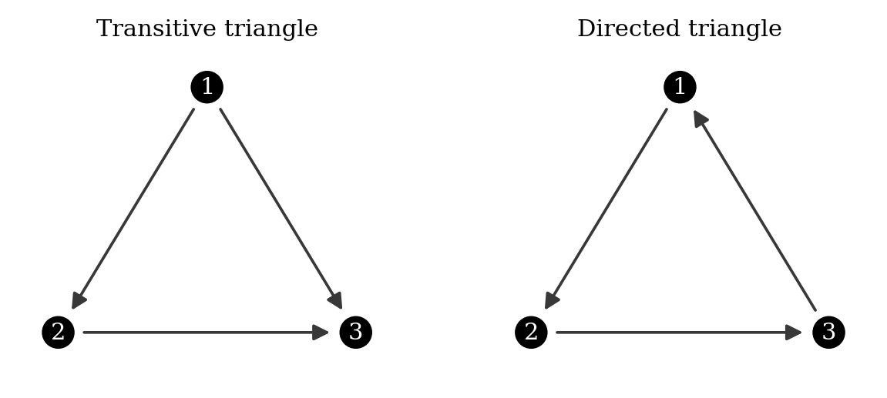
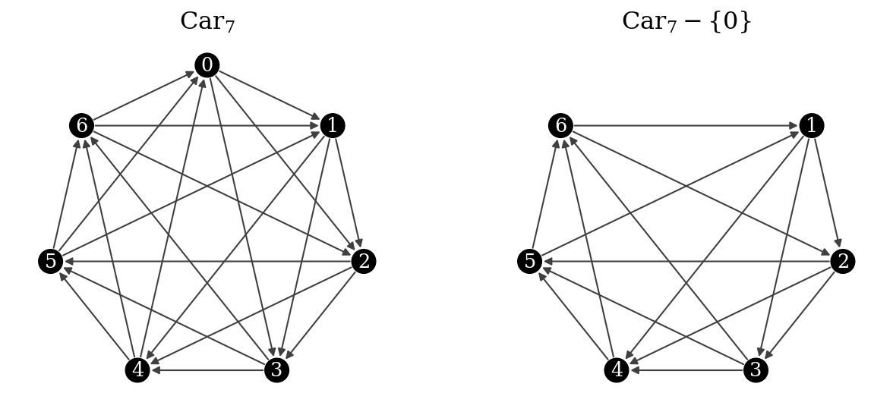
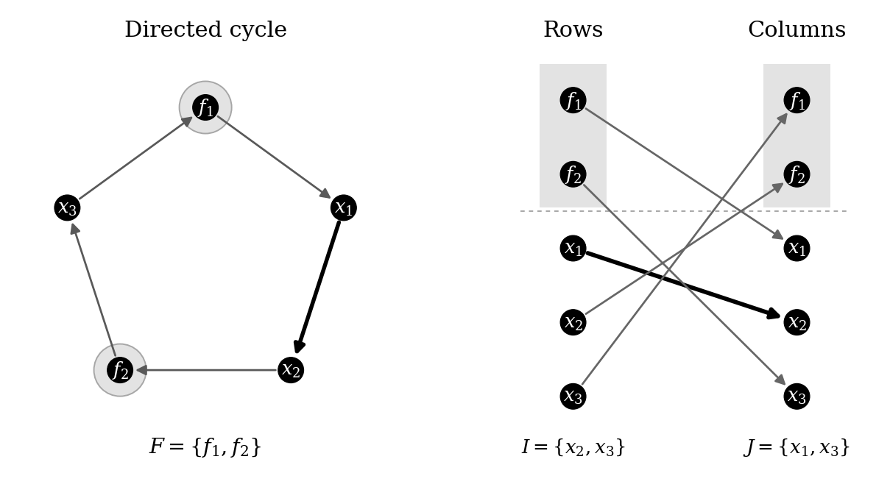
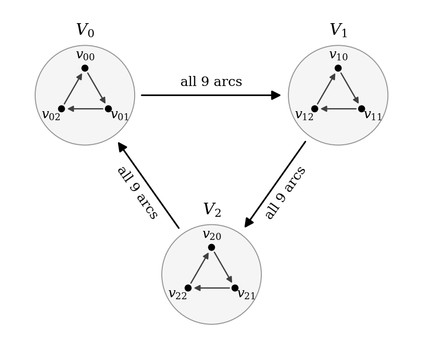
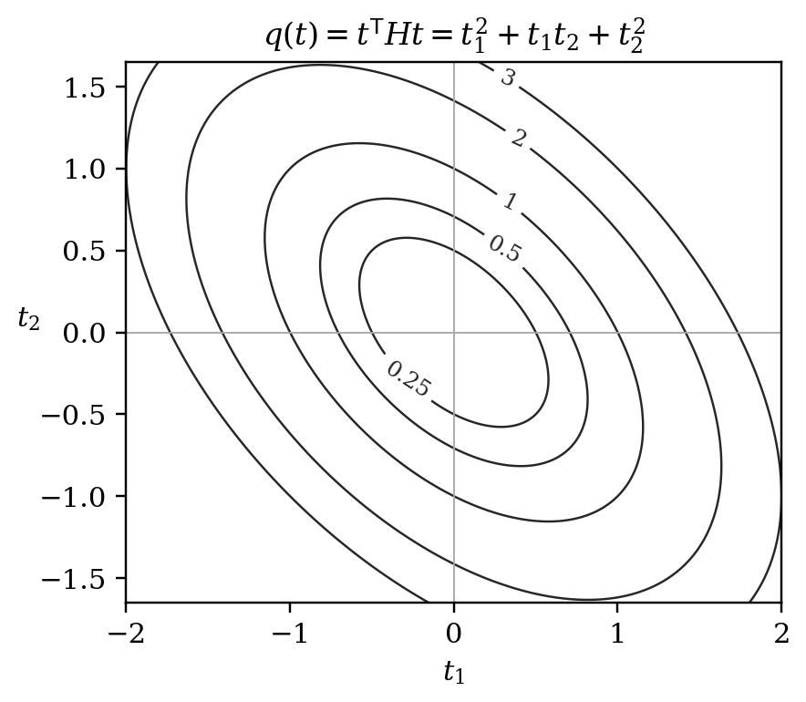

# 从三角形读起：竞赛图 Hamilton 计数与 Hessian

第四版论文的大一阅读指南

这份指南从三顶点的图和排列计数讲起。读者只需先会阶乘、矩阵乘法和一元函数的导数；行列式、期望和二次型会在用到时说明。第 1–4 节建立记号，第 5–10 节解释路径计数的证明，第 11–15 节解释吹胀模型和 Hessian，第 16 节给出论文阅读顺序，第 17 节附练习和答案。

长论文中最费力的两步，是带统一误差的永久式估计，以及对大量删点项的总和控制。指南会写出它们的假设、用途和可以直接检查的算例；完整的分析证明仍须回到正文。这样读完以后，至少能辨认每一步在证明什么，以及结论究竟说到了哪一层。

## 1. 先数两个三顶点的图

### 1.1 竞赛图里的箭头

取若干个顶点。任意两个不同顶点之间恰好画一条箭头，这样的有向图叫作**竞赛图**。可以把顶点想成参赛者，把 $u\to v$ 理解成 $u$ 战胜 $v$；这里不允许平局，也不允许同一对选手同时出现两种结果。

图 1 画了两个三顶点竞赛图。左图中 $1\to2$、$2\to3$、$1\to3$，三个人排得出一个前后次序；右图中 $1\to2\to3\to1$，胜负形成一个圈。

{width=85%}

**有向路径**要求按箭头方向依次前进，而且不重复经过顶点。经过全部顶点的有向路径叫作 **Hamilton 路径**。例如左图中 $(1,2,3)$ 是一条 Hamilton 路径；$(1,3,2)$ 则不是，因为没有 $3\to2$ 这条边。

用 $H(T)$ 记竞赛图 $T$ 的 Hamilton 路径数。左图只有 $(1,2,3)$ 这一条。右图恰好有

$$
(1,2,3),\qquad(2,3,1),\qquad(3,1,2)
$$

三条。所以这两个图分别满足 $H(T)=1$ 和 $H(T)=3$。这里路径的起点是计数的一部分；把同一个顶点顺序反过来，通常就不再是一条有向路径。

若还能沿最后一条边回到起点，就得到 **Hamilton 圈**。圈的起点没有特殊地位，因此 $(1,2,3,1)$、$(2,3,1,2)$、$(3,1,2,3)$ 表示同一个圈。用 $C(T)$ 记圈数；左图 $C(T)=0$，右图 $C(T)=1$。全文都用这个“圈不指定起点”的约定。

### 1.2 我们到底要最大化什么

对固定的顶点数 $n$，令

$$
P(n)=\max\{H(T):T\text{ 是 }n\text{ 顶点竞赛图}\}.
$$

这就是在所有箭头画法中，寻找 Hamilton 路径最多的那一种。三顶点时，任何图要么像左图一样有一个全胜顶点和一个全败顶点，要么像右图一样每个顶点一胜一负。因此 $P(3)=3$。

当 $n$ 增大，逐个尝试箭头很快就行不通了。共有 $\binom n2=n(n-1)/2$ 对顶点，每一对有两个方向，所以有

$$
2^{\binom n2}
$$

种带标号的竞赛图。即使算出其中一个图的路径数，也还没有比较完其他图。论文需要一套对所有竞赛图同时成立的估计。

### 1.3 度数：先观察一个顶点的胜负

从 $v$ 指向其他顶点的边数叫作**出度**，记为 $d^+(v)$；指向 $v$ 的边数叫作**入度**，记为 $d^-(v)$。在 $n$ 顶点竞赛图中，

$$
d^+(v)+d^-(v)=n-1.
$$

定义度差 $s_v=d^+(v)-d^-(v)$。传递三角形的三个度差是 $2,0,-2$；有向三圈的三个度差都是 $0$。当每个顶点的度差都是 $0$ 时，称图为**正则竞赛图**。这要求 $n$ 为奇数，因为每个顶点都必须有 $(n-1)/2$ 条出边。

路径很多的图往往需要较均衡的度数，但“每个顶点胜负相等”并不能单独决定整张图的路径数。后面会看见，度差负责一种损失，矩阵中剩余的结构又负责一个常数因子。证明要同时处理这两部分。

## 2. 用随机图找一个比较标准

### 2.1 一个固定排列有多大概率成为路径

把每对顶点的方向独立地掷硬币决定，两种方向各有 $1/2$ 的概率。先固定一个排列 $(v_1,\ldots,v_n)$。它成为有向路径，需要下面 $n-1$ 条边同时出现：

$$
v_1\to v_2,\quad v_2\to v_3,\quad\ldots,\quad v_{n-1}\to v_n.
$$

这些是不同的边，所以概率是 $2^{-(n-1)}$。共有 $n!$ 个排列，于是随机竞赛图的平均路径数为

$$
\mu_n=\frac{n!}{2^{n-1}}.
$$

这一步用到的概率知识叫作**期望的可加性**。对每个排列定义一个量：它若是路径，取值 $1$；否则取值 $0$。这些量加起来就是路径数。各个排列是否成功可能互相影响，但计算它们的平均值之和，并不要求这些事件独立。

以三顶点为例，八种带标号的竞赛图中，六种是传递图，两种是有向三圈。平均路径数为

$$
\frac{6\cdot1+2\cdot3}{8}=\frac32=\frac{3!}{2^2}.
$$

这里的 $3/2$ 是八个整数的平均值，并不是某张图里存在“一条半路径”。

### 2.2 为什么圈的基准不同

对 $n\ge3$，全部顶点排成一个有向的循环顺序，共有 $(n-1)!$ 种。解释如下：把顶点 $1$ 固定在书写的第一位，再任意排列其他顶点，就消除了“同一个圈换起点”的重复。每个循环顺序需要 $n$ 条边，成功概率为 $2^{-n}$。所以平均圈数是

$$
\nu_n=\frac{(n-1)!}{2^n}.
$$

在三顶点的八种图中，恰好两种有一个圈，故平均值为 $1/4$，与 $\nu_3=2!/8$ 一致。

### 2.3 把巨大的计数除以平均值

直接比较 $H(T)$ 会遇到阶乘。改看 $H(T)/\mu_n$，就变成了“这张图的路径数是随机平均值的多少倍”。三圈的比值是 $3/(3/2)=2$；传递三角形的比值是 $2/3$。

取最大值后，我们关心的是 $P(n)/\mu_n$。这个比值随 $n$ 变化，但会趋近一个有限常数。用随机平均值归一化，并不是假设极值图是随机图；它只是给计数选了一个自然的单位。

## 3. 先把两项主要结论读准

### 3.1 常数 $L$ 从哪里出现

记

$$
L=\frac{\cosh1}{\cos1}=2.855957892565\ldots,
\qquad \cosh x=\frac{e^x+e^{-x}}2.
$$

三角函数中的 $1$ 按弧度计算。Divoux–Wang 已证明全体竞赛图的最大路径数满足 $P(n)/\mu_n\to L$，也确定了 Hamilton 圈的相应首项常数。圆环竞赛图给出达到该首项的构造。不能把这个常数或这个构造重新列为本文首次发现的结果。

第四版论文关于全局路径数的主要结论是

$$
\boxed{\displaystyle P(n)=\left(L+O\left(\frac1n\right)\right)\mu_n.}
$$

与已有首项渐近相比，这里进一步控制了误差。$O(1/n)$ 的准确含义是：存在与 $n$ 无关的常数 $K$ 和起始点 $n_0$，使每个 $n\ge n_0$ 都满足

$$
\left|\frac{P(n)}{\mu_n}-L\right|\le\frac Kn.
$$

这没有给出具体的 $K$，也不保证小 $n$ 时误差已经很小。它控制的是除以 $\mu_n$ 以后的误差；原始计数的误差上界仍然可以随着阶乘增大。更不能把结论读成“每张竞赛图都有约 $L\mu_n$ 条路径”。最大值中的那个 $P$ 不能省略。

记号 $o(1)$ 只要求误差趋于零，$O(1/n)$ 则给出了一种速度。比如 $1/\sqrt n$ 和 $1/\log n$ 都趋于零，却都不是 $O(1/n)$。论文证明的困难，就在于对所有竞赛图统一得到这个更小的误差。

### 3.2 构造与上界是两件事

要证明一个最大值接近 $L$，需要两个方向。第一，给出具体的图，使路径数至少为 $(L-K_1/n)\mu_n$。第二，证明任何图的路径数都不超过 $(L+K_2/n)\mu_n$。只画出路径很多的图，完成的是第一件事。

奇数 $d$ 个顶点的**圆环竞赛图**可这样画：把 $0,1,\ldots,d-1$ 按圆周排列，从每个顶点向顺时针接下来的 $(d-1)/2$ 个顶点画箭头。例如 $d=5$ 时，顶点 $0$ 指向 $1,2$，而 $3,4$ 指向 $0$。这一定义保证任意两个顶点之间恰有一个方向，也保证每个顶点出度相同。

{width=92%}

圆环图及其相应删点图给出渐近极值构造；这与“它们在每一个有限 $n$ 都是唯一最优图”是不同的命题。第四版论文没有证明后者。

### 3.3 另一项主要结果为什么涉及 Hessian

Wormald 研究把一个固定小竞赛图吹胀为大图时，Hamilton 圈的期望值。其渐近公式中出现一个角变量函数，以及这个函数在指定点处的二阶导数矩阵，称作 **Hessian**。如果这个矩阵退化，通常的局部高斯近似就可能失效；若不退化，就有希望把渐近常数算清楚。原角函数还含有一个一次相位项，须在完整的积分表达式中消去，不能把它本身误称为在该点梯度为零的函数。

本文第二项主要结果给出了这个原始角 Hessian 的完整矩阵公式，并证明它对每个正则基图都正定。它不只是计算了一个行列式，也不是仅对圆环图作数值试验。第 11–15 节会从二元 Taylor 展开开始说明，并把三顶点基图的矩阵逐项算出。

这两项结果研究的范围不同：路径定理面对所有 $n$ 顶点竞赛图；Hessian 定理先固定一个小基图，再研究它的随机吹胀。二者通过同一类行列式常数联系起来，不能因此把模型里的结论直接当成全体有限竞赛图的精确极值结论。

## 4. 计数为什么会变成矩阵计算

### 4.1 邻接矩阵与矩阵乘法

给顶点编号 $1,\ldots,n$。定义邻接矩阵 $A$：若有边 $i\to j$，则 $A_{ij}=1$；否则为 $0$。对角线全为 $0$。有向三圈的邻接矩阵是

$$
A=\begin{pmatrix}0&1&0\\0&0&1\\1&0&0\end{pmatrix}.
$$

矩阵乘法规定 $(A^2)_{ij}=\sum_k A_{ik}A_{kj}$。每个乘积为 $1$，恰好表示一条 $i\to k\to j$ 的两步走法。一般地，$(A^r)_{ij}$ 数的是从 $i$ 到 $j$ 的 $r$ 步有向游走；这里允许重复顶点。因此 $A^{n-1}$ 并不能直接数 Hamilton 路径，还要另想办法排除重复。

### 4.2 永久式把每一行与每一列各用一次

对 $n\times n$ 矩阵 $B$，定义

$$
\operatorname{per}B=\sum_{\sigma\in\mathfrak S_n}\prod_{i=1}^n B_{i,\sigma(i)}.
$$

$\mathfrak S_n$ 表示 $1,\ldots,n$ 的所有排列。每个排列从每一行选一个位置，而且每一列也恰好选一次。以二阶矩阵为例，

$$
\operatorname{per}\begin{pmatrix}a&b\\c&d\end{pmatrix}=ad+bc.
$$

对邻接矩阵 $A$，一个乘积非零，表示每个顶点都选了一条出边，同时每个顶点也恰好被一条选中的边指向。沿这些边走，最后得到的是若干个互不相交的有向圈，合起来覆盖所有顶点。这叫作**圈覆盖**。

所以 $\operatorname{per}A$ 数的是圈覆盖，不一定是一条 Hamilton 圈。比如把两个有向三圈放在六个顶点上，并把两组之间的边全部朝同一方向画，两个三圈组成一个圈覆盖；但任何跨组的路径都无法返回，整张图没有 Hamilton 圈。

### 4.3 行列式为什么要添负号

行列式的排列公式是

$$
\det B=\sum_{\sigma\in\mathfrak S_n}\operatorname{sgn}(\sigma)\prod_i B_{i,\sigma(i)}.
$$

它与永久式的区别是多了排列的符号 $\operatorname{sgn}(\sigma)$。二阶时 $\det B=ad-bc$。这些正负号使行列式有很强的代数性质，却也使它通常不能直接当作计数：不同项可能互相抵消。

对上面的三圈矩阵，$\operatorname{per}A=1$；而

$$
\det(I+A)=\det\begin{pmatrix}1&1&0\\0&1&1\\1&0&1\end{pmatrix}=2.
$$

$I$ 是单位矩阵，对角线为 $1$、其余位置为 $0$。展开后，两个非零项分别来自对角线的三个 $1$，以及三圈的三条边，两项的符号都是正的。第 5 节将用它们组成 $1+2=3$，恰好还原三圈的三条 Hamilton 路径。

### 4.4 反对称矩阵记录箭头方向

定义

$$
S=A-A^T.
$$

$A^T$ 是把行与列交换的转置矩阵。于是 $S_{ij}=1$ 表示 $i\to j$，$S_{ij}=-1$ 表示 $j\to i$，而 $S_{ii}=0$。它满足 $S^T=-S$，这样的矩阵叫作**实反对称矩阵**。它的第 $i$ 行各项相加，正好是度差 $s_i$。

设 $J$ 为全 $1$ 矩阵。因为 $A+A^T=J-I$，所以

$$
A=\frac{J-I+S}{2}.
$$

这把邻接矩阵拆成公共的平均部分 $(J-I)/2$ 和每张图自己的方向部分 $S/2$。后者是行列式常数中出现的主要矩阵。

### 4.5 怎样理解“频率”和“谱界”

对实反对称矩阵，线性代数有一个结构定理：换到适当的正交坐标后，它由若干块

$$
\begin{pmatrix}0&\lambda_j\\-\lambda_j&0\end{pmatrix},\qquad\lambda_j\ge0,
$$

以及可能出现的零块组成。“正交”表示新坐标的长度、角度和旧坐标一致。每个二阶块只在一个平面里起作用；本文把这些非负参数 $\lambda_j$ 叫作频率。后面所说的**谱**，在这里就是这一组参数，不需要先掌握复特征向量的全部理论。

频率可把大行列式变成一串二阶行列式的乘积。例如该二阶块记为 $B_j$，则

$$
\det(I+B_j)=1+\lambda_j^2,\qquad
\det(I+\mathrm iB_j)=1-\lambda_j^2,
$$

其中 $\mathrm i^2=-1$。若全部 $\lambda_j<1$，两式的比值为正。因此一个矩阵比值可以改写成

$$
\rho(C)=\frac{\det(I+C)}{\det(I+\mathrm iC)}
=\prod_j\frac{1+\lambda_j^2}{1-\lambda_j^2}.
$$

这里 $C$ 指适当归一化后的反对称矩阵，条件 $\lambda_j<1$ 必须核实。比如一个 $d$ 顶点竞赛图取 $C=S/d$ 时，矩阵的最大伸缩倍数至多为 $(d-1)/d<1$。不能删掉归一化，就对任意 $S$ 直接套这个正性结论。

**算一次二阶块。** 若 $\lambda=1/2$，这个块对比值的贡献是

$$
\frac{1+(1/2)^2}{1-(1/2)^2}=\frac53.
$$

研究整张竞赛图的谱界，就是要限制所有这样的块合起来能产生多大的乘积。Fang–Huang 的反对称矩阵谱比较和 Divoux–Wang 的计数分析，给出了圆环图达到极值的关键约束。第 10 节会解释这些已有结果在路径证明中被用到的位置。

## 5. 把路径数写成可以估计的矩阵表达式

我们已经知道随机竞赛图的平均路径数是 $\mu_n=n!/2^{n-1}$。现在固定一个图 $T$，目标是估计 $H(T)/\mu_n$。若直接对全部 $n!$ 个顶点排列检查相邻边，公式虽然正确，却很难看出哪个图的路径更多。论文改用下面的精确恒等式：

$$
H(T)=\sum_{U\subseteq V(T)}
\det(I+A[U])\operatorname{per}A[U^c].
$$

这里 $A[U]$ 同时保留 $U$ 中标号对应的行和列，$U^c$ 是其余顶点；$I$ 的大小随 $U$ 改变。永久式 $\operatorname{per}$ 与行列式的区别，是排列求和中没有正负号。若矩阵的元素是零或一，永久式便计数“每行每列各选一个 $1$”的方法。对邻接矩阵而言，选出的边组成覆盖全部顶点的若干个互不相交的有向圈。

求和按 $U$ 和补集分开两个矩阵，再把结果相乘相加，这种形式称为卷积。它并不是说：先任取补集上的几个圈，再把它们任意接成一条路径。右边能够恰好等于路径数，要用到竞赛图每一对顶点恰有一个方向的条件。合稿第 5 节从生成函数恒等式推导它，文献归属是 Irving–Omar 所讨论恒等式的竞赛图特例。生成函数的做法，是先用不同字母记录哪些顶点被使用，再让相应单项式的系数记录数量。这样，可以通过代数运算同时整理许多组合对象；最后再取出每个顶点恰好使用一次的系数。

先把三个顶点的例子算到底。取有向三圈 $1\to2\to3\to1$，则

$$
A=\begin{pmatrix}0&1&0\\0&0&1\\1&0&0\end{pmatrix},
\qquad
I+A=\begin{pmatrix}1&1&0\\0&1&1\\1&0&1\end{pmatrix}.
$$

它的路径是 $(1,2,3)$、$(2,3,1)$ 和 $(3,1,2)$。右边共有八个子集，我们按大小计算；空矩阵的行列式和永久式均约定为 $1$。

| $U$ 的大小 | 子集数 | 单项贡献 | 原因 |
|---|---:|---:|---|
| $0$ | $1$ | $1$ | $\operatorname{per}A=1$，唯一圈覆盖就是这个三圈 |
| $1$ | $3$ | $0$ | 剩余两点之间只有一条有向边，不能形成圈覆盖 |
| $2$ | $3$ | $0$ | 补集只有一点，其邻接矩阵为 $[0]$ |
| $3$ | $1$ | $2$ | $\det(I+A)=1+1=2$，补集为空 |

最后一行中的两个 $1$，分别来自三个对角元的乘积和三圈边的乘积；其余行列式项含零因子。因此恒等式给出

$$
H(T)=1+3\times0+3\times0+2=3.
$$

这个公式还有一个很有用的性质：右边每项非负。永久式的非负性来自 $A$ 的元素非负；$\det(I+A[U])$ 为正则要用竞赛图矩阵的特殊结构，不能对任意非负矩阵照搬。论文证明这一点后，就可以分别给各项上界，再相加。接下来的主要工作是估计其中的永久式。

## 6. 永久式为什么会由一个高斯行列式近似

先看行和、列和都为 $1$ 的非负矩阵 $D$，这种矩阵叫双随机矩阵。可以把第 $i$ 行看成第 $i$ 个人选择各个位置的概率：他选位置 $j$ 的概率是 $D_{ij}$。假设各个人独立选择，那么

$$
\operatorname{per}D
=\mathbb P(\text{所有人选择的位置互不相同}).
$$

列和为 $1$ 还表示每个位置的预期人数相同。最均匀的矩阵是 $J_n/n$，其中 $J_n$ 每个元素都为 $1$。此时共有 $n^n$ 个等可能选择结果，只有 $n!$ 个没有重复，所以

$$
\operatorname{per}(J_n/n)=\frac{n!}{n^n}.
$$

这个数是双随机永久式的比较基准。它与路径数的基准 $\mu_n$ 作用相似，但两者对应不同的计数问题，不能互换。

为了描述偏离均匀的程度，写成

$$
D=\frac{J_n+E}{n}=\frac{J_n}{n}+B,
\qquad B=E/n.
$$

行列和均为 $1$，等价于 $E$ 的行列和均为 $0$。例如第 $i$ 行满足 $\sum_jE_{ij}=0$：这一行中某些位置概率增加，就必须由其他位置的减少抵消。减去均匀部分、留下零行列和偏差的操作，称为双中心化。

合稿第 3 节证明的形式是

$$
\frac{n^n\operatorname{per}D}{n!}
=\frac{\operatorname{per}(J_n+E)}{n!}
=\det(I-BB^{\mathsf T})^{-1/2}+O_{C,q}(n^{-1}).
$$

它要求 $|E_{ij}|\le C$，并要求 $\|B\|_{\rm op}\le q<1$，其中 $C,q$ 预先固定。算子范数 $\|B\|_{\rm op}$ 是矩阵把向量长度放大的最大倍数，即 $\sup_{x\ne0}\|Bx\|_2/\|x\|_2$。所以第二个条件说，所有方向上的放大倍数都离 $1$ 有一个固定距离。第一个条件允许 $E$ 有许多非零元素，并不要求整个矩阵的偏差趋于零。

公式中的“统一”可以准确地读成：存在只依赖 $C,q$ 的常数 $K$ 和整数 $n_0$，对每个 $n\ge n_0$、每个满足条件的矩阵，上式左右之差的绝对值都不超过 $K/n$。不能先为一个矩阵选出误差常数，再在求和时让这个常数随删集增长。

举例说，若固定 $C=3$、$q=0.8$，我们必须找出同一个 $K,n_0$，同时处理这一类中的所有矩阵。矩阵可以随 $n$ 改变，零元素的位置也可以改变。若允许写成 $K_n/n$，随后又取 $K_n=n$，所得误差只是 $1$，并未趋于零。统一性保证我们后面可以选择图、选择删集，而不必重新付出一个失控的常数。

为什么主项恰好是这个行列式？这里可以算出一个高斯积分。正态分布也叫高斯分布，标准正态随机变量 $Z$ 的密度是 $(2\pi)^{-1/2}e^{-z^2/2}$。配平方给出

$$
\mathbb E e^{tZ}
=\frac1{\sqrt{2\pi}}\int_{\mathbb R}e^{tz-z^2/2}\,dz
=e^{t^2/2}.
$$

取两个相互独立的标准正态向量 $X,Y$，各自的坐标也独立。固定 $X$ 后，对 $Y$ 用上式，可以得到

$$
\mathbb E_Y e^{X^{\mathsf T}BY}
=e^{\|B^{\mathsf T}X\|_2^2/2}
=e^{X^{\mathsf T}BB^{\mathsf T}X/2}.
$$

实对称矩阵 $BB^{\mathsf T}$ 可以通过正交变换化成对角矩阵。正交变换可以理解为旋转或反射坐标轴，它保持长度，而标准正态向量的密度只依赖长度，因此变换后的坐标仍服从同样的联合分布。记对角化后的数为 $\sigma_1^2,\ldots,\sigma_n^2$；它们非负，$\sigma_j$ 就是 $B$ 的奇异值。由范数条件，$\sigma_j\le q<1$。于是

$$
\begin{aligned}
\mathbb E e^{X^{\mathsf T}BY}
&=\prod_{j=1}^n\mathbb E e^{\sigma_j^2Z_j^2/2}\\
&=\prod_{j=1}^n\frac1{\sqrt{2\pi}}
\int_{\mathbb R}e^{-(1-\sigma_j^2)z^2/2}\,dz\\
&=\prod_{j=1}^n(1-\sigma_j^2)^{-1/2}
=\det(I-BB^{\mathsf T})^{-1/2}.
\end{aligned}
$$

最后一个积分只需换元 $u=\sqrt{1-\sigma_j^2}\,z$。这也解释了为何要与 $1$ 保持距离：若某个 $\sigma_j$ 达到 $1$，对应积分便不再收敛。

这里的行列式因子也受控制。每个 $B_{ij}$ 的绝对值至多为 $C/n$，所以其全部元素平方和不超过 $C^2$，也就是 $\sum_j\sigma_j^2\le C^2$。再用 $\sigma_j\le q<1$，可证明该因子位于 $1$ 与一个只依赖 $C,q$ 的常数之间。因此公式中的加性 $O(1/n)$，也能改写成主项乘以 $1+O(1/n)$。这个结论是在阶数趋大时使用的，不能把它当作对任意二阶、三阶矩阵精确成立的等式。

还剩下更难的问题：永久式为何接近这个高斯平均？把 $\operatorname{per}(J+tE)$ 按 $t$ 展开，每个系数记录选了多少个扰动元素。永久式要求使用互不相同的行、列，而高斯平均可以用成对配对来计算。论文先用容斥处理“互不相同”的限制：先允许重复，减去指定位置相同的情况，再补回被减去多次的情况。随后利用零行列和消去只出现一次的指标；保留下来的主要配对恰好组成上述高斯表达式。含更多重复连接的项形成余项。

这个说明指出了主项的来源，但尚未证明 $O(n^{-1})$。还须控制次数随 $n$ 增长的许多系数，以及剩余高次项的总和。合稿第 3.2—3.6 节完成这两部分，尾项处理中使用 Han–Niles-Weed 所用的复高斯矩与算术—几何平均估计。McCullagh 已有这一行列式近似及 $O(n^{-1})$ 误差；Divoux–Wang 的非负双随机矩阵证明也可保留定量余项得到这一阶。因此，路径论文需要解决的进一步问题，是经过后面的删行删列、缩放和求和以后，误差是否仍能保持 $O(n^{-1})$。

## 7. 把矩阵缩放成双随机矩阵时，计数怎样改变

邻接矩阵的第 $i$ 行和是顶点 $i$ 的出度，一般不等于 $1$。即使先把整个矩阵除以一个常数，也不能让不同的行和同时变成 $1$。因此要允许各行、各列分别乘正数。

设 $M'_{ij}=u_iM_{ij}v_j$。一个永久式乘积每行用一次，也每列用一次，所以

$$
\begin{aligned}
\prod_iM'_{i,\pi(i)}
&=\left(\prod_i u_i\right)
\left(\prod_i v_{\pi(i)}\right)
\prod_iM_{i,\pi(i)}\\
&=\left(\prod_i u_i\right)
\left(\prod_j v_j\right)
\prod_iM_{i,\pi(i)}.
\end{aligned}
$$

前面的因子不依赖排列 $\pi$，故

$$
\operatorname{per}M'
=\left(\prod_i u_i\right)\left(\prod_jv_j\right)
\operatorname{per}M.
$$

用一个二阶矩阵检查：

$$
M=\begin{pmatrix}1&2\\2&4\end{pmatrix}
\xrightarrow{\text{第二行乘 }1/2}
\begin{pmatrix}1&2\\1&2\end{pmatrix}
\xrightarrow{\text{两列分别乘 }1/2,\ 1/4}
D=\begin{pmatrix}1/2&1/2\\1/2&1/2\end{pmatrix}.
$$

原永久式为 $1\times4+2\times2=8$，新永久式为 $1/4+1/4=1/2$。全部乘数的乘积为 $1\times(1/2)\times(1/2)\times(1/4)=1/16$，确有 $8/16=1/2$。要从 $D$ 的永久式恢复 $M$ 的永久式，必须乘回 $16$。

这个例子正好一次完成；一般矩阵校正行和后，列和会改变，校正列和又会影响行和。寻找最终正对角乘数的过程通常称为 Sinkhorn 缩放。含零元素的矩阵未必总能这样处理，论文第 4 节是在规定的度数及矩阵条件下证明所需缩放存在，并估计乘数。

为避免大量正数连乘，论文写 $u_i=e^{x_i}$、$v_j=e^{y_j}$。恢复因子便成为

$$
\operatorname{per}M
=e^{-\sum_i x_i-\sum_j y_j}\operatorname{per}D.
$$

所以“找到双随机矩阵”只是其中一步。还要知道指数中的总和有多大，也要知道缩放后高斯行列式改变多少。忽略恢复因子，就相当于在二阶例子中把 $1/2$ 错当成 $8$。

## 8. 异常顶点为什么会产生不同的行删集与列删集

若每个顶点的出度都接近 $(n-1)/2$，矩阵的行列和比较均匀，也更接近缩放所需的条件。但研究最大值时，不能先假设图已经满足这一性质。

论文先用 Brégman 不等式处理度数偏差特别大的图。这个不等式把零一矩阵的永久式上界写成行和的函数；结合这些行和的固定总量，可以看出过度不均匀会降低上界。于是需要精细分析的图，其度数离差平方和不会太大。即便如此，仍可能有少量出度特别小或特别大的顶点。把它们放入集合 $F$，其余顶点放入 $M$。

更具体地，若零一矩阵每行有 $r_i>0$ 个 $1$，Brégman 不等式给出 $\operatorname{per}A\le\prod_i(r_i!)^{1/r_i}$；若有一行全零，永久式就是零。论文利用这个乘积对度数不均匀性的反应，得到带离差平方和的改进。这里调用的是已有的计数不等式，它的证明可在附录中读到。

“异常点只有少量”也有一个简单的数量依据。假设已知出度离差平方和不超过 $An^2\log n$，而每个异常点的出度偏差至少为 $cn$，其中 $A,c>0$ 固定。那么每个异常点至少贡献 $c^2n^2$，所以异常点数不超过 $(A/c^2)\log n$。不过，点数少不等于对 Hamilton 路径的影响小，因为每条 Hamilton 路径仍必须经过这些点；连接它们的边必须计入。

在永久式的一项中，每个顶点有一条被选中的出边和一条入边。把涉及 $F$ 的边固定以后，这些边已经用掉了 $M$ 中的部分行和部分列。行代表边的起点，列代表边的终点；被用掉的起点标号与终点标号没有理由相同。

{width=94%}

图中选出的圈为

$$
f_1\to x_1\to x_2\to f_2\to x_3\to f_1,
\qquad F=\{f_1,f_2\},\quad M=\{x_1,x_2,x_3\}.
$$

从 $M$ 指向 $F$ 的边是 $x_2\to f_2$、$x_3\to f_1$，它们占用核心的行 $x_2,x_3$。从 $F$ 指向 $M$ 的边是 $f_1\to x_1$、$f_2\to x_3$，它们占用核心的列 $x_1,x_3$。因此剩下的是

$$
I_{\rm del}=\{x_2,x_3\},\qquad
J_{\rm del}=\{x_1,x_3\},\qquad
A[M\setminus I_{\rm del},M\setminus J_{\rm del}]
=A[\{x_1\},\{x_2\}].
$$

它的唯一元素就是剩余边 $x_1\to x_2$ 对应的 $1$。若错误地把行列删集都取成 $\{x_2,x_3\}$，留下的将是 $A[\{x_1\},\{x_1\}]=[0]$，这一个有效的圈覆盖便丢失了。

同时保留相同标号的行列叫主子矩阵；上面这样的矩阵叫非主子矩阵。论文第 4 节必须同时估计二者，并把误差写成删去的行列数量的函数。之后再对所有跨块匹配求和，才能证明含异常顶点的那些图不能达到最终的极值。这里的分类针对永久式中的匹配；Divoux–Wang 的圈数证明则按异常顶点上形成的有向路径段分类。

## 9. 误差不能直接相加：保留权重和度差的作用

路径卷积有 $2^n$ 个子集。即使每个永久式近似都有 $O(1/n)$ 误差，也不能直接说总误差仍是 $O(1/n)$。必须同时看每一项原本有多大的权重。

按 $k=|U|$ 分组时，子集有 $\binom nk$ 个，而补集永久式的随机基准含有 $(n-k)!$。除以全阶的 $n!$ 后，有一个关键抵消：

$$
\binom nk\frac{(n-k)!}{n!}=\frac1{k!}.
$$

真实估计还含二的幂与行列式因子，但阶乘分母提示我们：大删集即使数量多，其总权重仍可能很小。论文进一步证明所需权重的若干加权和有统一上界。

可以用简化的例子理解这种求和。若每个 $k$ 层的权重至多为 $c^k/k!$，该层误差至多为 $Kk^2/n$，其中 $c,K>0$ 固定，那么

$$
\sum_{k=0}^{\infty}\frac{c^k}{k!}\frac{Kk^2}{n}
=\frac K n(c^2+c)e^c.
$$

等式由 $k^2=k(k-1)+k$ 得到：两项分别把阶乘约去两个和一个因子，再对指数级数求和。这是一个说明原理的算例，论文实际使用更细的权重界。若把所有 $k$ 粗略替换为最大允许值 $K_0\log n$，反而可能多出 $(\log n)^2$ 因子。

另一个关键发生在缩放恢复因子中。以下取 $n\ge2$。设出度为 $d_i^+$，入度为 $d_i^-$，定义度差及其归一化：

$$
s_i=d_i^+-d_i^-=2d_i^+-(n-1),\qquad
a_i=\frac{s_i}{n-1},\qquad
\tau=\sum_i a_i^2.
$$

所以 $\tau\ge0$，且正则竞赛图有 $\tau=0$。若用出度离差平方和 $V(T)=\sum_i(d_i^+-(n-1)/2)^2$，则 $\tau=4V(T)/(n-1)^2$；这个 $4$ 来自度差是出度偏差的两倍。

排除异常点以后，$|a_i|$ 与 $1$ 保持固定距离。缩放估计留下乘积

$$
\Gamma=\prod_i(1-a_i^2)\le\prod_ie^{-a_i^2}=e^{-\tau},
$$

其中使用 $1-u\le e^{-u}$。这是度数不均匀带来的减小因子，不能因为它不超过 $1$ 就过早丢掉。

例如，假设某一步的上界含有 $\exp\{-\tau+K\sqrt{\tau/n}\}$。若只留下正项，在 $\tau=1$ 时看见的是 $n^{-1/2}$ 量级，而我们需要 $n^{-1}$。保留负项后，完整配平方给出

$$
0\le\left(\frac{\sqrt\tau}{2}-\frac K{\sqrt n}\right)^2
=\frac\tau4-K\sqrt{\tau/n}+\frac{K^2}{n},
$$

因此

$$
K\sqrt{\tau/n}\le\frac\tau4+\frac{K^2}{n},
\qquad
-\tau+K\sqrt{\tau/n}\le-\frac{3\tau}{4}+\frac{K^2}{n}
\le\frac{K^2}{n}.
$$

这一不等式对每个 $\tau\ge0$ 同时成立。以 $K=2$ 为例，总指数至多为 $4/n$，而不需要先知道 $\tau$ 的具体值。

论文真正得到的指数更长：

$$
-\tau+K\left[
\frac{1+\tau+\tau^2}{n}
+\frac{\tau^{3/2}+\tau}{\sqrt n}
+\sqrt{\tau/n}\right].
$$

前面的粗估计已经把所需范围限制到 $0\le\tau\le K_0\log n$。于是除常数项和最后的平方根项外，其余正项满足

$$
\begin{aligned}
K\left[\frac{\tau+\tau^2}{n}
+\frac{\tau^{3/2}+\tau}{\sqrt n}\right]
&\le\tau K\left[
\frac{1+K_0\log n}{n}
+\frac{\sqrt{K_0\log n}+1}{\sqrt n}\right]\\
&\le\frac\tau4
\end{aligned}
$$

对所有充分大的 $n$ 成立，因为方括号趋于零。再用刚才的配平方，总指数至多为

$$
-\tau+\frac\tau4+\frac\tau4+\frac{K+K^2}{n}
=-\frac\tau2+\frac{K+K^2}{n}
\le\frac{K+K^2}{n}.
$$

最后，若 $c$ 为固定正数，则

$$
0\le e^{c/n}-1
=\int_0^{c/n}e^u\,du\le\frac{ce^c}{n}.
$$

所以这个指数因子至多为 $1+O(1/n)$；当 $\tau$ 较大时，它可以远小于 $1$。这里把平方根量级的正误差与原有负项一起处理，才得到了对全部剩余图一致的上界。

## 10. 从矩阵修正因子到常数 $L$

完成上述计数以后，剩下的主要矩阵量是

$$
\rho_n(S)=\frac{\det(I+S/n)}{\det(I+iS/n)},
\qquad S=A-A^{\mathsf T},\qquad i^2=-1.
$$

$S$ 的转置等于 $-S$，称为实反对称矩阵。一个矩阵的全部特征值合称为它的谱；$S$ 的非零特征值成对出现为 $i\lambda_j,-i\lambda_j$，其中 $\lambda_j>0$。对每一对分别计算行列式因子，再设 $x_j=\lambda_j^2/n^2$，就得到

$$
\rho_n(S)=\prod_j\frac{1+x_j}{1-x_j}.
$$

因此看似含复数的比值，其实是正实数。竞赛图符号矩阵的非对角元素都是 $\pm1$，所以所有元素的平方和为 $n(n-1)$。每个 $\lambda_j^2$ 在奇异值平方和中出现两次，因而

$$
\sum_jx_j=\frac{n-1}{2n}<\frac12.
$$

各个 $x_j$ 也小于 $1/2$，分母不会为零。谱半径指特征值绝对值的最大值；技术补充稿再用 Deng 等人的谱半径界限制最大的 $x_j$，在这些约束下估计乘积，得到常数 $C_*>L$。这个上界能说明整套误差估计如何使用，但最优首项已经由 Divoux–Wang 确定。

合稿最后使用更强的谱比较。Fang–Huang 的定理控制矩阵幂的比较，Divoux–Wang 据此得到：上述谱比值不超过传递符号矩阵对应的比值。传递图的符号矩阵记为 $T_n^0$，上三角元素全为 $1$、下三角全为 $-1$。它满足

$$
\det(I+zT_n^0)=\frac{(1+z)^n+(1-z)^n}{2}.
$$

分别代入 $z=1/n$ 和 $z=i/n$，得到

$$
\rho_n(S)\le r_n
=\frac{(1+1/n)^n+(1-1/n)^n}
{(1+i/n)^n+(1-i/n)^n}
=\frac{\cosh1}{\cos1}+O(n^{-1}).
$$

最后一步的主项来自 $(1+z/n)^n\to e^z$；分子趋于 $e+e^{-1}=2\cosh1$，分母趋于 $e^i+e^{-i}=2\cos1>0$。保留 $n\log(1+z/n)=z+O(1/n)$ 中的误差，就得到商的 $O(1/n)$ 误差。这里的谱比较是所调用的已有定理；合稿第 6、12 节说明如何将它用于本问题。

传递图在这一步是谱比较的参照，不代表它的路径最多。事实上，传递图只有顺着顶点次序的一条 Hamilton 路径。我们前面得到的是含度差修正的路径上界；度数均匀的图与传递图即使有相同的谱因子，其路径数也可能很不相同。要让路径数接近这个谱上界，还需要下面的低度差构造与双侧估计。

上界至此成为 $H(T)/\mu_n\le L+O(1/n)$。被先前粗估计排除的两类图也满足这一上界；统一选择起始阶数后，便能对所有竞赛图取最大值。

下界需要实际构造。奇阶圆环图每个顶点的出度相同；从下一奇阶圆环图删去一个顶点，可得到偶阶图，其度差均为 $1$ 或 $-1$。合稿第 8 节对这两类图证明归一化路径数 $H(T)/\mu_n$ 与 $\rho_n(S)$ 相差 $O(1/n)$。它们的符号矩阵又可以通过重新排列坐标、将指定坐标同时乘以 $-1$，变成传递符号矩阵；这种相似变换不改变行列式，故 $\rho_n(S)=r_n$。于是它们给出 $H(T)/\mu_n\ge L-O(1/n)$。上下界合在一起，得到

$$
L-\frac Kn\le\frac{P(n)}{\mu_n}\le L+\frac Kn
\qquad(n\ge n_0).
$$

首项常数、谱比较和圆环构造都有明确的已有来源。路径稿的定量工作贯穿永久式、删除、缩放、异常顶点和加权求和；只有这些步骤使用相容的一致误差，最后的 $1/n$ 才能保留下来。

读结论时还要注意它的尺度。这里的 $K/n$ 是除以 $\mu_n$ 后的误差，路径条数本身的误差允许达到 $K\mu_n/n$，并不是只有 $K/n$ 条路径。它也没有确定最大路径数展开式中 $1/n$ 项的具体系数：许多可能的系数都满足这个界。此外，证明给出的是充分大阶数的统一结论，不能仅把一个小阶数代入渐近式，就断定哪个小图恰好取得最大值。

## 11. 把一个小图变成大图：随机吹胀在研究什么

先固定一个有 $d$ 个顶点的竞赛图 $T^*$，称它为**基图**。把基图的第 $j$ 个顶点替换成一个含 $m$ 个顶点的集合 $V_j$，称为第 $j$ 个块。如果基图中有边 $j\to k$，就把 $V_j$ 与 $V_k$ 之间的全部 $m^2$ 条边定向为从 $V_j$ 指向 $V_k$。各块内部还没有定向，接下来才作随机选择。这样得到的图共有

$$
N=dm
$$

个顶点。这种构造叫作基图的**吹胀**。这个词表示把每个顶点展开成一组顶点，并按原来的方向连接各组。

{width=86%}

例如，基图取有向三圈 $1\to2\to3\to1$，每块取三个顶点。最后的图有九个顶点，块间分别有九条边从 $V_1$ 指向 $V_2$、从 $V_2$ 指向 $V_3$、从 $V_3$ 指向 $V_1$。块内可以是一个有向三圈，也可以是三个顶点按先后顺序排列的传递竞赛图。块内的不同选择会改变整个九顶点图的 Hamilton 圈数。

Wormald 考虑了两种内部随机选择。模型 $\mathcal T(T^*,m)$ 中，每块内部的每条边都独立、公平地选择方向。模型 $\mathcal R(T^*,m)$ 中，每块从全部有标号正则竞赛图中均匀选取，各块之间独立。这里“均匀”表示每个允许的有标号图具有相同概率；“正则”表示块内每个顶点的出度都等于 $(m-1)/2$，所以 $m$ 必须是奇数。

两种模型的区别不能简化成“所有边还是独立，只是出度相等”。在 $\mathcal R$ 中，块内的边通常不独立：若一个顶点已有足够多的出边，剩下的边就受到限制。例如 $m=3$ 时，$\mathcal T$ 允许全部八种有标号定向，而 $\mathcal R$ 只允许两个有向三圈。对三圈基图作这种正则吹胀，每个顶点有三个块间出邻居、一个块内出邻居，总出度为四；若内部块不限制为正则，顶点的总出度就可能不同。

用 $C(G)$ 表示一个具体图 $G$ 的 Hamilton 圈数，$H(G)$ 表示其 Hamilton 路径数。随机选择内部块之后，这两个数会随样本变化。符号 $\mathbb E C$ 表示**期望**，也就是把所有可能结果按其概率加权平均。在有限概率空间里，若结果 $G_j$ 的概率为 $p_j$，定义就是

$$
\mathbb E C=\sum_j p_jC(G_j),\qquad \sum_jp_j=1.
$$

期望可以不是整数，即使每个样本的圈数都是整数。一个期望渐近式也不表示每个样本都接近期望；若要说明绝大多数样本如何表现，还需要另外的概率估计。我们在这一部分只讨论期望。

期望仍能提供一种存在性结论：至少有一个允许的样本，其圈数不低于期望。否则，每个可能值都小于这个平均值，再作加权平均就会产生矛盾。不过，这只保证某个样本存在，既没有指定它是哪一个，也没有说明这样的样本占多大比例。用随机模型证明极值下界时，经常正是利用这一点。

还可以把圈数写成许多零一变量之和。对每个候选有向 Hamilton 圈，若它的所有边都在样本中出现，就记一，否则记零。把这些变量相加，恰好得到圈数。因此，平均圈数等于各个候选圈出现概率之和。这个相加步骤不要求不同圈互相独立；两个圈可以共用很多边。只有计算某一个圈出现的概率时，才需要仔细检查模型内哪些边独立、哪些边受到正则条件约束。

为了判断这个平均圈数究竟多不多，把它除以完全随机竞赛图的平均圈数。沿用前面的记号，比较尺度为

$$
\nu_N=\frac{(N-1)!}{2^N},\qquad
\mu_N=\frac{N!}{2^{N-1}}.
$$

这种除以比较尺度的做法称为**归一化**。因此研究的量是 $\mathbb EC/\nu_N$ 和 $\mathbb EH/\mu_N$，不是基图本身有多少个圈或路径。

这里有两个必须分开的极限。先固定基图，因而固定 $d$，让每块的大小 $m\to\infty$，得到这个基图对应的极限常数。随后才可能让 $d$ 变化，比较不同基图阶数的常数。写成 $a_{d,m}\to r_d$ 时，意思是“对每个固定的 $d$，让 $m$ 越来越大”。它不自动保证当 $d$ 与 $m$ 同时变化时仍有同样的近似；误差也许依赖 $d$。正则块模型的第一个极限还只能沿奇数 $m$ 取值。

## 12. 从二元 Taylor 展开认识 Hessian

一元函数在一点附近可以用常数项、一次项和二次项近似。对于二元实值函数 $f(x,y)$，做法相同，只是二次项除了 $x^2,y^2$，还会有 $xy$。在原点附近，若二阶偏导连续，就有

$$
\begin{aligned}
f(x,y)={}&f(0,0)+f_x(0,0)x+f_y(0,0)y\\
&+\frac12\bigl(f_{xx}(0,0)x^2
+2f_{xy}(0,0)xy+f_{yy}(0,0)y^2\bigr)
+o(x^2+y^2).
\end{aligned}
$$

偏导数 $f_x$ 的含义是先固定 $y$，只对 $x$ 求导。$f_{xy}$ 是再对另一个变量求一次导。上述连续性条件保证 $f_{xy}=f_{yx}$。最后的小 $o$ 表示：余项除以 $x^2+y^2$ 后，随着 $(x,y)\to(0,0)$ 趋于零。也就是说，在足够小的范围内，余项比二次尺度更小。

把二阶偏导放入矩阵，就得到 **Hessian 矩阵**：

$$
\mathbf H_f(0)=
\begin{pmatrix}
f_{xx}(0,0)&f_{xy}(0,0)\\
f_{yx}(0,0)&f_{yy}(0,0)
\end{pmatrix}.
$$

若 $v=(x,y)^T$，二次项便是 $\tfrac12v^T\mathbf H_f(0)v$。上标 $T$ 表示转置，把列向量变成行向量。展开矩阵乘法就会得到前面的三个二次项，混合项出现两次，正是公式中系数 $2$ 的来源。变量更多时，只需把二阶偏导排成更大的矩阵。

以 $f(x,y)=x^2+xy+y^2$ 为例，先求一阶偏导 $f_x=2x+y$、$f_y=x+2y$，再求一次，得到

$$
\mathbf H_f=
\begin{pmatrix}2&1\\1&2\end{pmatrix},\qquad
\frac12(x,y)\mathbf H_f(x,y)^T=x^2+xy+y^2.
$$

这是二次多项式，所以没有更高阶的余项。矩阵的非对角元记录两个变量共同变化时的影响。只知道沿坐标轴的两个二阶导数，并不足以确定一般方向上的二次变化。

对实对称矩阵 $M$，如果每个非零实向量 $v$ 都满足 $v^TMv>0$，就说 $M$ **正定**。上面的矩阵正定，因为

$$
v^T\mathbf H_fv
=2x^2+2xy+2y^2=(x+y)^2+x^2+y^2>0
\quad\text{当 }(x,y)\ne(0,0).
$$

若一阶导数同时为零，正定 Hessian 保证实值函数在这一点附近严格增大，从而该点是严格局部极小值。这里必须有“一阶导数为零”这个条件；有非零一次项时，足够小的变化通常先受一次项控制。

**非退化**的要求较弱：它只表示 Hessian 可逆，也就是行列式不为零。正定一定非退化，但反过来不成立。例如 $f(x,y)=x^2-y^2$ 的 Hessian 是 $\operatorname{diag}(2,-2)$，行列式为 $-4$，虽然可逆，沿 $x$ 轴与沿 $y$ 轴的变化却一增一减。另一个例子是 $x^4+y^2$：原点仍是严格极小值，但其 Hessian 为 $\operatorname{diag}(0,2)$，是退化的，因为二次项没有反映 $x$ 方向上的四次变化。

因此，“有极小值”“Hessian 正定”“Hessian 非退化”是三个不同说法。研究稿需要的是一个明确的正定公式；仅凭数值例子中行列式不为零，还不能替代对所有正则基图的证明。

对二阶实对称矩阵，正定性有一个便于手算的检验。设它的第一行是 $(a,b)$、第二行是 $(b,c)$，且 $a>0$。相应二次型可以配方为

$$
ax^2+2bxy+cy^2
=a\left(x+\frac ba y\right)^2
+\frac{ac-b^2}{a}y^2.
$$

因此，只要左上角元素为正、行列式也为正，这个矩阵就正定。这里两个条件缺一不可：例如负单位矩阵的行列式也是正数，其二次型却处处为负。对于更大的矩阵，仅检查总行列式的符号同样不够，通常需要更多信息。研究稿给出整个矩阵的表达式，正好能利用这些额外结构，而不只是得到一个难以判断正负的行列式展开。

也要区分“二次型的矩阵”和“Taylor 展开的二次项”。后者带有系数二分之一。如果算出了 Hessian，却把二次项直接写成 $v^T\mathbf Hv$，就会差一倍；随后放入指数函数或高斯积分时，这一倍会影响整个常数。

## 13. 论文中的角函数为什么是复值的

接下来把微积分对象和图联系起来。设基图是 $d$ 阶正则竞赛图，$A$ 是邻接矩阵：有边 $j\to k$ 时 $A_{jk}=1$，否则为零，对角元为零。令 $I$ 为单位矩阵、$J$ 为全一矩阵，并定义

$$
S=A-A^T=2A+I-J,\qquad C=S/d.
$$

$S$ 把一对相反方向记为 $1$ 与 $-1$，所以 $S^T=-S$；这样的矩阵称为**反对称矩阵**。正则性又说明每行的 $1$ 与 $-1$ 一样多，故 $S\mathbf1=0$，其中 $\mathbf1$ 是全一列向量。这里单独写的 $C$ 是矩阵，带图参数的 $C(G)$ 才是圈数。

Wormald 用生成函数计算随机吹胀的期望。生成函数可以理解为一种记账方式：把不同块的访问次数记在不同变量的幂次上，再从展开式中取出所需幂次的系数。其分析中出现的一个行列式是

$$
K(y)=\det\bigl(I-(A+\tfrac12I)
\operatorname{diag}(y_1,\ldots,y_d)\bigr).
$$

$\operatorname{diag}(y_1,\ldots,y_d)$ 表示以这些数为对角元的矩阵。这里先接受生成函数把问题带到 $K$；本节不把整套系数提取重新证明一遍。需要跟踪的是：一个图给出 $A$，$A$ 给出 $K$，然后由 $K$ 定义要微分的函数。

置 $z=2/d$。在点 $(z,\ldots,z)$ 附近，方程 $K(y)=0$ 可以把最后一个变量解成前面变量的函数：

$$
y_d=h(y_1,\ldots,y_{d-1}).
$$

“附近”很重要，我们只选取经过这个点的一支解，并不声称整个空间都有同一个解函数。Wormald 的角函数是

$$
\widetilde f(\theta)
=\log h(ze^{i\theta_1},\ldots,ze^{i\theta_{d-1}}),
\qquad \theta\in\mathbb R^{d-1}.
$$

其中 $i^2=-1$，欧拉公式 $e^{i\theta}=\cos\theta+i\sin\theta$ 表示在复平面上改变角度。虽然 $\theta$ 是实变量，输入 $ze^{i\theta_j}$ 通常是复数，输出 $\widetilde f$ 通常也是复数。复对数有不同取值，这里只取原点附近连续、可微的一支，使 $\widetilde f(0)=\log z$。局部微分始终使用同一支。

复数之间没有像实数那样的大小次序，所以不能把这个函数当成一个实值曲面，直接说它“向上弯”或在原点达到最小值。真正得到正定性的对象，是它在原点的二阶导数矩阵：

$$
\mathbf H=
\left(\frac{\partial^2\widetilde f}
{\partial\theta_j\partial\theta_k}(0)\right)_{j,k=1}^{d-1}.
$$

对这里的正则基图，计算表明这个矩阵恰好是实对称矩阵。一阶导数则是纯虚数。更具体地，原点附近的展开为

$$
\widetilde f(\theta)
=\log z-i\sum_{j=1}^{d-1}\theta_j
+\frac12\theta^T\mathbf H\theta
+O(\|\theta\|^3).
$$

这里 $\|\theta\|=(\sum_j\theta_j^2)^{1/2}$，大 $O$ 表示余项的绝对值被某个常数乘以 $\|\theta\|^3$ 控制。减去常数项与一次项，所得函数的实部就由这个实二次型在局部控制。这是后面出现高斯积分的原因。

研究稿从原隐式方程求导，得到

$$
\mathbf H=E^TQE,\qquad
Q=(I+C^2)(I-C^2)^{-1},\qquad
E=(e_1-e_d,\ldots,e_{d-1}-e_d).
$$

$e_j$ 是第 $j$ 个坐标为一、其余为零的列向量。$E$ 把 $d-1$ 个自由坐标送入 $d$ 维空间中坐标和为零的部分：

$$
Ev=(v_1,\ldots,v_{d-1},-v_1-\cdots-v_{d-1})^T.
$$

公式还说明了正定性。选取相互垂直且长度为一的基向量，就得到正交单位坐标。在适当的这种坐标下，实反对称矩阵 $C$ 由零块和 $\left(\begin{smallmatrix}0&\lambda\\-\lambda&0\end{smallmatrix}\right)$ 这样的二阶块组成。每个二阶块的平方为 $-\lambda^2I_2$，因此它对 $Q$ 的贡献是

$$
\frac{1-\lambda^2}{1+\lambda^2}I_2.
$$

$C$ 的全部元素平方和为 $(d-1)/d$；一个二阶块占去 $2\lambda^2$，所以每个 $\lambda^2\le(d-1)/(2d)<1$。上面的系数都为正，零块对 $Q$ 的贡献也是正的。于是 $Q$ 正定。非零 $v$ 给出非零 $Ev$，故 $v^T\mathbf Hv=(Ev)^TQ(Ev)>0$。这样不仅得到非退化，还得到整个 Hessian 的正定性。

若还没有学过反对称矩阵的这种标准形，可以先把它作为本节唯一引用的线性代数事实，下一节用三圈例子直接验证所有计算。标准形的意思不是修改原图，而是换一组坐标观察同一个线性变换。正交单位坐标变换保持向量长度和内积，也保持矩阵全部元素的平方和。因此，原坐标里算出的平方和可以用来限制新坐标里的每个二阶块。

公式中的逆矩阵也由此得到解释。在每个二阶块上，$I-C^2$ 等于正数 $1+\lambda^2$ 乘以单位矩阵；在零块上，它就是单位矩阵，所以整个矩阵可逆。相比之下，$I+C^2$ 的系数是 $1-\lambda^2$，它的正性需要上面的严格界。这两个符号不能混淆；只知道反对称性，就能处理前一个逆矩阵，却还不足以在任意大小的反对称矩阵上保证后一个矩阵为正定。

## 14. 三圈基图：从矩阵一直算到常数二

取有向三圈 $1\to2\to3\to1$。它是正则竞赛图，$d=3$，相应矩阵为

$$
A=\begin{pmatrix}0&1&0\\0&0&1\\1&0&0\end{pmatrix},\qquad
S=\begin{pmatrix}0&1&-1\\-1&0&1\\1&-1&0\end{pmatrix},\qquad C=S/3.
$$

先平方。比如 $S^2$ 的第一行第一列是 $0^2+1\cdot(-1)+(-1)\cdot1=-2$，第一行第二列是 $0\cdot1+1\cdot0+(-1)\cdot(-1)=1$。其余位置同样计算，得到

$$
S^2=
\begin{pmatrix}-2&1&1\\1&-2&1\\1&1&-2\end{pmatrix}
=J-3I,\qquad C^2=(J-3I)/9.
$$

为避免直接求一个三阶逆矩阵，先区分两类向量。令 $P=J/3$，它把向量 $(a,b,c)^T$ 变成三个坐标都等于 $(a+b+c)/3$ 的向量；令 $\Pi=I-P$，它减去这个共同平均值，结果的坐标和为零。它们满足

$$
P^2=P,\qquad \Pi^2=\Pi,\qquad P\Pi=\Pi P=0,
\qquad P+\Pi=I.
$$

例如，一个向量已经是常数向量时，再取一次平均不会改变它，所以 $P^2=P$；已经减去平均值的向量再次取平均为零，所以 $P\Pi=0$。利用这些关系，前面的矩阵写成

$$
C^2=-\frac13\Pi,\qquad
I+C^2=P+\frac23\Pi,\qquad
I-C^2=P+\frac43\Pi.
$$

现在可以直接检查逆矩阵：

$$
\left(P+\frac43\Pi\right)
\left(P+\frac34\Pi\right)=P+\Pi=I.
$$

因此

$$
Q=\left(P+\frac23\Pi\right)
\left(P+\frac34\Pi\right)
=P+\frac12\Pi=\frac12I+\frac16J.
$$

本例中还需要把三个坐标压回两个自由坐标。矩阵 $E$ 与它的列向量内积组成的矩阵分别为

$$
E=\begin{pmatrix}1&0\\0&1\\-1&-1\end{pmatrix},
\qquad
E^TE=\begin{pmatrix}2&1\\1&2\end{pmatrix}.
$$

$E$ 的每列坐标和为零，所以 $JE=0$。于是 Hessian 为

$$
\mathbf H=E^TQE
=\frac12E^TE+\frac16E^TJE
=\begin{pmatrix}1&1/2\\1/2&1\end{pmatrix}.
$$

现在每一个数都可以检查：

$$
\det\mathbf H=1-\frac14=\frac34,\qquad
\sqrt{\frac d{\det\mathbf H}}
=\sqrt{\frac3{3/4}}=2.
$$

若非零向量 $u$ 满足 $Mu=\lambda u$，就把 $\lambda$ 称为矩阵 $M$ 的特征值：矩阵在这个方向上只做倍数伸缩。对这里的 Hessian，直接乘以 $(1,1)^T$ 和 $(1,-1)^T$，得到特征值 $3/2$ 和 $1/2$，都为正；也可以直接验证，当 $(x,y)\ne(0,0)$ 时，其二次型 $x^2+xy+y^2>0$。两种方式都确认了正定性。

{width=75%}

把结果放回角函数，也可以看清它到底描述什么。此时原点附近的一次项是 $-i(\theta_1+\theta_2)$，二次项是 $\tfrac12(\theta_1^2+\theta_1\theta_2+\theta_2^2)$。前者影响复指数的相位，后者给出实部的二次变化。两个角度相同与两个角度相反时，二次项的大小不同，这正是 Hessian 两个特征值不同所反映的现象；但只要角度向量不为零，二次项总为正。

这里藏着一个容易漏掉的坐标因子。在坐标和为零的平面上，$Q$ 只是乘以 $1/2$。如果使用一组相互垂直的单位向量作基，其二阶矩阵就是 $\tfrac12I_2$，行列式为 $1/4$。为什么 $\det\mathbf H$ 却是 $3/4$？因为 $E$ 的两列虽然构成这个平面的一组基，却既不是单位向量，也不相互垂直。它们的长度都是 $\sqrt2$，内积为一。

通常把 $E^TE$ 称为这组基的 **Gram 矩阵**；它记录所有两两内积。其行列式为三，正是上面两个行列式之间的倍数。一般的 $d$ 阶情形也是如此：

$$
E^TE=I_{d-1}+J_{d-1},\qquad \det(E^TE)=d.
$$

后一个等式可以用两类向量验证：在全一方向，$J_{d-1}$ 乘以 $d-1$，所以 $I+J$ 的特征值是 $d$；在坐标和为零的方向，$J$ 的作用为零，所以其余特征值都是一。把这些特征值相乘，就得到 $d$。

更正式地，设 $V$ 的列是一组正交单位基，写 $E=VR$。$R$ 是两组坐标之间的变换矩阵。于是 $E^TQE=R^T(V^TQV)R$，取行列式会多出 $(\det R)^2=\det(E^TE)=d$。这个因子来自坐标选择，不能因为所讨论的是同一个子空间，就把它省略。

在三圈的平面里，还能把这个因子理解为面积。由两列基向量张成的平行四边形，面积平方等于“长度平方的乘积减去内积的平方”，即 $2\cdot2-1^2=3$。换到正交单位坐标时，面积因子为 $\sqrt3$；二次型矩阵左右各作一次坐标变换，行列式中便出现它的平方三。这也解释了为什么这里不是简单地多出一个基向量长度。

三圈例子还能独立核对行列式比值。直接展开三阶行列式可得

$$
\det(I+tS)=1+3t^2.
$$

分别代入 $t=1/3$ 与 $t=i/3$，得到 $\det(I+C)=4/3$、$\det(I+iC)=2/3$，比值也是二。这里含有 $i$ 的行列式最后为正实数；不应仅凭矩阵中出现复数，就判断它的行列式一定不是实数。

## 15. 为什么计数常数里会出现 Hessian 的行列式

先看一维高斯积分。对 $a>0$，变量替换 $u=\sqrt a\,x$ 给出

$$
\int_{\mathbb R}e^{-ax^2/2}\,dx
=\frac1{\sqrt a}\int_{\mathbb R}e^{-u^2/2}\,du
=\sqrt{\frac{2\pi}{a}}.
$$

最后用了标准高斯积分 $\int e^{-u^2/2}\,du=\sqrt{2\pi}$。系数 $a$ 越大，指数衰减越快，积分越小，具体影响是乘以 $a^{-1/2}$。

若实对称正定矩阵 $M$ 的大小为 $r\times r$，选取正交单位坐标后，它的二次型成为 $a_1u_1^2+\cdots+a_ru_r^2$，其中 $a_j>0$。积分于是分成 $r$ 个一维积分。因为 $\det M=a_1\cdots a_r$，有

$$
\int_{\mathbb R^r}e^{-x^TMx/2}\,dx
=\frac{(2\pi)^{r/2}}{\sqrt{\det M}}.
$$

这说明二次项的行列式如何控制积分。若指数里再乘上一个大的正数 $m$，把 $x$ 换成 $u/\sqrt m$，还会产生 $m^{-r/2}$。因此主要贡献集中在原点附近、大小约为 $m^{-1/2}$ 的范围。这里“集中”指积分的贡献位置，不是在声称随机图的圈数集中于期望。

现在可以理解为什么计数定理会要求非退化，并为什么正定性特别有用。如果某个方向的二次系数为零，高斯近似在这个方向就没有衰减，必须继续检查三次、四次或更高阶项，变量缩放也可能不再是平方根尺度。如果某个系数为负，沿这个实方向的高斯指数反而增长。行列式不为零只排除了第一种问题；明确的正定性把两种问题一并排除。

Wormald 的生成函数方法把计数系数转成角变量积分。去掉第 13 节展开中的常数项与一次项，令

$$
\Phi(\theta)=\widetilde f(\theta)-\log z
+i\sum_j\theta_j.
$$

它的二次项是 $\tfrac12\theta^T\mathbf H\theta$。积分中的相应指数因子形如 $e^{-m\Phi(\theta)}$，其绝对值是 $e^{-m\operatorname{Re}\Phi(\theta)}$。所以起作用的是实部的衰减，而不是给整个复值函数排列大小。证明能够用局部二次项替换原积分，还需要控制高阶余项及远离原点的部分；这些是 Wormald 所用计数定理的内容，不能只写一个 Taylor 展开就略去。

合并该定理中的归一化因子后，对固定正则基图得到

$$
\frac{\mathbb EC_{\mathcal T}}{\nu_{dm}}
\longrightarrow\sqrt{\frac d{\det\mathbf H}}
=:\rho_d(S).
$$

高斯积分解释了分母为什么含有平方根行列式；分子 $\sqrt d$ 还涉及所用坐标及整个计数公式的归一化。上一节的坐标计算给出一个一致性检查：若 $M=V^TQV$ 是零和子空间上正交单位坐标中的矩阵，那么 $\det\mathbf H=d\det M$，所以 $\sqrt{d/\det\mathbf H}=1/\sqrt{\det M}$。同一个常数用两种坐标计算，结果应该相同。

在三圈例子中，这个极限就是二。它表示块大小趋于无穷时，吹胀模型的平均圈数约为完全随机竞赛图平均圈数的两倍。它不是“三圈图本身有两个 Hamilton 圈”：三圈基图本身只有一个圈，而 $\nu_3=1/4$，其有限阶比值是四。$m=1$ 的计数和 $m\to\infty$ 的极限是不同问题。

研究稿的矩阵计算还把这个平方根写成

$$
\rho_d(S)=\frac{\det(I+C)}{\det(I+iC)}.
$$

分子、分母都是正有理数。正性可以按第 13 节的二阶块检查：每块对分子贡献 $1+\lambda^2$，对分母贡献 $1-\lambda^2$，两者都为正。至于有理性，挑出同一组编号的行和列所得到的方阵称为主子矩阵，它的行列式称为主子式。若 $M$ 是奇数阶 $r$ 的反对称主子矩阵，则

$$
\det M=\det M^T=\det(-M)=(-1)^r\det M=-\det M,
$$

所以 $\det M=0$。因此在 $\det(I+iC)$ 的展开中只出现 $i$ 的偶次幂，而这些幂等于 $1$ 或 $-1$；其余因子都来自有理矩阵 $C$。这个表示解释了 Wormald 计算小例子时看到的有理数现象。

当基图取奇阶圆环竞赛图 $\mathrm{Car}_d$ 时，记这个常数为 $r_d$。[Divoux–Wang 的论文](https://arxiv.org/abs/2610.23755v1)第 7、9 节已经给出闭式

$$
r_d=\frac{(1+1/d)^d+(1-1/d)^d}
{(1+i/d)^d+(1-i/d)^d}.
$$

如果把内部块限制为正则竞赛图，[Wormald 的定理 1](https://arxiv.org/html/2610.16245v1)给出的修正因子是 $e^{1/d}$，所以对应常数记为

$$
\mathfrak r_d=e^{1/d}r_d.
$$

这不是从三圈算例猜出来的因子，也不是重新定义同一个概率模型。它来自两种内部块分布的比较。Wormald 的定理 5 还给出对应的路径结论：路径按 $\mu_{dm}$ 归一化后，两个模型的极限分别也是 $r_d$ 与 $\mathfrak r_d$。例如 $r_3=2$，而 $\mathfrak r_3=2e^{1/3}\approx2.7912$。

不同基图之间的期望比较，也发生在这个极限之后。若两个固定基图得到的极限常数不同，那么当块大小足够大时，它们的归一化期望就按同样的顺序排列；这是数列收敛的基本性质。但“足够大”可能依赖这两个基图，不能直接改写成所有块大小都成立。把只差顶点重新编号的基图归入同一个同构类型，固定阶数下只有有限多个这样的类型，才可以把有限多个阈值合并成一个共同阈值。这个步骤解释了期望极值结论中为什么保留了充分大块阶的条件。

沿奇数 $d=3,5,7,\ldots$，$\mathfrak r_d$ 严格递增，并且

$$
\mathfrak r_d\longrightarrow
L=\frac{\cosh1}{\cos1}\approx2.855958,
\qquad \cosh1=\frac{e+e^{-1}}2.
$$

极限可以直接从闭式得到：$(1\pm1/d)^d\to e^{\pm1}$，$(1\pm i/d)^d\to e^{\pm i}$，而 $e^{1/d}\to1$。严格单调性则不是仅由极限存在推出的。研究稿用 [Fang–Huang 的显式谱](https://arxiv.org/html/2608.06238v1)配合 Divoux–Wang 的正系数展开，逐项比较得到这一性质；本指南不再重复该级数论证。

最后需要分清结论的归属和范围。模型常数还能直接由 Divoux–Wang 的加权圈计数定理推出，不必先算角 Hessian；圆环闭式和全图渐近常数也已有于该文。研究稿在这一部分直接处理的是 Wormald 原角函数的完整 Hessian 及其正定性，再说明它与已有计数理论的关系。固定基图阶数后比较模型期望，需要相应的谱等号分析与非正则基图估计；这仍不同于断言每一个有限阶竞赛图中，圆环都恰好拥有最多的 Hamilton 圈。

## 16. 带着问题回到论文

### 16.1 先后两次阅读

第一次阅读可以先读第四版中文合稿的引言、定理 1.1 与定理 1.2，再读图示和每章开头。目标是能回答三个问题：变量 $n,d,m$ 各指什么；结论面对全体图还是固定基图的随机模型；新的贡献是常数、误差、矩阵公式，还是已知结果的推论。遇到永久式估计中的长求和时，先记下它的输入与输出，不必在第一次阅读时追完每个指标。

第二次可以沿着两条证明分别读。路径部分按“路径恒等式、永久式展开、缩放与删点误差、谱比较、全局误差”前进；Hessian 部分按“角变量、临界点、二阶导数、矩阵正定性、吹胀渐近”前进。每读完一段，把它用到的假设写在旁边。特别留意“对所有图统一”“基图固定”“$m\to\infty$”这些条件，它们决定下一步能否使用该结论。

若只想先练习线性代数，可从第 14 节的三圈 Hessian 算例入手，再对照专题稿《Wormald 角函数的 Hessian 及其在竞赛图吹胀中的应用》。若主要想了解路径定理，则从第 5 节的 $1+2=3$ 开始，对照技术补充《竞赛图路径计数的永久式估计》。英文合稿与中文合稿陈述相同的数学结果；术语可以逐节对照，无需把两个版本当作两项独立工作。

### 16.2 已有结果与本文结果怎样连接

下面的表只列本指南中反复用到的关系。文献中每一条精确命题的假设、归一化和版本，以第四版论文引言及相应引用处为准。

| 事项 | 主要来源及本文所做的事 |
|:--|:--|
| 全体竞赛图的路径、圈首项常数 $L$，及圆环渐近构造 | Divoux–Wang 已得到；本文据此讨论进一步的定量误差 |
| 全体竞赛图的 $P(n)=(L+O(1/n))\mu_n$ | 第四版路径主定理，重点是对全部图统一保留 $1/n$ 级误差 |
| 永久式的行列式型近似 | McCullagh、Divoux–Wang 的既有方法；本文采用与当前删点、缩放求和相适应的定量形式 |
| 反对称矩阵的谱比较及圆环常数公式 | Fang–Huang、Divoux–Wang 的已有结果，不能改写为本文首创 |
| Wormald 原始角 Hessian 的完整矩阵、正定性与有理平方性质 | 第四版 Hessian 主定理；由明确的矩阵公式逐步推出 |
| 固定奇数阶基图、大块随机吹胀中圆环基图的期望极值 | 结合 Wormald 模型、已有谱极值和 Hessian 计算所得的推论；须注明沿用的结果 |
| 正则块常数在奇数阶上严格递增并趋于 $L$ | 从已有频率和常数表达式继续推出；不是另一项独立发现的极限常数 |

在某篇已有论文的公式上再走一步，得到一个新写出的推论，依然应该在那一步说明来源。读者需要知道哪些困难已经由前人解决，本文又在哪个具体环节增加了信息。这里最应分清的，是“首项常数已经确定”与“统一误差仍需证明”，以及“吹胀常数已有表达式”与“原始角 Hessian 的矩阵结构得到直接计算”。

### 16.3 常用词与读法

| 词或记号 | 在本文中的意思 |
|:--|:--|
| Hamilton 路径 / 圈 | 每个顶点经过一次；圈额外要求回到起点，且不区分起点 |
| $H(T),C(T)$ | 一张指定图的路径数、圈数 |
| $P(n)$ | 在所有 $n$ 顶点竞赛图中取路径数最大值 |
| $\mu_n,\nu_n$ | 随机竞赛图的平均路径数、平均圈数 |
| 正则 | 每个顶点出度都为顶点数减一的一半 |
| 永久式 | 遍历排列的乘积求和，不带排列符号 |
| 双随机矩阵 | 元素非负，每行和与每列和都为 $1$ |
| 统一误差 | 估计中的常数不随当前允许的图或矩阵任意改变 |
| 非主子式 | 选取的行下标集合与列下标集合不同的子矩阵行列式 |
| Hessian | 各个二阶偏导数组成的矩阵；出现在 Taylor 展开的二次项中 |
| 正定 | 对每个非零实向量 $t$，都有 $t^THt>0$ |
| 固定基图的渐近 | 先选定 $d$ 及基图，再让块大小 $m$ 增大 |
| 渐近极值 | 与最优值的归一化差趋于零；并不自动给出有限阶精确最优 |

### 16.4 自己检查一次证明时看什么

先核对计数约定：路径是否记起点，圈是否把旋转视为同一个对象，空矩阵的永久式和行列式是否取 $1$。再核对缩放：矩阵除以 $d$ 还是除以 $n-1$，永久式前面乘了哪些行、列因子，度差平方与出度偏差平方是否差一个 $4$。这些地方的错误往往不会破坏公式的外观，却会改变最终常数。

随后核对量词。若一条估计对每个固定矩阵都有 $o(1)$，不能立即用它控制随 $n$ 改变的全部矩阵；若每项误差是 $O(1/n)$，也不能不计项数和权重就把整个和的误差写成 $O(1/n)$。第 8–9 节保留权重、处理非主删集和度差惩罚，正是为解决这些问题。

最后再核对模型。一个关于期望的定理，不能改成关于每个样本的定理；固定 $d$ 的误差，不能未经证明就让 $d$ 同时随 $m$ 增大。Hessian 的正定性也只说明当前二次近似不退化；局部积分能否替代整个积分，还依赖正文中对其余区域的估计。

指南中的小例子和恒等式已作独立计算核对。它们能检查归一化、符号和公式在小阶上的一致性，不能代替任意阶的证明。现有复核也不等于论文所有分析步骤都已经通过形式化证明系统认证。

## 17. 练习与解答

前六题练习计数和矩阵运算，第七、八题解释证明中两处容易忽略的步骤，最后两题把计算放回论文的模型中。题目中的三顶点有向圈都取为 $1\to2\to3\to1$。沿用论文的计数约定：路径按顶点顺序计数，圈不区分循环起点。

### 17.1 先做题

**第 1 题：把三顶点的图数清楚。**

设 $T$ 的三条边为 $1\to2$、$1\to3$、$2\to3$，设 $Q$ 的三条边为 $1\to2$、$2\to3$、$3\to1$。

1. 列出 $T$ 和 $Q$ 的全部有向 Hamilton 路径，分别求 $H(T)$、$H(Q)$。
2. 分别求 $C(T)$、$C(Q)$。
3. 为什么 $Q$ 的路径数和圈数不相等？

**第 2 题：随机基准从哪里来？**

在 $n$ 个有标号顶点之间，对每对顶点独立掷公平硬币，决定边的方向。

1. 一个固定顶点排列成为有向 Hamilton 路径的概率是多少？由此求 $\mathbb EH$。
2. 当 $n\ge3$ 时，不区分循环起点的候选有向圈有多少个？由此求 $\mathbb EC$。
3. 代入 $n=3$，求 $\mu_3$、$\nu_3$，并计算 $H(Q)/\mu_3$、$C(Q)/\nu_3$。

**第 3 题：最大值和平均值。**

三个有标号顶点上共有 $2^3=8$ 个竞赛图。

1. 其中有几个有向三圈，几个传递竞赛图？可以通过列举方向或者排列顶点来说明。
2. 利用第 1 题，求这八个图的平均路径数、平均圈数，以及最大的路径数 $P(3)$。
3. “平均路径数为 $3/2$”是否意味着某个图的路径数等于 $3/2$？是否意味着每个图的路径数至少为 $3/2$？

**第 4 题：永久式与行列式。**

对二阶矩阵，公式分别为

$$
\operatorname{per}\begin{pmatrix}a&b\\c&d\end{pmatrix}=ad+bc,
\qquad
\det\begin{pmatrix}a&b\\c&d\end{pmatrix}=ad-bc.
$$

1. 计算全一矩阵 $\left(\begin{smallmatrix}1&1\\1&1\end{smallmatrix}\right)$ 的永久式和行列式。为什么二者不同？
2. $Q$ 的邻接矩阵为

   $$
   A=\begin{pmatrix}0&1&0\\0&0&1\\1&0&0\end{pmatrix}.
   $$

   在六种“每行选一个元素、所选列互不相同”的选法中，哪些乘积不为零？由此计算 $\operatorname{per}A$。
3. 比较 $\operatorname{per}A$ 和 $H(Q)$。本例中的永久式在数什么？

**第 5 题：度差中的因子 $1/4$。**

顶点 $i$ 的出度、入度分别记为 $d_i^+$、$d_i^-$，度差为 $s_i=d_i^+-d_i^-$。定义

$$
V(T)=\sum_{i=1}^n\left(d_i^+-\frac{n-1}{2}\right)^2,
\qquad
\tau=\sum_{i=1}^n\left(\frac{s_i}{n-1}\right)^2
\quad(n\ge2).
$$

1. 从 $d_i^++d_i^-=n-1$ 推出 $s_i=2d_i^+-(n-1)$，并证明

   $$
   V(T)=\frac14\sum_i s_i^2.
   $$

2. 对第 1 题中的 $T$、$Q$，分别列出出度和度差，计算 $V$ 与 $\tau$。
3. 为什么把 $V(T)$ 直接写成“度差平方和”会差一个因子？

**第 6 题：一次具体的对角缩放。**

给定

$$
M=\begin{pmatrix}1&2\\3&6\end{pmatrix}.
$$

1. 分别将两行除以各自的行和，得到矩阵 $M_1$。检查它的列和，判断它是否已经双随机。
2. 再分别将 $M_1$ 的两列除以各自的列和，得到 $B$。检查 $B$ 的行和、列和。
3. 把这一过程写成 $B=RMC$，其中 $R,C$ 为对角矩阵。核对

   $$
   \operatorname{per}B
   =(R_{11}R_{22})(C_{11}C_{22})\operatorname{per}M.
   $$

**第 7 题：在有向三圈上检查卷积与删行删列。**

仍用第 4 题的矩阵 $A$。本题直接使用论文中的恒等式

$$
H(Q)=\sum_{U\subseteq\{1,2,3\}}
\det(I+A[U])\operatorname{per}A[U^c].
$$

这里 $A[U]$ 保留指标都在 $U$ 中的行、列；空矩阵的行列式和永久式均约定为 $1$。

1. 按 $|U|=0,1,2,3$ 分组，计算右端。
2. 若一个永久式项已经选中元素 $A_{12}$，剩下的行集、列集分别是什么？写出剩余矩阵并计算永久式。
3. 把第 2 问的剩余矩阵误写成“同时删除第一个顶点后的主子矩阵”，结果会怎样？

**第 8 题：平方根误差怎样被负项吸收？**

固定常数 $K>0$，设 $n\ge1$、$\tau\ge0$。

1. 展开一个平方，证明

   $$
   K\sqrt{\tau/n}\le\frac{\tau}{4}+\frac{K^2}{n}.
   $$

2. 推出

   $$
   \exp\!\left(-\tau+K\sqrt{\tau/n}\right)
   \le\exp(K^2/n).
   $$

   为什么右边是 $1+O(1/n)$，且误差常数不依赖 $\tau$？
3. 如果先删去负项 $-\tau$，能否仍从剩下的式子得到对所有 $\tau$ 一致的 $1+O(1/n)$ 上界？可取 $\tau=1$ 检查。
4. 论文中的 $P(n)/\mu_n=L+O(1/n)$ 应怎样用常数和不等式写出来？它是否声称每个竞赛图都具有同一个渐近路径数？

**第 9 题：把 Hessian 公式代入有向三圈。**

这道题只检查论文已经证明的矩阵公式，不要求重新做多元求导。设

$$
S=\begin{pmatrix}0&1&-1\\-1&0&1\\1&-1&0\end{pmatrix},
\qquad C_0=S/3,
\qquad
E=\begin{pmatrix}1&0\\0&1\\-1&-1\end{pmatrix}.
$$

论文的公式在这里是

$$
\mathbf H=E^T(I+C_0^2)(I-C_0^2)^{-1}E.
$$

1. 计算 $S^2$。若向量 $v$ 的三个坐标之和为零，$S^2v$ 等于什么？
2. 注意 $E$ 的两列坐标和都为零。无需算完整的逆矩阵，求 $\mathbf H$。
3. 计算 $\det\mathbf H$ 和 $\sqrt{3/\det\mathbf H}$，再通过配方说明 $\mathbf H$ 正定。这里“正定”是指每个非零实向量 $x$ 都满足 $x^T\mathbf Hx>0$。
4. 展开 $\det(I+tS)$，并分别代入 $t=1/3$ 和 $t=i/3$，核对

   $$
   \rho_3(S)=\frac{\det(I+S/3)}{\det(I+iS/3)}
   =\sqrt{3/\det\mathbf H}.
   $$

   其中 $i^2=-1$。

**第 10 题：三角形吹胀、两个极限与结果来源。**

把有向三圈的每个顶点替换成 $m$ 个顶点，三块之间的方向仍组成一个有向三圈。总顶点数为 $N=3m$。先令每块内部独立取均匀随机竞赛图。

1. 期望邻接矩阵中，一个顶点指向下一块的总权重是多少？指向本块其他顶点的总权重是多少？求其行和，并说明如何将它缩放成双随机矩阵。
2. 利用第 9 题的 $\rho_3(S)=2$ 和论文中已经证明的固定基图模型极限，写出圈数、路径数的归一化期望极限。若内部块改为随机正则竞赛图，允许哪些 $m$？两个极限又是多少？
3. 取 $m=1$，模型只有图 $Q$。计算它的实际圈数，检查大块极限公式是否能当作此时的精确等式。再说明“固定 $d$，令 $m\to\infty$，随后令 $d\to\infty$”为什么不能自动替换成“令 $d=m\to\infty$”。
4. 判断下面四句话是否准确，并改正不准确的说法：

   - 甲：“$L=\cosh1/\cos1$ 是这份合稿首次确定的。”
   - 乙：“已知计数公式以 Hessian 非退化为条件；只要得到同一个计数常数，就已经证明 Hessian 非退化。”
   - 丙：“固定基图的模型常数可以由 Divoux–Wang 的加权计数结果推出；正则内部块的额外因子来自 Wormald。”
   - 丁：“合稿的全局 $O(1/n)$ 路径误差，说明奇阶圆环图在每个足够大的有限阶数上都是路径数的唯一最大图。”

### 17.2 逐题解答

**第 1 题。**

$T$ 中，顶点 $1$ 没有入边，顶点 $3$ 没有出边。唯一可能的完整顺序是

$$
1\to2\to3.
$$

因此 $H(T)=1$。图中没有任何有向圈，故 $C(T)=0$。

$Q$ 的路径恰为

$$
1\to2\to3,\qquad
2\to3\to1,\qquad
3\to1\to2.
$$

所以 $H(Q)=3$。把末端连回起点，三种写法都给出同一个有向三圈，故 $C(Q)=1$。路径的起点是计数的一部分；圈只是换了书写起点，不算另一个圈。逆向顺序不是有向路径，因为所需的边方向不在 $Q$ 中。

**第 2 题。**

一个固定排列规定了 $n-1$ 条不同的无向边应朝哪个方向。它们独立，每条满足要求的概率为 $1/2$，所以排列成为有向路径的概率为 $2^{-(n-1)}$。共有 $n!$ 个排列。把各排列对应的“成功则为 $1$，失败则为 $0$”相加，再取平均，得到

$$
\mathbb EH=n!2^{-(n-1)}=\mu_n.
$$

不必要求不同排列之间相互独立；期望的相加只需要每个排列自身的成功概率。

当 $n\ge3$ 时，固定一个顶点为书写起点，其余 $n-1$ 个顶点可以任意排列，因此候选有向圈有 $(n-1)!$ 个。每个候选圈规定 $n$ 条不同无向边的方向，成功概率为 $2^{-n}$。故

$$
\mathbb EC=(n-1)!2^{-n}=\nu_n.
$$

这里不再除以 $2$：反向走是另一个候选方向，而不是同一个有向圈的另一种书写起点。

于是

$$
\mu_3=\frac{6}{4}=\frac32,\qquad
\nu_3=\frac28=\frac14,
$$

$$
\frac{H(Q)}{\mu_3}=\frac3{3/2}=2,\qquad
\frac{C(Q)}{\nu_3}=\frac1{1/4}=4.
$$

有限图的两个归一化比值并不必然相同。

**第 3 题。**

三个顶点有两种有向三圈方向。其余六个图都是传递图：分别取三个顶点的一个排列，让排列中靠前的顶点指向靠后的顶点，共得到 $3!=6$ 个不同的图。它们与两种三圈恰好组成全部八个图。

平均路径数、平均圈数分别为

$$
\frac{6\cdot1+2\cdot3}{8}=\frac32,
\qquad
\frac{6\cdot0+2\cdot1}{8}=\frac14.
$$

两类图的路径数只有 $1$ 和 $3$，所以 $P(3)=3$。平均值 $3/2$ 不必是某个图的取值，也不是每个图的下界。正确的结论是：至少有一个图的路径数不低于平均值。否则八个数全都低于平均值，它们相加后也会低于自己的总和，矛盾。

**第 4 题。**

全一矩阵的两种选法分别选主对角线和另一条对角线，两种乘积都是 $1$。因此永久式为 $1+1=2$，行列式为 $1-1=0$。区别来自行列式中的正负号；即使矩阵元素非负，行列式的不同项也可能抵消。

对 $A$，第一行唯一的非零元素在第二列，第二行在第三列，第三行在第一列。三列互不相同，所以唯一非零乘积是

$$
A_{12}A_{23}A_{31}=1.
$$

故 $\operatorname{per}A=1$。这个选择让每个顶点恰有一条选中的出边和一条选中的入边，形成覆盖全部顶点的有向三圈。它不是路径计数：本例中永久式为 $1$，而 $H(Q)=3$。

在更大的图中，永久式的一项还可以形成多个互不相交的圈；这些圈合起来使用全部顶点。因此不能直接把永久式叫作 Hamilton 圈数。

**第 5 题。**

由 $d_i^-=n-1-d_i^+$，

$$
s_i=d_i^+-(n-1-d_i^+)
=2d_i^+-(n-1).
$$

所以

$$
d_i^+-\frac{n-1}{2}=\frac{s_i}{2}.
$$

逐个平方后相加，就得到 $V(T)=\frac14\sum_i s_i^2$。

对传递图 $T$，

$$
(d_1^+,d_2^+,d_3^+)=(2,1,0),\qquad
(s_1,s_2,s_3)=(2,0,-2).
$$

因此

$$
V(T)=(2-1)^2+(1-1)^2+(0-1)^2=2,
$$

$$
\sum_i s_i^2=8,\qquad
\tau=\frac8{(3-1)^2}=2.
$$

对有向三圈 $Q$，出度全为 $1$，度差全为 $0$，故 $V(Q)=\tau=0$。

$V$ 是出度相对于平均出度的离差平方和。度差恰好是该离差的两倍，所以平方和相差四倍；这里只改名字、不改公式，会掩盖这个因子。

**第 6 题。**

$M$ 的行和为 $3,9$，故

$$
M_1=
\begin{pmatrix}1/3&2/3\\1/3&2/3\end{pmatrix}.
$$

它的行和都为 $1$，列和却为 $2/3,4/3$，还不是双随机矩阵。

第一列除以 $2/3$，第二列除以 $4/3$，得到

$$
B=\begin{pmatrix}1/2&1/2\\1/2&1/2\end{pmatrix}.
$$

此时元素非负，每行、每列之和都为 $1$。对角缩放矩阵为

$$
R=\begin{pmatrix}1/3&0\\0&1/9\end{pmatrix},
\qquad
C=\begin{pmatrix}3/2&0\\0&3/4\end{pmatrix}.
$$

直接计算，

$$
\operatorname{per}M=1\cdot6+2\cdot3=12,\qquad
\operatorname{per}B=\frac14+\frac14=\frac12.
$$

缩放因子的乘积为

$$
\left(\frac13\cdot\frac19\right)
\left(\frac32\cdot\frac34\right)=\frac1{24},
$$

与 $\operatorname{per}B=(1/24)\operatorname{per}M$ 一致。

一般地，每个永久式项都恰好使用每一行和每一列一次，因此所有项都乘上相同的行、列缩放因子。这解释了公式的来源。本例恰好经过一轮行缩放、一轮列缩放就完成；它没有证明一般矩阵也能这样一步完成。

**第 7 题。**

先按子集大小分组。

- $U=\varnothing$：贡献为 $1\cdot\operatorname{per}A=1$。
- $|U|=1$：补集上的二阶矩阵对应两个顶点。它们之间只有一个方向的边，另一方向为零；对角元也为零，所以永久式为 $0$。三个子集的贡献全为 $0$。
- $|U|=2$：补集只含一个顶点，其邻接矩阵为 $[0]$，永久式为 $0$。三个子集的贡献仍全为 $0$。
- $U=\{1,2,3\}$：补集为空，永久式为 $1$。此时

  $$
  I+A=
  \begin{pmatrix}1&1&0\\0&1&1\\1&0&1\end{pmatrix},
  \qquad
  \det(I+A)=1+1=2.
  $$

因此总和为 $1+0+0+2=3$，正好等于 $H(Q)$。

若已经选中 $A_{12}$，第 $1$ 行和第 $2$ 列便不能再次使用。剩余行集为 $\{2,3\}$，列集为 $\{1,3\}$，故

$$
A[\{2,3\},\{1,3\}]
=\begin{pmatrix}0&1\\1&0\end{pmatrix},
\qquad \operatorname{per}=1.
$$

若误把它写成同时删去顶点 $1$ 的主子矩阵，就会得到

$$
A[\{2,3\},\{2,3\}]
=\begin{pmatrix}0&1\\0&0\end{pmatrix},
\qquad \operatorname{per}=0.
$$

两者的列集不同，永久式也不同。这就是论文必须分别记录删掉哪些行、哪些列的原因。

**第 8 题。**

非负平方给出

$$
0\le
\left(\frac{\sqrt\tau}{2}-\frac K{\sqrt n}\right)^2
=\frac{\tau}{4}-K\sqrt{\tau/n}+\frac{K^2}{n}.
$$

移项便得到第 1 问。于是

$$
-\tau+K\sqrt{\tau/n}
\le-\frac{3\tau}{4}+\frac{K^2}{n}
\le\frac{K^2}{n}.
$$

指数函数递增，因而得到所求上界。固定 $K$，当 $n\ge K^2$ 时，$u=K^2/n$ 满足 $0\le u\le1$。用初等估计

$$
e^u-1=\int_0^u e^t\,dt\le eu
$$

可得

$$
\exp\!\left(-\tau+K\sqrt{\tau/n}\right)
\le 1+\frac{eK^2}{n}.
$$

右端常数 $eK^2$ 不依赖 $\tau$，这就是“一致”的含义。这是一个上界；当 $\tau$ 很大时，左端可能很小，并不要求它与 $1$ 的差也为 $O(1/n)$。

若先去掉 $-\tau$，取 $\tau=1$，剩下 $e^{K/\sqrt n}$。因为 $e^x\ge1+x$，

$$
n\bigl(e^{K/\sqrt n}-1\bigr)\ge K\sqrt n\longrightarrow\infty.
$$

所以不存在一个固定常数把这个误差对所有大 $n$ 控制在“常数除以 $n$”以内。

论文的极值结论是：存在与 $n$ 无关的常数 $K_0,n_0$，使每个 $n\ge n_0$ 都满足

$$
\left|\frac{P(n)}{\mu_n}-L\right|\le\frac{K_0}{n},
$$

等价地，

$$
|P(n)-L\mu_n|\le\frac{K_0\mu_n}{n}.
$$

这里的 $P(n)$ 是最大路径数。它给所有图共同的上界，并保证有图达到同阶下界；没有说每个图都接近最大值。传递竞赛图不论有多少个顶点，都只有一条 Hamilton 路径，便是反例。记号 $O(1/n)$ 也没有指定常数等于 $1$，不能直接据此给某个具体 $n$ 报出数值误差。

**第 9 题。**

直接相乘，

$$
S^2=
\begin{pmatrix}-2&1&1\\1&-2&1\\1&1&-2\end{pmatrix}
=J_3-3I_3.
$$

若 $v$ 的坐标和为零，$J_3v=0$，于是

$$
S^2v=-3v,\qquad
C_0^2v=-\frac13v.
$$

因此 $(I-C_0^2)v=\frac43v$。反过来，把 $v$ 乘以 $3/4$ 再代入 $I-C_0^2$，就得到 $v$，故

$$
(I-C_0^2)^{-1}v=\frac34v.
$$

再作用 $I+C_0^2$，得到

$$
(I+C_0^2)(I-C_0^2)^{-1}v
=\frac23\cdot\frac34v=\frac12v.
$$

将这个结论分别用于 $E$ 的两列，

$$
\mathbf H=\frac12E^TE
=\frac12\begin{pmatrix}2&1\\1&2\end{pmatrix}
=\begin{pmatrix}1&1/2\\1/2&1\end{pmatrix}.
$$

所以

$$
\det\mathbf H=1-\frac14=\frac34,\qquad
\sqrt{\frac3{\det\mathbf H}}=\sqrt4=2.
$$

对实数 $x,y$，

$$
\begin{pmatrix}x&y\end{pmatrix}
\mathbf H\begin{pmatrix}x\\y\end{pmatrix}
=x^2+xy+y^2
=\left(x+\frac y2\right)^2+\frac34y^2.
$$

只有 $x=y=0$ 时右端才为零，故 $\mathbf H$ 正定。

最后按第一行展开：

$$
\begin{aligned}
\det(I+tS)
&=\det\begin{pmatrix}1&t&-t\\-t&1&t\\t&-t&1\end{pmatrix}\\
&=(1+t^2)-t(-t-t^2)-t(t^2-t)\\
&=1+3t^2.
\end{aligned}
$$

因此

$$
\det(I+S/3)=1+\frac13=\frac43,\qquad
\det(I+iS/3)=1-\frac13=\frac23,
$$

$$
\rho_3(S)=\frac{4/3}{2/3}=2
=\sqrt{3/\det\mathbf H}.
$$

这是对三顶点例子的完整核算，不是对所有正则基图的证明。特别是，第 2 题中 $C(Q)/\nu_3=4$，不能把这里的 $\rho_3(S)=2$ 当作有限图圈数的精确归一化值。

**第 10 题。**

一个顶点向下一块的 $m$ 个顶点都有确定的出边，故这部分总权重为 $m$。本块还有 $m-1$ 个顶点，每条边向外的概率为 $1/2$，故块内总权重为 $(m-1)/2$。向前一块的出边权重为零。因此期望邻接矩阵 $W$ 的行和为

$$
m+\frac{m-1}{2}=\frac{3m-1}{2}=\frac{N-1}{2}.
$$

按同样的方法计算入边，列和也为 $(N-1)/2$。所以

$$
D=\frac{2W}{N-1}
$$

非负，且行和、列和均为 $1$。

固定 $d=3$，令 $m\to\infty$，独立内部块模型满足

$$
\frac{\mathbb EC_{\mathcal T}}{\nu_{3m}}\longrightarrow2,
\qquad
\frac{\mathbb EH_{\mathcal T}}{\mu_{3m}}\longrightarrow2.
$$

正则竞赛图的阶数必须为奇数，所以正则内部块模型只取奇数 $m$。Wormald 的模型转换给出

$$
\frac{\mathbb EC_{\mathcal R}}{\nu_{3m}}
\longrightarrow2e^{1/3},
\qquad
\frac{\mathbb EH_{\mathcal R}}{\mu_{3m}}
\longrightarrow2e^{1/3},
\qquad
2e^{1/3}\approx2.79122.
$$

当 $m=1$ 时，实际图就是 $Q$，实际圈数为 $1$。若误把渐近式当成精确等式，独立内部块的公式会给出

$$
2\nu_3=2\cdot\frac14=\frac12,
$$

显然不对。极限结论比较的是 $m$ 越来越大时的归一化数量，没有断言 $m=1$ 就等于极限。

两个参数也必须分开。下面这个简单函数说明，仅知道逐个固定 $d$ 后的极限，无法决定同时增长时的行为：

$$
f(d,m)=\frac{d}{d+m}.
$$

每个固定 $d$ 都有 $\lim_{m\to\infty}f(d,m)=0$，再令 $d\to\infty$，所得仍是 $0$；但沿 $d=m$，

$$
f(m,m)=\frac12.
$$

因此，在吹胀模型中，要让基图阶数和块阶数一起增长，必须另有对 $d$ 一致的误差估计。固定基图的结论本身不提供这种保证。

四句话的判断如下。

- **甲不准确。** Divoux–Wang 已经确定全体竞赛图的路径、圈极值首项常数 $L$。v4 合稿把路径结论推进为归一化误差 $O(1/n)$；不能把首项常数重新算作本文首次发现。
- **乙不准确。** 形式上，“若 $A$ 成立，则有公式 $B$”与“另外证明了 $B$”不能合起来推出 $A$。Hessian 非退化性需要独立证明。合稿通过完整矩阵公式证明它正定，从而满足 Wormald 计数定理的条件。
- **丙准确。** 对独立内部块，将期望加权矩阵用于 Divoux–Wang 的计数公式，可以推出固定正则基图的模型常数；正则内部块再乘 Wormald 给出的 $e^{1/d}$。有限阶谱比较来自 Divoux–Wang 对 Fang–Huang 结果的应用。合稿还写出确定同构类型的等号分析和排除非正则基图的估计。
- **丁不准确。** $O(1/n)$ 是数量上的误差控制，不能排除两个不同图的路径数只差一个更小的量。合稿没有据此证明全体竞赛图在每个足够大的有限阶数上的路径极值图唯一。固定基图吹胀模型中的唯一期望极值，是另一个有专门条件和证明的结论。

这些练习核对的是具体算例、公式含义和论证之间的关系。做出一个小例子能帮助发现归一化错误；把结论用于所有阶数、所有竞赛图，则仍需论文中的统一估计。

## 18. 继续阅读的文献

指南以 2026 年 10 月 28 日的第四版论文为依据，研究结论及引用关系与该版对齐。下面给出直接相关的原始文献；固定版本用于避免不同修订稿的定理编号混淆。

[1] Alexander Divoux and Shouda Wang. *The maximum number of Hamiltonian cycles in tournaments*. [arXiv:2610.23755v1](https://arxiv.org/html/2610.23755v1)。可先读引言，再对照第 3 节的永久式近似、第 5 节的加权计数、第 7、9 节的谱比值与圆环闭式。

[2] N. C. Wormald. *Tournaments with many Hamilton cycles*. [arXiv:2610.16245v1](https://arxiv.org/html/2610.16245v1)。模型、角 Hessian、内部正则块的修正因子和路径对应均来自这一工作。

[3] Yijia Fang and Hao Huang. *Maximizing directed cycles in tournaments*. [arXiv:2608.06238v1](https://arxiv.org/html/2608.06238v1)。论文的谱比较、等号分类和显式频率是后续常数分析的重要依据。

[4] Peter McCullagh. *An asymptotic approximation for the permanent of a doubly stochastic matrix*. Journal of Statistical Computation and Simulation 84(2) (2014), 404–414. [arXiv:1205.5723](https://arxiv.org/abs/1205.5723)。永久式的行列式型近似及其误差阶已有这一先例。

[5] John Irving and Mohamed Omar. *Revisiting the Rédei-Berge Symmetric Functions via Matrix Algebra*. The Electronic Journal of Combinatorics 32(4) (2025), P4.43. [DOI: 10.37236/13841](https://doi.org/10.37236/13841)。第 5 节使用的路径矩阵恒等式见相关生成函数方法。

[6] Yanjun Han and Jonathan Niles-Weed. *Approximate independence of permutation mixtures*. [arXiv:2408.09341v2](https://arxiv.org/html/2408.09341v2)。永久式余项的分析使用了与该文复高斯矩估计相关的方法。读指南时不必先掌握整篇文献；需要核对具体引理时，再回到合稿给出的版本和编号。
