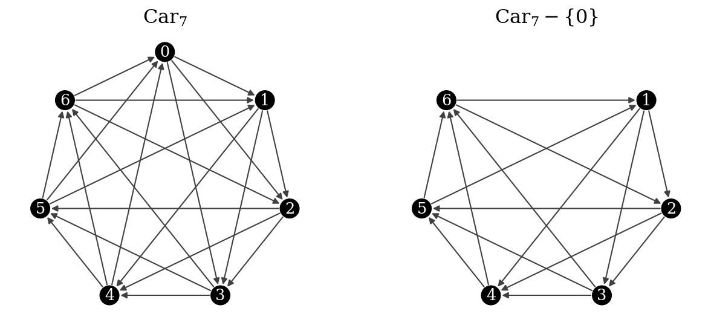

# Quantitative Hamiltonian path counts and Wormald's angular Hessian

Xingchen Liu and Xiangyu Ye

7 November 2026

## Abstract

We prove that the maximum number of directed Hamiltonian paths in an $n$-vertex tournament satisfies

$$
P(n)=\left(\frac{\cosh1}{\cos1}+O(n^{-1})\right)\frac{n!}{2^{n-1}}.
$$

The proof builds on our earlier constant-factor counting framework, combining uniform permanent estimates, local diagonal scaling for nonprincipal submatrices, and a score-sensitive path bound with the spectral comparison of Fang and Huang. Divoux and Wang established the sharp leading asymptotic constant for cycles and paths. We also give an independent derivation of the full angular Hessian in Wormald's random blow-up formula and prove its positive definiteness for every regular base. The overlap with Bhattacharjee's results is stated explicitly. For each fixed odd base order, we prove eventual uniqueness of the carousel base for the expected path and cycle counts in both blow-up models, and establish strict monotonicity of the regular-block constants.

## 1. Introduction

A tournament is an orientation of a complete graph. Write $H(T)$ for the number of directed Hamiltonian paths in a tournament $T$, and $C(T)$ for the number of directed Hamiltonian cycles. Paths are counted as vertex orderings, whereas cyclic starting points are identified for cycles. Let

$$
P(n)=\max_{|V(T)|=n}H(T),\qquad
\mu_n=\frac{n!}{2^{n-1}},\qquad
\nu_n=\frac{(n-1)!}{2^n}.
$$

Szele [10] observed that a uniform random tournament has $\mu_n$ Hamiltonian paths in expectation: each vertex ordering is directed with probability $2^{-(n-1)}$. Hence $P(n)\ge\mu_n$. The corresponding expected cycle count is $\nu_n$ for $n\ge3$. These expectations provide the natural normalization for the extremal problem.

Adler, Alon and Ross [9] improved the random lower bound by choosing an almost complete packing of edge-disjoint triangles and orienting each triangle cyclically, independently of the others. A vertex ordering containing one of these triangles in three consecutive positions is more likely to form a directed path than it is in the independent-edge model. For a uniformly random vertex ordering, the number of such occurrences converges in distribution to $\operatorname{Poisson}(1)$, from which they obtained the lower bound $(e-o(1))\mu_n$. Wormald [6] used a different construction: the directions between large vertex classes are prescribed by a fixed tournament, while the tournaments within the classes are random. His calculation for carousel bases gives a cycle lower constant exceeding $2.85588$ along an infinite sequence of orders, already close to the constant considered below.

The upper bounds developed through permanent estimates. If $A$ is the adjacency matrix of a tournament, then $\operatorname{per}A$ counts its spanning unions of vertex-disjoint directed cycles. In particular, it bounds the number of Hamiltonian cycles. Alon [2] applied Brégman's inequality to this permanent and optimized the resulting expression over the outdegrees, obtaining $P(n)=O(n^{3/2}\mu_n)$. Friedgut and Kahn [7] used an entropy argument to improve the polynomial exponent; their cycle bound is $O(n^{\alpha}\nu_n)$ with $\alpha\approx1.249$. These estimates identify the correct exponential scale, but leave a polynomial gap between the upper and lower bounds. At the scale of a leading constant, one must retain information that a bound in terms of the degrees alone discards.

Divoux and Wang [12] determined the sharp leading constant. They proved that the maximum cycle count is $(L+o(1))\nu_n$ and the maximum path count is $(L+o(1))\mu_n$, where $L=\cosh1/\cos1$. Their proof still uses permanents, but replaces a degree bound by a determinant approximation for nearly doubly stochastic matrices. After separating vertices with large degree imbalance, they classify a Hamiltonian cycle by the directed path segments that it induces on the exceptional set. These segments are encoded in modified adjacency matrices of the remaining tournament. Sinkhorn scaling and a determinant–permanent inclusion-exclusion formula then reduce the count to a ratio of determinants of a skew-symmetric matrix. A matrix comparison of Fang and Huang [11] bounds this ratio by its value for a transitive tournament. Odd carousels, and their one-vertex deletions at even orders, attain the bound asymptotically; a separate argument transfers the cycle result to paths.

The first author's path-counting preprint [14], publicly archived on 8 October 2026, had already established $(L-O(n^{-1}))\mu_n\le P(n)\le(C_*+O(n^{-1}))\mu_n$ and the analytic framework used below. Thus it closed the polynomial gap, while leaving a gap between the two leading constants $L<C_*$. That archive contains the positive path convolution, uniform permanent estimate, nonprincipal scaling and exceptional-vertex analysis; it predates the arXiv v1 submission of [12] on 16 October 2026. The present sharp estimate combines that framework with the spectral moment comparison of Fang and Huang [11]. It refines the leading asymptotic in [12, Theorem 1.4] and retains a uniform $O(n^{-1})$ normalized error through deletion, scaling and summation. We make no claim that this error order is optimal.

**Theorem 1.1.** There are absolute constants $K',n_1$ such that every integer $n\ge n_1$ satisfies

$$
(L-K'/n)\mu_n\le P(n)\le(L+K'/n)\mu_n.
$$

For odd $n$, the carousel $\mathrm{Car}_n$ has vertex set $\mathbb Z/n\mathbb Z$, with $i\to j$ precisely when the representative of $j-i$ modulo $n$ belongs to $\{1,\ldots,(n-1)/2\}$. The lower bound is attained, up to an error of $O(\mu_n/n)$, by odd carousels and by the even tournaments obtained by deleting one vertex from $\mathrm{Car}_{n+1}$.

{width=94%}

The second part of the paper concerns Wormald's random blow-up models. Fix an odd integer $d\ge3$ and a tournament $T^*$ on $d$ vertices. Each vertex is replaced by a block of $m$ vertices, and the directions between blocks are prescribed by $T^*$. In $\mathcal T(T^*,m)$ the internal tournaments are independent and uniform; in $\mathcal R(T^*,m)$ they are independent and uniform among regular tournaments, so $m$ must be odd. Put $N=dm$. The expected cycle and path counts are normalized by $\nu_N$ and $\mu_N$, respectively.

{width=78%}

For a regular base, Theorem 4 of Wormald [6] expresses the limiting constant in terms of an angular Hessian, subject to its determinant being nonzero. He computes this determinant for several bases and conjectures that the condition always holds. We prove positive definiteness and evaluate the determinant for every regular base.

**Theorem 1.2.** Let $T^*$ be regular, with adjacency matrix $A$. Set $S=A-A^T$, $C=S/d$, and $E=(e_1-e_d,\ldots,e_{d-1}-e_d)$. The Hessian $\mathbf H$ of Wormald's angular function at the origin is positive definite, and

$$
\mathbf H=E^T(I+C^2)(I-C^2)^{-1}E,\qquad
\mathcal H=d\,\frac{\det(I+C^2)}{\det(I-C^2)}>0,
$$
$$
\sqrt{d/\mathcal H}=\rho_d(S)
:=\frac{\det(I+S/d)}{\det(I+iS/d)}\in\mathbb Q_{>0}.
$$

Here $\mathcal H=\det\mathbf H$, and the square root is positive. The angular function is defined in Section 9. Together with Theorems 1, 4 and 5 of Wormald [6], this shows that, for fixed $d$, the normalized expected cycle and path counts in $\mathcal T(T^*,m)$ both tend to $\rho_d(S)$, while the corresponding limits in $\mathcal R(T^*,m)$ are $e^{1/d}\rho_d(S)$.

The model constants can also be obtained directly from Divoux and Wang [12, Proposition 5.1], without the Hessian calculation; Section 10.1 records that derivation. Their Proposition 7.1 and Lemma 9.1 already give the spectral maximum and the carousel value. The next corollary combines these results with the equality conditions of Fang and Huang [11], the zero-row-sum condition for a regular base, and a separate bound for nonregular bases.

**Corollary 1.3.** For each fixed odd $d\ge3$, there exists $M_d$ such that, for every $m\ge M_d$, the carousel $\mathrm{Car}_d$ is the unique base, up to isomorphism, maximizing the expected number of Hamiltonian cycles and paths in both models. For $\mathcal R(T^*,m)$, only odd $m$ are considered.

The closed form below is the binomial evaluation in Divoux and Wang [12, Section 7 and Lemma 9.1], with the factor $e^{1/d}$ supplied by Wormald [6, Theorem 1]. The known frequencies in Fang and Huang [11, Lemma 4.2] give the following further consequence.

**Corollary 1.4.** Set

$$
r_d=\frac{(1+1/d)^d+(1-1/d)^d}{(1+i/d)^d+(1-i/d)^d},
\qquad \mathfrak r_d=e^{1/d}r_d.
$$

Along odd integers $d\ge3$, the sequence $\mathfrak r_d$ increases strictly to $L$.

Theorem 1.2 directly proves Wormald's Hessian conjecture [6, Conjecture 6]. Corollary 1.3 combines existing counting and spectral results with the equality and nonregular-base arguments given here. The limit in Conjecture 2 follows from the closed form in [12] and Wormald's factor $e^{1/d}$; Corollary 1.4 adds strict monotonicity. Section 10 retains the expansion through $d^{-5}$, with remainder $O(d^{-6})$, as a calculation from that closed form.

Bhattacharjee [13, Theorems 1.1 and 1.3, Proposition 3.1, Lemma 3.2 and Corollary 3.3] also treats Wormald's Conjectures 2 and 6. The original angular Hessian, positivity, determinant/rational-square formulas and carousel limit were obtained independently in our Wormald project [15] and in his work. We retain our direct derivation and record the overlap. Our October 8 path archive [14] concerns a different part of the paper and is not used to date the Hessian result. Bhattacharjee's public release dated 14 October [16] already contains the full Hessian; the fixed Liu--Ye manuscript revision cited in [15] is dated 19 October. Git commit dates and public-release dates have different meanings, and these records do not establish priority for our Hessian calculation.

The contribution and dependency structure is as follows.

| Component | Scope and relation to prior work |
|---|---|
| Constant-factor path framework | Independently archived in [14]; the upper constant there was $C_*>L$. |
| Sharp global path estimate | Uniform final $O(n^{-1})$ error, obtained by combining the counting estimates with [11]; the sharp leading asymptotic is in [12]. |
| Signed permanent estimate | The independent proof from [14] is retained; the counting applications use its nonnegative specialization. |
| Angular Hessian and carousel limit | Independent derivation overlapping [13,16]; no priority claim is based on the earlier path archive. |
| Fixed-base extremality | Equality analysis, nonregular-base decay and a finite-class comparison complete eventual uniqueness for expectations. |
| Regular-block monotonicity | A strict monotonicity consequence of the known carousel spectrum. |

For Corollary 1.3 the order $d$ is fixed first. There are finitely many base isomorphism classes; regular noncarousel bases have a strict limiting gap, and the normalized expectations of nonregular bases tend to zero. A common threshold can therefore be chosen for all four expectations and all bases of that fixed order. The statement concerns expectations, and the regular-block model only allows odd $m$.

### 1.1 The counting estimates and their relation to earlier methods

McCullagh [5] obtained the determinant approximation with an $O(n^{-1})$ relative error under moderate-deviation assumptions. Divoux and Wang [12, Proposition 3.1] prove a uniform $1+o(1)$ version for nonnegative doubly stochastic matrices; their coefficient estimates and Gamma averaging can be refined to retain $O(n^{-1})$ in that setting. Section 3 gives the form needed here, with fixed entry and operator-norm bounds, and includes the detailed proof. The quantitative assertion of Theorem 1.1 concerns the final path count after deletion, scaling and summation; it does not assert a new determinant main term or a first $O(n^{-1})$ permanent approximation.

The proof expands the permanent by imposing distinct row and column indices separately. Double centering eliminates terms with a vertex of degree one. Components in which every vertex has degree two give Gaussian pairings and hence the determinant main term; the other components are estimated after contracting their degree-two chains. The resulting coefficient estimates hold over a range growing with the matrix order. For the tail, permanent polarization reduces the required complex-matrix bound to a positive semidefinite one. The complex Gaussian identity and arithmetic–geometric mean estimate used by Han and Niles-Weed [3, Lemmas 4.3–4.4] provide this bound; we then apply Cauchy's coefficient estimate. Together, the coefficient estimates and the tail bound give the uniform $O(n^{-1})$ error.

For paths, we use the identity

$$
H(T)=\sum_{U\subseteq V(T)}\det(I+A[U])\operatorname{per}A[U^c].
$$

This is a specialization of the determinant–permanent identities discussed by Irving and Omar [1]. All its summands are nonnegative for a tournament. We can therefore estimate the permanent in each term without controlling cancellation in the final sum. The terms with large $U$ have a sufficiently small factorial tail. For the remaining terms, the task is to apply the permanent approximation with an error uniform in both the tournament and the deletion set. We also retain the weights associated with each deletion-set size: their fixed moments are summable. Replacing every size by the largest permitted value would introduce unnecessary logarithmic losses.

The exceptional vertices require a further estimate. We split the adjacency matrix into four blocks according to the exceptional set and its complement, and expand the permanent over the matchings between these blocks. A cross-block matching removes core rows and core columns that need not have the same indices. Thus estimates restricted to principal submatrices do not suffice. Section 4 treats these nonprincipal submatrices, performs the diagonal scaling, and records the change in the Gaussian determinant factor. This four-block expansion is the way exceptional vertices are counted here; the directed-segment classification in [12] concerns the cycle count.

It remains to ensure that these estimates give the claimed error for every tournament. We may assume $H(T)\ge\mu_n$. Brégman's inequality first bounds the sum of squared degree imbalances. Tournaments with a sufficiently large value of this sum are bounded directly; those with an exceptional vertex are handled by the cross-block expansion. For the remaining tournaments, the scaling calculation retains an exponential penalty for degree imbalance. Some intermediate errors have square-root size, which would be too large if estimated in isolation. Together with the penalty, they contribute only $O(n^{-1})$ to the upper bound. The main term is

$$
\rho_n(S)=\frac{\det(I+S/n)}{\det(I+iS/n)},\qquad S=A-A^T.
$$

As in [12], the comparison of Fang and Huang [11] bounds this ratio by its value at the sign matrix of a transitive tournament. That value is $L+O(n^{-1})$. For the lower bound, the two-sided path estimate applies to odd carousels and to their even-order one-vertex deletions: the degree imbalances are respectively zero and of absolute value one. These arguments give Theorem 1.1 directly. Proposition 6.6 supplies the all-order spectral comparison; Proposition 7.3 isolates the uniform score penalty, and Corollary 8.2a gives the resulting degree-variance stability estimate.

### 1.2 Wormald's models

Wormald [6] obtains the fixed-base counting formula by projecting a Hamiltonian cycle onto a closed walk in the base tournament. Inside each block, the cycle induces a collection of directed paths. Generating functions for these walks and paths lead to a multivariate coefficient problem, to which smooth-point asymptotics apply. For a regular base, the remaining constant involves the determinant of an angular Hessian defined through an implicit equation. This leaves both a nondegeneracy question and a comparison problem between different bases.

We differentiate the original implicit equation to obtain Theorem 1.2, including positive definiteness of the full Hessian. This supplies an unconditional justification for Wormald's nondegeneracy assumption. The identity $\sqrt{d/\det\mathbf H}=\rho_d(S)$ also links the Hessian to the existing spectral theory. The model limit $\rho_d(S)$ itself is already a direct application of [12, Proposition 5.1]; using Wormald's conditional Hessian formula to infer nondegeneracy would not be a valid substitute for the calculation.

For regular bases, we supplement the comparison in [12] with the equality classification from Fang and Huang [11]. Signed similarity together with zero row sums forces the carousel. Nonregular bases are bounded separately by Brégman's inequality. Since only finitely many bases occur at fixed order, the strict limiting gaps give Corollary 1.3. The short spectral proof gives Corollary 1.4; the separate expansion records higher-order terms. The base order is fixed before the block order tends to infinity.

### 1.3 Further questions and organization

Theorem 1.1 does not identify the path maximizers at every finite order or determine the coefficient of the first correction term. It would also be useful to estimate $M_d$ in terms of $d$. Allowing the base order and the block order to grow together would require error bounds uniform in the base order, beyond the fixed-base asymptotics used here.

Section 2 fixes notation. Sections 3 and 4 give the permanent and nonprincipal scaling estimates; Section 5 records the positive path convolution, summable weights and uniform tail. Section 6 proves the spectral comparison for all orders. Sections 7 and 8 establish the sharp path bound directly, followed by degree-variance stability. Sections 9--11 treat the original angular Hessian and fixed-base model extrema; Section 12 summarizes the completed proof. The appendices retain the auxiliary identities and state the standard estimates used in the argument.

## 2. Preliminaries and notation

### 2.1 The random baseline and error conventions

Let $\mathfrak S_n$ be the symmetric group on $[n]$, and let $I_\pi$ indicate that the consecutive edges of $\pi$ all point forward. Each ordering uses $n-1$ distinct undirected edges, so

$$
H(T)=\sum_{\pi\in\mathfrak S_n}I_\pi(T),\qquad
\mathbb E I_\pi=\prod_{j=1}^{n-1}\frac12=2^{-(n-1)},
$$

$$
\mathbb EH(T)=\sum_{\pi\in\mathfrak S_n}\mathbb EI_\pi
=n!2^{-(n-1)}=\mu_n.
$$

The maximum is at least the mean, so $P(n)\ge\mu_n$. Let $\mathcal T_n$ denote all tournaments with vertex labels $[n]$. In this paper, a uniform $O(n^{-1})$ error means

$$
\exists K<\infty\ \exists n_0\ \forall n\ge n_0\ \forall T\in\mathcal T_n:
\quad |\mathrm{error}(n,T)|\le K/n.
$$

The constants $K,n_0$ are uniform over tournaments and deletion sets. They may depend on additional fixed parameters $b,A_0,B_0$, when present.

### 2.2 Sign matrices and spectral factors

**Definition 2.1 (Sign matrices and scores).**

The adjacency matrix $A$ has zero diagonal and $A_{ij}=1$ precisely when $i\to j$. Define

$$
S=A-A^{\mathsf T},\qquad 2A=J-I+S,\qquad s=S\mathbf1.
$$

Here $I$ is the identity matrix in the current dimension, $J=\mathbf1\mathbf1^{\mathsf T}$, and $\mathbf1$ is the all-ones column vector. In $I_p,J_p,\mathbf1_p$, the subscript explicitly specifies the dimension $p$. The superscript $\mathsf T$ denotes transpose. If $d_i^+$ is the outdegree, then $s_i=2d_i^+-(n-1)$ and $\sum_i s_i=0$. The Euclidean and maximum vector norms are

$$
\|x\|_2=\left(\sum_i|x_i|^2\right)^{1/2},\quad
\|x\|_\infty=\max_i|x_i|.
$$

We use the notation

$$
\mathcal E=\|s\|_2^2,\qquad d=\|s\|_\infty,\qquad
a=\frac{s}{n-1},\qquad \tau=\|a\|_2^2.
$$

The normalized scores $a$ and $\tau$ are defined for $n\ge2$. An odd-order tournament is regular when every vertex has outdegree $(n-1)/2$, equivalently $s=0$. An even-order tournament is balanced when every outdegree is $n/2$ or $n/2-1$, equivalently $s_i\in\{-1,1\}$. Thus $d$ measures the largest vertex imbalance, whereas $\tau$ measures the total squared imbalance after normalization.

**Definition 2.2 (Submatrices and permanents).**

For a vertex set $U$, the notation $A[U]=A[U,U]$ denotes the principal submatrix. For possibly different row and column sets $R,C$, the submatrix $A[R,C]$ selects those rows and columns, always in increasing original vertex-label order. The same convention applies to a general matrix $M[R,C]$. The complement $U^c$ is taken in the current full vertex set. Empty sums equal zero and empty products equal one; both the determinant and the permanent of the empty matrix equal one. For a square matrix of order $m$, denoted by $M$, the permanent is

$$
\operatorname{per}M=\sum_{\pi\in\mathfrak S_m}\prod_{i=1}^m M_{i,\pi(i)}.
$$

**Definition 2.3 (Frequencies and spectral factors).**

The singular values of a real matrix $M$ are the nonnegative square roots of the eigenvalues of $M^{\mathsf T}M$. The operator norm $\|M\|_{\rm op}=\sup_{\|x\|_2=1}\|Mx\|_2$ equals the largest singular value. The square of the Frobenius norm $\|M\|_F=(\sum_{i,j}|M_{ij}|^2)^{1/2}$ is the sum of the squared singular values. For the skew-symmetric matrix $S$, write $\pm i\lambda_j$ for its nonzero eigenvalue pairs, where $i^2=-1$ and $\lambda_j>0$, adding zero frequencies when needed. Each $\lambda_j$ occurs twice among the singular values. Define

$$
x_j=\frac{\lambda_j^2}{n^2},\qquad
D_n(S)=\det(I-S^{\mathsf T}S/n^2)^{-1/2},
$$

$$
\rho_n(S)=D_n(S)\det(I+S/n)=\prod_j\frac{1+x_j}{1-x_j}.
$$

The skew-symmetric singular values occur in pairs, and $\|S\|_F^2=n(n-1)$, so

$$
\sum_jx_j=\frac{n-1}{2n},\qquad \|S/n\|_{\rm op}^2\le\frac{n-1}{2n}<\frac12.
$$

Therefore $D_n$ and $\rho_n$ are positive and bounded by absolute constants. In particular,

$$
D_n(S)=\det(I+iS/n)^{-1}.
$$

For every $i$,

$$
s_i=\sum_{j\ne i}(A_{ij}-A_{ji})
=d_i^+-[(n-1)-d_i^+]=2d_i^+-(n-1),
$$

$$
\sum_i s_i=\sum_{i<j}(S_{ij}+S_{ji})=0,\qquad
\|S\|_F^2=\sum_{i\ne j}1=n(n-1).
$$

In a real orthonormal basis, a real skew-symmetric matrix becomes a direct sum of blocks $\left(\begin{smallmatrix}0&\lambda_j\\-\lambda_j&0\end{smallmatrix}\right)$ and zero blocks. Consequently,

$$
\det(I+S/n)=\prod_j(1+\lambda_j^2/n^2)=\prod_j(1+x_j),
$$

$$
\begin{aligned}
\det(I-S^{\mathsf T}S/n^2)&=\prod_j(1-x_j)^2,\\
D_n(S)&=\prod_j(1-x_j)^{-1},\\
\det(I+iS/n)&=\prod_j(1-\lambda_j/n)(1+\lambda_j/n)
=\prod_j(1-x_j),\\
\rho_n(S)&=\prod_j\frac{1+x_j}{1-x_j}.
\end{aligned}
$$

Each frequency occurs twice in the squared Frobenius norm, so

$$
2\sum_j\lambda_j^2=n(n-1),\qquad
\sum_jx_j=\frac{n-1}{2n},\qquad
\|S/n\|_{\rm op}^2\le\sum_jx_j<\frac12.
$$

For $n=1$, we have $S=[0]$, the frequency sum is empty, and $D_1(S)=\rho_1(S)=1$.

Every $\log$ below is a natural logarithm. Using $-\log(1-x)=\int_0^x(1-u)^{-1}\,du\le2x$ for $0\le x\le1/2$, we obtain

$$
0\le\log D_n(S)\le2\sum_jx_j<1,\qquad 1\le D_n(S)<e.
$$

Similarly, $\log(1+x)\le x$ gives $\log\rho_n(S)<3/2$. Multiplication by $D_n(S)$ or $\rho_n(S)$ therefore preserves the order of the error. Lemma 6.1 gives a sharper bound.

## 3. A uniform permanent approximation

In this section we prove a uniform estimate for permanents. Write a matrix with unit row and column sums as $(J_n+E)/n$, where $E\mathbf1=E^{\mathsf T}\mathbf1=0$. If the entries of $E$ are bounded and $\|E/n\|_{\mathrm{op}}\le q<1$, the main term is a determinant. Section 4 applies this estimate to scaled tournament submatrices.

McCullagh [5] obtained the determinant main term under moderate-deviation conditions. Here we give a self-contained version for a fixed entry bound $C$ and singular-value spectral gap $q$, with an error uniform over the matrix class determined by these parameters. The proof controls the coefficients and the tail separately, so that the conclusion applies uniformly to the deletions and scalings in Section 4. A recent related approximation of Li [8, Theorem 2.1] assumes that the maximum absolute row or column sum of the centered perturbation is $o(n)$; this condition does not cover dense kernels whose corresponding sums have order $n$.

The compressed-core proof below was developed independently in the authors' earlier path-counting project [14]. We retain the signed-matrix theorem as a separate analytic result, while the tournament applications in Sections 4--8 use nonnegative matrices.

### 3.1 The theorem and the proof strategy

**Theorem 3.1 (Uniform permanent approximation).**

Fix $0\le C<\infty$ and $0\le q<1$. Let $n\ge1$, and suppose $E\in\mathbb R^{n\times n}$ satisfies

$$
E\mathbf1=E^{\mathsf T}\mathbf1=0,\qquad
\max_{i,j}|E_{ij}|\le C,\qquad
\|E/n\|_{\mathrm{op}}\le q.
$$

Put $B=E/n$. Uniformly over all matrices satisfying these conditions,

$$
\frac{\operatorname{per}(J_n+E)}{n!}
=\det(I-BB^{\mathsf T})^{-1/2}+O_{C,q}(n^{-1}).
\tag{3.1}
$$

[Equation (3.1)](#eq-uniform-permanent) can also be written as the determinant factor times the relative error $1+O_{C,q}(n^{-1})$. The subscript $C,q$ means that the error constant and the threshold dimension may depend on these two parameters fixed in advance, but must apply simultaneously to every admissible matrix.

For a concrete signed example, set

$$
B=\frac17\begin{pmatrix}1&2&-3\\-2&1&1\\1&-3&2\end{pmatrix},\qquad E=3B.
$$

Then $B$ is doubly centered and $\|B\|_{\rm op}=5/7<1$, while $J_3+E$ has negative entries. For every $m\ge1$, $E_m=E\otimes J_m$ has order $n=3m$, entry bound $9/7$, and $\|E_m/n\|_{\rm op}=5/7$. This provides signed admissible inputs of arbitrarily large order with fixed parameters. This example concerns the theorem's hypotheses; it does not claim that an alternative method cannot extend to signed inputs.

All determinant square roots in this section are the positive square roots on the relevant real intervals. The assumptions give $\|B\|_{\mathrm F}^2\le C^2$. Thus the determinant factor is at least one and is uniformly bounded by a constant depending only on $C,q$.

Inclusion-exclusion for the row and column indices expresses each coefficient of the permanent as a sum over bipartite multigraphs. Centering eliminates degree-one vertices. The degree-two components correspond to Gaussian pairings and give the determinant main term. We classify the remaining components by their excess, the number of edges minus vertices; each unit of excess contributes a factor $n^{-1}$. We first estimate coefficients of degree at most $\alpha n$, then use a complex-analytic bound for the remaining coefficients.

The proof uses the Gaussian series $G(t)$, which is a different object from the numerical bound $G=100/19$ in Section 7.4. Put

$$
f(t)=\frac{\operatorname{per}(J_n+tE)}{n!},
\qquad G(t)=\det(I-t^2BB^{\mathsf T})^{-1/2}.
$$

Choose $1<\sigma<R<1/q$; when $q=0$, no upper restriction is imposed. For example, take

$$
R=\frac{3+q}{2(1+q)},\qquad \sigma=\frac{1+R}{2}.
$$

In this section we define a separate control function $\Gamma(r)$, which is distinct from the score product $\Gamma$ in Section 7:

$$
\Gamma(r)=\exp\left(\frac{C^2r^2}{2(1-q^2r^2)}\right),
\qquad r\ge0,\ rq<1.
$$

Throughout this section, when $q=0$, upper restrictions involving $1/q$ are omitted. All constants depend only on $C,q$ and the chosen radii. Section 3.6 combines them into an explicit error bound.

For these radii,

$$
R-1=\frac{1-q}{2(1+q)}>0,\qquad
1-Rq=\frac{2-q-q^2}{2(1+q)}=\frac{(1-q)(q+2)}{2(1+q)}>0,
$$

$$
\sigma-1=(R-1)/2>0,\qquad R-\sigma=(R-1)/2>0.
$$

In this section, let $s_i$ denote the singular values of $B$. Then

$$
\sum_i s_i^2=\sum_{i,j}B_{ij}^2\le n^2(C/n)^2=C^2,\qquad
0\le s_i\le q.
$$

Using $-\log(1-u)=\int_0^u(1-v)^{-1}\,dv\le u/(1-u)$,

$$
\begin{aligned}
\log G(r)&=-\frac12\sum_i\log(1-r^2s_i^2)\\
&\le\frac12\sum_i\frac{r^2s_i^2}{1-r^2s_i^2}
\le\frac{r^2\sum_i s_i^2}{2(1-r^2q^2)}
\le\frac{C^2r^2}{2(1-r^2q^2)}.
\end{aligned}
$$

Consequently $1\le G(1)\le\Gamma(1)$. If $|f(1)-G(1)|\le K/n$, then

$$
\left|\frac{f(1)}{G(1)}-1\right|
=\frac{|f(1)-G(1)|}{G(1)}\le K/n,
$$

Thus the absolute error estimate also gives a relative error of the same order.

### 3.2 Coefficients and Gaussian pairing

**Definition 3.1 (Permanent coefficients and rescaling).**

Write $f(t)=\sum_{k=0}^n a_kt^k$. Expanding according to the entries taken from $E$ gives

$$
a_k=\frac1{(n)_k}
\sum_{\substack{I,J\subseteq[n]\\|I|=|J|=k}}
\operatorname{per}E[I,J],
$$

Here $0\le k\le n$, so the denominator $(n)_k$ is nonzero. For $k>n$, define $a_k=0$ directly, without using an expression containing $1/(n)_k$. Define

$$
F_k=\frac{(n)_k}{n^k}a_k
=\frac1{k!}
\sum_{\substack{i_1,\ldots,i_k\ \mathrm{distinct}\\
j_1,\ldots,j_k\ \mathrm{distinct}}}
\prod_{\ell=1}^kB_{i_\ell j_\ell},
\qquad
F(t)=\sum_{k=0}^nF_kt^k.
$$

The sum on the right remains meaningful when $k>n$: its indexing set is empty, so its value is zero. The formal identities below use this convention.

**Definition 3.2 (Set partitions and weights).**

For a finite set $E$, let $\mathfrak P(E)$ be the set of all partitions of $E$ into disjoint nonempty blocks, and put $\mathfrak P_k=\mathfrak P([k])$. The indicator that the $k$ coordinates are distinct has a standard inclusion-exclusion expansion on the partition lattice. The permanent calculation in [5, Section 8] also uses an expansion over pairs of partitions. A block of size $d$ has Möbius weight $(-1)^{d-1}(d-1)!$; here the weight of an entire partition is defined as $\mu(\pi)=\prod_{D\in\pi}(-1)^{|D|-1}(|D|-1)!$. Apply this expansion separately to the row and column coordinates of $F_k$. Each partition pair determines a bipartite multigraph: its edges have distinct labels $1,\ldots,k$, the vertices on the two sides are the blocks of the row and column partitions, and each block of size $d$ receives the weight above.

The numerical label of each vertex is summed independently over $[n]$; different vertices may have the same numerical label. If a row vertex has degree one, summing its label gives a column sum of $B$, which is zero. A column vertex of degree one similarly gives a zero row sum. Thus only graphs in which every vertex has degree at least two contribute.

For example, in degrees two and three, each surviving row or column partition has a single block. The products of the Möbius weights on the two sides are $1$ and $4$, respectively. Dividing by $k!$ gives

$$
F_2=\frac12\sum_{i,j}B_{ij}^2,
\qquad
F_3=\frac23\sum_{i,j}B_{ij}^3,
\qquad |F_3|\le\frac{2C^3}{3n}.
$$

The quadratic term is part of the Gaussian main term, whereas the cubic term is $O(n^{-1})$.

A connected component whose vertices all have degree two is called a pure degree-two component. Their total exponential generating function is $G(t)$. This can be checked directly with two independent standard real Gaussian vectors $X,Y$. By Wick's formula,

$$
\mathbb E\exp(tX^{\mathsf T}BY)
$$

the coefficient of $t^k$ in this expression is the sum over pairing partitions on the two sides of the edge labels, precisely the graphs whose vertices all have degree two. Integrating first with respect to the conditional Gaussian distribution and then diagonalizing $BB^{\mathsf T}$ gives

$$
\mathbb E\exp(tX^{\mathsf T}BY)
=\mathbb E\exp\!\left(\frac{t^2}{2}X^{\mathsf T}BB^{\mathsf T}X\right)
=\det(I-t^2BB^{\mathsf T})^{-1/2}.
$$

This analytic identity holds when $|t|\|B\|_{\mathrm{op}}<1$ and determines all formal coefficients. In particular, the coefficients of $G$ are nonnegative, and

$$
G(r)\le\Gamma(r)\qquad(r\ge0,\ rq<1),
$$

because $-\log(1-x)\le x/(1-x)$ and $\sum_i s_i^2=\|B\|_{\mathrm F}^2\le C^2$; here $s_i$ are the singular values of $B$.

Remove all pure degree-two components from every contributing graph, and call what remains its core. A core need not be connected. If it has $h$ edges and $v$ vertices, define its excess as $j=h-v$. Every nonempty core satisfies $j\ge1$. Decomposition into components with labeled edges gives the coefficientwise identity

$$
F(t)=G(t)\left(1+\sum_{j\ge1}C_j(t)\right),
$$

Here $C_j$ is the generating series for cores of excess $j$, with the Möbius signs and matrix contractions included in its coefficients. The identity is formal: a fixed degree $k$ involves only finitely many $j<k$, so no convergence in $j$ at nonzero $t$ is required. The distinct-index definition of $F_k$ makes all coefficients above degree $n$ vanish.

**Definition 3.3 (Core series).**

For $\pi,\sigma\in\mathfrak P_h$, let $D_\pi(a)$ and $D_\sigma(a)$ denote the two partition blocks containing edge label $a$. Give the row blocks labels $x_D\in[n]$ and the column blocks labels $y_E\in[n]$, and define the contraction

$$
\mathcal W_B(\pi,\sigma)
=\sum_{x:\pi\to[n]}\sum_{y:\sigma\to[n]}
\prod_{a=1}^hB_{x_{D_\pi(a)},y_{D_\sigma(a)}}.
$$

Both sums run over all functions, with no injectivity requirement. Define $\mathcal K_{j,h}$ to be the set of partition pairs satisfying the following conditions: every block has size at least two; every connected component of the associated bipartite multigraph contains a block of size at least three; and $h-|\pi|-|\sigma|=j$. Here $|\pi|$ counts blocks, not elements of the original set. A connected component is a maximal set of vertices connected by successive edges. Degree counts incident half-edges, with parallel edges counted separately; after compression, a loop contributes two to the degree of its vertex. Define the core series by

$$
C_j(t)=\sum_{h=0}^{\infty}c_{j,h}t^h,\qquad
c_{j,h}=\frac1{h!}\sum_{(\pi,\sigma)\in\mathcal K_{j,h}}
\mu(\pi)\mu(\sigma)\mathcal W_B(\pi,\sigma).
$$

For fixed $h$, the sum is finite. A nonempty core has at least one block on either side, so $j\le h-2$ and $c_{j,h}=0$ for $h\le j+1$. We shall also use the weaker condition $j<h$. The empty graph contributes $F_0=G(0)=1$ and is not included in $C_j$.

Write $g_k=[t^k]G(t)$ for $k\ge0$, where $[t^k]$ denotes coefficient extraction. Thus $g_0=1$ and $g_k=0$ for odd $k$. Lemma 3.2 will show that the weighted norm $\|C_j\|_R=\sum_h|c_{j,h}|R^h$ is finite.

Fix the entries selected from $E$ by specifying the row set $I$ and image set $J$, both of size $k$. The total weight of bijections at these positions is $\operatorname{per}E[I,J]$. The remaining $n-k$ rows can be bijected arbitrarily to the remaining columns in $(n-k)!$ ways. Hence

$$
[t^k]\operatorname{per}(J+tE)
=(n-k)!\sum_{|I|=|J|=k}\operatorname{per}E[I,J],
$$

$$
a_k=\frac{(n-k)!}{n!}\sum_{|I|=|J|=k}\operatorname{per}E[I,J]
=\frac1{(n)_k}\sum_{|I|=|J|=k}\operatorname{per}E[I,J].
$$

Given the row set, column set, and a bijection, labeling its $k$ matching edges successively by $1,\ldots,k$ can be done in $k!$ ways. Thus

$$
\sum_{\boldsymbol i,\boldsymbol j\ \mathrm{distinct}}\prod_{h=1}^kB_{i_hj_h}
=k!\sum_{|I|=|J|=k}\operatorname{per}B[I,J]
=\frac{k!}{n^k}\sum_{|I|=|J|=k}\operatorname{per}E[I,J].
$$

For a condition $\mathcal A$, $\mathbf1\{\mathcal A\}$ equals one when the condition holds and zero otherwise. It is a scalar indicator, distinct from the all-ones vector $\mathbf1_p$. For a partition $\pi$, define

$$
\mu(\pi)=\prod_{D\in\pi}(-1)^{|D|-1}(|D|-1)!,\quad
\mathbf1_\pi(\boldsymbol i)=\prod_{D\in\pi}\mathbf1\{i_h\text{ constant on }D\text{}\}.
$$

Then

$$
\mathbf1\{i_1,\ldots,i_k\text{ distinct}\}
=\sum_{\pi\in\mathfrak P_k}\mu(\pi)\mathbf1_\pi(\boldsymbol i).
$$

To verify this, let $D_1,\ldots,D_r$ be the equality classes of the given coordinates. The right-hand side factors as

$$
\prod_{a=1}^r\left(\sum_{\pi\in\mathfrak P(D_a)}\mu(\pi)\right).
$$

The permutation sign is $\operatorname{sgn}(\pi)=(-1)^{\#\{(i,j):i<j,\ \pi(i)>\pi(j)\}}$: it is one for an even number of inversions and minus one for an odd number. A block of size $d$ can be arranged into a directed cycle in $(d-1)!$ ways, and such a cycle has sign $(-1)^{d-1}$. Thus each parenthesis is the sum of the signs of all permutations of that set. This equals one for a singleton. For size at least two, multiplication by a fixed transposition bijects positive and negative terms, so they cancel and the sum is zero.

Substituting on both sides gives

$$
F_k=\frac1{k!}\sum_{\pi,\sigma\in\mathfrak P_k}\mu(\pi)\mu(\sigma)
\sum_{\boldsymbol i,\boldsymbol j}\mathbf1_\pi(\boldsymbol i)\mathbf1_\sigma(\boldsymbol j)
\prod_{h=1}^kB_{i_hj_h}.
$$

If $\pi$ has a singleton block $\{h\}$, summing the label $i_h$, which appears only once, gives $\sum_iB_{ij_h}=0$. The column side is identical. For $k=2$ only one pair of two-element blocks survives, with weight $(-1)(-1)=1$; for $k=3$ only one pair of three-element blocks survives, with weight $2\cdot2=4$. Hence

$$
F_2=\frac1{2!}\sum_{i,j}B_{ij}^2,\quad
F_3=\frac4{3!}\sum_{i,j}B_{ij}^3,\quad
|F_3|\le\frac23n^2(C/n)^3=\frac{2C^3}{3n}.
$$

Put $K=BB^{\mathsf T}$ and $Q=B^{\mathsf T}B$. The fourth-order term is

$$
\begin{aligned}
F_4={}&\frac18(\operatorname{tr}K)^2+\frac14\operatorname{tr}(K^2)\\
&-\frac34\sum_i\left(\sum_jB_{ij}^2\right)^2
-\frac34\sum_j\left(\sum_iB_{ij}^2\right)^2
+\frac32\sum_{i,j}B_{ij}^4.
\end{aligned}
$$

The first three classes of partition pairs are: both sides have type $2+2$ ($3\cdot3=9$ pairs); one side has type $4$ and the other type $2+2$ (three pairs in each orientation, with block weight $-6$); and both sides have type $4$ (weight $36$). Dividing by $4!=24$ gives the stated coefficients. The three identical pairing pairs give $3/24=1/8$, and the six distinct pairing pairs give $6/24=1/4$. This also directly confirms the separation of the main term $g_4$ from the non-Gaussian correction.

A standard real Gaussian variable $X$ has density $(2\pi)^{-1/2}e^{-x^2/2}$. For $u\in\mathbb R$, completing the square gives

$$
\mathbb Ee^{uX}=\frac1{\sqrt{2\pi}}\int_{\mathbb R}e^{-x^2/2+ux}\,dx
=e^{u^2/2}\frac1{\sqrt{2\pi}}\int_{\mathbb R}e^{-(x-u)^2/2}\,dx=e^{u^2/2}.
$$

For $v\in\mathbb R^n$, independence gives the multivariate generating function $\mathbb Ee^{v^{\mathsf T}X}=e^{\|v\|^2/2}$. Differentiating with respect to the coordinates gives

$$
\mathbb E\prod_{h=1}^{2r}X_{i_h}
=\sum_{\mathcal P\text{ a pairing}}\prod_{\{a,b\}\in\mathcal P}\mathbf1\{i_a=i_b\},
\qquad \mathbb E\prod_{h=1}^{2r+1}X_{i_h}=0.
$$

We record the real Gaussian moment calculation. A standard real Gaussian vector has independent coordinates with density $(2\pi)^{-1/2}e^{-x^2/2}$. Put

$$
m_r=\frac1{\sqrt{2\pi}}\int_{\mathbb R}x^re^{-x^2/2}\,dx.
$$

Normalization gives $m_0=1$, and symmetry of the integral of an odd function gives $m_{2r+1}=0$. Integration by parts for $r\ge1$ gives

$$
\begin{aligned}
m_{2r}
&=-\frac1{\sqrt{2\pi}}\int_{\mathbb R}x^{2r-1}\,d(e^{-x^2/2})\\
&=\frac{2r-1}{\sqrt{2\pi}}\int_{\mathbb R}x^{2r-2}e^{-x^2/2}\,dx\\
&=(2r-1)m_{2r-2}
=(2r-1)(2r-3)\cdots1.
\end{aligned}
$$

The boundary term vanishes because $|x|^ae^{-x^2/2}\to0$ for every fixed integer $a\ge0$. With $(-1)!!=1$, this can be written uniformly as $m_{2r}=(2r-1)!!$, including $r=0$.

For an index list $i_1,\ldots,i_k$, define the multiplicity $c_a=\#\{h:i_h=a\}$. Independence gives the finite product

$$
\mathbb E\prod_{h=1}^kX_{i_h}=\prod_{a=1}^n m_{c_a}.
$$

If any $c_a$ is odd, the right-hand side is zero. If all $c_a$ are even, every admissible pairing must pair positions with equal indices. The number of pairings of $c_a$ positions satisfies

$$
p_0=1,\qquad p_{2r}=(2r-1)p_{2r-2}
=(2r-1)!!.
$$

Thus the total number of admissible pairings is $\prod_a(c_a-1)!!$, exactly the moment computed above. Defining the Kronecker symbol $\delta_{ab}=\mathbf1\{a=b\}$ gives

$$
\mathbb E\prod_{h=1}^{2r}X_{i_h}
=\sum_{\mathcal P}\prod_{\{a,b\}\in\mathcal P}\delta_{i_ai_b}.
$$

Here $\mathcal P$ ranges over pairings of $[2r]$. The empty pairing contributes one when $r=0$, and odd moments vanish.

First take a real $t$ satisfying $|t|q<1$. Integrate with respect to $Y$, and then orthogonally diagonalize $BB^{\mathsf T}$. The standard-vector density is $(2\pi)^{-n/2}e^{-\|x\|_2^2/2}$. An orthogonal transformation preserves $\|x\|_2$ and has absolute Jacobian one, so the transformed density is unchanged and still factors into the coordinate densities. Therefore,

$$
\begin{aligned}
\mathbb Ee^{tX^{\mathsf T}BY}
&=\mathbb E_Xe^{t^2\|B^{\mathsf T}X\|^2/2}\\
&=\prod_i\frac1{\sqrt{2\pi}}\int_{\mathbb R}
e^{-(1-t^2s_i^2)x^2/2}\,dx\\
&=\prod_i(1-t^2s_i^2)^{-1/2}=G(t).
\end{aligned}
$$

To extend the identity to the complex disk, put $U=X^{\mathsf T}BY$ and choose a real $r$ with $|t|<r<1/q$. If $q=0$, then $B=0$ and the result is immediate. For real $u$,

$$
e^{r|u|}\le e^{ru}+e^{-ru}.
$$

Since $Y$ has the same distribution as $-Y$, $U$ has the same distribution as $-U$. Hence

$$
\mathbb E e^{r|U|}
\le\mathbb E e^{rU}+\mathbb E e^{-rU}
=2G(r)<\infty.
$$

Nonnegativity of the terms in the exponential series gives, for $k\ge0$,

$$
\frac{r^k|U|^k}{k!}\le e^{r|U|}
\quad\Longrightarrow\quad
\mathbb E|U|^k\le\frac{k!}{r^k}\mathbb Ee^{r|U|}
\le\frac{2k!}{r^k}G(r)<\infty.
$$

Consequently, for every integer $N\ge0$, expectation can be taken term by term in the finite sum:

$$
\sum_{k=0}^{N}\frac{r^k}{k!}\mathbb E|U|^k
=\mathbb E\sum_{k=0}^{N}\frac{r^k|U|^k}{k!}
\le\mathbb Ee^{r|U|}\le2G(r).
$$

Next let $s=|t|/r<1$. Bound the remainder of the exponential series pointwise:

$$
\left|e^{tU}-\sum_{k=0}^{N}\frac{t^kU^k}{k!}\right|
\le\sum_{k>N}s^k\frac{r^k|U|^k}{k!}
\le s^{N+1}e^{r|U|}.
$$

Taking expectations yields the explicit error

$$
\left|\mathbb Ee^{tU}-\sum_{k=0}^{N}\frac{t^k}{k!}\mathbb EU^k\right|
\le2G(r)s^{N+1}\longrightarrow0.
$$

This proves that, for every complex $t$ with $|t|<1/q$,

$$
\mathbb E e^{tU}
=\sum_{k=0}^{\infty}\frac{t^k}{k!}\mathbb E U^k,
\qquad
\sum_{k=0}^{\infty}\frac{|t|^k}{k!}|\mathbb E U^k|
\le2G(r)<\infty.
$$

We compare these coefficients with those of $G(t)$. Let $s_i$ be the singular values of $B$. The series for each factor is determined by $c_0=1$ and the recurrence

$$
c_{m+1}=\frac{2m+1}{2m+2}c_m,
\qquad
c_m=\frac{(2m)!}{4^m(m!)^2},
\qquad
(1-z)^{-1/2}=\sum_{m\ge0}c_mz^m\quad(|z|<1).
$$

The recurrence follows by coefficientwise comparison in $(1-z)f'(z)=f(z)/2$; since $c_{m+1}/c_m<1$, the series on the right converges absolutely for $|z|<1$. Further,

$$
\frac{d}{dz}\bigl[(1-z)f(z)^2\bigr]
=-f(z)^2+2(1-z)f(z)f'(z)
=-f(z)^2+f(z)^2=0.
$$

Its value at zero is one, so $(1-z)f(z)^2=1$, which selects the branch taking value one at zero. Multiplying the finitely many factors gives

$$
G(t)=\prod_i\left(\sum_{m\ge0}c_m s_i^{2m}t^{2m}\right),
\qquad |t|q<1.
$$

On the real interval this agrees with the Gaussian integral already computed. If one coefficient differed from that of $\mathbb E U^k/k!$, choose the least differing degree $k_0$, divide the difference of the two series by $t^{k_0}$, and let $t\to0$ along the real axis. This would give

$$
0=\lim_{t\to0}\frac{\mathbb Ee^{tU}-G(t)}{t^{k_0}}
=\frac{\mathbb E U^{k_0}}{k_0!}-[t^{k_0}]G(t)\ne0,
$$

a contradiction. Hence all coefficients agree. Both sides are represented by absolutely convergent series on the stated complex disk, so the identity also holds there. The exponential factor $1/k!$ matches the factor $1/k!$ in the exponential generating function for labeled edges; Wick pairings correspond to partitions whose blocks on both sides all have size two. We interchange convergent series only within the fixed spectral-gap disk. The infinite sum over core excess $j$ is still used only as a formal coefficient identity.

In any contributing graph every degree is at least two, so

$$
2(h-v)=\sum_{u}(\deg u-2)\ge0.
$$

If $h-v=0$, all vertices have degree exactly two and every connected component is pure degree two. After removing those components, any nonempty core has $j=h-v\ge1$. Splitting the edge-label set between the pure degree-two part and the core gives a factor $\binom kh$; multiplying by $1/k!$ gives $1/[h!(k-h)!]$, so the generating functions multiply exactly.

Put $K=BB^{\mathsf T}$. The matrix eigendecomposition and $-\log(1-u)=\sum_{r\ge1}u^r/r$ give

$$
\log G(t)=\frac12\sum_{r=1}^{\infty}\frac{t^{2r}}r\operatorname{tr}(K^r)
=A_st^2+B_st^4+C_st^6+O(t^8),
$$

Within this paragraph define the scalars $A_s=\operatorname{tr}K/2$, $B_s=\operatorname{tr}(K^2)/4$, and $C_s=\operatorname{tr}(K^3)/6$. Exponentiating coefficient by coefficient gives

$$
\begin{aligned}
G(t)
&=1+(A_st^2+B_st^4+C_st^6)
+\frac12(A_st^2+B_st^4)^2+\frac16(A_st^2)^3+O(t^8)\\
&=1+A_st^2+(B_s+A_s^2/2)t^4
+(C_s+A_sB_s+A_s^3/6)t^6+O(t^8).
\end{aligned}
$$

Therefore

$$
\begin{aligned}
g_2&=\tfrac12\operatorname{tr}K,\\
g_4&=\tfrac14\operatorname{tr}(K^2)+\tfrac18(\operatorname{tr}K)^2,\\
g_6&=\tfrac16\operatorname{tr}(K^3)
+\tfrac18\operatorname{tr}K\operatorname{tr}(K^2)
+\tfrac1{48}(\operatorname{tr}K)^3.
\end{aligned}
$$

All odd coefficients are zero because $G(t)$ contains only $t^2$. The scalars $A_s,B_s,C_s$ are used only in this exponential expansion.

There are three two-element partitions $12|34,13|24,14|23$. Choosing one on each side gives nine pairs: three identical and six distinct. Identical pairings give the matrix-label sum $(\sum_{ij}B_{ij}^2)^2=(\operatorname{tr}K)^2$; distinct pairings give $\operatorname{tr}(K^2)$. Thus the pure degree-two contribution is

$$
\frac3{4!}(\operatorname{tr}K)^2+\frac6{4!}\operatorname{tr}(K^2)=g_4.
$$

If one side is a four-element block, its Möbius weight is $-6$. The other side has three possible pairings into two-element blocks, each with weight $(-1)^2=1$. The row-colored degree-four term is therefore

$$
\frac{3(-6)}{24}\sum_i\sum_{j,k}B_{ij}^2B_{ik}^2
=-\frac34\sum_i\left(\sum_jB_{ij}^2\right)^2.
$$

Exchanging row and column colors gives the column-colored degree-four term

$$
-\frac34\sum_j\sum_{i,k}B_{ij}^2B_{kj}^2
=-\frac34\sum_j\left(\sum_iB_{ij}^2\right)^2.
$$

If both sides are four-element blocks, the product of the weights is $(-6)^2=36$. The last term is therefore

$$
\frac{36}{24}\sum_{i,j}B_{ij}^4=\frac32\sum_{i,j}B_{ij}^4.
$$

The four classes sum to the expression for $F_4$ above. Partitions containing degree-one vertices contribute zero by centering.

### 3.3 Estimating non-Gaussian cores

We first sum over the internal indices of each degree-two chain and bound the resulting matrix product by its operator norm. After these chains are compressed, a graph of excess $j$ has at most $2j$ vertices. Put

$$
W=\max\left\{1,CR+\frac{C^2R^2}{1-Rq}\right\},
\qquad D=710W^3,\qquad
T_1=\frac32W^2+\frac{10}{3}W^3.
$$

**Lemma 3.2 (Compressed core activity).**

With the notation above,

$$
\|C_j\|_R\le(Dj/n)^j\qquad(j\ge1),
\tag{3.2}
$$

and the first excess satisfies the sharper bound

$$
\|C_1\|_R\le T_1/n.
$$

Here $\|H\|_R=\sum_{k\ge0}|[t^k]H|R^k$.

**Proof.**

Compress all maximal paths whose internal vertices have degree two. Each compressed edge represents a chain of positive length whose endpoints have degree at least three. Loops, parallel edges, and disconnected compressed graphs are allowed. If $b$ is the number of vertices of degree at least three and $e$ is the number of compressed edges, compression preserves excess and gives

$$
e=b+j,\qquad
2j=\sum_{i=1}^b(d_i-2),\qquad
1\le b\le2j,\qquad e\le3j.
$$

**The decoration counting identity.** Fix the excess and the original number of edges. Sum over all ordered degree sequences $(d_1,\ldots,d_b)$, assignments of the two vertex colors, pairings of labeled half-edges, and positive chain lengths compatible with the colors. After removing the temporary labels, the absolute Möbius compensation is $1/(b!\prod_i d_i)$. For a chain contraction, its internal numerical indices must be summed before taking the absolute value.

The structural vertices are the blocks of the two partitions of the edge labels, and their numerical indices lie in $[n]$. Distinct blocks remain distinct vertices even when their numerical indices coincide. Möbius inversion has already accounted for the original distinctness constraints, so we count partition pairs directly. Temporarily label the $b$ vertices of high degree and the $d_i$ half-edges at each vertex, and use these labels to choose a unique reading direction for every chain. After summing over all ordered degree sequences, every original core with labeled edges has $b!\prod_i d_i!$ decorations. For any fixed degree sequence, only compatible vertex labelings occur; summing over all sequences produces exactly the full $b!$ factor. Every structural vertex is identifiable by its color and incident original edge labels, and every incident half-edge by its original edge label. There is therefore no additional automorphism stabilizer. Conversely, a decorated half-edge pairing and all positive chain lengths determine every chain position. The original $h$ edge labels can be assigned to these positions in $h!$ ways. When the bipartite color-parity conditions hold, the internal vertices and their colors are then determined as well.

Removing the $h!$ factor from the original exponential generating function and the temporary decorations, and restoring the absolute Möbius weights $\prod_i(d_i-1)!$ of the high-degree vertices, gives the compensation

$$
\frac1{b!\prod_i d_i}.
$$

This step includes loops and chain reversal. Order the two distinct labeled half-edges in each pair, and read the chain starting from the smaller one. Reversal changes the list of original edge labels occupying these positions; it does not supply an additional free factor of two. The two half-edges of a loop follow the same convention. Internal degree-two vertices have absolute Möbius weight one, and there is no additional factorial for chain length. Chains with endpoints of different colors have odd length; those with endpoints of the same color have even length. In particular, every loop has even length at least two. These restrictions are part of the exact identity.

For example, take one row-colored vertex of degree four and two loops of length two, each passing through its own column-colored vertex of degree two. Then $j=b=1$ and $h=4$. There are three ways to split the four original edge labels into two pairs. The degree-four vertex has Möbius weight $(-1)^3 3!=-6$, whereas the product of the two degree-two weights is $+1$. After division by $4!$, the signed contribution is

$$
-\frac34\sum_i\left(\sum_k B_{ik}^2\right)^2.
$$

Even if numerical indices coincide in some summands, the two structural column vertices remain distinct. Exchanging colors gives $-\tfrac34\sum_k(\sum_i B_{ik}^2)^2$. The absolute compensation bound uses the absolute values of these terms. As an example with parallel edges, take three chains of length one between a row vertex and a column vertex. Their contribution is $\tfrac{(2!)^2}{3!}\sum_{i,k}B_{ik}^3=\tfrac23\sum_{i,k}B_{ik}^3$, exactly the cubic term above. These examples include loops, parallel edges, and the reversal convention, while the original graph remains bipartite.

We discard color restrictions only when taking an upper bound. For fixed $j,b$, the resulting total compensation is

$$
U_{j,b}=
\frac{2^b}{b!}\frac{(2e)!}{2^e e!}
\sum_{\substack{d_1+\cdots+d_b=2e\\d_i\ge3}}
\frac1{d_1\cdots d_b},
\qquad e=b+j.
$$

In the following estimate, each chain's internal numerical indices must be summed before taking absolute values. Replacing $B$ by $|B|$ entry by entry at the outset would lose the operator spectral-gap control. A chain of length one is a matrix entry, whose absolute value is at most $C/n$. For a chain of length $\ell\ge2$, first sum its internal labels. Its contraction is an entry of an alternating product of $B,B^{\mathsf T}$. The Euclidean norms of the row or column vectors at the ends are at most $C/\sqrt n$, and the operator norms of the intervening factors are at most $q$. Thus the absolute value of the contraction is at most

$$
\frac{C^2}{n}q^{\ell-2}.
$$

Summing over lengths with weight $R$ bounds the total activity of each chain by $W/n$. Summing the labels of the $b$ high-degree vertices contributes at most $n^b$. Hence

$$
\|C_j\|_R\le n^{-j}
\sum_{b=1}^{2j}U_{j,b}W^{b+j}.
$$

The number of degree compositions is $\binom{2j-1}{b-1}\le4^j$: write $d_i=3+x_i$, so that $\sum_i x_i=2j-b$. In addition, $\prod_i d_i^{-1}\le3^{-b}$, and the number of half-edge pairings is at most $(6j)^{b+j}$. Therefore

$$
\sum_{b=1}^{2j}U_{j,b}W^{b+j}
\le(24jW)^j
\sum_{b=1}^{2j}\frac{(4jW)^b}{b!}.
$$

Taking $\theta=1/(2W)\le1/2$ gives

$$
\sum_{b=0}^{2j}\frac{(4jW)^b}{b!}
\le\theta^{-2j}\exp(4jW\theta)
=(2\mathrm e W)^{2j}.
$$

Thus the activity is at most $(96\mathrm e^2W^3j)^j\le(710W^3j)^j$. For the last inequality, use $\mathrm e<87/32$, obtained by summing the exponential series through degree six and bounding its tail by $8/(7\cdot7!)$.

For $j=1$ only $b=1,2$ are possible. The compensation formula gives, respectively,

$$
U_{1,1}=\frac32,\qquad U_{1,2}=\frac{10}{3}.
$$

Combining this with the chain bound gives $\|C_1\|_R\le T_1/n$.

Compressing one degree-two vertex removes one vertex and one edge, so $h-v$ is unchanged. The compressed graph satisfies

$$
2e=\sum_{i=1}^bd_i,\quad e-b=j,\quad
2j=\sum_{i=1}^b(d_i-2)\ge b,
$$

Consequently $b\le2j$ and $e=b+j\le3j$. The numbers of temporary decorations and original edge labels cancel against the Möbius weights exactly as follows:

$$
\frac1{h!}\cdot\frac{h!}{b!\prod_i d_i!}\cdot\prod_i(d_i-1)!
=\frac1{b!}\prod_i\frac{(d_i-1)!}{d_i!}
=\frac1{b!\prod_i d_i}.
$$

For $2e$ half-edges, the number of pairings follows from $p_{2e}=(2e-1)p_{2e-2}$ and $p_0=1$:

$$
p_{2e}=(2e-1)(2e-3)\cdots1=\frac{(2e)!}{2^ee!}.
$$

There are $2^b$ color assignments. Ignoring compatibility restrictions on colors and chain lengths therefore gives $U_{j,b}$. A chain of length one has contraction $B_{ij}$. For length $\ell\ge2$, write the contraction as $r^{\mathsf T}M_1\cdots M_{\ell-2}c$, where $r,c$ are rows or columns of $B$. Then

$$
\|r\|_2^2,\|c\|_2^2\le n(C/n)^2=C^2/n,
$$

$$
|r^{\mathsf T}M_1\cdots M_{\ell-2}c|
\le\|r\|_2\prod_a\|M_a\|_{\rm op}\|c\|_2
\le(C^2/n)q^{\ell-2}.
$$

Weighting by length gives

$$
R\frac Cn+\sum_{\ell=2}^{\infty}R^\ell\frac{C^2}nq^{\ell-2}
=\frac1n\left(CR+\frac{C^2R^2}{1-Rq}\right)\le W/n.
$$

The $b$ remaining vertices have at most $n^b$ numerical labelings, giving $n^b(W/n)^e=n^{-j}W^{b+j}$. Summing the internal chain indices preserves the factor $q^{\ell-2}$.

To count degree compositions, put $x_i=d_i-3\ge0$. Then $\sum_ix_i=2j-b$, so

$$
\#\{(d_1,\ldots,d_b)\}=\binom{(2j-b)+b-1}{b-1}
=\binom{2j-1}{b-1}\le2^{2j-1}\le4^j.
$$

Moreover, $\prod_i1/d_i\le3^{-b}$ and the number of pairings is at most $(2e)^e\le(6j)^{b+j}$. Thus

$$
\begin{aligned}
U_{j,b}W^{b+j}
&\le\frac{2^b}{b!}(6j)^{b+j}4^j3^{-b}W^{b+j}\\
&=(24jW)^j\frac{(4jW)^b}{b!}.
\end{aligned}
$$

If $0<\theta\le1$ and $b\le2j$, then $\theta^b\ge\theta^{2j}$. Hence

$$
\sum_{b=0}^{2j}\frac{(4jW)^b}{b!}
\le\theta^{-2j}\sum_{b=0}^{\infty}\frac{(4jW\theta)^b}{b!}
=\theta^{-2j}e^{4jW\theta}.
$$

Taking $\theta=1/(2W)$ gives $(2W)^{2j}e^{2j}$. Multiplication by $(24jW)^j$ yields $(96e^2W^3j)^j$. The numerical estimate follows from

$$
e<\sum_{h=0}^6\frac1{h!}+\frac1{7!}\sum_{r=0}^{\infty}8^{-r}
=\frac{1957}{720}+\frac1{4410}<\frac{87}{32},
$$

$$
96(87/32)^2=\frac{22707}{32}=709.59375<710.
$$

When $j=1$, $b=1,e=2,d_1=4$. Thus

$$
U_{1,1}=\frac2{1!}\frac{4!}{2^2\,2!}\frac14=\frac32.
$$

When $b=2,e=3$, the only degree sequence is $(3,3)$. Hence

$$
U_{1,2}=\frac{2^2}{2!}\frac{6!}{2^3\,3!}\frac1{3\cdot3}=\frac{10}{3}.
$$

This gives $T_1=(3/2)W^2+(10/3)W^3$ term by term.

Fix a compressed core and assign numerical labels to its $b$ remaining high-degree vertices. Its $e$ compressed edges have internal structural vertex sets $V_1,\ldots,V_e$, respectively; these sets are pairwise disjoint. Numerical labels may coincide, but each structural vertex has its own independent summation variable. The distributive law for finite sums therefore gives

$$
\sum_{\text{all internal labels}}\prod_{r=1}^e
\left(\prod_{a\in\mathrm{chain}_r}B_{i_aj_a}\right)
=\prod_{r=1}^e\left[
\sum_{\text{internal labels of chain }r\text{}}
\prod_{a\in\mathrm{chain}_r}B_{i_aj_a}\right].
$$

Each bracket is a single entry of an alternating matrix product; only now do we take its absolute value. Summation over positive chain lengths also separates into $e$ geometric series. With the high-degree labels fixed, the total absolute activity is thus at most $(W/n)^e$. Summing over the $n^b$ choices of high-degree labels then gives

$$
n^b(W/n)^e=W^en^{b-e}=W^{b+j}n^{-j}.
$$

The internal vertex sets of the chains are disjoint, so their summation variables are independent; numerical labels may still coincide.

When $j=1,b=1$, there is one degree-four vertex with four half-edges. The only pairings are

$$
(12)(34),\quad(13)(24),\quad(14)(23).
$$

Each pairing gives two loops. There are two colors and the compensation denominator is $b!d_1=4$, giving a total of $2\cdot3/4=3/2$.

When $j=1,b=2$, both vertices have degree three. Half-edge pairings fall into two classes. If all three edges join the vertices, there are $3!=6$ pairings. If each vertex has one loop and the remaining two half-edges form an edge, there are $3\cdot3=9$ pairings. The two counts sum to fifteen. There are four vertex-color assignments and the compensation denominator is $2!\cdot3\cdot3=18$. Therefore

$$
\frac4{18}(6+9)=\frac{10}{3}.
$$

Dropping the color and length compatibility conditions gives an upper bound. The two cases give the two terms of $T_1$. $\square$

### 3.4 A linear coefficient window and factorial restoration

The activity bound [in (3.2)](#eq-core-activity) is useful when $j/n$ is small. Take

$$
\alpha=\min\left\{\frac14,\frac1{16D},\frac{\log\sigma}{2}\right\},
\qquad M=\lfloor\alpha n\rfloor.
$$

and put $v_j=(Dj/n)^j$. When $j+1\le M$,

$$
\frac{v_{j+1}}{v_j}
=\frac{D(j+1)}n\left(1+\frac1j\right)^j
\le\frac{\mathrm e D(j+1)}n
\le3D\alpha<\frac12.
$$

Hence, for $n\ge4/\alpha$,

$$
\sum_{j=2}^{M}v_j\le2v_2=\frac{8D^2}{n^2}.
$$

In the formal core identity, contributions of degree at most $M$ can come only from excess $j\le M$. Combining nonnegativity of the coefficients of $G$, the activity lemma, and the convolution inequality for weighted coefficient sums gives

$$
\sum_{k=0}^{M}|F_k-[t^k]G|R^k
\le\Gamma(R)\left(\frac{T_1}n+\frac{8D^2}{n^2}\right).
$$

This estimate concerns only coefficients of degree at most $M$.

Write $g_k=[t^k]G$ and, for $0\le k\le M$, put $r_k=n^k/(n)_k$. Since $\alpha\le1/4$,

$$
\log r_k
=\sum_{\ell=0}^{k-1}-\log(1-\ell/n)
\le\frac{k(k-1)}{2n(1-\alpha)}
\le\frac{k^2}n
\le\alpha k.
$$

The condition $\alpha\le(\log\sigma)/2$ implies $r_k\le\sigma^k$. Moreover,

$$
0\le r_k-1
\le\frac{k(k-1)}{2n(1-\alpha)}r_k.
$$

Since $a_k=r_kF_k$, we can decompose

$$
a_k-g_k=r_k(F_k-g_k)+(r_k-1)g_k.
$$

The preceding $R$-weighted estimate bounds the first part. For the second part we use the second moment of the Gaussian coefficients:

$$
\sum_{k\ge0}k(k-1)g_k\sigma^k
=\left((t\partial_t)^2-t\partial_t\right)G(t)\big|_{t=\sigma}.
$$

Put $a_i=\sigma^2s_i^2$. Differentiating $G(t)=\prod_i(1-t^2s_i^2)^{-1/2}$ gives

$$
\frac{\left((t\partial_t)^2-t\partial_t\right)G(t)}{G(t)}
\bigg|_{t=\sigma}
=\left(\sum_i\frac{a_i}{1-a_i}\right)^2
+\sum_i\frac{a_i(1+a_i)}{(1-a_i)^2}.
$$

Define

$$
u_\sigma=\frac{\sigma^2C^2}{1-\sigma^2q^2},
\qquad
v_\sigma=\frac{\sigma^2C^2(1+\sigma^2q^2)}
{(1-\sigma^2q^2)^2},
$$

$$
K_G=\frac{\Gamma(\sigma)}{2(1-\alpha)}
\left(u_\sigma^2+v_\sigma\right).
$$

The two terms in the derivative formula are at most $u_\sigma^2$ and $v_\sigma$, respectively. Therefore,

$$
\sum_{k=0}^{M}(r_k-1)g_k\le K_G/n.
$$

This gives the first two terms in the error bound.

Since $e<3$ and $\alpha\le1/(16D)$,

$$
\frac{v_{j+1}}{v_j}\le3D\alpha\le3/16<1/2,
\quad
\sum_{j=2}^Mv_j\le v_2\sum_{r=0}^{\infty}2^{-r}
=2(2D/n)^2=8D^2/n^2.
$$

If $H(t)=\sum h_kt^k$ and $K(t)=\sum k_kt^k$, then

$$
\sum_{r=0}^M|[t^r](HK)|R^r
\le\sum_{a,b\ge0}|h_a||k_b|R^{a+b}
=\|H\|_R\|K\|_R.
$$

In coefficients with $r\le M$, only $j\le M$ are needed. We therefore truncate to a finite excess sum before applying this inequality; we do not evaluate $\sum_{j\ge1}C_j(R)$.

The integral estimate for factorial restoration is

$$
-\log(1-u)=\int_0^u\frac{dv}{1-v}\le\frac{u}{1-\alpha}
\quad(0\le u\le\alpha).
$$

Summing over $u=0,1/n,\ldots,(k-1)/n$ gives

$$
\log r_k\le\frac{k(k-1)}{2n(1-\alpha)}\le k^2/n\le\alpha k,
\quad r_k\le e^{\alpha k}\le\sigma^k.
$$

The inequality $e^x-1\le xe^x$ gives $r_k-1\le[k(k-1)/(2n(1-\alpha))]r_k$. Consequently,

$$
\begin{aligned}
\sum_{k=0}^M|a_k-g_k|
&\le\sum_{k=0}^Mr_k|F_k-g_k|+\sum_{k=0}^M(r_k-1)g_k\\
&\le\sum_{k=0}^MR^k|F_k-g_k|
+\frac1{2n(1-\alpha)}\sum_{k\ge0}k(k-1)g_k\sigma^k.
\end{aligned}
$$

Put $D_t=t\partial_t$ and $a_i(t)=t^2s_i^2$. Successive differentiation gives

$$
\begin{aligned}
D_t\log G&=\sum_i\frac{a_i}{1-a_i}=:A(t),\\
D_tA&=\sum_i\frac{2a_i}{(1-a_i)^2},\\
D_tG&=GA,\\
D_t^2G&=G\left[A^2+\sum_i\frac{2a_i}{(1-a_i)^2}\right],\\
\frac{(D_t^2-D_t)G}{G}
&=A^2+\sum_i\left[\frac{2a_i}{(1-a_i)^2}-\frac{a_i}{1-a_i}\right]\\
&=A^2+\sum_i\frac{a_i(1+a_i)}{(1-a_i)^2}.
\end{aligned}
$$

At $t=\sigma$ we have $a_i\le\sigma^2q^2$, so

$$
A(\sigma)\le\frac{\sigma^2C^2}{1-\sigma^2q^2}=u_\sigma,
\quad
\sum_i\frac{a_i(1+a_i)}{(1-a_i)^2}
\le\frac{\sigma^2C^2(1+\sigma^2q^2)}{(1-\sigma^2q^2)^2}=v_\sigma.
$$

Together with $G(\sigma)\le\Gamma(\sigma)$, this gives exactly $K_G/n$.

Define the projection $\mathcal P_M\sum_kh_kt^k=\sum_{k=0}^Mh_kt^k$. A nonempty core of excess $j$ has at least $j+1$ original edges, so in degrees at most $M$ no $j>M$ occurs. Thus, exactly,

$$
\mathcal P_M(F-G)=\mathcal P_M\left(G\sum_{j=1}^MC_j\right).
$$

The right-hand side involves only finitely many core series, so its weighted coefficient norm is legitimate. The triangle inequality and the convolution bound give

$$
\begin{aligned}
\sum_{k=0}^M|F_k-g_k|R^k
&=\|\mathcal P_M(F-G)\|_R\\
&\le\left\|G\sum_{j=1}^MC_j\right\|_R\\
&\le\|G\|_R\sum_{j=1}^M\|C_j\|_R\\
&\le\Gamma(R)\left[T_1/n+\sum_{j=2}^M(Dj/n)^j\right]\\
&\le\Gamma(R)(T_1/n+8D^2/n^2).
\end{aligned}
$$

Only finitely many weighted norms of $C_j$ occur. On restoring $a_k$, the first part satisfies

$$
\sum_{k=0}^Mr_k|F_k-g_k|
\le\sum_{k=0}^M\sigma^k|F_k-g_k|
\le\sum_{k=0}^MR^k|F_k-g_k|.
$$

The second part, $(r_k-1)g_k$, is bounded by the Gaussian derivative moment above.

### 3.5 Controlling the remaining coefficients

We have controlled coefficients through degree $M$, where $M$ is proportional to $n$. To estimate higher coefficients by Cauchy's inequality, it suffices, on the fixed circle $|t|=R>1$, to bound $f$ by $\exp(O(\sqrt n))$. The next two lemmas give this bound while retaining the normalization factor $n!/n^n$.

**Lemma 3.3 (Permanent polarization).**

For a complex square matrix $Z$, its singular values are the nonnegative square roots of the eigenvalues of $Z^*Z$, and the corresponding norms are computed as in Definition 2.3. Write $|Z|=(Z^*Z)^{1/2}$ for its operator absolute value, taking the Hermitian positive semidefinite square root, rather than the absolute values of individual entries. For a Hermitian matrix, $H\ge0$ means that $x^*Hx\ge0$ holds for every vector. Then

$$
|\operatorname{per}Z|
\le\sqrt{\operatorname{per}|Z|\,
\operatorname{per}|Z^*|}.
$$

**Proof.**

On complex vector spaces we use the inner product $\langle x,y\rangle=x^*y$. In $(\mathbb C^n)^{\otimes n}$, put

$$
\xi=(n!)^{-1/2}
\sum_{\pi\in \mathfrak S_n}
e_{\pi(1)}\otimes\cdots\otimes e_{\pi(n)}.
$$

Then $\|\xi\|=1$ and $\langle\xi,Z^{\otimes n}\xi\rangle=\operatorname{per}Z$. Take the polar decomposition $Z=U|Z|$. If $Z$ is singular, extend the partial isometry in its polar decomposition to a unitary matrix $U$. Write $T=|Z|^{\otimes n}$ and $V=U^{\otimes n}$. Applying Cauchy–Schwarz in the semi-inner product induced by the positive semidefinite operator $T$ gives

$$
|\langle\xi,VT\xi\rangle|
\le\sqrt{\langle V^*\xi,TV^*\xi\rangle
\langle\xi,T\xi\rangle}.
$$

The two factors are $\operatorname{per}(U|Z|U^*)=\operatorname{per}|Z^*|$ and $\operatorname{per}|Z|$, respectively. Both are nonnegative because they are diagonal matrix elements of positive semidefinite tensor powers. $\square$

**Lemma 3.4 (A positive semidefinite permanent bound).**

Let $n\ge1$, and let $H$ be an $n\times n$ Hermitian positive semidefinite matrix with eigenvalues $\lambda_1,\ldots,\lambda_n$. Then

$$
\operatorname{per}H\le\frac{n!}{n^n}h_n(\lambda_1,\ldots,\lambda_n),
$$

Here $h_n$ is the complete homogeneous symmetric polynomial of degree $n$, defined by

$$
h_n(\lambda_1,\ldots,\lambda_n)
=\sum_{\substack{k_1,\ldots,k_n\ge0\\k_1+\cdots+k_n=n}}
\prod_{i=1}^n\lambda_i^{k_i}.
$$

All $k_i$ are integers. Every zeroth power in this polynomial equals one, including, when $\lambda_i=0$, the expression $\lambda_i^0$. This polynomial is a different object from the scalar weight $h_k=((k+1)/2)^{k/2}$ in Section 2. If $\lambda_1=1$ and $0\le\lambda_i<1$ for $i\ge2$, then

$$
\operatorname{per}H\le\frac{n!}{n^n}
\prod_{i=2}^n(1-\lambda_i)^{-1}.
$$

**Proof.**

Let $Z$ be a circularly symmetric complex Gaussian vector with covariance matrix $H$. The complex Wick formula gives $\operatorname{per}H=\mathbb E\prod_i|Z_i|^2$. Pointwise AM–GM bounds this product by $n^{-n}\|Z\|^{2n}$. After unitary diagonalization, $\|Z\|^2$ has the same distribution as $\sum_i\lambda_i|\zeta_i|^2$, where $\zeta_i$ are independent standard circularly symmetric complex Gaussian variables satisfying $\mathbb E|\zeta_i|^{2k}=k!$. Expanding the polynomial therefore gives

$$
\mathbb E\left(\sum_i\lambda_i|\zeta_i|^2\right)^n
=n!h_n(\lambda_1,\ldots,\lambda_n).
$$

Finally, $h_n(1,\lambda_2,\ldots,\lambda_n)$ is the sum of all monomials in $\lambda_2,\ldots,\lambda_n$ of total degree at most $n$. It is bounded by the product of the corresponding infinite geometric series. $\square$

The Gaussian identity and AM–GM comparison in Lemma 3.4 are the tools used by Han–Niles-Weed [3, arXiv v2, Lemmas 4.3–4.4] for positive semidefinite inputs. Lemma 3.3 connects them to the general matrices needed here.

Put $\beta=RC/(1-Rq)$ and write $P_n=J_n/n$ for the orthogonal projection onto the all-ones direction. In general, $u^\perp=\{v:u^*v=0\}$ denotes the orthogonal complement of the vector $u$. Double centering gives $P_nB=BP_n=0$. Consequently, on $|t|=R$,

$$
|P_n+tB|=P_n+R(B^{\mathsf T}B)^{1/2},
\qquad
|(P_n+tB)^*|=P_n+R(BB^{\mathsf T})^{1/2}.
$$

Both have eigenvalue $1$ in the all-ones direction and, on $\mathbf1^\perp$, eigenvalues $Rs_i$, including zero singular values when needed. Since $Rq<1$, the two lemmas and the exact identity $f(t)=(n^n/n!)\operatorname{per}(P_n+tB)$ give

$$
|f(t)|\le\prod_i(1-Rs_i)^{-1}
\le\exp\!\left(\frac{R}{1-Rq}\sum_i s_i\right)
\le\exp(\beta\sqrt n).
$$

The last step uses $\sum_i s_i\le\sqrt n\,\|B\|_{\mathrm F}\le C\sqrt n$. Cauchy's coefficient estimate therefore gives

$$
\sum_{k>M}|a_k|
\le\frac{R}{R-1}
\exp\!\left(\beta\sqrt n-\alpha n\log R\right).
$$

For the Gaussian tail, nonnegativity of the coefficients gives the slightly weaker but convenient bound

$$
\sum_{k>M}g_k
\le \Gamma(\sigma)\sigma^{-M}
\le\sigma\Gamma(\sigma)\exp\!\left(-\alpha n\log\sigma\right).
$$

Both tails decay exponentially in $n$. Combining them with the $O(n^{-1})$ estimate in the finite window proves Theorem 3.1.

For any $M$,

$$
\begin{aligned}
\langle\xi,M^{\otimes n}\xi\rangle
&=\frac1{n!}\sum_{\pi,\sigma\in \mathfrak S_n}\prod_{h=1}^nM_{\pi(h),\sigma(h)}\\
&=\frac1{n!}\sum_{\pi\in \mathfrak S_n}\sum_{\tau\in \mathfrak S_n}\prod_{i=1}^nM_{i,\tau(i)}
=\operatorname{per}M.
\end{aligned}
$$

Here $\tau=\sigma\circ\pi^{-1}$; for fixed $\pi$, $\sigma\mapsto\tau$ is a bijection. The $n!$ basis tensors are mutually orthogonal, so $\|\xi\|^2=(n!)^{-1}n!=1$. If $T\ge0$,

$$
|\langle a,Tb\rangle|^2
=|\langle T^{1/2}a,T^{1/2}b\rangle|^2
\le\langle a,Ta\rangle\langle b,Tb\rangle.
$$

Taking $a=V^*\xi,b=\xi$ and using $VTV^*=(U|Z|U^*)^{\otimes n}=|Z^*|^{\otimes n}$ gives Lemma 3.3.

A standard circularly symmetric complex variable $\zeta=x+iy$ has density $\pi^{-1}e^{-|z|^2}$. Integration in polar coordinates gives

$$
\begin{aligned}
\mathbb E|\zeta|^{2k}
&=\pi^{-1}\int_0^{2\pi}\!d\theta\int_0^{\infty}r^{2k}e^{-r^2}r\,dr\\
&=\int_0^{\infty}u^ke^{-u}\,du=k!.
\end{aligned}
$$

Writing $I_k=\int_0^\infty u^ke^{-u}\,du$, integration by parts gives $I_k=kI_{k-1}$ and $I_0=1$.

For integers $a,b\ge0$, polar integration gives the one-dimensional mixed moment

$$
\begin{aligned}
\mathbb E[\zeta^a(\overline\zeta)^b]
&=\frac1\pi\int_0^\infty r^{a+b+1}e^{-r^2}\,dr
\int_0^{2\pi}e^{i(a-b)\theta}\,d\theta\\
&=\begin{cases}a!,&a=b,\\0,&a\ne b.\end{cases}
\end{aligned}
$$

If $a\ne b$, the angular integral is $[e^{i(a-b)\theta}/(i(a-b))]_0^{2\pi}=0$. If $a=b$, the angular integral is $2\pi$; the substitution $u=r^2$ then gives $\int_0^\infty u^ae^{-u}\,du=a!$.

Let $\zeta_1,\ldots,\zeta_n$ be independent, and put $Z=L\zeta$ and $H=LL^*$. For index lists $\boldsymbol a,\boldsymbol b\in[n]^n$, the preceding identity and independence imply that the mixed moment is zero if some numerical index has different multiplicities in the two lists. If every multiplicity agrees and is $c_j$, the mixed moment is $\prod_jc_j!$. This is exactly the number of bijective pairings that match every position in the first list to a position of equal value in the second. Thus

$$
\mathbb E\prod_{i=1}^n\zeta_{a_i}\prod_{j=1}^n\overline\zeta_{b_j}
=\sum_{\sigma\in \mathfrak S_n}\prod_{i=1}^n\delta_{a_i,b_{\sigma(i)}}.
$$

Expanding the product and interchanging the finite sums gives

$$
\begin{aligned}
\mathbb E\prod_{i=1}^n|Z_i|^2
&=\sum_{\boldsymbol a,\boldsymbol b}
\prod_iL_{i,a_i}\prod_j\overline L_{j,b_j}
\sum_{\sigma\in \mathfrak S_n}\prod_i\delta_{a_i,b_{\sigma(i)}}\\
&=\sum_{\sigma\in \mathfrak S_n}\sum_{\boldsymbol a}
\prod_i L_{i,a_i}\overline L_{\sigma(i),a_i}\\
&=\sum_{\sigma\in \mathfrak S_n}\prod_i
\left(\sum_{a=1}^nL_{i,a}\overline L_{\sigma(i),a}\right)\\
&=\sum_{\sigma\in \mathfrak S_n}\prod_iH_{i,\sigma(i)}
=\operatorname{per}H.
\end{aligned}
$$

The second line uses $b_{\sigma(i)}=a_i$ to sum out all $b$ indices. The third line uses the independent summation of each $a_i$. The matrix $L$ may be singular: take $L=H^{1/2}$. Thus the proof includes positive semidefinite matrices with zero eigenvalues. The same second-moment calculation also determines the meaning of covariance: $\mathbb EZ_i\overline Z_j=H_{ij}$ and $\mathbb EZ_iZ_j=0$.

For every sample $|Z_i|^2\ge0$. AM–GM gives

$$
\prod_i|Z_i|^2\le\left(\frac{\sum_i|Z_i|^2}{n}\right)^n,
\qquad \operatorname{per}H\le n^{-n}\mathbb E\|Z\|_2^{2n}.
$$

A unitary transformation preserves $\|Z\|$. Applying the multinomial theorem term by term gives

$$
\begin{aligned}
\mathbb E\left(\sum_i\lambda_i|\zeta_i|^2\right)^n
&=\sum_{k_1+\cdots+k_n=n}\frac{n!}{\prod_i k_i!}
\prod_i\lambda_i^{k_i}\mathbb E|\zeta_i|^{2k_i}\\
&=n!\sum_{k_1+\cdots+k_n=n}\prod_i\lambda_i^{k_i}
=n!h_n(\lambda).
\end{aligned}
$$

If $\lambda_1=1$, eliminate the first variable using $k_1=n-\sum_{i\ge2}k_i$:

$$
h_n(1,\lambda_2,\ldots,\lambda_n)
=\sum_{\substack{k_2,\ldots,k_n\ge0\\\sum k_i\le n}}\prod_{i\ge2}\lambda_i^{k_i}
\le\prod_{i=2}^n\sum_{k_i=0}^{\infty}\lambda_i^{k_i}
=\prod_{i=2}^n(1-\lambda_i)^{-1}.
$$

Write $P=P_n$. Since $P^2=P$ and $PB=B^{\mathsf T}P=BP=PB^{\mathsf T}=0$,

$$
(P+tB)^*(P+tB)=P+R^2B^{\mathsf T}B
\quad(|t|=R).
$$

These two parts act on orthogonal subspaces, so the square root is $P+R(B^{\mathsf T}B)^{1/2}$. The two polarization factors have the same eigenvalues $1,Rs_1,\ldots$. The zero singular value corresponding to the all-ones direction may be omitted from the product because its factor is one. Define $A_R=\prod_i(1-Rs_i)^{-1}>0$. Take logarithms only of this positive upper bound, avoiding, when $f(t)=0$, the undefined expression $\log|f(t)|$. Retaining the normalization exactly gives

$$
\begin{aligned}
|f(t)|&=\frac{n^n}{n!}|\operatorname{per}(P+tB)|
\le\prod_i(1-Rs_i)^{-1},\\
\log A_R&=-\sum_i\log(1-Rs_i)\le\sum_i\frac{Rs_i}{1-Rs_i}
\le\frac R{1-Rq}\sum_i s_i
\le\frac{RC}{1-Rq}\sqrt n=\beta\sqrt n.
\end{aligned}
$$

Hence $|f(t)|\le A_R\le e^{\beta\sqrt n}$, including the case $f(t)=0$. Zeros are possible for admissible inputs: take $n=3$ and

$$
E=\begin{pmatrix}0&1&-1\\-1&0&1\\1&-1&0\end{pmatrix},\qquad B=E/3.
$$

This matrix is doubly centered, and

$$
B^{\mathsf T}B=\frac19(3I_3-J_3).
$$

The eigenvalue of $J_3$ is three in the all-ones direction and zero on the zero-sum subspace. The eigenvalues of $B^{\mathsf T}B$ are therefore $0,1/3,1/3$, giving $\|B\|_{\rm op}=1/\sqrt3\le3/5=:q<1$. The six permanent terms come from the identity permutation, three transpositions, and two three-cycles. Hence

$$
\begin{aligned}
6f(t)&=1+3(1-t^2)+(1+t)^3+(1-t)^3\\
&=1+3-3t^2+2+6t^2=6+3t^2,\\
f(i\sqrt2)&=1+(i\sqrt2)^2/2=0.
\end{aligned}
$$

Taking $R=\sqrt2<5/3=1/q$ and $\sigma=(1+\sqrt2)/2$ gives a zero of $f$ on the chosen circle $|t|=R$. Thus $\log|f(t)|$ is not defined everywhere on this circle.

Cauchy's coefficient formula on the circle $t=Re^{i\theta}$ is

$$
a_k=\frac1{2\pi R^k}\int_0^{2\pi}f(Re^{i\theta})e^{-ik\theta}\,d\theta,
\qquad |a_k|\le e^{\beta\sqrt n}R^{-k}.
$$

Thus

$$
\sum_{k>M}|a_k|\le e^{\beta\sqrt n}\frac{R^{-M}}{R-1}
\le\frac R{R-1}e^{\beta\sqrt n-\alpha n\log R}.
$$

Here $M\ge\alpha n-1$. The coefficients on the Gaussian side are nonnegative, so

$$
\sum_{k>M}g_k\le\sigma^{-M}\sum_{k>M}g_k\sigma^k
\le\sigma\Gamma(\sigma)e^{-\alpha n\log\sigma}.
$$

Put $c=\alpha\log R>0$. For $n\ge(2\beta/c)^2$, we have $\beta\sqrt n-cn\le-cn/2$. Since $ne^{-cn/2}\to0$, the first tail is $o(n^{-1})$, and the same argument applies to the second. Here we use the linear growth of $M=\lfloor\alpha n\rfloor$.

### 3.6 Combining the error bounds

**Proposition 3.5 (An explicit error bound).**

For every integer $n\ge4/\alpha$,

$$
|f(1)-G(1)|
\le \frac{\Gamma(R)T_1+K_G}{n}
+\frac{8\Gamma(R)D^2}{n^2}
+\frac{R}{R-1}\exp\!\left(\beta\sqrt n-\alpha n\log R\right)
+\sigma\Gamma(\sigma)\exp\!\left(-\alpha n\log\sigma\right).
$$

The first two terms come from the coefficient window and factorial-restoration errors in Section 3.4. The last two come from the tail bounds in Section 3.5. Both exponential terms are $o(n^{-1})$, giving the uniform error rate in Theorem 3.1.

Put $c_1=\alpha\log R>0$, $c_2=\alpha\log\sigma>0$, and $\beta=RC/(1-Rq)\ge0$. For

$$
n\ge N_1:=\max\{1,(2\beta/c_1)^2\},
$$

we have

$$
\sqrt n\ge2\beta/c_1
\ \Longrightarrow\ 
\beta\sqrt n\le(c_1/2)n
\ \Longrightarrow\ 
\beta\sqrt n-c_1n\le-c_1n/2.
$$

For any fixed $c>0$, the function $u(x)=xe^{-cx}$ satisfies, on $x\ge0$,

$$
u'(x)=e^{-cx}(1-cx),\qquad
\max_{x\ge0}u(x)=u(1/c)=1/(ec).
$$

Thus, for $n\ge N_1$,

$$
\frac R{R-1}\exp(\beta\sqrt n-c_1n)
\le\frac R{R-1}e^{-c_1n/2}
\le\frac{2R}{ec_1(R-1)}\frac1n,
$$

$$
\sigma\Gamma(\sigma)e^{-c_2n}
\le\frac{\sigma\Gamma(\sigma)}{ec_2}\frac1n.
$$

If we also require $n\ge4/\alpha$, the right-hand side of Proposition 3.5 is at most

$$
\frac1n\left[
\Gamma(R)T_1+K_G+8\Gamma(R)D^2
+\frac{2R}{ec_1(R-1)}
+\frac{\sigma\Gamma(\sigma)}{ec_2}\right].
$$

Every quantity in brackets depends only on $C,q,R,\sigma$ fixed in advance, and not on the matrix being estimated. To obtain one constant valid for all $n\ge1$, the finitely many smaller dimensions must also be covered. From $|1+E_{ij}|\le1+C$,

$$
|f(1)|\le\frac1{n!}\sum_{\pi\in \mathfrak S_n}(1+C)^n=(1+C)^n,
\qquad 1\le G(1)\le\Gamma(1).
$$

Let $N=\lceil\max\{N_1,4/\alpha\}\rceil$ and enlarge the uniform constant to at least

$$
\max_{1\le n<N}n\left[(1+C)^n+\Gamma(1)\right]
$$

covers the remaining orders as well; the maximum of an empty set is taken to be zero. $\square$

**Quantifying the existing permanent proof.**

Divoux and Wang [12, Proposition 3.1] prove a uniform permanent approximation with relative error $o(1)$ for nonnegative doubly stochastic matrices. In the nonnegative setting used in our counting argument, their proof can be refined to give an $O(N^{-1})$ error. This rate is a refinement of their estimates, rather than the statement of their proposition. Theorem 3.1 here allows an arbitrary real doubly centered matrix $E$, without requiring $J+E$ to be nonnegative. We retain that formulation and its detailed proof; the two theorem statements do not have identical hypotheses.

The refinement concerns two estimates in [12, Sections 3.2–3.3]. Their finite coefficient sum is already bounded by

$$
\sum_{1\le E\le K\sqrt N}
\frac{(cE/N)^{\lceil E/3\rceil}}{1-cE/N}.
$$

Put $\eta_N=cK/\sqrt N$. For sufficiently large $N$, this is at most

$$
\frac{c}{N(1-\eta_N)}
\sum_{E\ge1}E\eta_N^{\lceil E/3\rceil-1}
=O(N^{-1}).
$$

The remaining coefficients satisfy the exponential tail estimate in their proof. In the subsequent Gamma average, $G\sim\Gamma(N+1,1)$ and $Z=N/G$ satisfy

$$
\mathbb E(Z-1)=0,\qquad
\mathbb E(Z-1)^2=\frac1{N-1}.
$$

For $\Delta(s)=\det(I-s^2B^TB)^{-1/2}$, the fixed operator-norm gap and Frobenius-norm bound give a uniform bound on $\Delta''$ over the fixed window used there. A second-order Taylor expansion, together with their estimate outside the window, gives an $O(N^{-1})$ error. Thus this permanent error in the nonnegative doubly stochastic case can be obtained by refining the earlier proof. The global path estimate still requires control of the errors from scaling, degree imbalance, and exceptional vertices.

## 4. Diagonal scaling and nonprincipal submatrices

This section returns to the graph notation: $s=S\mathbf1$ is the score vector, $a=s/(n-1)$, and we assume $n\ge2$. Theorem 3.1 applies to matrices whose row and column sums agree after scalar normalization. Tournament matrices generally have different row and column sums: if $C=2A/(n-1)$, then

$$
C\mathbf1=\mathbf1+a,\qquad C^{\mathsf T}\mathbf1=\mathbf1-a.
$$

We must therefore control the permanent and its Gaussian factor while correcting the marginals. We first construct a local diagonal scaling and estimate its total logarithmic cost. We then compare Gram matrices to control the effects of deleting rows and columns. Finally, paired score corrections bring tournament submatrices within the hypotheses of the local theorem, thereby proving Lemma 4.4.

For a general order $p\ge1$, retain $P_p=J_p/p=\mathbf1_p\mathbf1_p^{\mathsf T}/p$ and set $\Pi_p=I_p-P_p$, the orthogonal projection that removes the all-ones direction. The total mass of a matrix is $\mathfrak m(X)=\sum_{i,j}X_{ij}$. A doubly stochastic matrix is a square matrix with nonnegative entries and every row sum and column sum equal to one. Constants in this section are uniform once the density and centered-kernel spectral-gap parameters have been fixed.

**Definition 4.1 (Marginal errors).**

For any real $p\times p$ matrix $Q$ ($p\ge1$; its mass need not yet equal $p$), define

$$
\alpha(Q)=Q\mathbf1_p-\mathbf1_p,\qquad
\beta(Q)=Q^{\mathsf T}\mathbf1_p-\mathbf1_p,
$$

$$
g(Q)=(\alpha(Q),\beta(Q))\in\mathbb R^{2p},\qquad
\varepsilon(Q)=\|g(Q)\|_\infty,
$$

$$
\|g(Q)\|_2^2=\sum_i\alpha(Q)_i^2+\sum_j\beta(Q)_j^2.
$$

Likewise, $(x,y)$ denotes concatenation of two vectors, so $\|(x,y)\|_\infty=\max(\|x\|_\infty,\|y\|_\infty)$. When the mass is $p$, the errors on each side sum to zero. When the mass differs from $p$, these definitions still apply, but normalization is required before invoking Lemma 4.1.

Write $n$ for the full order and $m=n-t$ for the retained order. In Lemmas 4.1 and 4.2, $p$ denotes a general matrix order; in the application we take $p=m$. The matrices $C,C^{\prime},\widehat C$ have order $n$, while $X,\widetilde X,B_X,Z$ have order $m$. Their total masses are

$$
\mathfrak m(C')=n+\nu,\quad \mathfrak m(\widehat C)=n,\quad
\mathfrak m(X)=m+\kappa,\quad
\mathfrak m(\widetilde X)=\mathfrak m(B_X)=m.
$$

Here $Z=\Pi_m[(S-I)/(n-1)][R,T]\Pi_m$, and $B_X$ is the scaled doubly stochastic matrix. In Theorem 3.1, the perturbation is $mB_X-J_m$ and its normalization is $B_X-P_m$.

### 4.1 Local Scaling and Its Cost

We seek a matrix of the form $B_{ij}=X_{ij}e^{x_i+y_j}$ with every row sum and column sum equal to one. Replacing $(x,y)$ by $(x+c\mathbf1,y-c\mathbf1)$ leaves $B$ unchanged; the condition $\sum x_i=\sum y_j$ removes this one-dimensional freedom. The singular-value spectral gap controls the linearized balancing equations on the remaining subspace. The entry bound further provides dimension-independent control in the infinity norm, making a contraction argument applicable.

**Lemma 4.1 (Local scaling).**

Let $p\ge1$, and let $X$ have total mass $p$ and be a real $p\times p$ matrix. Write

$$
\alpha=X\mathbf 1_p-\mathbf 1_p,\qquad \beta=X^{\mathsf T}\mathbf 1_p-\mathbf 1_p,\qquad \varepsilon=\max(\|\alpha\|_\infty,\|\beta\|_\infty).
$$

Assume $|X_{ij}|\le C/p$, that the sum of absolute values in each row and each column is at most $2$, and that

$$
X_0=X-\frac{\alpha\mathbf 1_p^{\mathsf T}+\mathbf 1_p\beta^{\mathsf T}}p,\qquad E=X_0-P_p
$$

satisfies $|E_{ij}|\le C_0/p$ and $\|E\|_{\rm op}\le q<1$, where $C,C_0\ge0$ and $0\le q<1$ are fixed parameters. Define

$$
L_0=\frac32+C_0+\frac{C_0^2}{1-q},
$$

$$
\varepsilon_0=\min\left\{\frac1{256L_0^2},\frac{1-q}{2(32L_0+2)}\right\}.
$$

If $\varepsilon\le\varepsilon_0$, the condition $\sum_i x_i=\sum_j y_j$ is satisfied by finite real potential vectors $x,y$ such that every row sum and column sum of $B=\operatorname{diag}(e^x)X\operatorname{diag}(e^y)$ equals $1$. Moreover,

$$
\|(x,y)\|_\infty\le4L_0\varepsilon,\qquad |B_{ij}|\le2C/p,\qquad \|B-P_p\|_{\rm op}\le(1+q)/2.
$$

If $X$ is entrywise nonnegative, then $B$ is doubly stochastic and has the same zero pattern as $X$.

**Proof.**

The entries of each marginal-error vector sum to zero. Consequently, every row sum and column sum of $X_0$ is $1$, and $E$ is doubly centered. Set $u=(\mathbf 1_p,-\mathbf 1_p)$ and $N=uu^{\mathsf T}/(2p)$. The balanced Hessian $\mathsf H_0$ has diagonal blocks $I$ and off-diagonal blocks $X_0,X_0^{\mathsf T}$, respectively. Its gauge-fixed inverse can be written explicitly. Put

$$
R_L=(I-EE^{\mathsf T})^{-1},\qquad R_R=(I-E^{\mathsf T}E)^{-1},\qquad O=ER_R.
$$

The four blocks of $(\mathsf H_0+N)^{-1}$ are then

$$
M_{LL}=R_L-P_p/4,\qquad M_{RR}=R_R-P_p/4,
$$

$$
M_{LR}=-O-P_p/4,\qquad M_{RL}=-O^{\mathsf T}-P_p/4.
$$

Indeed, on the common constant direction, the inverse eigenvalue is $1/2$; on the gauge direction, it is $1$; and on the two zero-sum subspaces, the usual block inverse applies. The dense entry bound gives

$$
|(R_L-I)_{ij}|,\ |(R_R-I)_{ij}|\le\frac{C_0^2}{p(1-q^2)},
$$

$$
|O_{ij}|\le\frac{C_0}{p}+\frac{C_0^2q}{p(1-q^2)}.
$$

For the last estimate, decompose $O=E+EE^{\mathsf T}ER_R$ and control the two-norms of the row and column at the two ends. The vector one-norm is

$$
\|x\|_1=\sum_i|x_i|,
$$

The corresponding induced matrix one-norm and infinity norm are $\|M\|_{1\to1}=\max_j\sum_i|M_{ij}|$ and $\|M\|_{\infty\to\infty}=\max_i\sum_j|M_{ij}|$, respectively. Both induced norms of the inverse above are therefore at most $L_0$.

Let $\mathsf H_X$ have diagonal blocks $\operatorname{diag}(X\mathbf 1_p)$ and $\operatorname{diag}(X^{\mathsf T}\mathbf 1_p)$, respectively, and off-diagonal blocks $X,X^{\mathsf T}$. Both induced norms of the difference $\mathsf H_X-\mathsf H_0$ are at most $3\varepsilon$. The Neumann series shows that both induced norms of $(\mathsf H_X+N)^{-1}$ are at most $2L_0$.

Write $z=(x,y)$ and $g=(\alpha,\beta)$. The balancing equation is

$$
0=g+\mathsf H_Xz+\mathcal N_X(z).
$$

Here $\mathcal N_X(z)$ is the concatenation of the row sums and column sums of $X_{ij}(e^{x_i+y_j}-1-x_i-y_j)$. On the ball $\|z\|_\infty\le R\le1/4$, the absolute marginal bounds give

$$
\|\mathcal N_X(z)\|_\infty\le8R^2,\qquad \|D\mathcal N_X(z)\|_{\infty\to\infty}\le16R.
$$

All these vectors are orthogonal to $u$. On the gauge subspace $u^\perp$, consider

$$
\mathcal T(z)=-(\mathsf H_X+N)^{-1}(g+\mathcal N_X(z)).
$$

Take $R=4L_0\varepsilon$. The norm of the image of the origin is at most $R/2$, and the Lipschitz constant is at most $128L_0^2\varepsilon\le1/2$. Thus the map preserves the gauge ball and is a contraction, yielding the required finite potential vectors. If $\varepsilon=0$, simply take $z=0$.

Finally, $R\le1/4$ gives the entry bound. The assumptions on absolute row and column sums imply

$$
\|B-X\|_{1\to1},\ \|B-X\|_{\infty\to\infty}\le32L_0\varepsilon.
$$

We also have $\|X-X_0\|_{\rm op}\le2\varepsilon$, so the second condition in $\varepsilon_0$ establishes the spectral gap of the centered kernel. Positive diagonal factors preserve both nonnegativity and the zero pattern. This proves the lemma.

Finding a balanced point alone does not suffice to estimate the permanent: restoring the diagonal factors requires multiplying the permanent by $\exp(-\sum x_i-\sum y_j)$. The next lemma controls this total cost and also gives the Frobenius displacement bound needed to compare Gaussian factors.

**Lemma 4.2 (Displacement and capacity).**

Under the preceding hypotheses, assume in addition that $X\ge0$. Let $\theta_X=\sum_i x_i+\sum_j y_j$ denote the total scaling potential. There is a constant depending only on the fixed density and spectral-gap parameters such that

$$
\|(x,y)\|_2\le K\|(\alpha,\beta)\|_2,\qquad \|B-X\|_F\le\frac K{\sqrt p}\|(\alpha,\beta)\|_2,
$$

$$
0\le\theta_X\le K\|(\alpha,\beta)\|_2^2.
$$

**General mass.** For a nonnegative matrix $X$ of arbitrary positive total mass, suppose that $\widetilde X=pX/\mathfrak m(X)$ satisfies the hypotheses of Lemma 4.1, and apply the preceding conclusions to $\widetilde X$. If $B$ is its scaling, the following exact identities hold:

$$
\theta_X=\theta_{\widetilde X}+p\log\frac p{\mathfrak m(X)},\qquad \operatorname{per}X=e^{-\theta_X}\operatorname{per}B.
$$

In particular, if $\kappa=\mathfrak m(X)-p$, then $\operatorname{per}X\le e^\kappa\operatorname{per}B$. When the mass differs from $p$, $\theta_X$ itself need not be nonnegative.

**Proof.**

The convex potential is

$$
\Phi_X(x,y)=\sum_{i,j}X_{ij}e^{x_i+y_j}-\sum_i x_i-\sum_j y_j.
$$

Its gradient at the origin is $g=(\alpha,\beta)$, and a balanced point is a minimizer. If $R=\|(x,y)\|_\infty$, then the Hessian along $tz$, $0\le t\le1$, is bounded below by the Hessian at the balanced matrix $B$ multiplied by $e^{-2R}$. On the gauge subspace, the smallest eigenvalue of the latter is at least $1-\|B-P_p\|_{\rm op}$. Thus there is a fixed positive lower bound $\lambda$ along the entire segment. Integrating the gradient gives $\|z\|_2\le\lambda^{-1}\|g\|_2$. The dense entry bound together with $|e^{x_i+y_j}-1|\le K|x_i+y_j|$ then gives the Frobenius displacement estimate.

Since $\Phi_X(0)=p$ and $\Phi_X(z)=p-\theta_X$, convexity gives $\theta_X\ge0$. Strong convexity gives $\theta_X\le\|g\|_2^2/(2\lambda)$. The general-mass identity follows by absorbing the scalar $p/\mathfrak m(X)$ into the two diagonal potentials. Finally, $p\log(\mathfrak m(X)/p)\le\kappa$ gives the permanent upper bound.

From the mass identity $\sum_{ij}X_{ij}=p$,

$$
\sum_i\alpha_i=\sum_j\beta_j=0,
\quad X_0\mathbf1=X\mathbf1-\alpha-\mathbf1\frac{\sum_j\beta_j}p=\mathbf1,
\quad X_0^{\mathsf T}\mathbf1=\mathbf1.
$$

Since $P_p\mathbf1=\mathbf1$, we have $E\mathbf1=E^{\mathsf T}\mathbf1=0$. The same calculation also gives

$$
\Pi_pX\Pi_p=X-P_p-\frac{\alpha\mathbf1^{\mathsf T}+\mathbf1\beta^{\mathsf T}}p=E.
$$

On the constant subspace, set $c=(\mathbf1,\mathbf1)$ and $u=(\mathbf1,-\mathbf1)$. Then

$$
\mathsf H_0c=2c,\quad\mathsf H_0u=0,\quad Nc=0,\quad Nu=u.
$$

The inverse therefore has eigenvalues $1/2,1$ on these two lines, respectively. On the two zero-sum subspaces, direct multiplication verifies

$$
\begin{pmatrix}I&E\\E^{\mathsf T}&I\end{pmatrix}
\begin{pmatrix}R_L&-ER_R\\-E^{\mathsf T}R_L&R_R\end{pmatrix}
=\begin{pmatrix}I&0\\0&I\end{pmatrix},
$$

where we use

$$
R_L-ER_RE^{\mathsf T}=I,\quad R_R-E^{\mathsf T}R_LE=I,
\quad R_LE=ER_R.
$$

The last identity can be checked term by term using the Neumann series. Writing the projection onto the constant subspace back in block form gives the four blocks, including $R_L-P_p/4$ and $-ER_R-P_p/4$.

Because every row and column of $E$ has two-norm at most $C_0/\sqrt p$,

$$
R_L-I=E(I-E^{\mathsf T}E)^{-1}E^{\mathsf T},
\quad |(R_L-I)_{ij}|\le\frac{C_0^2}{p(1-q^2)},
$$

$$
O-E=EE^{\mathsf T}E(I-E^{\mathsf T}E)^{-1},
\quad |(O-E)_{ij}|\le\frac{C_0^2q}{p(1-q^2)}.
$$

The absolute sum of each $2p$-dimensional block row is therefore at most

$$
1+\frac14+\frac14+C_0+
\frac{C_0^2(1+q)}{1-q^2}
=\frac32+C_0+\frac{C_0^2}{1-q}=L_0.
$$

The matrix is symmetric, so its induced one-norm is the same. Also,

$$
\|X-X_0\|_{\infty\to\infty},\|X-X_0\|_{1\to1}\le2\varepsilon,
\quad\|\mathsf H_X-\mathsf H_0\|_{\infty\to\infty},
\|\mathsf H_X-\mathsf H_0\|_{1\to1}\le3\varepsilon.
$$

Set $M=(\mathsf H_0+N)^{-1}$ and $D=\mathsf H_X-\mathsf H_0$. Then

$$
(\mathsf H_X+N)^{-1}=(I+MD)^{-1}M
=\sum_{h=0}^{\infty}(-MD)^hM,
$$

$$
\|(\mathsf H_X+N)^{-1}\|\le\frac{L_0}{1-3L_0\varepsilon}\le2L_0.
$$

Here either the one-norm or the infinity norm above may be used; $\varepsilon\le1/(256L_0^2)$ guarantees $3L_0\varepsilon<1/2$.

For $|h|\le2R\le1/2$, the Taylor integral remainder is

$$
e^h-1-h=h^2\int_0^1(1-t)e^{th}\,dt,
\qquad |e^h-1-h|\le\tfrac12e^{1/2}h^2.
$$

Each absolute row sum is at most two, and $|x_i+y_j|\le2R$, so

$$
\|\mathcal N_X(z)\|_\infty\le2\cdot\tfrac12e^{1/2}(2R)^2\le8R^2.
$$

In the derivative, the sum of absolute coefficients for a given row potential and all column potentials is at most

$$
2\sum_j|X_{ij}|\,|e^{x_i+y_j}-1|
\le2\cdot2\cdot2Re^{1/2}\le16R.
$$

The totals on the two sides agree, so $u^{\mathsf T}g=u^{\mathsf T}\mathcal N_X(z)=0$. Also, $\mathsf H_Xu=0$, and hence the inverse preserves $u^\perp$. Setting $R=4L_0\varepsilon$ gives

$$
\|\mathcal T(0)\|_\infty\le2L_0\varepsilon=R/2,
\quad\operatorname{Lip}(\mathcal T)\le2L_0\cdot16R
=128L_0^2\varepsilon\le1/2.
$$

Consequently, $\|\mathcal T(z)\|_\infty\le R/2+\|z\|_\infty/2\le R$. Starting from $z_0=0$ and $z_{h+1}=\mathcal T(z_h)$,

$$
\|z_{h+1}-z_h\|_\infty\le2^{-h}\|z_1-z_0\|_\infty,
\quad\sum_{h=0}^{\infty}\|z_{h+1}-z_h\|_\infty<\infty.
$$

The iteration therefore converges to a finite real vector, and its limit satisfies the balancing equation. Since $R\le1/4$, we have $e^{x_i+y_j}\le e^{1/2}<2$, giving $|B_{ij}|\le2C/p$. At the same time,

$$
\|B-X\|_{\infty\to\infty},\|B-X\|_{1\to1}
\le2\cdot2Re^{1/2}\le8R=32L_0\varepsilon,
$$

$$
\|B-P_p\|_{\rm op}\le q+(32L_0+2)\varepsilon\le(1+q)/2.
$$

For nonnegative $X$, the Hessian quadratic form in any direction $h=(v,w)$ is

$$
h^{\mathsf T}\nabla^2\Phi_X(z)h
=\sum_{ij}X_{ij}e^{x_i+y_j}(v_i+w_j)^2\ge0.
$$

At the balanced point $z_*$, the Hessian is $\left(\begin{smallmatrix}I&B\\B^{\mathsf T}&I\end{smallmatrix}\right)$. On the gauge subspace, decompose into the constant direction and the zero-sum directions. The former has eigenvalue two, and the latter have lower bound $1-\|B-P_p\|_{\rm op}$. If $0\le t\le1$,

$$
X_{ij}e^{t(x_i+y_j)}=B_{ij}e^{-(1-t)(x_i+y_j)}\ge e^{-2R}B_{ij}.
$$

We may therefore take $\lambda=e^{-2R}(1-\|B-P_p\|_{\rm op})>0$. Integrating the gradient along the segment gives

$$
0=\nabla\Phi_X(z_*)=g+\int_0^1\nabla^2\Phi_X(tz_*)z_*\,dt,
$$

$$
\lambda\|z_*\|_2^2\le-\langle g,z_*\rangle\le\|g\|_2\|z_*\|_2,
\quad\|z_*\|_2\le\lambda^{-1}\|g\|_2.
$$

For the Frobenius displacement,

$$
\begin{aligned}
\|B-X\|_F^2
&=\sum_{ij}X_{ij}^2(e^{x_i+y_j}-1)^2\\
&\le K\frac{C^2}{p^2}\sum_{ij}(x_i+y_j)^2\\
&\le K\frac{C^2}{p^2}\left(2p\sum_ix_i^2+2p\sum_jy_j^2\right)
\le\frac{K'}p\|g\|_2^2.
\end{aligned}
$$

At balance, $\sum_{ij}B_{ij}=p$, so $\Phi_X(z_*)=p-\theta_X$. Strong convexity gives

$$
p-\theta_X\ge p+\langle g,z_*\rangle+\frac\lambda2\|z_*\|_2^2,
$$

$$
0\le\theta_X\le-\langle g,z_*\rangle-\frac\lambda2\|z_*\|_2^2
\le\frac{\|g\|_2^2}{2\lambda}.
$$

The last inequality follows from $0\le\|\sqrt\lambda z_*+g/\sqrt\lambda\|_2^2$. If the mass is $p+\kappa$, set $c=p/(p+\kappa)$; add $\tfrac12\log c$ to the potentials on both sides to obtain

$$
\theta_X=\theta_{\widetilde X}+p\log c,\qquad
\operatorname{per}X=e^{-\theta_X}\operatorname{per}B,
$$

$$
-\theta_X\le p\log(1+\kappa/p)\le\kappa.
$$

Here $\kappa$ may be negative, but $p+\kappa>0$ is required.

To shorten the formulas in this calculation, temporarily write $P=P_p$, $L=R_L$, $R=R_R$, and $O=ER_R$. Centering gives

$$
EP=PE=E^{\mathsf T}P=PE^{\mathsf T}=0,\quad
LP=PL=RP=PR=P,\quad OP=PO=O^{\mathsf T}P=PO^{\mathsf T}=0.
$$

After adding the gauge projection, the matrix is

$$
\mathsf H_0+N=\begin{pmatrix}I+P/2&E+P/2\\E^{\mathsf T}+P/2&I+P/2\end{pmatrix},
$$

The proposed inverse is $M=\left(\begin{smallmatrix}L-P/4&-O-P/4\\-O^{\mathsf T}-P/4&R-P/4\end{smallmatrix}\right)$. Multiplying the upper-left block term by term gives

$$
\begin{aligned}
[(\mathsf H_0+N)M]_{LL}
={}&(I+P/2)(L-P/4)+(E+P/2)(-O^{\mathsf T}-P/4)\\
={}&L-P/4+P/2-P/8-EO^{\mathsf T}-P/8\\
={}&L-EO^{\mathsf T}.
\end{aligned}
$$

Since $O^{\mathsf T}=E^{\mathsf T}L$,

$$
L-EO^{\mathsf T}=L-EE^{\mathsf T}L=(I-EE^{\mathsf T})L=I.
$$

The upper-right block is

$$
\begin{aligned}
[(\mathsf H_0+N)M]_{LR}
={}&(I+P/2)(-O-P/4)+(E+P/2)(R-P/4)\\
={}&-O-P/4-P/8+ER+P/2-P/8\\
={}&-O+ER=0.
\end{aligned}
$$

The lower-left block is

$$
\begin{aligned}
[(\mathsf H_0+N)M]_{RL}
={}&(E^{\mathsf T}+P/2)(L-P/4)+(I+P/2)(-O^{\mathsf T}-P/4)\\
={}&E^{\mathsf T}L+P/2-P/8-O^{\mathsf T}-P/4-P/8\\
={}&E^{\mathsf T}L-O^{\mathsf T}=0.
\end{aligned}
$$

The lower-right block is

$$
\begin{aligned}
[(\mathsf H_0+N)M]_{RR}
={}&(E^{\mathsf T}+P/2)(-O-P/4)+(I+P/2)(R-P/4)\\
={}&-E^{\mathsf T}O-P/8+R-P/4+P/2-P/8\\
={}&R-E^{\mathsf T}O\\
={}&R-E^{\mathsf T}ER=(I-E^{\mathsf T}E)R=I.
\end{aligned}
$$

Thus $M$ is the required inverse.

The row-side and column-side remainders are, respectively,

$$
\mathcal N_{L,i}(x,y)=\sum_jX_{ij}(e^{x_i+y_j}-1-x_i-y_j),
$$

$$
\mathcal N_{R,j}(x,y)=\sum_iX_{ij}(e^{x_i+y_j}-1-x_i-y_j).
$$

Its row-side partial derivatives are

$$
\frac{\partial\mathcal N_{L,i}}{\partial x_k}
=\mathbf1\{i=k\}\sum_jX_{ij}(e^{x_i+y_j}-1),\quad
\frac{\partial\mathcal N_{L,i}}{\partial y_j}=X_{ij}(e^{x_i+y_j}-1).
$$

The column-side partial derivatives are

$$
\frac{\partial\mathcal N_{R,j}}{\partial x_i}=X_{ij}(e^{x_i+y_j}-1),\quad
\frac{\partial\mathcal N_{R,j}}{\partial y_k}
=\mathbf1\{j=k\}\sum_iX_{ij}(e^{x_i+y_j}-1).
$$

Thus the absolute sum of each row-side Jacobian row is at most

$$
\left|\sum_jX_{ij}(e^{x_i+y_j}-1)\right|
+\sum_j|X_{ij}||e^{x_i+y_j}-1|
\le2\sum_j|X_{ij}||e^{x_i+y_j}-1|.
$$

When $\|(x,y)\|_\infty\le R\le1/4$, the right-hand side is at most

$$
2\sum_j|X_{ij}|\cdot2Re^{2R}\le8Re^{1/2}\le16R.
$$

The column side has the same bound, using the assumption that each absolute column sum is at most two. Integrating the vector-valued function along the segment joining the two points gives

$$
\mathcal N(z)-\mathcal N(w)=\int_0^1D\mathcal N(w+t(z-w))(z-w)\,dt,
$$

Its Lipschitz constant is therefore at most $16R$. Multiplication by the gauge-fixed inverse bound $2L_0$ gives the contraction constant $32L_0R=128L_0^2\varepsilon$.

Set $E_B=B-P_p$, where $P_p=J_p/p$. For $h=(v,w)\in u^\perp$, we have $\sum_iv_i=\sum_jw_j$, so there is a unique decomposition

$$
v=c\mathbf1+v_0,\quad w=c\mathbf1+w_0,\quad
\mathbf1^{\mathsf T}v_0=\mathbf1^{\mathsf T}w_0=0.
$$

Its squared norm is

$$
\|h\|_2^2=2pc^2+\|v_0\|_2^2+\|w_0\|_2^2.
$$

Since $B\mathbf1=B^{\mathsf T}\mathbf1=\mathbf1$, the mixed constant terms vanish. Computing term by term gives

$$
\begin{aligned}
h^{\mathsf T}\begin{pmatrix}I&B\\B^{\mathsf T}&I\end{pmatrix}h
&=\|v\|^2+\|w\|^2+2v^{\mathsf T}Bw\\
&=4pc^2+\|v_0\|^2+\|w_0\|^2+2v_0^{\mathsf T}E_Bw_0\\
&\ge4pc^2+\|v_0\|^2+\|w_0\|^2-2q_B\|v_0\|\|w_0\|\\
&\ge4pc^2+(1-q_B)(\|v_0\|^2+\|w_0\|^2)\\
&\ge(1-q_B)\|h\|^2,
\end{aligned}
$$

Here $q_B=\|E_B\|_{\rm op}<1$, and the penultimate step uses $2ab\le a^2+b^2$. This gives the strong-convexity constant used in the displacement and capacity lemma.

### 4.2 Gaussian Deletion and Centering

Deleting $t$ rows from a dense normalized matrix removes a total squared row norm of order $t/n$. Applying the log-determinant derivative to the corresponding Gram-matrix loss preserves this order. Switching to the Gram matrix on the other side then handles column deletion. This yields a linear deletion error even when the retained submatrix is nonprincipal.

**Definition 4.2 (Gaussian determinant factor).**

Whenever $\|Z\|_{\rm op}<1$ for a real matrix $Z$, define

$$
\mathcal G(Z)=\det(I-Z^{\mathsf T}Z)^{-1/2}.
$$

Using $ZZ^{\mathsf T}$ gives the same value; adjoining zero rows or zero columns also leaves this value unchanged.

**Lemma 4.3 (Gram deletion and stability).**

Suppose $\|Z\|_{\rm op}\le q_*<1$. Delete the row set $I$ and the column set $J$, leaving the sets $R,T$. Then

$$
0\le\log\mathcal G(Z)-\log\mathcal G(Z[R,T])\le\frac{\sum_{i\in I}\|Z_{i,\cdot}\|_2^2+\sum_{j\in J}\|Z_{\cdot,j}\|_2^2}{2(1-q_*^2)}.
$$

**Double centering.** At order $m\ge1$, assume $\|W\|_{\rm op}\le q_*$ for a square retained matrix $W$. Set $u=\mathbf 1_m/\sqrt m$. Then

$$
0\le\log\mathcal G(W)-\log\mathcal G(\Pi_mW\Pi_m)\le\frac{\|W^{\mathsf T}u\|_2^2+\|Wu\|_2^2}{2(1-q_*^2)}.
$$

**Stability.** For two real matrices of the same dimensions whose operator norms are both at most $q_*$, we also have

$$
|\log\mathcal G(U)-\log\mathcal G(V)|\le\frac{\|U\|_F+\|V\|_F}{2(1-q_*^2)}\|U-V\|_F.
$$

**Proof.**

Let $P_R$ be the diagonal projection onto the retained row coordinates. Deleting rows reduces the column-side Gram matrix by the positive semidefinite matrix $Z^{\mathsf T}(I-P_R)Z$, whose trace is the sum of squared norms of the deleted rows. For $F(H)=-\tfrac12\log\det(I-H)$ and a positive semidefinite direction $D$,

$$
DF(H)[D]=\tfrac12\operatorname{tr}((I-H)^{-1}D)\le\frac{\operatorname{tr}D}{2(1-q_*^2)}.
$$

Integrate this bound, and then use the row-side Gram matrix to handle column deletion. Projecting away the two all-ones directions in turn gives the centering bound by the same method. For the final conclusion, integrate along the segment joining the two Gram matrices and use

$$
\|U^{\mathsf T}U-V^{\mathsf T}V\|_*\le(\|U\|_F+\|V\|_F)\|U-V\|_F,
$$

where $\|\cdot\|_*$ denotes the trace norm. The required operator spectral gap holds along the entire Gram-matrix segment.

Now let $S$ be a tournament sign matrix of order $n\ge4$, with $s=S\mathbf 1_n$ and $\tau=\|s\|_2^2/(n-1)^2$. Set

$$
Y=\frac{S-I}{n-1},\qquad D_n(S)=\det(I-S^{\mathsf T}S/n^2)^{-1/2}.
$$

Skew-symmetry and the paired singular values give

$$
\|Y\|_{\rm op}^2\le q_Y^2=\frac{n(n-1)/2+1}{(n-1)^2}<1.
$$

Take an integer $0\le t<n$, delete any $t$ rows and $t$ columns, and write $m=n-t\ge1$ and $Z=\Pi_mY[R,T]\Pi_m$. Every row and column of $Y$ has squared two-norm $n/(n-1)^2$. Moreover,

$$
\|Y\mathbf 1_n\|_2^2=\|Y^{\mathsf T}\mathbf 1_n\|_2^2=\tau+\frac n{(n-1)^2},
$$

Here $\mathbf1_I,\mathbf1_J\in\mathbb R^n$ are indicator column vectors in the original vertex universe $[n]$, for the sets $I,J$: a coordinate is one when it belongs to the corresponding set and zero otherwise.

$$
\|Y\mathbf 1_J\|_2^2,\ \|Y^{\mathsf T}\mathbf 1_I\|_2^2\le\frac{t^2n}{(n-1)^2}.
$$

The preceding lemma therefore gives

$$
0\le\log\mathcal G(Y)-\log\mathcal G(Z)\le\frac{t n/(n-1)^2+2[\tau+n(1+t^2)/(n-1)^2]/m}{1-q_Y^2}.
$$

The full-matrix Gram identity is $Y^{\mathsf T}Y=(S^{\mathsf T}S+I)/(n-1)^2$. Its difference from $S^{\mathsf T}S/n^2$ is positive semidefinite and has trace

$$
\vartheta_n=\frac{2n-1}{n(n-1)}+\frac n{(n-1)^2}.
$$

Consequently, $0\le\log\mathcal G(Y)-\log D_n(S)\le43/(4n)$. If $m\ge n/2$, the first loss is at most $(24t+18\tau+8)/n$. Both are nonnegative losses relative to the same full-matrix kernel, so

$$
|\log\mathcal G(Z)-\log D_n(S)|\le\frac{24t+18\tau+11}{n}.
$$

To make the constants explicit, note that $1-q_Y^2=n(n-3)/(2(n-1)^2)$. Substitution and $t\le n/2$ directly verify the constants above. The estimate applies to independently chosen row and column deletion sets $I,J$; skew-symmetry is used only for the original full matrix $S$.

For $0\le H\le q_*^2I$, spectral decomposition or the determinant derivative formula gives

$$
\frac{d}{dt}\left[-\frac12\log\det(I-H-tD)\right]
=\frac12\operatorname{tr}((I-H-tD)^{-1}D).
$$

If $D\ge0$ and the entire segment remains bounded above by $q_*^2I$, the right-hand side lies in $[0,\operatorname{tr}D/(2(1-q_*^2))]$. For row deletion,

$$
H_0=Z^{\mathsf T}P_RZ,\quad
D=Z^{\mathsf T}(I-P_R)Z\ge0,\quad
\operatorname{tr}D=\sum_{i\in I}\sum_jZ_{ij}^2.
$$

For column deletion, switch to $(P_RZ)(P_RZ)^{\mathsf T}$. The squared norms of the deleted columns are no larger than their original squared norms, so the two losses can be added. Centering uses the projection $I-uu^{\mathsf T}$; the first corresponding Gram loss is $W^{\mathsf T}uu^{\mathsf T}W$, with trace $\|W^{\mathsf T}u\|^2$. The other step contributes at most $\|Wu\|^2$.

For arbitrary $U,V$,

$$
U^{\mathsf T}U-V^{\mathsf T}V
=U^{\mathsf T}(U-V)+(U-V)^{\mathsf T}V,
$$

$$
\|U^{\mathsf T}U-V^{\mathsf T}V\|_*
\le\|U\|_F\|U-V\|_F+\|U-V\|_F\|V\|_F.
$$

Along the Gram segment $H_t=(1-t)V^{\mathsf T}V+tU^{\mathsf T}U$, we still have $0\le H_t\le q_*^2I$. Using $|\operatorname{tr}(AB)|\le\|A\|_{\rm op}\|B\|_*$ and integrating then gives the Lipschitz constant in the lemma.

Since $S^{\mathsf T}=-S$,

$$
(S-I)^{\mathsf T}(S-I)=(-S-I)(S-I)=-S^2+I=S^{\mathsf T}S+I.
$$

Consequently,

$$
q_Y^2=\frac{n(n-1)/2+1}{(n-1)^2},\qquad
1-q_Y^2=\frac{n(n-3)}{2(n-1)^2}>0\quad(n\ge4).
$$

Each row has exactly $n$ entries of modulus $1/(n-1)$, and its squared norm is $n/(n-1)^2$. Also,

$$
Y\mathbf1=(s-\mathbf1)/(n-1),\quad
Y^{\mathsf T}\mathbf1=(-s-\mathbf1)/(n-1),
$$

$$
\|s\mp\mathbf1\|^2=\|s\|^2+n\mp2\sum_i s_i=\|s\|^2+n.
$$

For the indicator vector of the deleted columns, each row satisfies $|(Y\mathbf1_J)_i|\le t/(n-1)$, so the squared norm is at most $nt^2/(n-1)^2$. The all-ones direction of the retained matrix $W=Y[R,T]$ satisfies

$$
\begin{aligned}
\|W\mathbf1_m/\sqrt m\|^2
&\le\frac1m\|Y(\mathbf1_n-\mathbf1_J)\|^2\\
&\le\frac2m\left[\tau+\frac n{(n-1)^2}+\frac{nt^2}{(n-1)^2}\right].
\end{aligned}
$$

The other direction is analogous. Substitution into the deletion and centering bounds gives the loss $L$ above. Multiply it by $n$ and substitute the spectral gap:

$$
nL\le\frac{2nt}{n-3}
+\frac{4(n-1)^2\tau}{m(n-3)}
+\frac{4n(1+t^2)}{m(n-3)}.
$$

When $m=n-t\ge n/2$,

$$
\frac n{n-3}\le4,\quad
\frac{4(n-1)^2}{m(n-3)}\le18,\quad
\frac{4n}{m(n-3)}\le8,
$$

$$
\frac{4nt^2}{m(n-3)}\le16t.
$$

The last inequality follows from $t/m\le1$ and $n/(n-3)\le4$. Hence $nL\le24t+18\tau+8$.

The difference between the full-order Gram matrices is

$$
\left(\frac1{(n-1)^2}-\frac1{n^2}\right)S^{\mathsf T}S
+\frac I{(n-1)^2}\ge0,
$$

Its trace is $\vartheta_n$. The logarithmic loss is at most

$$
\frac{\vartheta_n}{2(1-q_Y^2)}
=\frac{3n^2-3n+1}{n^2(n-3)}\le\frac{43}{4n}.
$$

The last inequality is equivalent to $31n^2-117n-4\ge0$; at $n=4$, its left-hand side is $24>0$, and it increases thereafter. If $a,b\ge0$, then $|a-b|\le\max(a,b)$. Both losses are relative to $\mathcal G(Y)$, so

$$
|\log\mathcal G(Z)-\log D_n(S)|
\le\max\left(\frac{24t+18\tau+8}n,\frac{43}{4n}\right)
\le\frac{24t+18\tau+11}n.
$$

### 4.3 Preprocessing Tournament Submatrices

The row and column errors of $C=2A/(n-1)$ have opposite signs. Multiplying row $i$ by $(1+a_i)^{-1}$ corrects the original row sum; multiplying column $i$ by $(1-a_i)^{-1}$ corrects the original column sum. Applying both corrections simultaneously leaves marginal residuals, which we estimate below. The main effect is to cancel the first-order change in total mass and produce the score penalty $\Gamma$ in the restored product.

Fix $0\le a_0<1$ and finite positive parameters $A_0,B_0$. In this subsection, assume

$$
a_i=\frac{s_i}{n-1},\qquad \max_i|a_i|\le a_0,\qquad \tau=\sum_i a_i^2\le A_0\log n,\qquad t\le B_0\log n.
$$

Define

$$
C=\frac{J-I+S}{n-1}=\frac{2A}{n-1},\qquad \ell_i=\frac1{1+a_i},\qquad r_i=\frac1{1-a_i},\qquad g_i=\frac1{1-a_i^2}.
$$

Set $C'=\operatorname{diag}(\ell)C\operatorname{diag}(r)$, $F=C'-C$, and $\nu=\mathfrak m(C')-n$. To compute the total mass, write $v_i=a_i/(1-a_i^2)$, $w_i=a_i^2/(1-a_i^2)$, and also $V=\sum_i v_i$, $W=\sum_i w_i$. Expanding $\ell=\mathbf 1-v+w$ and $r=\mathbf 1+v+w$ gives the exact identity

$$
\nu=\frac{W^2-V^2+W+2w^{\mathsf T}Sv}{n-1}.
$$

More precisely, $\mathbf 1^{\mathsf T}Sv=-(n-1)W$ cancels the first-order mass change. The fixed score bound gives $W\le K\tau$, $|V|\le K\tau$, and $\|v\|_2\le K\sqrt\tau$. Estimating $Sv$ row by row yields

$$
|\nu|\le K\mathcal M_\tau,\qquad \mathcal M_\tau=\frac{\tau+\tau^2}{n}+\frac{\tau^{3/2}}{\sqrt n}=o(1).
$$

The marginal identities are

$$
C'\mathbf 1_n-\mathbf 1_n=\operatorname{diag}(\ell)C(r-\mathbf 1_n),
$$

$$
(C')^{\mathsf T}\mathbf 1_n-\mathbf 1_n=\operatorname{diag}(r)C^{\mathsf T}(\ell-\mathbf 1_n).
$$

Every row and column of $C$ has two-norm $O(n^{-1/2})$, and $\|C\|_{\rm op}=O(1)$. Thus the marginal error is $O(\sqrt{\tau/n})$ in the infinity norm and $O(\sqrt\tau)$ in the two-norm. A direct entrywise estimate also gives

$$
\|F\|_F\le K\sqrt{\tau/n}.
$$

Normalize $\widehat C=nC'/\mathfrak m(C')$. Denote its row and column errors by $e_i,f_j$, so $\sum e_i=\sum f_j=0$. For arbitrary deletion sets of common size $t$, denoted by $I,J$, write $R=[n]\setminus I$, $T=[n]\setminus J$, $m=n-t$, and set

$$
X=\frac n m\widehat C[R,T],\qquad \kappa=\mathfrak m(X)-m,\qquad \widetilde X=\frac m{\mathfrak m(X)}X.
$$

The exact mass identity for deleting rows and columns is

$$
\kappa=\frac n m\left[-\sum_{i\in I}e_i-\sum_{j\in J}f_j+\sum_{i\in I,j\in J}\widehat C_{ij}-\frac{t^2}{n}\right].
\tag{4.1}
$$

The marginal error in each retained row before the final normalization is

$$
(X\mathbf 1_m)_i-1=\frac n m\left[e_i+\frac t n-\sum_{j\in J}\widehat C_{ij}\right],
$$

The column side has the corresponding identity of the same form. Consequently,

$$
|\kappa|\le K\left[t\sqrt{\tau/n}+t^2/n\right],
$$

$$
\varepsilon(\widetilde X)\le K(\sqrt{\tau/n}+t/n),\qquad \|g(\widetilde X)\|_2\le K(\sqrt\tau+t/\sqrt n).
$$

Here $g(\widetilde X)$ is the concatenated vector of row and column marginal errors. The entries of $\widetilde X$ lie in $[0,K/m]$.

To apply Lemma 4.1, we now verify the centered-kernel conditions for $\widetilde X$. Write

$$
\eta=\frac{n^2}{\mathfrak m(C')\mathfrak m(X)}=1+O((t+1)/n),
$$

Then

$$
\Pi_m\widetilde X\Pi_m=\eta\left[Z+\Pi_mF[R,T]\Pi_m\right].
$$

Since $\mathfrak m(C^{\prime})=n+o(1)$ and $\mathfrak m(X)=m+o(1)$, we have $\eta=(n/m)(1+o(1))$. Compression does not increase the operator norm of $Y$, and the Frobenius estimate above bounds the second term. The centered kernel therefore has operator norm at most $1/\sqrt2+o(1)$ and entries $O(1/m)$. The marginal error of the original matrix $\widetilde X$ tends to zero in the infinity norm. Since $\widetilde X$ has mass $m$, the matrix $E$ in Lemma 4.1 equals $\Pi_m\widetilde X\Pi_m$. Fix $q=3/4$ and entry bounds $C,C_0$. The resulting $L_0,\varepsilon_0$ depend only on $a_0,A_0,B_0$. Lemma 4.1 thus applies uniformly for sufficiently large $n$, giving a doubly stochastic matrix $B_X$ and the spectral-norm bound $7/8$.

The two-norm displacement lemma gives

$$
\|B_X-\widetilde X\|_F\le K(\sqrt{\tau/n}+t/n).
$$

Combined with the stronger centered-kernel bound, this shows that the centered operator norm of $B_X$ is still at most $1/\sqrt2+o(1)$; for example, it is eventually at most $4/5$. The entries continue to satisfy the bound $K/m$.

Apply the Gaussian deletion estimate to $Z$ and use the logarithmic Lipschitz bound for the perturbations due to prescaling, normalization, and diagonal scaling. Since $B_X-P_m=\Pi_mB_X\Pi_m$, this gives

$$
|\log\mathcal G(B_X-P_m)-\log D_n(S)|\le K\left[\sqrt{\tau/n}+(t+1)/n\right].
$$

The term $\tau/n$ from centering has been absorbed into $\sqrt{\tau/n}$. The deletion error is linear in $t/n$, as needed for summing against the subsequent subset weights.

We can now collect the errors under the fixed dimension conventions. All constants and the final applicability threshold depend only on the fixed parameters $a_0,A_0,B_0$. The full-order mass error contributes $O(|\nu|)\le K\mathcal M_\tau$ to the restoration logarithm. The mass change from deletion is at most $K[t\sqrt{\tau/n}+t^2/n]$, and the Gaussian logarithmic error is $K[\sqrt{\tau/n}+(t+1)/n]$. Applying Theorem 3.1 at order $m\ge n/2$ adds $O(1/m)=O(1/n)$. The final scalar restoration contributes $e^{-1}\exp(O((t+1)/n))$. With total mass $m+\kappa$, the matrix $X$ uses the capacity estimate only in the form $e^{-\theta_X}\le e^\kappa$; one cannot assert that $\theta_X$ is nonnegative for this general mass. Section 4.4 restores these factors exactly and obtains the error exponent in Lemma 4.4.

Verify entry by entry that

$$
1-v_i+w_i=1-\frac{a_i}{1-a_i^2}+\frac{a_i^2}{1-a_i^2}
=\frac1{1+a_i}=\ell_i,
$$

$$
1+v_i+w_i=\frac1{1-a_i}=r_i,\qquad
a_iv_i=w_i,\quad \ell_ir_i=g_i=1+w_i.
$$

Set $L=\mathbf1-v+w$ and $R=\mathbf1+v+w$ (here $L,R$ denote vectors only within this calculation). Then

$$
L^{\mathsf T}JR=(n-V+W)(n+V+W)=(n+W)^2-V^2,
$$

$$
L^{\mathsf T}IR=\sum_i g_i=n+W.
$$

Expand the skew-symmetric part term by term:

$$
\begin{aligned}
L^{\mathsf T}SR
={}&\mathbf1^{\mathsf T}Sv+\mathbf1^{\mathsf T}Sw
-v^{\mathsf T}S\mathbf1-v^{\mathsf T}Sv-v^{\mathsf T}Sw\\
&+w^{\mathsf T}S\mathbf1+w^{\mathsf T}Sv+w^{\mathsf T}Sw\\
={}&-2(n-1)W+2w^{\mathsf T}Sv.
\end{aligned}
$$

Here $\mathbf1^{\mathsf T}Sv=-(n-1)a^{\mathsf T}v=-(n-1)W$; $\mathbf1^{\mathsf T}Sw+w^{\mathsf T}S\mathbf1=0$; $v^{\mathsf T}Sv=w^{\mathsf T}Sw=0$; and $-v^{\mathsf T}Sw=w^{\mathsf T}Sv$. Thus

$$
\begin{aligned}
\mathfrak m(C')&=\frac{(n+W)^2-V^2-(n+W)-2(n-1)W+2w^{\mathsf T}Sv}{n-1}\\
&=n+\frac{W^2-V^2+W+2w^{\mathsf T}Sv}{n-1}.
\end{aligned}
$$

Since $\sum_i a_i=0$,

$$
V=\sum_i\left(a_i+\frac{a_i^3}{1-a_i^2}\right)
=\sum_i\frac{a_i^3}{1-a_i^2},\quad
|V|\le\frac{a_0}{1-a_0^2}\tau,
\quad W\le\frac\tau{1-a_0^2},
$$

$$
\|v\|_2\le\frac{\sqrt\tau}{1-a_0^2},\quad
\|Sv\|_\infty\le\sqrt n\|v\|_2,\quad
|w^{\mathsf T}Sv|\le\|w\|_1\|Sv\|_\infty\le K\sqrt n\tau^{3/2}.
$$

Substitution gives $|\nu|\le K[(\tau+\tau^2)/n+\tau^{3/2}/\sqrt n]$.

Since $\operatorname{diag}(\ell)C\mathbf1=\mathbf1$,

$$
C'\mathbf1-\mathbf1=\operatorname{diag}(\ell)C(r-\mathbf1).
$$

Moreover, $|r_i-1|\le K|a_i|$, $|\ell_i-1|\le K|a_i|$, and $\|C_{i,\cdot}\|_2\le K/\sqrt n$. Hence

$$
\|C'\mathbf1-\mathbf1\|_\infty\le K\sqrt{\tau/n},\quad
\|C'\mathbf1-\mathbf1\|_2\le K\|C\|_{\rm op}\sqrt\tau\le K'\sqrt\tau.
$$

The column side is analogous. Entry by entry,

$$
F_{ij}=C_{ij}(\ell_ir_j-1),\quad
|\ell_ir_j-1|\le K(|a_i|+|a_j|),
$$

$$
\|F\|_F^2\le\frac K{n^2}\sum_{ij}(a_i^2+a_j^2)
=\frac{2K\tau}n.
$$

At total mass $n$, the normalized matrix $\widehat C$ has retained-block mass given directly by inclusion–exclusion:

$$
\begin{aligned}
\sum_{i\in R,j\in T}\widehat C_{ij}
&=n-\sum_{i\in I}(1+e_i)-\sum_{j\in J}(1+f_j)
+\sum_{i\in I,j\in J}\widehat C_{ij}\\
&=n-2t-\sum_Ie_i-\sum_Jf_j+\sum_{I,J}\widehat C_{ij}.
\end{aligned}
$$

Since $m^2/n=n-2t+t^2/n$, multiplying by $n/m$ and then subtracting $m$ gives equation (4.1). By $\widehat C_{ij}\le K/n$,

$$
|\kappa|\le\frac nm\left(2t\max(\|e\|_\infty,\|f\|_\infty)
+(K+1)t^2/n\right)
\le K'[t\sqrt{\tau/n}+t^2/n].
$$

The error in a retained row likewise satisfies, term by term,

$$
\frac nm\left(1+e_i-\sum_{j\in J}\widehat C_{ij}\right)-1
=\frac nm\left(e_i+t/n-\sum_{j\in J}\widehat C_{ij}\right).
$$

The normalization multiplier $m/(m+\kappa)$ differs from one by $O(|\kappa|/m)$. Thus the marginal infinity norm and two-norm are $K(\sqrt{\tau/n}+t/n)$ and $K(\sqrt\tau+t/\sqrt n)$, respectively.

Successive substitution of the definitions gives

$$
\widetilde X=\frac m{m+\kappa}\frac nm\frac n{n+\nu}C'[R,T]
=\frac{n^2}{(n+\nu)(m+\kappa)}C'[R,T]=\eta C'[R,T].
$$

Also, $C=J/(n-1)+Y$. Multiplying on the left and right by $\Pi_m$ removes $J$ and yields the centered-kernel identity. Since $m=n-t$,

$$
\eta=\frac nm(1+\nu/n)^{-1}(1+\kappa/m)^{-1}
=1+O((t+1)/n).
$$

Consequently,

$$
\|\Pi_m\widetilde X\Pi_m-Z\|_F
\le|\eta-1|\|Z\|_F+|\eta|\|F[R,T]\|_F
\le K[(t+1)/n+\sqrt{\tau/n}].
$$

Adding the displacement from diagonal scaling gives

$$
\|(B_X-P_m)-Z\|_F
\le K[(t+1)/n+\sqrt{\tau/n}].
$$

All the matrices above have Frobenius norms $O(1)$, and their operator norms are eventually at most the fixed value $4/5<1$. Adding the Gram Lipschitz bound and the deletion bound gives

$$
\begin{aligned}
|\log\mathcal G(B_X-P_m)-\log D_n(S)|
&\le K\left[\frac{t+\tau+1}n+\sqrt{\tau/n}\right]\\
&\le K'\left[\frac{t+1}n+\sqrt{\tau/n}\right],
\end{aligned}
$$

For sufficiently large $n$, we have $\tau/n\le1$, and hence $\tau/n\le\sqrt{\tau/n}$.

First write

$$
e'=C'\mathbf1-\mathbf1,\quad
f'=(C')^{\mathsf T}\mathbf1-\mathbf1,\quad
\widehat C=\frac n{n+\nu}C'.
$$

Coordinatewise,

$$
\begin{aligned}
e_i&=(\widehat C\mathbf1)_i-1
=\frac n{n+\nu}(1+e'_i)-1
=\frac{ne'_i-\nu}{n+\nu},\\
f_j&=(\widehat C^{\mathsf T}\mathbf1)_j-1
=\frac n{n+\nu}(1+f'_j)-1
=\frac{nf'_j-\nu}{n+\nu}.
\end{aligned}
$$

Since $\sum_ie'_i=\sum_jf'_j=\nu$, these formulas also verify

$$
\sum_ie_i=\frac{n\nu-n\nu}{n+\nu}=0,\quad
\sum_jf_j=0.
$$

When $|\nu|\le n/2$,

$$
\|e\|_\infty\le2\|e'\|_\infty+2|\nu|/n,\quad
\|e\|_2\le2\|e'\|_2+2|\nu|/\sqrt n,
$$

$$
\|f\|_\infty\le2\|f'\|_\infty+2|\nu|/n,\quad
\|f\|_2\le2\|f'\|_2+2|\nu|/\sqrt n.
$$

For $0<\tau\le A_0\log n$, divide $|\nu|/n$ by $\sqrt{\tau/n}$. The mass bound already obtained gives at most a constant times

$$
\frac{\sqrt\tau+\tau^{3/2}}{n^{3/2}}+\frac\tau n=o(1).
$$

Dividing $|\nu|/\sqrt n$ by $\sqrt\tau$ gives the same expression. When $\tau=0$, we have $a=0$, so $\nu=0$, and no division is needed. This yields the infinity-norm bound $K\sqrt{\tau/n}$ and the two-norm bound $K\sqrt\tau$ on both sides, respectively.

Suppose

$$
h=X\mathbf1_m-\mathbf1_m,\quad
k=X^{\mathsf T}\mathbf1_m-\mathbf1_m,\quad
\widetilde X=\frac m{m+\kappa}X.
$$

The normalized errors on the two sides are then exactly

$$
\widetilde\alpha_i=\frac{mh_i-\kappa}{m+\kappa},\qquad
\widetilde\beta_j=\frac{mk_j-\kappa}{m+\kappa}.
$$

Using $\sum_ih_i=\sum_jk_j=\kappa$ again verifies $\sum_i\widetilde\alpha_i=\sum_j\widetilde\beta_j=0$. When $|\kappa|\le m/2$,

$$
\|\widetilde\alpha\|_\infty\le2\|h\|_\infty+2|\kappa|/m,
\quad\|\widetilde\alpha\|_2\le2\|h\|_2+2|\kappa|/\sqrt m,
$$

$$
\|\widetilde\beta\|_\infty\le2\|k\|_\infty+2|\kappa|/m,
\quad\|\widetilde\beta\|_2\le2\|k\|_2+2|\kappa|/\sqrt m.
$$

Here $k$ denotes the column-error vector. The retained row and column errors are, respectively,

$$
h_i=\frac nm\left(e_i+t/n-\sum_{j\in J}\widehat C_{ij}\right),\qquad
k_j=\frac nm\left(f_j+t/n-\sum_{i\in I}\widehat C_{ij}\right).
$$

Since $\widehat C_{ij}\le K/n$,

$$
\|h\|_\infty,\|k\|_\infty\le K'[\sqrt{\tau/n}+t/n],
$$

$$
\|h\|_2,\|k\|_2\le K'[\sqrt\tau+t/\sqrt n].
$$

The mass term $|\kappa|/\sqrt m\le K[t\sqrt\tau/n+t^2/n^{3/2}]$ is absorbed into the two-norm bound above because $t/n\to0$; the infinity-norm mass term is likewise absorbed into its corresponding bound. This verifies all the marginal-error hypotheses of the local scaling lemma, one marginal at a time.

The normalized mass is $m$, so the centered matrix is exactly

$$
E=\widetilde X-P_m-\frac{\widetilde\alpha\mathbf1^{\mathsf T}
+\mathbf1\widetilde\beta^{\mathsf T}}m
=\Pi_m\widetilde X\Pi_m.
$$

If $0\le\widetilde X_{ij}\le C_1/m$ and the infinity norms of both marginal error vectors are at most $\epsilon_n$, then

$$
|E_{ij}|\le\frac{C_1+1+2\epsilon_n}{m}\le\frac{C_1+3}{m}
\quad(\epsilon_n\le1).
$$

Nonnegativity makes each absolute row sum or column sum equal to the corresponding row sum or column sum, which is at most $1+\epsilon_n\le2$. Also,

$$
\|E\|_{\rm op}\le|\eta|\|Z\|_{\rm op}+|\eta|\|F[R,T]\|_F
\le\frac1{\sqrt2}+o(1).
$$

First fix $q=3/4$ and the entry bound $C_0=C_1+3$; these determine $L_0,\varepsilon_0$. Then choose a uniform order threshold such that

$$
\|E\|_{\rm op}\le3/4,\quad
\epsilon_n\le\varepsilon_0,\quad m\ge n/2,
\quad |\nu|\le n/2,\quad |\kappa|\le m/2.
$$

All these conditions follow from bounds involving only fixed parameters and $n$, so the threshold is fixed before choosing the particular graph and deletion sets. The local theorem initially gives $\|B_X-P_m\|_{\rm op}\le7/8$; more precisely,

$$
\|B_X-P_m\|_{\rm op}
\le\|\Pi_m\widetilde X\Pi_m\|_{\rm op}
+\|B_X-\widetilde X\|_F
\le1/\sqrt2+o(1)\le4/5.
$$

This estimate is again uniform over tournaments and deletion sets.

Take a sufficiently large odd integer $n$ and the corresponding regular carousel tournament, with adjacency matrix $A_n$ and sign matrix $S_n^{\mathrm{cir}}$. All scores are then zero, all the preceding prescaling factors are one, and

$$
C=\frac{2A_n}{n-1}=\frac{J_n-I_n+S_n^{\mathrm{cir}}}{n-1},
\qquad C\mathbf1_n=C^{\mathsf T}\mathbf1_n=\mathbf1_n.
$$

Consequently, $C'=X=\widetilde X=C$ (here no rows or columns are deleted, so $t=0$). The potential vectors $x=y=0$ already satisfy the balancing equation; the unique small solution in local scaling gives $B_X=C$. On the constant-vector direction, $C-P_n$ vanishes; on its orthogonal complement,

$$
(C-P_n)|_{\mathbf1_n^\perp}
=\left.\frac{S_n^{\mathrm{cir}}-I_n}{n-1}\right|_{\mathbf1_n^\perp},\qquad
(S_n^{\mathrm{cir}}-I_n)^{\mathsf T}(S_n^{\mathrm{cir}}-I_n)=I_n-(S_n^{\mathrm{cir}})^2.
$$

The carousel transformation in Section 8.2 preserves all frequencies of the sign matrix, and the largest positive frequency is $\cot(\pi/(2n))$. Therefore,

$$
\begin{aligned}
\|B_X-P_n\|_{\rm op}
&=\frac{\sqrt{1+\cot^2(\pi/(2n))}}{n-1}\\
&=\frac1{(n-1)\sin(\pi/(2n))}\\
&=\frac{2n}{\pi(n-1)}
\frac{\pi/(2n)}{\sin(\pi/(2n))}
\longrightarrow\frac2\pi<\frac1{\sqrt2}.
\end{aligned}
$$

Here we use $\sin u/u\to1$. Thus the centered norm need not tend to zero; the fixed bound $4/5$ suffices for Theorem 3.1.

### 4.4 Proof of the Nonprincipal Permanent Bound

We apply the scaling and deletion estimates to tournament submatrices. The deleted row and column sets may differ, since a cycle cover can enter and leave the exceptional set through different core vertices.

**Lemma 4.4 (Nonprincipal permanent bound).**

Fix $0\le b<1$ and positive constants $A_0,B_0$. For a tournament core of order $N\ge2$, set $a=S\mathbf1/(N-1)$ and $\tau=\sum_i a_i^2$. Let $I,J\subseteq[N]$ be the deleted row and column sets, respectively. Here $I,J$ are sets, distinguished from the identity and all-ones matrices by the set operations below. Assume

$$
\max_i|a_i|\le b,\qquad
\tau\le A_0\log N,\qquad
|I|=|J|=t\le B_0\log N.
$$

Define $\ell_i=(1+a_i)^{-1}$, $r_i=(1-a_i)^{-1}$, and

$$
\Gamma=\prod_i(1-a_i^2),\qquad
\mathcal M_\tau=\frac{\tau+\tau^2}{N}+\frac{\tau^{3/2}}{\sqrt N}.
$$

Let $R=[N]\setminus I$ and $T=[N]\setminus J$ be the retained row and column sets, respectively; here $T$ is a column index set. Then

$$
\operatorname{per}A[R,T]\le
e^{-1}D_N(S)\Gamma
\left(\prod_{i\in I}\ell_i\right)
\left(\prod_{j\in J}r_j\right)
\frac{(N-t)!}{2^{N-t}}\exp(\varepsilon_{\tau,t}),
$$

$$
\varepsilon_{\tau,t}\le K\left[
\mathcal M_\tau+\sqrt{\tau/N}+\frac{t+1}{N}
+t\sqrt{\tau/N}+\frac{t^2}{N}\right].
$$

For every sufficiently large $N$, this estimate holds simultaneously for every admissible tournament and every pair $I,J$. The constant $K$ and the threshold depend only on $b,A_0,B_0$.

The factor $\Gamma$ records the cost of degree imbalance. For a principal deleted set $I=J=U$, the restored vertex weight is $\ell_i r_i=(1-a_i^2)^{-1}$; when the deleted sets differ, the row and column factors are retained separately. The error contains a term of order $\sqrt{\tau/N}$. In the final case, it is therefore essential to retain $\Gamma\le e^{-\tau}$.

We now prove Lemma 4.4, using $n$ for the full core order $N$ and taking $a_0=b$. The preceding construction has already produced the scaled matrix $B_X$. It remains to restore all diagonal factors and scalar factors and then compare the resulting Gaussian determinant with $D_n(S)$.

**Proof.**

The construction above gives the entry bound and spectral gap required by Theorem 3.1. Hence

$$
\operatorname{per}B_X=\frac{m!}{m^m}\mathcal G(B_X-P_m)(1+O(1/m)).
$$

The row and column scaling factors are restored exactly as

$$
\prod_{i\in R}(1+a_i)\prod_{j\in T}(1-a_j)=\Gamma\prod_{i\in I}\ell_i\prod_{j\in J}r_j.
$$

Thus deleting rows restores the $\ell$ factors, and deleting columns restores the $r$ factors. The complete scalar identity is

$$
\operatorname{per}A[R,T]=\Gamma\prod_{i\in I}\ell_i\prod_{j\in J}r_j\left[\frac{m(n-1)\mathfrak m(C')}{2n^2}\right]^m e^{-\theta_X}\operatorname{per}B_X.
\tag{4.2}
$$

After substituting $m!/m^m$ into [equation (4.2)](#eq-exact-restoration), the remaining scalar factor is

$$
\frac{m!}{2^m}(1-1/n)^m\left[\frac{\mathfrak m(C')}{n}\right]^m.
$$

The difference between its logarithm and the logarithm of $e^{-1}m!/2^m$ is $O((t+1)/n+|\nu|)$. The capacity bound gives $e^{-\theta_X}\le e^\kappa$. Substituting the mass error, Gaussian error, and baseline permanent approximation error gives the required exponent bound. The following calculation gives the restoration factors in detail, uniformly over the tournament and deletion sets.

The factors associated with the deleted rows and columns are, respectively,

$$
\begin{aligned}
\operatorname{per}C[R,T]
&=\left(\prod_{i\in R}\ell_i^{-1}\right)
\left(\prod_{j\in T}r_j^{-1}\right)\operatorname{per}C'[R,T]\\
&=\left(\prod_{i=1}^n(1+a_i)\prod_{j=1}^n(1-a_j)\right)
\left(\prod_{i\in I}(1+a_i)^{-1}\right)
\left(\prod_{j\in J}(1-a_j)^{-1}\right)\operatorname{per}C'[R,T]\\
&=\Gamma\prod_{i\in I}\ell_i\prod_{j\in J}r_j\operatorname{per}C'[R,T].
\end{aligned}
$$

From $X=n^2C'[R,T]/[m(n+\nu)]$, we obtain

$$
\operatorname{per}C'[R,T]=[m(n+\nu)/n^2]^m\operatorname{per}X.
$$

Using $A=(n-1)C/2$ and $\operatorname{per}X=e^{-\theta_X}\operatorname{per}B_X$ then gives equation (4.2). After substituting the permanent approximation, the scalar factor is

$$
\left[\frac{m(n-1)(n+\nu)}{2n^2}\right]^m\frac{m!}{m^m}
=\frac{m!}{2^m}(1-1/n)^m(1+\nu/n)^m.
$$

Set $u=1/n$. Since

$$
|\log(1-u)+u|\le\frac{u^2}{2(1-u)},
$$

$$
\left|m\log(1-1/n)+1\right|
\le\left|1-\frac mn\right|+\frac{m}{2n^2(1-1/n)}
\le\frac tn+\frac1{2(n-1)}.
$$

When $|\nu|/n\le1/2$, we have $|m\log(1+\nu/n)|\le2|\nu|$. The capacity contribution satisfies $-\theta_X\le\kappa$. The Gaussian factor satisfies $\mathcal G(B_X-P_m)\le D_n(S)e^{K[\sqrt{\tau/n}+(t+1)/n]}$. Finally, $1+O(1/m)\le e^{K/n}$ after increasing the uniform threshold. Thus the error exponent is bounded term by term as follows:

$$
\begin{aligned}
\varepsilon_{\tau,t}\le K\bigg[&\underbrace{\mathcal M_\tau}_{\text{full-order mass}}
+\underbrace{t\sqrt{\tau/n}+t^2/n}_{\text{deletion mass}}\\
&+\underbrace{\sqrt{\tau/n}+(t+1)/n}_{\text{Gaussian and scalar}}
+\underbrace{1/n}_{\text{permanent error}}\bigg].
\end{aligned}
$$

Combining terms of the same order gives Lemma 4.4. $\square$

### 4.5 Two-Sided Estimates for Small Scores

When every score is $o(\sqrt n)$, the original marginals are already sufficiently close to one for local scaling to apply directly. The capacity bound then controls the restoration factor from both sides and gives the approximation needed in Theorem 8.1.

**Lemma 4.5 (Permanent approximation for small scores).**

Suppose $d=\|S\mathbf 1_n\|_\infty=o(\sqrt n)$. Fix $0<B_0<\infty$, delete any $t\le B_0\log n$ rows and $t$ columns, and write $m=n-t$. Uniformly over these choices,

$$
\operatorname{per}A[R,T]=e^{-1}D_n(S)\frac{m!}{2^m}\left[1+O_{B_0}\left(\frac{(d+t+1)^2}{n}\right)\right].
\tag{4.3}
$$

More precisely, for fixed $B_0>0$ there are constants $C_{\mathrm{err}},\delta>0$ and an integer $N_0\ge4$ such that the following holds uniformly for $n\ge N_0$. Let $S$ be a tournament sign matrix and let $I,J\subseteq[n]$ satisfy $|I|=|J|=t\le B_0\log n$. Put $d=\|S\mathbf1_n\|_\infty$ and $\eta=(d+t+1)^2/n$. If $\eta\le\delta$, the absolute relative error in [equation (4.3)](#eq-small-score-permanent) is at most $C_{\mathrm{err}}\eta$. Here $R=[n]\setminus I$, $T=[n]\setminus J$, and $m=n-t$; the two deleted sets may be chosen independently. In the asymptotic range of the lemma, $\eta\to0$.

**Proof.**

Increase $N_0$ so that $2t\le n$ throughout the logarithmic deletion window, giving $m\ge n/2>0$. Paired prescaling is not needed here. Set $C=2A/(n-1)$ and $X=(n/m)C[R,T]$. The row and column errors of the full matrix $C$ are $s_i/(n-1)$ and $-s_i/(n-1)$, respectively. Thus the exact mass identity [equation (4.1)](#eq-deletion-mass) and the marginal formulas in Section 4.3 give

$$
|\kappa|=O(t(d+t)/n),\qquad \varepsilon(X)=O((d+t)/n),\qquad \|g(X)\|_2=O((d+t)/\sqrt n).
$$

The mass error satisfies $|\kappa|\le K\eta$. Decreasing $\delta$ if necessary uniformly ensures $\mathfrak m(X)=m+\kappa>0$. Normalize $\widetilde X=mX/\mathfrak m(X)$. Its density and centered-kernel spectral-gap parameters are fixed, so the local scaling lemma applies. The two-norm displacement and capacity estimates give

$$
\|B_X-\widetilde X\|_F=O((d+t)/n),\qquad 0\le\theta_{\widetilde X}=O((d+t)^2/n).
$$

The correction for general mass then gives $|\theta_X|=O((d+t)^2/n)$. We also have $\tau\le nd^2/(n-1)^2$. The finite-deletion estimate, normalization factors, and diagonal-scaling perturbation together give

$$
|\log\mathcal G(B_X-P_m)-\log D_n(S)|=O((d+t+1)^2/n).
$$

The exact restoration now contains no score product and is

$$
\operatorname{per}A[R,T]=\left[\frac{m(n-1)}{2n}\right]^m e^{-\theta_X}\operatorname{per}B_X.
$$

Apply the uniform permanent theorem and use $(1-1/n)^m=e^{-1}\exp(O((t+1)/n))$. Every logarithmic error is controlled by a fixed multiple of $\eta=(d+t+1)^2/n$. Choose $\delta$ sufficiently small and exponentiate these bounds. Throughout the preceding finite range, this uniformly bounds the absolute value of the relative error by $C_{\mathrm{err}}\eta$. In the asymptotic range $d=o(\sqrt n)$, $t\le B_0\log n$, we have $\eta\to0$. This proves the uniform approximation for submatrices with few deletions used in Theorem 8.1.

Since $|s_i|\le d$, the absolute marginal error of the full matrix is at most $d/(n-1)$. The deletion-mass formula gives

$$
|\kappa|\le\frac nm\left[\frac{2td}{n-1}+\frac{2t^2}{n-1}+\frac{t^2}n\right]
\le K\frac{t(d+t)}n.
$$

The error in a retained row is at most $K(d+t)/n$. There are $2m$ row and column errors in total, so

$$
\|g(X)\|_2\le\sqrt{2m}\,K(d+t)/n
\le K'(d+t)/\sqrt n.
$$

Normalization preserves this order. Capacity and displacement give

$$
0\le\theta_{\widetilde X}\le K(d+t)^2/n,
\quad
\|B_X-\widetilde X\|_F\le\frac K{\sqrt m}\frac{d+t}{\sqrt n}
\le K'(d+t)/n.
$$

Since $|\kappa|/m\le1/2$,

$$
\left|m\log\frac m{m+\kappa}\right|
=m|\log(1+\kappa/m)|\le2|\kappa|,
$$

It follows that $|\theta_X|\le K[(d+t)^2+t(d+t)]/n\le K'(d+t)^2/n$. If $d=t=0$, all these quantities are zero.

Gaussian deletion gives $K(t+\tau+1)/n$, while

$$
\tau=\frac{\sum_i s_i^2}{(n-1)^2}\le\frac{nd^2}{(n-1)^2}\le\frac{4d^2}n.
$$

The centered-kernel displacement is $K(d+t+1)/n$, so the total Gaussian logarithmic error is at most

$$
K\left[\frac{t+1}n+\frac{d^2}{n^2}+\frac{d+t+1}n\right]
\le K'\frac{(d+t+1)^2}n=K'\eta.
$$

After complete restoration, we may write

$$
\frac{\operatorname{per}A[R,T]}{e^{-1}D_n(S)m!/2^m}
=e^u(1+v),\qquad |u|\le K\eta,\quad |v|\le K/n\le K\eta.
$$

After choosing a fixed $\delta\le1/(2K)$,

$$
|e^u(1+v)-1|
\le|e^u-1|+e^{|u|}|v|
\le e^{K\delta}(|u|+|v|)
\le2Ke^{K\delta}\eta.
$$

Here $K,\delta,N_0$ depend only on $B_0$ and the fixed analytic parameters.

There is no paired prescaling here: $C=J/(n-1)+Y$, $X=(n/m)C[R,T]$, and $\widetilde X=mX/(m+\kappa)$. Therefore,

$$
\widetilde X=\frac n{m+\kappa}C[R,T],\qquad
\Pi_m\widetilde X\Pi_m=\frac n{m+\kappa}Z.
$$

The scalar displacement is

$$
\left|\frac n{m+\kappa}-1\right|
=\frac{|t-\kappa|}{|m+\kappa|}
\le\frac{4(t+|\kappa|)}n
\quad(m\ge n/2,\ |\kappa|\le m/2).
$$

Hence

$$
\begin{aligned}
\|(B_X-P_m)-Z\|_F
&\le\|\Pi_m(B_X-\widetilde X)\Pi_m\|_F
+\left|\frac n{m+\kappa}-1\right|\|Z\|_F\\
&\le K\frac{d+t}{n}+K\frac{t+|\kappa|}{n}\\
&\le K'\left[\frac{d+t}{n}+\frac{t(d+t)}{n^2}\right].
\end{aligned}
$$

Since $t/n\le1/2$, the last term is absorbed into $K(d+t)/n$. If $d=t=0$, this displacement is zero. Including the $O(n^{-1})$ difference between $Y$ and $S/n$ gives the uniform error bound $O((d+t+1)^2/n)$.

For $d,t\ge0$, each of the following terms is at most a fixed multiple of $\eta=(d+t+1)^2/n$:

$$
\frac{t+1}n\le\eta,\quad
\frac{d+t}n\le\eta,\quad
\frac{(d+t)^2}n\le\eta,\quad
\frac{t(d+t)}n\le\eta,\quad
\frac{d^2}{n^2}\le\eta.
$$

Thus each logarithmic error is $O(\eta)$. The inequality $|e^u-1|\le e^{|u|}|u|$ gives the same order for the relative error. $\square$

## 5. Path convolution and a determinant representation

### 5.1 Positive path convolution

**Lemma 5.1 (Path convolution).**

For every tournament,

$$
H(T)=\sum_{U\subseteq V(T)}\det(I+A[U])\operatorname{per}A[U^c].
\tag{5.1}
$$

**Proof.**

The permanent of the adjacency matrix counts directed cycle covers. The convolution [equation (5.1)](#eq-path-convolution) converts cycle-cover counts on complementary vertex sets into the path count. It is the tournament specialization of Proposition 2 of Irving and Omar [1], where the complementary adjacency matrix is $\overline A=J-A=I+A^{\mathsf T}$ and includes the diagonal entries.

The identity can also be checked directly using generating functions. Set $X=\operatorname{diag}(z_1,\ldots,z_n)$, the diagonal matrix with diagonal entries $z_1,\ldots,z_n$ and zero off-diagonal entries. More generally, $\operatorname{diag}(v)$ has the entries of the vector $v$ on its diagonal. Multiplying by the corresponding variable whenever a vertex is visited gives the generating function for all walks:

$$
1+\mathbf1^{\mathsf T}(I-XA)^{-1}X\mathbf1
=\frac{\det(I+X\overline A)}{\det(I-XA)}.
$$

The equality follows from the rank-one determinant lemma. Extracting the coefficient of $z_1\cdots z_n$ selects exactly the Hamiltonian paths. The trace of a matrix is the sum of its diagonal entries,

$$
\operatorname{tr}M=\sum_iM_{ii}.
$$

For the denominator, the formal identity $\det(I-XA)^{-1}=\exp(\sum_{r\ge1}\operatorname{tr}((XA)^r)/r)$ shows that the coefficients of squarefree monomials, in which each variable has exponent zero or one, count disjoint directed cycle covers and thus equal permanents. Combining this with the principal-minor expansion of the numerator gives

$$
H(T)=\sum_U\det\overline A[U]\operatorname{per}A[U^c].
$$

Substituting $\overline A[U]=I+A[U]^{\mathsf T}$ proves the identity.

Write $T[U]$ for the subtournament induced by the vertex set $U$, and let $k=|U|$. The symmetric part of $I+A[U]$ is the positive definite matrix $(I+J)/2$. Thus its real eigenvalues are positive, its nonreal eigenvalues occur in conjugate pairs, and its determinant is positive. The squared row norms are $1+d_i^+(T[U])$, whose mean is $(k+1)/2$. Hadamard's inequality and the arithmetic–geometric mean inequality give

$$
0<\det(I+A[U])\le h_k,\qquad h_k=\left(\frac{k+1}{2}\right)^{k/2}.
$$

This proves the convolution and positivity claims. $\square$

Set $h_0=1$ and define

$$
w_k=\frac{2^k h_k}{k!}.
$$

**Lemma 5.1a (Fixed moments and a uniform tail).** For every fixed $c>0$ and integer $r\ge0$,

$$
\sum_{k\ge0}(k+1)^r c^kw_k<\infty.
$$

For sufficiently large $n$, put $k_n=\lceil4\log n/\log\log n\rceil$. There is an absolute constant $C$ such that the normalized contribution of $|U|>k_n$ to (5.1) is bounded uniformly by

$$
B_n:=\frac C2\sqrt{n+1}\sum_{k>k_n}w_k
=n^{-3/2+o(1)}=o(n^{-1}).
$$

**Proof.** Stirling's formula gives $\log(c^kw_k)=-(k/2)\log k+O_c(k)$, and the exact ratio of successive terms is at most $K_c/\sqrt{k+1}$. Hence every fixed moment converges and $\sum_{k>k_n}c^kw_k=n^{-2+o(1)}$. Brégman's bound and degree balancing [2, Lemma 2.1 and Corollary 2.3] give $\operatorname{per}A_T\le C\sqrt{m+1}m!/2^m$ for every tournament of order $m$; enlarge $C$ to include $m=0$. Consequently, the normalized convolution terms of size $k$ are at most

$$
\frac{\binom nk h_k C\sqrt{n-k+1}(n-k)!2^{-(n-k)}}{n!2^{-(n-1)}}
\le\frac C2\sqrt{n+1}\,w_k.
$$

Summing proves the assertion. $\square$

We call $|U|\le k_n$ the short terms. In the error estimates below, retaining the fixed moments of $c^kw_k$ instead of bounding $k$ by $k_n$ avoids logarithmic losses.

### 5.2 The emergence of the spectral factor

First suppose $d=o(\sqrt n)$. By Lemma 4.5, for $|U|=k\le k_n$ we have

$$
\operatorname{per}A[U^c]
=e^{-1}D_n(S)\frac{(n-k)!}{2^{n-k}}
\left(1+O\left(\frac{(d+k+1)^2}{n}\right)\right).
$$

For integers $0\le k\le n$, define the falling factorial by

$$
(n)_k=\prod_{h=0}^{k-1}(n-h),
$$

Thus $(n)_0=1$, and $(n)_k>0$ in this range. The normalization satisfies $((n-k)!/2^{n-k})/\mu_n=2^{k-1}/(n)_k$. Substituting the leading term into Lemma 5.1 therefore gives the normalized sum

$$
\frac{e^{-1}D_n(S)}2
\sum_{|U|\le k_n}\frac{2^{|U|}}{(n)_{|U|}}\det(I+A[U]),
$$

The relative error is uniform over tournaments and sets $|U|\le k_n$. Replacing $(n)_k$ by $n^k$ in the short sum and adding the tail yields the principal-minor identity below; Section 8.1 estimates the resulting errors.

$$
\sum_U(2/n)^{|U|}\det(I+A[U])
=\det\left(I+\frac2n(I+A)\right).
$$

Since $2A=J-I+S$, the rank-one term $J$ asymptotically contributes a factor of two, while the scalar term contributes $e$. More precisely, the small-score assumption gives

$$
\det\left(I+\frac2n(I+A)\right)
=2e\det(I+S/n)\left(1+O(n^{-1}+d^2/n^2)\right).
$$

The factor $e^{-1}$ in the permanent estimate comes from restoring $(1-1/n)^{n-k}$ and reflects the zero diagonal. The factor $1/2$ comes from the path normalization above. They cancel the factor $2e$ in the generating determinant, leaving $D_n(S)\det(I+S/n)=\rho_n(S)$. The two determinants have separate origins: the first approximates cycle-cover counts, and the second sums the weights in the path convolution. Theorem 8.1 will complete the error summation and prove

$$
\frac{H(T)}{\mu_n}=\rho_n(S)+O((d+1)^2/n)
\qquad\text{when }d=o(\sqrt n).
$$

To obtain an upper bound for all tournaments, Section 7 separately handles large score variance and extreme degrees, retaining the score penalty in the remaining class. The next lemma controls this same spectral factor for every tournament.

## 6. The spectral bound and equality

The spectral-ratio bound in this section is due to Divoux and Wang [12, Proposition 7.1], using the comparison of Fang and Huang [11]. The determinant polynomial and the carousel switching are also in [12, Section 7 and Lemma 9.1]. We give the details and follow the equality conditions needed for the fixed-base corollary.

### 6.1 The spectral radius and an elementary uniform bound

**Lemma 6.1 (Spectral cap).** Every tournament sign matrix of order $n$ satisfies

$$
\|S\|_{\rm op}\le\cot\left(\frac\pi{2n}\right)<\frac{2n}\pi,
\qquad \rho_n(S)\le\frac{3n-1}{n+1}<3.
$$

**Proof.** The phase-ordering argument [4, Theorem 3.1] gives the operator bound as follows. Apply a simultaneous signed permutation to $z$ and $S$ so that the phases of the nonzero entries of $z$ lie in increasing order in $[0,\pi)$. Then $c_{ij}=\operatorname{Im}(\overline z_i z_j)\ge0$ for $i<j$, and, for the transitive sign matrix $T_n^0$,

$$
z^*iSz=-2\sum_{i<j}S_{ij}c_{ij}
\le 2\sum_{i<j}c_{ij}=z^*(-iT_n^0)z.
$$

Rayleigh's principle reduces the bound to $T_n^0$. Subtracting consecutive row eigenvalue equations gives $(\lambda-1)v_i=(\lambda+1)v_{i+1}$. The geometric ratio $r=(\lambda-1)/(\lambda+1)$ satisfies $r^n=-1$ by the first row equation. Thus the eigenvalues are $i\cot((2j-1)\pi/(2n))$, $1\le j\le n$. Their largest modulus is $\cot(\pi/(2n))$, and $\tan u>u$ gives the strict inequality (the case $n=1$ is immediate).

For the ratio bound, write the eigenvalues in nonzero pairs $\pm i\lambda_j$ and put $x_j=\lambda_j^2/n^2$. The Frobenius identity gives $\sum_jx_j=(n-1)/(2n)<1/2$. With $\phi(x)=\log((1+x)/(1-x))$, the derivative $\phi'(x)=2/(1-x^2)$ is increasing on $[0,1)$ and $\phi(0)=0$. Hence $\phi(a+b)\ge\phi(a)+\phi(b)$ for $a,b\ge0$, $a+b<1$. Repeatedly merging the $x_j$ gives

$$
\log\rho_n(S)=\sum_j\phi(x_j)
\le\phi\left(\frac{n-1}{2n}\right),
$$

which proves the stated bound, including $n=1$.

The eigenvalue calculation also yields

$$
\det(I+zT_n^0)=\frac{(1+z)^n+(1-z)^n}{2}.
$$

Indeed, each even transitive principal determinant equals one: the positive cotangent frequencies pair with their reciprocals at complementary angles. Odd principal determinants vanish by skew-symmetry. The principal-minor expansion is therefore $\sum_h\binom n{2h}z^{2h}$. $\square$

**Historical remark.** Combining the stronger cap $x_j\le4/\pi^2$ with $\sum_jx_j\le1/2$ gives the earlier constant

$$
C_* =\frac{3\pi^4+4\pi^2-32}{\pi^4+4\pi^2-32}>L.
$$

It is the relaxed convex maximum attained at $4/\pi^2,1/2-4/\pi^2,0,\ldots$. The present proof uses the elementary bound $\rho_n<3$ to exclude exceptional vertices and the all-order sharp comparison in Proposition 6.6 for the final upper bound.

### 6.2 Product comparison and equality

**Theorem 6.2 (Fang–Huang).**

We use the following form of [Fang–Huang, Corollary 3.4](https://arxiv.org/html/2608.06238v1#S3). Define the comparison matrix $K_d$ by

$$
(K_d)_{ij}=\begin{cases}
1,&i+j\le d,\\
0,&i+j=d+1,\\
(-1)^{i+j-d-2},&i+j\ge d+2.
\end{cases}
$$

Let $p\ge1$, let $x\in\mathbb R^d$, and let $S_1,\ldots,S_p$ be tournament sign matrices of order $d$. Write $x^*$ for the vector obtained by arranging the absolute values of the coordinates of $x$ in decreasing order. Then

$$
(S_1\cdots S_p x)^*\prec_w K_d^p x^*.
$$

The right-hand side is a nonnegative decreasing vector. Weak majorization $u\prec_w v$ means

$$
\sum_{i=1}^r u_i\le\sum_{i=1}^r v_i
\quad(1\le r\le d).
$$

Moreover, vector equality in the outermost comparison implies equality for every suffix product. To apply this to Frobenius norms, we first record the squared-norm inequality under weak majorization, including its equality case.

**Lemma 6.3 (Truncated sums under weak majorization).**

Write $(a-t)_+=\max(a-t,0)$. For nonnegative decreasing vectors satisfying $u\prec_w v$ and $t\ge0$,

$$
\sum_{i=1}^d(u_i-t)_+
=\max_{0\le r\le d}\left(\sum_{i=1}^r u_i-rt\right)
\le\max_{0\le r\le d}\left(\sum_{i=1}^r v_i-rt\right)
=\sum_{i=1}^d(v_i-t)_+.
$$

**Proof.**

The first equality follows by taking $r=\#\{i:u_i>t\}$: adding coordinates at most $t$, or removing coordinates greater than $t$, cannot increase the sum. For $a\ge0$, we also have

$$
2\int_0^\infty(a-t)_+\,dt
=2\int_0^a(a-t)\,dt
=2[at-t^2/2]_0^a=a^2.
$$

Integrating coordinate by coordinate gives

$$
\|u\|_2^2
=2\int_0^\infty\sum_i(u_i-t)_+\,dt
\le2\int_0^\infty\sum_i(v_i-t)_+\,dt
=\|v\|_2^2.
$$

Suppose the squared norms are equal. The function $g(t)=\sum_i(v_i-t)_+-\sum_i(u_i-t)_+$ is continuous and nonnegative, with integral zero. If $g(t_0)>0$, then $g(t)>g(t_0)/2$ on an interval of positive length, a contradiction. Thus $g\equiv0$. Comparing right derivatives gives

$$
\#\{i:u_i>t\}=\#\{i:v_i>t\}=:N(t).
$$

For coordinate $j$,

$$
u_j=\int_0^\infty
\mathbf1_{\{\#\{i:u_i>t\}\ge j\}}\,dt
=\int_0^\infty\mathbf1_{\{N(t)\ge j\}}\,dt=v_j.
$$

Equality of squared norms therefore forces $u=v$. Taking $x=e_j$ and using $e_j^*=e_1$ yields

$$
\|S^pe_j\|_2^2\le\|K_d^pe_1\|_2^2.
$$

Equality also forces $(S^pe_j)^*=K_d^pe_1$.

### 6.3 Moments of the comparison matrix

Write $\operatorname{tr}M=\sum_jM_{jj}$.

Let $T_d$ be the transitive tournament sign matrix, with all entries above the diagonal equal to $1$. Let $R_0$ be the reversal permutation matrix and $D_0=\operatorname{diag}(1,-1,\ldots)$. By the definition of $K_d$,

$$
(D_0K_dR_0)_{ij}
=(-1)^{i-1}(K_d)_{i,d+1-j}
=\begin{cases}
(-1)^{i-1},&i<j,\\
0,&i=j,\\
(-1)^j,&i>j.
\end{cases}
$$

Here $R_0e_j=e_{d+1-j}$ and $(D_0)_{jj}=(-1)^{j-1}$. Since $(K_d)_{ij}$ depends only on $i+j$, we have $K_d^T=K_d$.

Write the sequence of increasing odd indices followed by decreasing even indices as

$$
(\ell_1,\ldots,\ell_d)=(1,3,\ldots,d,d-1,d-3,\ldots,2),
\qquad \Lambda e_j=e_{\ell_j}.
$$

Each index occurs once. Hence $\Lambda^T\Lambda=\Lambda\Lambda^T=I$, and $\ell_1=1$.

Permute the rows and columns in this order. Odd indices are increasing, so the corresponding upper-triangular entries are $(-1)^{i-1}=1$; even indices are decreasing, so those entries are $(-1)^j=1$. An odd index precedes an even index, and the corresponding entry is $(-1)^{i-1}$ if $i<j$, or $(-1)^j$ if $i>j$, again equal to $1$. Hence

$$
T_d=\Lambda^TD_0K_dR_0\Lambda.
$$

Set $U=D_0\Lambda$. Since $R_0R_0^T=I$, $\Lambda\Lambda^T=I$ and $K_d^T=K_d$, multiplication gives

$$
\begin{aligned}
T_dT_d^T
&=\Lambda^TD_0K_dR_0\Lambda
\Lambda^TR_0^TK_dD_0\Lambda\\
&=\Lambda^TD_0K_d^2D_0\Lambda=U^TK_d^2U.
\end{aligned}
$$

The first index in this ordering is 1, so $Ue_1=e_1$. Also $T_d^T=-T_d$, hence

$$
T_d^2=-U^TK_d^2U,\qquad
T_d^{2p}=(-1)^pU^TK_d^{2p}U
$$

because each adjacent pair $UU^T$ in the product equals $I$. Consequently,

$$
(-1)^p(T_d^{2p})_{11}
=e_1^TK_d^{2p}e_1
=(K_d^pe_1)^T(K_d^pe_1)
=\|K_d^pe_1\|_2^2.
$$

The signed cyclic shift $Z$ in Appendix A.2 satisfies $Z^TT_dZ=T_d$, and therefore $Z^TT_d^{2p}Z=T_d^{2p}$. Comparing diagonal entries gives $(T_d^{2p})_{j+1,j+1}=(T_d^{2p})_{jj}$ for $j<d$. At $j=d$, the two signs cancel and give $(T_d^{2p})_{11}=(T_d^{2p})_{dd}$. Thus all diagonal entries agree, and

$$
\begin{aligned}
\|T_d^p\|_F^2
&=\operatorname{tr}((T_d^p)^TT_d^p)
=(-1)^p\operatorname{tr}T_d^{2p}\\
&=d(-1)^p(T_d^{2p})_{11}
=d\|K_d^pe_1\|_2^2.
\end{aligned}
$$

Sum the $d$ column inequalities from the preceding section:

$$
\|S^p\|_F^2
=\sum_{j=1}^d\|S^pe_j\|_2^2
\le d\|K_d^pe_1\|_2^2
=\|T_d^p\|_F^2\qquad(p\ge1).
$$

In particular, the inequality holds for every odd $p$, as required in the next section.

### 6.4 The extremum of the spectral ratio

Let $S$ be any tournament sign matrix of order $d$, with nonzero eigenvalues $\pm i\lambda_j$, where $\lambda_j>0$, and put $x_j=\lambda_j^2/d^2$. Since $2\sum_j\lambda_j^2=\|S\|_F^2=d(d-1)$, we have $x_j\le(d-1)/(2d)<1/2$. In the skew-symmetric canonical form, a zero block contributes $1$ to both determinants, while a nonzero two-dimensional block contributes $1+x_j$ and $1-x_j$, respectively. Hence

$$
\det(I+S/d)=\prod_j(1+x_j),\qquad
\det(I+iS/d)=\prod_j(1-x_j)>0.
$$

For $0\le x<1$, integrate the geometric series:

$$
\begin{aligned}
\log\frac{1+x}{1-x}
&=\int_0^x\left(\frac1{1+t}+\frac1{1-t}\right)\,dt\\
&=2\int_0^x\frac{dt}{1-t^2}
=2\sum_{r=0}^\infty\int_0^x t^{2r}\,dt
=2\sum_{r=0}^\infty\frac{x^{2r+1}}{2r+1}.
\end{aligned}
$$

The interchange follows from uniform convergence of the geometric series on $[0,x]$. The skew-symmetric canonical form also gives $\|S^p\|_F^2=2\sum_j\lambda_j^{2p}$. Substituting term by term yields

$$
\begin{aligned}
\log\rho_d(S)
&=2\sum_j\sum_{r=0}^\infty
\frac{\lambda_j^{4r+2}}{(2r+1)d^{4r+2}}\\
&=\sum_{r=0}^\infty
\frac{\|S^{2r+1}\|_F^2}{(2r+1)d^{4r+2}}
\le\sum_{r=0}^\infty
\frac{\|T_d^{2r+1}\|_F^2}{(2r+1)d^{4r+2}}
=\log\rho_d(T_d).
\end{aligned}
$$

Put $r_d=\rho_d(T_d)$. If equality holds above, every nonnegative difference in the series vanishes. The term $r=1$ gives $\|S^3\|_F^2=\|T_d^3\|_F^2$. Since this difference is itself the sum of the nonnegative column differences, equality holds in each column. The equality criterion of Section 6.2 and the suffix equality in Fang–Huang's theorem then give

$$
(S^3e_j)^*=K_d^3e_1,\qquad
(S^2e_j)^*=K_d^2e_1.
$$

Take squared norms in the second identity and sum over $j$:

$$
\operatorname{tr}S^4=\|S^2\|_F^2
=d\|K_d^2e_1\|_2^2
=\|T_d^2\|_F^2=\operatorname{tr}T_d^4.
$$

By Appendix A.3, equality of the fourth moments is equivalent to $S=\Omega^TT_d\Omega$ for a signed permutation matrix $\Omega$. Conversely, $\Omega^T\Omega=I$ implies

$$
I+tS=\Omega^T(I+tT_d)\Omega,\qquad
\det(I+tS)=(\det \Omega)^2\det(I+tT_d)=\det(I+tT_d).
$$

**Lemma 6.4 (The spectral ratio and equality).**

Take $t=1/d$ and $t=i/d$ separately to obtain $\rho_d(S)=r_d$. Thus

$$
\rho_d(S)\le r_d,
\quad\text{with equality if and only if }S=\Omega^TT_d\Omega.
$$

**Proof (Ordinary isomorphism in the regular case).**

Write $\Omega=D_{\varepsilon}P$, where $P$ is a permutation matrix and $D_{\varepsilon}=\operatorname{diag}(\varepsilon_1,\ldots,\varepsilon_d)$ with $\varepsilon_i\in\{-1,1\}$. Put $\varepsilon=(\varepsilon_1,\ldots,\varepsilon_d)^T$. Then

$$
S=P^TD_{\varepsilon}T_dD_{\varepsilon}P,\qquad PSP^T=D_{\varepsilon}T_dD_{\varepsilon}.
$$

Relabel by $P$ and continue to write $S$ for the resulting matrix. If the tournament is regular, then $S\mathbf1=0$, and $D_{\varepsilon}^2=I$ gives

$$
D_{\varepsilon}T_d\varepsilon=0,\qquad T_d\varepsilon=0.
$$

The difference between rows $i$ and $i+1$ has entry 1 in each of columns $i,i+1$ and zero elsewhere. Therefore

$$
0=(T_d\varepsilon)_i-(T_d\varepsilon)_{i+1}=\varepsilon_i+\varepsilon_{i+1}.
$$

It follows that $\varepsilon_i=(-1)^{i-1}\varepsilon_1$. The common sign $\varepsilon_1$ cancels in $D_{\varepsilon}T_dD_{\varepsilon}$, leaving the alternating switching. Appendix A.2 identifies this tournament with $\mathrm{Car}_d$. Thus, among regular tournaments, equality holds only for the carousel, up to isomorphism.

### 6.5 A gap from the sixth moment

{width=94%}

**Lemma 6.5 (Strict sixth-moment deficit).**

If regular $S$ is not ordinarily isomorphic to the carousel, the preceding equality argument gives

$$
\Delta_3:=\|T_d^3\|_F^2-\|S^3\|_F^2>0.
$$

**Proof.**

Modulo 2, $S\equiv J+I$. Since $J^2=dJ$ and $J^3=d^2J$,

$$
S^3\equiv(J+I)^3
=I+3J+3dJ+d^2J
\equiv I+(1+d+d^2)J\equiv I+J\pmod2.
$$

The last step uses that $d(d+1)$ is even. Also $(S^3)^T=-S^3$, so its diagonal entries vanish and its off-diagonal entries are odd. If $z=2k+1$,

$$
z^2=4k(k+1)+1\equiv1\pmod8.
$$

Pair the skew-symmetric positions in the squared norm:

$$
\|S^3\|_F^2=2\sum_{i<j}((S^3)_{ij})^2
\equiv2\binom d2=d(d-1)\pmod{16}.
$$

This also applies to $T_d$. Thus $\Delta_3$ is a positive multiple of 16, and $\Delta_3\ge16$. Retaining just term $r=1$ in the logarithmic series gives

$$
\log\frac{r_d}{\rho_d(S)}
\ge\frac{\Delta_3}{3d^6}\ge\frac{16}{3d^6}.
$$

Exponentiate and rearrange:

$$
\rho_d(S)\le r_de^{-16/(3d^6)},\qquad
r_d-\rho_d(S)\ge r_d(1-e^{-16/(3d^6)})>0.
$$

The gap depends on the base order $d$. Section 11.7 obtains a corresponding block threshold by comparing the limits.

### 6.6 The sharp comparison at every order

**Proposition 6.6 (All-order spectral comparison).** For every tournament sign matrix $S$ of order $n$, $\rho_n(S)\le r_n$, where $r_n=L+O(n^{-1})$ is the explicit quotient below. The $O(n^{-1})$ constant is absolute and uniform over tournaments.

**Proof.**

For $n=1$ the ratio equals one. The regular equality classification in Section 6 concerns odd orders, but the preceding spectral inequality does not require regularity. To make its use at every order explicit, let $n\ge2$ and write the permutation in Section 6.3 as all odd indices in increasing order followed by all even indices in decreasing order. At odd order this is the original permutation. At even order it is $(1,3,\ldots,n-1,n,n-2,\ldots,2)$. The same entrywise computation gives

$$
T_n=\Lambda^TD_0K_nR_0\Lambda,\qquad
T_n^2=-U^TK_n^2U,\qquad U=D_0\Lambda,
\qquad Ue_1=e_1.
$$

The signed wrap-around shift satisfies $Z^TT_nZ=T_n$ at either parity. Consequently, all diagonal entries of $T_n^{2p}$ coincide. For every integer $p\ge1$, the columnwise Fang–Huang comparison and these identities give

$$
\|S^p\|_F^2\le n\|K_n^pe_1\|_2^2=\|T_n^p\|_F^2.
$$

Substitution into the absolutely convergent logarithmic series of Section 6.4 yields, at every order,

$$
\log\rho_n(S)
=\sum_{r\ge0}\frac{\|S^{2r+1}\|_F^2}{(2r+1)n^{4r+2}}
\le\log\rho_n(T_n).
$$

The determinant polynomial in Lemma 6.1 also holds at both parities. Hence

$$
\rho_n(S)\le r_n
=\frac{(1+1/n)^n+(1-1/n)^n}
{(1+i/n)^n+(1-i/n)^n}
=L+O(n^{-1}).
$$

For the last step, the Taylor estimate for the logarithm gives, for $z\in\{1,-1,i,-i\}$, $n\log(1+z/n)=z+O(n^{-1})$, while the denominator tends to $2\cos1>0$. The quotient therefore has an $O(n^{-1})$ error. These estimates depend on the order alone, not on the tournament. $\square$

## 7. The upper bound for arbitrary tournaments

Write $V_{\rm deg}(T)$ for degree variance, reserving $V(T)$ for the vertex set:

$$
V_{\rm deg}(T)=\sum_i\left(d_i^+-\frac{n-1}{2}\right)^2
=\frac14\|S\mathbf1\|_2^2,
\qquad
\tau=\frac{4V_{\rm deg}(T)}{(n-1)^2}.
$$

The proof has three cases. If $V_{\rm deg}(T)\ge16n^2\log n$, the variance penalty in Brégman's inequality makes the path count negligible. Otherwise, vertices with degrees outside $[(n-1)/20,19(n-1)/20]$ number at most $O(\log n)$. If any such vertices exist, separating them from the rest gives a path count below the random expectation. In the remaining tournaments, normalized scores stay a fixed distance from $\pm1$, and $\tau=O(\log n)$. For them, the permanent estimate below retains the factor $e^{-\tau}$ and controls the final error by $O(n^{-1})$.

The constant $K$ in this section may increase from one occurrence to the next; after the degree thresholds above are fixed, it is absolute. Section 5.1 has already bounded the long terms by $o(n^{-1})\mu_n$, so here we estimate only short terms $|U|\le k_n$.

The three cases require different precision: the high-variance class contributes $o(n^{-1})$ after normalization; the exceptional-vertex class only needs a fixed gap below the baseline $1$; the remaining class carries the sharp $O(n^{-1})$ estimate. All constants in the local scaling lemmas are fixed before taking the common large-order threshold.

**Proposition 7.1 (Uniform sharp upper bound).** There are absolute constants $K,n_0$ such that every tournament $T$ of order $n\ge n_0$ satisfies

$$
H(T)\le (L+K/n)\mu_n.
$$

### 7.1 Applying the nonprincipal permanent estimate

The estimate of Section 4.4 allows different deleted row and column sets. We use it below to control edges between the exceptional set and the core. When the deleted sets agree, the score product is retained outside the path convolution.

### 7.2 Large score variance

**Lemma 7.2 (Permanent bound with a variance penalty).**

There is an absolute constant $K$ such that, for every order $m\ge1$, a tournament $Q$ with outdegrees $d_i$ and degree variance $V_{\rm deg}(Q)=\sum_i(d_i-(m-1)/2)^2$ satisfies

$$
\operatorname{per}A_Q\le
K\sqrt{m+1}\frac{m!}{2^m}\exp\left(-\frac{V_{\rm deg}(Q)}{8m^2}\right).
$$

**Proof.**

Concavity of the row-degree factor strengthens the Brégman bound [2]. If any $d_i=0$, the bound is immediate. Otherwise, define $f(k)=\log(k!)/k$ for positive integers. Direct calculation gives, for $k\ge2$,

$$
2f(k)-f(k-1)-f(k+1)
=\frac{2[\log k-f(k-1)]-k\log(1+1/k)}{k(k+1)}.
$$

Applying the arithmetic–geometric mean inequality to $1,\ldots,k-1$ gives $\log k-f(k-1)\ge\log2$. Also, $(1+1/k)^k<e<3$, so the numerator is at least $\log(4/3)\ge1/4$. Consequently, on the degree interval $[1,m-1]$, the piecewise linear interpolation of the integer-point function $f(k)+k^2/(8m^2)$ is concave. Jensen's inequality at the mean $\eta=(m-1)/2$ gives

$$
\sum_i f(d_i)
\le m\widetilde f(\eta)-\frac{V_{\rm deg}(Q)}{8m^2}+\frac{1}{32m},
$$

Here $\widetilde f$ is the linear interpolation. The last term handles a half-integer mean and can be omitted when the mean is an integer. Stirling's formula gives

$$
\exp(m\widetilde f(\eta))\le K\sqrt{m+1}\frac{m!}{2^m}.
$$

Combining this with Brégman's row-degree bound proves the variance estimate.

We apply this bound to the tournament associated with each short deleted set. We must therefore check that its variance remains sufficiently large after deletion.

After deleting a size-$k$ set $U$, each remaining centered degree changes by at most $k/2$, and the sum of the original squared deviations at deleted vertices is at most $kn^2/4$. Applying Cauchy–Schwarz to the cross term gives

$$
V_{\rm deg}(T-U)\ge V_{\rm deg}(T)-\frac{kn^2}{4}-k\sqrt{nV_{\rm deg}(T)}.
$$

If $V_{\rm deg}(T)\ge16n^2\log n$, then uniformly for every $k\le k_n$,

$$
V_{\rm deg}(T-U)\ge(1-o(1))V_{\rm deg}(T).
$$

Thus the variance penalty in every short permanent is at most $n^{-2+o(1)}$, absorbing the preceding $\sqrt n$ factor. Summation with the summable determinant weights bounds the total normalized short contribution by $n^{-3/2+o(1)}$. Adding the long-deletion tail gives, uniformly over this graph class,

$$
V_{\rm deg}(T)\ge16n^2\log n\quad\Longrightarrow\quad
H(T)/\mu_n=o(1/n).
$$

Write $L_k=\log(k!)$. Then

$$
\begin{aligned}
2f(k)-f(k-1)-f(k+1)
&=\frac{2(L_{k-1}+\log k)}k-\frac{L_{k-1}}{k-1}
-\frac{L_{k-1}+\log k+\log(k+1)}{k+1}\\
&=\frac{2\log k-2L_{k-1}/(k-1)-k\log(1+1/k)}{k(k+1)}.
\end{aligned}
$$

AM–GM gives

$$
((k-1)!)^{1/(k-1)}\le\frac{1+\cdots+(k-1)}{k-1}=k/2,
$$

Hence $\log k-f(k-1)\ge\log2$. Also, $k\log(1+1/k)<1<\log3$, and

$$
\log(4/3)=\int_1^{4/3}\frac{du}{u}\ge\frac{1/3}{4/3}=\frac14.
$$

The second difference is therefore at least $1/[4k(k+1)]\ge1/(4m^2)$. Set $h(k)=f(k)+k^2/(8m^2)$. Then

$$
2h(k)-h(k-1)-h(k+1)
\ge\frac1{4m^2}-\frac2{8m^2}=0.
$$

If $\eta$ is an integer, $\widetilde h(\eta)=\widetilde f(\eta)+\eta^2/(8m^2)$. If $\eta=k+1/2$, then

$$
\frac{k^2+(k+1)^2}{2}=\eta^2+\frac14,
\quad
\widetilde h(\eta)=\widetilde f(\eta)+\frac{\eta^2+1/4}{8m^2}.
$$

Jensen's inequality therefore gives

$$
\begin{aligned}
\sum_i f(d_i)+\frac{\sum_i d_i^2}{8m^2}
&=\sum_i h(d_i)\le m\widetilde h(\eta)\\
&\le m\widetilde f(\eta)+\frac{m\eta^2}{8m^2}+\frac1{32m},\\
\sum_i f(d_i)&\le m\widetilde f(\eta)
-\frac{\sum_i(d_i-\eta)^2}{8m^2}+\frac1{32m}.
\end{aligned}
$$

For $m=2r+1$, the logarithmic form of Stirling's formula gives

$$
m f(r)=\frac{2r+1}{r}\left[r\log r-r+\tfrac12\log(2\pi r)+O(1/r)\right],
$$

$$
\log(m!/2^m)=m\log(m/2)-m+\tfrac12\log(2\pi m)+O(1/m).
$$

Subtracting and using $r=(m-1)/2$ gives $\tfrac12\log m+O(1)$. For $m=2r$, $\widetilde f(\eta)=[f(r-1)+f(r)]/2$; applying the same formula to each term gives the same difference. Exponentiating therefore yields $K\sqrt{m+1}$. If $d_i=0$, each term in the permanent contains a zero factor. The cases $m=1,2$ are incorporated directly into the constant.

Write $b_i=d_i^+-(n-1)/2$. For a retained vertex, let $e_i$ count its outgoing edges to $U$. Then

$$
b_i'=d_i^+-e_i-(n-k-1)/2=b_i+\delta_i,
\qquad\delta_i=k/2-e_i,\quad |\delta_i|\le k/2.
$$

Thus

$$
\begin{aligned}
V_{\rm deg}(T-U)&=\sum_{i\notin U}(b_i+\delta_i)^2\\
&\ge V_{\rm deg}(T)-\sum_{i\in U}b_i^2-2\left|\sum_{i\notin U}b_i\delta_i\right|\\
&\ge V_{\rm deg}(T)-kn^2/4-k\sum_{i\notin U}|b_i|\\
&\ge V_{\rm deg}(T)-kn^2/4-k\sqrt{nV_{\rm deg}(T)}.
\end{aligned}
$$

When $V\ge16n^2\log n$, the relative losses are respectively at most

$$
\frac{k}{64\log n}=o(1),\qquad
k\sqrt{n/V}\le\frac{k}{4\sqrt{n\log n}}=o(1).
$$

It follows that $V_{\rm deg}(T-U)/(8(n-k)^2)\ge(2-o(1))\log n$, so the penalty is $n^{-2+o(1)}$. Multiplying by $\sqrt n$ and $\sum_kw_k<\infty$ gives $n^{-3/2+o(1)}$.

To estimate the factorial factor in the variance bound, apply the Stirling formula from Appendix B.3. With $c$ denoting its constant,

$$
f(r)=\log r-1+\frac{\log r}{2r}+\frac cr+O(r^{-2}).
$$

First take $m=2r+1$, so that the average outdegree is the integer $r$. Multiplication by $m$ gives

$$
mf(r)=m\log r-m+\left(1+\frac1{2r}\right)\log r
+2c+\frac cr+O(r^{-1}).
$$

The logarithm of the natural scale is

$$
\log(m!/2^m)=m\log(m/2)-m+\frac12\log m+c+O(m^{-1}).
$$

Denote their difference by $\Delta_m$:

$$
\begin{aligned}
\Delta_m
&=m\log\frac{2r}{m}+\log r-\frac12\log m
+c+O(\log m/m)\\
&=m\log(1-1/m)+\frac12\log m-\log2
+\log(1-1/m)+c+O(\log m/m).
\end{aligned}
$$

Since $m\log(1-1/m)=-1+O(1/m)$ and all other terms except $\frac12\log m$ are uniformly bounded, $\Delta_m\le\frac12\log m+K$.

Next take $m=2r$ with $r\ge2$. The mean is $r-1/2$, and linear interpolation gives

$$
m\widetilde f((m-1)/2)=r[f(r-1)+f(r)].
$$

Substitution term by term yields

$$
\begin{aligned}
r[f(r-1)+f(r)]
={}&r\log(r-1)+r\log r-2r\\
&+\frac r{2(r-1)}\log(r-1)+\frac12\log r\\
&+c\frac r{r-1}+c+O(r^{-1}).
\end{aligned}
$$

Subtracting $\log((2r)!/2^{2r})=2r\log r-2r+\frac12\log(2r)+c+O(r^{-1})$ gives

$$
\begin{aligned}
\Delta_{2r}
={}&r\log(1-1/r)
+\frac r{2(r-1)}\log(r-1)\\
&-\frac12\log2+c\frac r{r-1}+O(r^{-1}).
\end{aligned}
$$

The first term is nonpositive. The second satisfies

$$
\frac r{2(r-1)}\log(r-1)
\le\frac12\log r+\frac{\log r}{2(r-1)}
\le\frac12\log r+\frac12,
$$

Here $\log r\le r-1$. The constant term $c r/(r-1)$ has absolute value at most $2|c|$. Thus again $\Delta_m\le\frac12\log m+K$. Exponentiating in both parity cases gives

$$
\exp(m\widetilde f((m-1)/2))\le e^K\sqrt m\,m!/2^m.
$$

The finitely many values of $m$ outside the expansion range are covered by increasing the same $K$. $\square$

### 7.3 Exceptional vertices

![A directed five-cycle in a permanent term and its row-column matching. Shaded vertices form the exceptional set $F=\{f_1,f_2\}$. Cross-block arcs occupy core rows $I=\{x_2,x_3\}$ and core columns $J=\{x_1,x_3\}$, leaving the nonprincipal entry $A[x_1,x_2]$ shown in bold. Only the arcs of this permanent term are drawn.](figures/nonprincipal_matching.png){width=94%}

Assume from now on that $V_{\rm deg}(T)<16n^2\log n$. Define the exceptional set

$$
F=\left\{i:\frac{d_i^+}{n-1}\notin[1/20,19/20]\right\},
\qquad f=|F|,\qquad M=T-F,\qquad N=n-f.
$$

Each exceptional vertex contributes to $V_{\rm deg}(T)$ at least a fixed positive multiple of $n^2$, so $f=O(\log n)$. A nonexceptional vertex originally has absolute score at most $0.9(n-1)$, and deleting $F$ changes its score by at most $f$. Consequently, uniformly for all sufficiently large $n$,

$$
\max_i|(S_M\mathbf1)_i/(N-1)|<0.95,\qquad
\tau_M=O(\log n).
$$

For the squared score sum, use $\|S_M\mathbf1\|_2\le\|S\mathbf1\|_2+f\sqrt N$ and divide by $N-1$. The same argument remains valid after further deleting a short core subset. Throughout these deletions the original exceptional set $F$ is retained, allowing the constants to be chosen uniformly.

First classify cycle covers according to their connections between $F$ and the core $M$, thereby estimating $\operatorname{per}A_T$. An exceptional vertex has few neighbors in one direction. A cycle cover must use edges in both directions unless that vertex is matched within $F$, and the latter choice incurs a cost of order $1/N$. Use the paired core weights $\ell,r$ from Lemma 4.4, whose total deviation satisfies

$$
\sum_{i\in M}|\ell_i-1|+\sum_{i\in M}|r_i-1|
\le K\sqrt{N\log n}.
$$

For $x\in F$, write $q_x=N^{-1}|\{j\in M:x\to j\}|$. Its distance from $[0,1/20]\cup[19/20,1]$ is $O(f/n)$. The weighted sums of cross-edge neighbors on the two sides are bounded by $N(q_x+\beta)$ and $N(1-q_x+\beta)$, where $\beta=O(\sqrt{\log n/n})$. Set

$$
u_x=2(q_x+\beta),\qquad v_x=2(1-q_x+\beta).
$$

Uniformly for every $x$, we may choose

$$
u_xv_x\le c_n=19/100+o(1),\qquad
u_x,v_x\le L_n=2+o(1).
$$

Decompose the permanent according to the permutation edges lying inside $F$. If there are $s$ internal edges, their row set $R$ and column set $C$ both have size $s$, and there are exactly $t=f-s$ cross edges in each direction. The deleted core row and column sets $I,J$ both have size $t$, but need not coincide. The exact four-block expansion is

$$
\operatorname{per}A_T
=\sum_{s=0}^{f}
\sum_{\substack{R,C\subseteq F\\|R|=|C|=s}}
\sum_{\substack{I,J\subseteq M\\|I|=|J|=f-s}}
\operatorname{per}A[R,C]\,
\operatorname{per}A[F\setminus R,J]\,
\operatorname{per}A[I,F\setminus C]\,
\operatorname{per}A[M\setminus I,M\setminus J].
$$

Every contributing permutation belongs to exactly one class. First apply the uniform bound of Lemma 4.4 to the core permanent and then separate the two cross-edge sums. Deleting a core row contributes $\ell_i$, and deleting a core column contributes $r_j$. For fixed $R,C$, the outgoing cross-edge sum is exactly

$$
\begin{aligned}
&\sum_{\substack{J\subseteq M\\|J|=t}}
\operatorname{per}A[F\setminus R,J]\prod_{j\in J}r_j\\
&=\sum_{\phi:F\setminus R\hookrightarrow M}
\prod_{x\in F\setminus R}A_{x,\phi(x)}r_{\phi(x)}
\le\prod_{x\in F\setminus R}\sum_{j\in M}A_{xj}r_j.
\end{aligned}
$$

Independently, the incoming cross-edge sum is

$$
\begin{aligned}
&\sum_{\substack{I\subseteq M\\|I|=t}}
\operatorname{per}A[I,F\setminus C]\prod_{i\in I}\ell_i\\
&=\sum_{\psi:F\setminus C\hookrightarrow M}
\prod_{y\in F\setminus C}A_{\psi(y),y}\ell_{\psi(y)}
\le\prod_{y\in F\setminus C}\sum_{i\in M}A_{iy}\ell_i.
\end{aligned}
$$

Here $\hookrightarrow$ means an injection. Each injection is counted exactly once by its image set and its corresponding permanent term, with no extra factor $t!$. The image sets $I,J$ need neither coincide nor be disjoint: they belong to the row and column copies of the core, respectively. Since every factor is nonnegative, the injectivity restrictions may be dropped. The product of the two upper bounds is

$$
N^{2t}2^{-2t}
\left(\prod_{x\notin R}u_x\right)
\left(\prod_{y\notin C}v_y\right).
$$

The permanent inside the exceptional set is at most $s!$. After division by $n!/2^n$, the full factor restoring factorials and powers of two is

$$
2^sN^{2t}\frac{(N-t)!}{(N+f)!}
=\left(\frac2N\right)^s\exp(O(f^2/N)).
$$

Here $N+f-(N-t)=f+t=2f-s$, so the factorial ratio contributes $N^{-(2f-s)}\exp(O(f^2/N))$. Multiplication by $N^{2t}$ leaves exactly $N^{-s}$.

Let $h=|R\cap C|$. The paired product satisfies

$$
\left(\prod_{x\notin R}u_x\right)
\left(\prod_{y\notin C}v_y\right)
\le c_n^{f-2s}L_n^{2s}(c_n/L_n^2)^h
\le c_n^{f-2s}L_n^{2s}.
$$

The first inequality follows by counting vertices carrying two factors, one factor or no factor; it remains valid even when $f-2s$ is negative. For $t\le f=O(\log n)$, the error in Lemma 4.4 is uniformly $o(1)$, and its factor $\Gamma\le1$ may be discarded. Using $\binom fs^2s!\le f^{2s}/s!$, the full sum gives

$$
\frac{\operatorname{per}A_T}{n!/2^n}
\le(1+o(1))e^{-1}D_N(S_M)c_n^f
\exp(O(f^2/N))
\exp\left(\frac{2L_n^2f^2}{c_n^2N}\right).
$$

All additional exponents here are $o(1)$. More explicitly, after deleting a short core subset $U$, the core order is $N'=n-f-|U|\sim n$, meaning $N'/n\to1$, while the exceptional set remains the original $F$. The normalized core scores are still eventually at most $0.95$, their squared sum is $O(\log n)$, and the cross-edge deletion size is $t\le f=O(\log n)$. Hence the error exponent in Lemma 4.4 is

$$
O\!\left(\frac{(\log n)^{3/2}}{\sqrt n}+\frac{(\log n)^2}{n}\right)=o(1),
$$

The constants are independent of $U,I,J$. The cross-edge neighbor proportions change from those in the original graph by only $O((f+|U|)/n)$, and the total one-norm deviation of the weights remains $O(\sqrt{n\log n})$. Thus the cross-edge sum estimates above also hold uniformly. The core Gaussian factor becomes $\exp(O(|U|/n))$ times the original one: applying the Gaussian row-and-column deletion lemma to $S_M/N$ gives logarithmic loss $O(|U|/n)$, and changing the normalization scale from $N$ to $N-|U|$ has the same order of cost.

In the path convolution, the proportion of size-$k$ subsets intersecting $F$ is at most $fk/n$. The general permanent bound therefore bounds their full normalized short contribution by

$$
K\frac f{\sqrt n}\sum_k kw_k=o(1).
$$

For subsets contained in the core, restore the falling factorial and sum the positive principal minors. For every core order $N\le n$, the rank-one determinant identity gives

$$
\det\left(I_N+\frac2n(I_N+A_M)\right)
\le2e\det(I_N+S_M/N).
$$

To prove this, first factor out $(1+1/n)^N\le e$. The remaining all-ones rank-one factor is at most $1+N/(n+1)<2$, because the real quadratic form of the inverse of $I+S_M/(n+1)$ is at most the squared vector norm. Finally, the skew-frequency determinant product increases monotonically as the scale increases from $1/(n+1)$ to $1/N$.

Restoring the falling factorial for short subsets contributes $\exp(O(k_n^2/n))=1+o(1)$. Since eventually $c_n<1/4$, the uniform estimates above give

$$
\frac{H(T)}{\mu_n}
\le(1/4)^f\rho_N(S_M)+o(1)
\le 3/4+o(1)<1,\qquad f\ge1.
$$

Since $P(n)\ge\mu_n$, a tournament with exceptional vertices cannot maximize the path count once $n$ is sufficiently large. A weaker bound for short convolution terms avoiding $F$ is $(10/3)4^{-f}(1+\varepsilon_n)$. Denote the combined contribution of the other short terms and the long terms by $\delta_n$. Then

$$
\frac{H(T)}{\mu_n}\le\frac{10}{3}4^{-f}(1+\varepsilon_n)+\delta_n,
\qquad \varepsilon_n,\delta_n\longrightarrow0.
\tag{7.1}
$$

Both errors tend to zero uniformly over the low-variance class. Take $n$ large enough that $1+\varepsilon_n\le21/20$ and that the short terms meeting $F$ and the long terms each contribute at most $1/25$. For $f\ge1$, [equation (7.1)](#eq-exceptional-bound) gives

$$
\frac{10}{3}\cdot\frac14\cdot\frac{21}{20}+\frac1{25}+\frac1{25}
=\frac{191}{200}<1.
$$

Either choice leaves the final upper-bound constant unchanged.

An exceptional vertex satisfies

$$
|d_i^+-(n-1)/2|>\frac9{20}(n-1),\quad
f\frac{81}{400}(n-1)^2\le V_{\rm deg}(T)<16n^2\log n,
$$

Hence $f<(6400/81)(n/(n-1))^2\log n$. For the core,

$$
\max_i|s_i^M|\le0.9(n-1)+f,
\quad \frac{0.9(n-1)+f}{n-f-1}\longrightarrow0.9,
$$

$$
\tau_M\le\frac{2\|s\|_2^2+2f^2N}{(N-1)^2}
=O(\log n)+O((\log n)^2/n)=O(\log n).
$$

Since $|\ell_i-1|\le|a_i|/(1-b)$ and $|r_i-1|\le|a_i|/(1-b)$,

$$
\sum_i(|\ell_i-1|+|r_i-1|)
\le\frac2{1-b}\sum_i|a_i|
\le\frac2{1-b}\sqrt{N\tau_M}=O(\sqrt{N\log n}).
$$

This bounds the difference between the weighted and unweighted count of any neighbor subset by the total deviation above. Specifically,

$$
\sum_jA_{xj}r_j\le Nq_x+K\sqrt{N\log n},\quad
\sum_iA_{ix}\ell_i\le N(1-q_x)+K\sqrt{N\log n}.
$$

For $q\in[0,1/20]\cup[19/20,1]$, we have $4q(1-q)\le4(1/20)(19/20)=19/100$. The $O(f/n)$ perturbation of the neighbor proportion and the perturbation $\beta=o(1)$ together give $u_xv_x\le19/100+o(1)$.

In the four-block expansion, $t=f-s$. There are $s$ edges within the exceptional set, $t$ from the exceptional set to the core, $t$ from the core to the exceptional set, and $N-t$ within the core. Their total is

$$
s+t+t+(N-t)=N+f=n.
$$

There are no signs in a permanent expansion, and each permutation occurs once after classification. The full powers-of-two and factorial factor is

$$
\frac{[(N-t)!/2^{N-t}]\,[N^{2t}/2^{2t}]}{(N+f)!/2^{N+f}}
=2^{f-t}N^{2t}\frac{(N-t)!}{(N+f)!}
=2^sN^{2t}\frac{(N-t)!}{(N+f)!}.
$$

Since

$$
\frac{(N-t)!}{(N+f)!}=\prod_{h=-t+1}^{f}\frac1{N+h}
=N^{-(f+t)}\exp\left(-\sum_{h=-t+1}^{f}\log(1+h/N)\right),
$$

and $\sum|h|/N=O(f^2/N)$, this becomes

$$
2^sN^{2t-(f+t)}e^{O(f^2/N)}=(2/N)^se^{O(f^2/N)}.
$$

If $h=|R\cap C|$, the vertices carrying both $u,v$ number $f-2s+h$, and those carrying just one factor number $2s-2h$. Consequently,

$$
c_n^{f-2s+h}L_n^{2s-2h}
=c_n^{f-2s}L_n^{2s}(c_n/L_n^2)^h
\le c_n^{f-2s}L_n^{2s}.
$$

Summing over all choices of internal edges gives

$$
\begin{aligned}
\sum_{s=0}^f\binom fs^2s!(2/N)^sc_n^{f-2s}L_n^{2s}
&\le c_n^f\sum_{s=0}^f\frac1{s!}
\left(\frac{2L_n^2f^2}{c_n^2N}\right)^s\\
&\le c_n^f\exp\left(\frac{2L_n^2f^2}{c_n^2N}\right).
\end{aligned}
$$

Below, $\#E$ and $|E|$ both denote the cardinality of a finite set $E$. When $k=0$, the deleted set avoids the exceptional set, and the proportion is zero. For $1\le k\le n$, the proportion satisfies

$$
\frac{\#\{U:|U|=k,U\cap F\ne\varnothing\}}{\binom nk}
\le\sum_{x\in F}\frac{\binom{n-1}{k-1}}{\binom nk}=fk/n.
$$

After multiplication by the general convolution weight $K\sqrt n\,w_k$, the total is $Kf\sum_kkw_k/\sqrt n=o(1)$.

Set $Q=S_M/(n+1)$ and $v=\mathbf1_N$. Then

$$
\begin{aligned}
\det\left(I_N+\frac2n(I_N+A_M)\right)
&=(1+1/n)^N\det(I_N+Q)
\left[1+\frac1{n+1}v^{\mathsf T}(I_N+Q)^{-1}v\right].
\end{aligned}
$$

Using $(I+Q)^{-1}=(I-Q)(I-Q^2)^{-1}$ and the vanishing of a skew-symmetric quadratic form,

$$
v^{\mathsf T}(I+Q)^{-1}v=v^{\mathsf T}(I+Q^{\mathsf T}Q)^{-1}v\le\|v\|_2^2=N.
$$

Also, $(1+1/n)^N\le e^{N/n}\le e$, and

$$
\det(I+S_M/(n+1))=\prod_j\left(1+\frac{\lambda_j^2}{(n+1)^2}\right)
\le\prod_j\left(1+\frac{\lambda_j^2}{N^2}\right).
$$

The three factors are at most $e$, $\det(I+S_M/N)$, and $2$, respectively. Multiplication by the permanent factor $e^{-1}/2$ leaves $\rho_N(S_M)$. The constants in the exceptional-set estimate satisfy

$$
\frac{10}{3}\frac14\frac{21}{20}=\frac78=\frac{175}{200},\qquad
\frac1{25}+\frac1{25}=\frac{16}{200},\qquad
\frac{175+16}{200}=\frac{191}{200}.
$$

Suppose that, after deleting the exceptional vertices and a short set, the distance of every exceptional vertex's core-neighbor proportion from $[0,1/20]\cup[19/20,1]$ is at most $\epsilon_n$, where $\epsilon_n=O((f+k_n)/n)$. On $q\in[0,1]$, the derivative of $q(1-q)$ has absolute value at most one. Thus

$$
q_x(1-q_x)\le\frac{19}{400}+\epsilon_n.
$$

Using the same nonnegative weight deviation $\beta_n=O(\sqrt{\log n/n})$,

$$
\begin{aligned}
u_xv_x
&=4(q_x+\beta_n)(1-q_x+\beta_n)\\
&=4q_x(1-q_x)+4\beta_n+4\beta_n^2\\
&\le\frac{19}{100}+4\epsilon_n+4\beta_n+4\beta_n^2=:c_n.
\end{aligned}
$$

Moreover, $u_x,v_x\le2+2\beta_n=:L_n$. Since $\epsilon_n,\beta_n\to0$, choose a uniform threshold such that

$$
4\epsilon_n+4\beta_n+4\beta_n^2<\frac6{100},\qquad c_n<\frac14.
$$

Each term in the additional exponent above also tends to zero:

$$
\frac{f^2}{N}=O((\log n)^2/n)\to0,
\quad
\frac{2L_n^2f^2}{c_n^2N}=O((\log n)^2/n)\to0.
$$

For $\tau\le A\log n,t\le B\log n$, the error terms in Lemma 4.4 are bounded respectively by constant multiples of

$$
\frac{\log n+(\log n)^2}{n},\quad
\frac{(\log n)^{3/2}}{\sqrt n},\quad
\sqrt{\frac{\log n}{n}},\quad
\frac{\log n+1}{n},\quad
\frac{(\log n)^{3/2}}{\sqrt n},\quad
\frac{(\log n)^2}{n}.
$$

The constants are independent of the tournament and deletion sets, so the resulting $o(1)$ error is uniform.

### 7.4 The score penalty in the remaining class

**Proposition 7.3 (Uniform score-sensitive bound).** Fix $K_0>0$. There are constants $K,N$ depending only on $K_0$ such that, for $n\ge N$, every tournament with $a=S\mathbf1/(n-1)$, $\|a\|_\infty\le0.9$, and $\tau=\sum_i a_i^2\le K_0\log n$ satisfies

$$
\frac{H(T)}{\mu_n}\le\rho_n(S)\exp\left(-\frac\tau2+\frac K n\right)+B_n,
$$

where $B_n\ge0$ is the graph-independent tail from Lemma 5.1a and $B_n=o(n^{-1})$.

**Proof.**

The remaining tournaments satisfy

$$
\max_i|a_i|\le0.9,\qquad
a=s/(n-1),\qquad \tau=\sum_i a_i^2\le K\log n.
$$

For the fixed $K_0$ in the statement, all subsequent constants may depend on $K_0$. The paired product satisfies

$$
\Gamma=\prod_i(1-a_i^2)\le e^{-\tau}.
$$

Apply Lemma 4.4 to the whole tournament. The score product is common to every short term. Retaining it outside the sum absorbs errors that, individually, may exceed $1/n$.

For a principal deleted set of size $k\le k_n$, denoted by $U$, Lemma 4.4 gives

$$
\operatorname{per}A[U^c]\le
e^{-1}D_n(S)\Gamma
\left(\prod_{i\in U}g_i\right)
\frac{(n-k)!}{2^{n-k}}\exp(R_\tau+R_{\tau,k}),
$$

$$
g_i=(1-a_i^2)^{-1}\le G:=100/19,
$$

$$
R_\tau\le K[\mathcal M_\tau+\sqrt{\tau/n}+1/n],\qquad
R_{\tau,k}\le K[k\sqrt{\tau/n}+(k+k^2)/n].
$$

When accumulating errors, we must retain the common factor $\Gamma$. Define the nonnegative coefficients

$$
c_k=(2/n)^k\sum_{|U|=k}\det(I+A[U])\prod_{i\in U}g_i.
$$

They satisfy $c_0=1$ and $c_k\le G^kw_k$. Restoring the falling factorial produces

$$
\log\frac{n^k}{(n)_k}=O(k^2/n),\qquad k\le k_n.
$$

Set $\delta_n=\sqrt{\tau/n}+1/n$ and $r_k=R_{\tau,k}+\log(n^k/(n)_k)$. Taking a nonnegative error bound, uniformly for $\tau\le K_0\log n$ we have $0\le r_k\le K\delta_n(k+k^2)$ and $\max_{k\le k_n}r_k=o(1)$. Therefore

$$
\sum_{k\le k_n}c_ke^{r_k}
\le\sum_{k=0}^{n}c_k+
K\delta_n\sum_{k\ge0}G^kw_k(k+k^2)
\le\left(\sum_{k=0}^{n}c_k\right)e^{K\delta_n}.
$$

The last step uses $\sum_kc_k\ge1$ and convergence of the corresponding fixed moments. The normalized short path sum is consequently at most

$$
\frac{e^{-1}D_n(S)\Gamma}{2}
e^{R_\tau+K\delta_n}
\det\left(I+\frac2n\operatorname{diag}(g)(I+A)\right).
$$

The total error is controlled by the finite moments of $G^kw_k$, rather than by the maximum deleted-set size $k_n$. This avoids an extra logarithmic factor in the final error.

We now remove the weights while preserving the score penalty. Set $W=I+(2/n)(I+A)$ and $\Delta=(2/n)\operatorname{diag}(g-1)(I+A)$. The symmetric part of $W$ is at least $I$, so $\|W^{-1}\|_{\rm op}\le1$. Each row of $I+A$ has Euclidean norm at most $\sqrt n$, and $\sum_i(g_i-1)\le K\tau$. Decomposing $\Delta$ as a sum of rank-one row matrices therefore controls its trace norm, the sum of its singular values. Using $\|uv^{\mathsf T}\|_*=\|u\|_2\|v\|_2$, we obtain

$$
\|\Delta\|_*\le K\tau/\sqrt n.
$$

The determinant inequality $|\det(I+E)|\le\exp(\|E\|_*)$ gives

$$
\det(W+\Delta)\le\det(W)e^{K\tau/\sqrt n}.
$$

Both determinants are positive: the symmetric part of $W$ is positive definite, and the weighted determinant has a principal-minor expansion with positive coefficients. The unweighted rank-one bound of Section 7.3, with $N=n$, is $\det(W)\le2e\det(I+S/n)$.

Combining the factors above and adding only the long-deletion tail at the end yields the uniform score-sensitive upper bound

$$
\frac{H(T)}{\mu_n}\le
\rho_n(S)\exp\left\{-\tau+
K\left[\frac{1+\tau+\tau^2}{n}
+\frac{\tau^{3/2}+\tau}{\sqrt n}+\sqrt{\tau/n}\right]\right\}
+B_n.
\tag{7.2}
$$

For $\tau\le K_0\log n$ and sufficiently large order, the polynomial error terms other than the constant $1/n$ consume at most $\tau/4$ in total. Young's inequality controls the remaining square-root term:

$$
K\sqrt{\tau/n}\le\tau/4+K^2/n.
$$

The total exponent in [equation (7.2)](#eq-score-penalty) is therefore at most $-\tau/2+K/n$. Applying Proposition 6.6 gives

$$
H(T)/\mu_n\le r_ne^{K/n}+B_n=L+O(1/n).
$$

This proves Proposition 7.3 and the sharp bound in the remaining class. $\square$

### 7.5 Completion of the upper bound

The three classes cover all tournaments. High-variance tournaments have normalized path count $o(1/n)$; low-variance tournaments containing exceptional vertices have count strictly below one; and every remaining tournament satisfies the bound $L+O(1/n)$ just proved. Hence

$$
{P(n)\le\bigl(L+O(1/n)\bigr)\mu_n.}
$$

The threshold in each case is independent of the particular tournament. Taking a common threshold proves the upper bound in Proposition 7.1.

## 8. The small-score formula and the lower bound

**Theorem 8.1 (Small-score path approximation).**

There is an absolute constant $C$ with the following property. For every nonnegative function satisfying $d(n)/\sqrt n\to0$, denoted by $d=d(n)$, there is a threshold $n_0(d)$ such that every tournament of order $n\ge n_0(d)$ with $\|S\mathbf1\|_\infty\le d(n)$ satisfies

$$
\left|\frac{H(T)}{\mu_n}-\rho_n(S)\right|\le C\frac{(d(n)+1)^2}{n}.
$$

### 8.1 Proof of the small-score approximation

**Proof.**

Write $d=d(n)$. Apply Lemma 4.5 to every principal deleted set $|U|=k\le k_n$. Since $d+k_n+1=o(\sqrt n)$, it applies uniformly over all these subsets. After restoring the falling factorial $(n)_k$, the positive path convolution gives

$$
\frac{H(T)}{\mu_n}
=\frac{e^{-1}D_n(S)}2
\sum_{k\le k_n}\left(\frac2n\right)^k
\sum_{|U|=k}\det(I+A[U])
+O\left(\frac{(d+1)^2}{n}\right).
$$

This error rate has no extra logarithmic factor, because the error is at most a fixed constant times

$$
\frac1n\sum_{k\ge0}w_k(d+k+1)^2
=O\left(\frac{(d+1)^2}{n}\right).
$$

Restoring the falling factorial contributes $O(n^{-1}\sum k^2w_k)$, and Section 5.1 bounds the terms with large deleted sets by $o(n^{-1})$. Extending the short generating sum above to all $k$ costs $n^{-2+o(1)}$, because its coefficients are bounded by $w_k$. Thus

$$
\frac{H(T)}{\mu_n}
=\frac{e^{-1}D_n(S)}2
\det\left(I+\frac2n(I+A)\right)
+O\left(\frac{(d+1)^2}{n}\right).
$$

Set $u=\mathbf1/\sqrt n$ and $Q=S/(n+1)$. The rank-one determinant lemma gives

$$
\det\left(I+\frac2n(I+A)\right)
=(1+1/n)^n\det(I+Q)
\left(1+\frac n{n+1}u^{\mathsf T}(I+Q)^{-1}u\right).
$$

Skew-symmetry gives

$$
u^{\mathsf T}(I+Q)^{-1}u=u^{\mathsf T}(I-Q^2)^{-1}u,
$$

The absolute difference of this quantity from one is at most

$$
\|Qu\|_2^2\le\frac{d^2}{(n+1)^2}.
$$

Also, $(1+1/n)^n=e(1+O(n^{-1}))$. Replacing $S/(n+1)$ by $S/n$ incurs a logarithmic determinant error $O(n^{-1})$, by the bounded sum of the squared normalized frequencies. Consequently,

$$
\det\left(I+\frac2n(I+A)\right)
=2e\det(I+S/n)\left(1+O(n^{-1}+d^2/n^2)\right).
$$

Substitution proves the theorem. All estimates use the same absolute constant; only the threshold beyond which the small-score condition holds depends on $d$.

For every $k$, using $d+k+1\le(d+1)(k+1)$ gives

$$
\frac1n\sum_kw_k(d+k+1)^2
\le\frac{(d+1)^2}{n}\sum_kw_k(k+1)^2.
$$

Thus using $k_n$ as a replacement for $k$ is unnecessary, and no $\log n$ loss occurs. For $Q^{\mathsf T}=-Q$,

$$
(I+Q)^{-1}=(I-Q)(I-Q^2)^{-1},\qquad
Q(I-Q^2)^{-1}\text{ is skew-symmetric},
$$

$$
\begin{aligned}
1-u^{\mathsf T}(I+Q)^{-1}u
&=u^{\mathsf T}[I-(I+Q^{\mathsf T}Q)^{-1}]u\\
&=(Qu)^{\mathsf T}(I+QQ^{\mathsf T})^{-1}(Qu)
\le\|Qu\|_2^2.
\end{aligned}
$$

Since $Qu=s/[(n+1)\sqrt n]$,

$$
\|Qu\|_2^2=\frac{\sum_i s_i^2}{n(n+1)^2}\le\frac{d^2}{(n+1)^2}.
$$

The determinant error from changing the normalization satisfies

$$
\begin{aligned}
0&\le\log\det(I+S/n)-\log\det(I+S/(n+1))\\
&=\sum_j\int_{\lambda_j^2/(n+1)^2}^{\lambda_j^2/n^2}\frac{du}{1+u}\\
&\le\sum_j\lambda_j^2\left(\frac1{n^2}-\frac1{(n+1)^2}\right)\\
&=\frac{n(n-1)}2\frac{2n+1}{n^2(n+1)^2}=O(n^{-1}).
\end{aligned}
$$

and

$$
0\le1-n\log(1+1/n)
=n\int_0^{1/n}\frac{u}{1+u}\,du\le\frac1{2n}.
$$

The difference between the rank-one factor and two is

$$
\left|1+\frac n{n+1}u^{\mathsf T}(I+Q)^{-1}u-2\right|
\le\frac1{n+1}+\frac{d^2}{(n+1)^2}.
$$

Multiplying in order and using $D_n(S)\det(I+S/n)<3$ gives the absolute error in Theorem 8.1. $\square$

### 8.2 Carousel tournaments

**Corollary 8.2 (Carousel lower bound).**

For the odd-order carousel tournaments and even-order one-vertex-deletion constructions defined below,

$$
H(\mathrm{Car}_n)/\mu_n=L+O(n^{-1}).
$$

**Proof.**

For odd $n$, take the residue classes modulo $n$ and define the carousel tournament $\mathrm{Car}_n$ as follows: for $1\le j\le(n-1)/2$, direct $i\to i+j$. It is regular, so $d=0$. For even $n$, let $\mathrm{Car}_n$ be obtained by deleting one vertex from $\mathrm{Car}_{n+1}$. Then $d=1$.

The sign matrix of an odd-order carousel is similar to $T_n^0$ by a signed permutation. Explicitly, use the diagonal signs $(-1)^i$, $0\le i<n$, to conjugate $T_n^0$, and reorder the indices as $0,2,\ldots,n-1,1,3,\ldots,n-2$. When two indices have the same parity, the switched edge follows increasing index order; when they have different parities, its direction is reversed. Reading indices in the stated cyclic order gives the carousel orientation. Restricting the inverse signed conjugation and reordering after a one-vertex deletion gives $T_n^0$ on the remaining ordered indices. Thus the same signed spectral calculation remains valid after any one vertex is deleted, and both parity cases satisfy

$$
\rho_n(S_{\mathrm{Car}_n})
=r_n:=\frac{(n+1)^n+(n-1)^n}{(n+i)^n+(n-i)^n}.
$$

Divide numerator and denominator by $n^n$. At each fixed $z=1,-1,i,-i$, use the Taylor expansion of $(1+z/n)^n$. This gives

$$
r_n=\frac{\cosh1}{\cos1}+O(n^{-1})=L+O(n^{-1}).
$$

Both parities therefore have $H(\mathrm{Car}_n)/\mu_n=L+O(n^{-1})$, and hence

$$
P(n)\ge(L-O(n^{-1}))\mu_n.
$$

The transition from signed similarity to the path count uses Theorem 8.1, with $d=0$ and $d=1$, respectively. Let the constants and thresholds for the lower and upper bounds be $K_l,N_l$ and $K_u,N_u$. Taking $K=\max(K_l,K_u)$ and $n_0=\max(N_l,N_u,2)$ completes Theorem 1.1.

Write $n=2m+1$, with original indices $i=0,\ldots,2m$. Let $D_{ii}=(-1)^i$. For $i<j$,

$$
(DT_n^0D)_{ij}=(-1)^{i+j}.
$$

Use the reordering $p_k=2k\pmod n$, represented in $0,\ldots,n-1$. It gives the sequence $0,2,\ldots,2m,1,3,\ldots,2m-1$. If $i,j$ have the same parity and their positive difference is $2h$, then

$$
2^{-1}(j-i)\pmod n=h\in\{1,\ldots,m\}.
$$

If their parities differ and $i<j$, write $j-i=2h+1$. Then

$$
2^{-1}(j-i)\pmod n=h+m+1\in\{m+1,\ldots,2m\}.
$$

In the new indices, edges with differences $1,\ldots,m$ point forward, and those with differences $m+1,\ldots,2m$ point backward, exactly as in the carousel tournament. A one-vertex deletion selects the corresponding principal submatrix. The restricted $D$ is still a diagonal sign matrix, and the transitive principal submatrix on the remaining ordered indices is still $T_n^0$. This proves that both parity constructions have the stated spectrum; it does not assert that signed transformations preserve the path count.

By $D_n(S)=\det(I+iS/n)^{-1}$ and the principal-minor polynomial,

$$
\begin{aligned}
\rho_n(S)&=\frac{\det(I+S/n)}{\det(I+iS/n)}\\
&=\frac{(1+1/n)^n+(1-1/n)^n}
{(1+i/n)^n+(1-i/n)^n}=r_n.
\end{aligned}
$$

For $z\in\{1,-1,i,-i\}$ and $n\ge2$, the power series for the principal logarithm on $|w|<1$ gives

$$
\begin{aligned}
n\log(1+z/n)&=z-\frac{z^2}{2n}+R_{n,z},\\
|R_{n,z}|&\le\sum_{h=3}^{\infty}\frac1{h n^{h-1}}
\le\frac1{3n^2(1-1/n)}\le\frac2{3n^2}.
\end{aligned}
$$

Exponentiating yields $(1+z/n)^n=e^z(1-z^2/(2n)+O(n^{-2}))$. Adding the terms in pairs gives

$$
\begin{aligned}
(1+1/n)^n+(1-1/n)^n&=2\cosh1\,[1-1/(2n)+O(n^{-2})],\\
(1+i/n)^n+(1-i/n)^n&=2\cos1\,[1+1/(2n)+O(n^{-2})].
\end{aligned}
$$

Because $\cos1>0$, the denominator is bounded below by a fixed positive constant for all sufficiently large $n$. Using

$$
\frac1{1+u}=1-u+\frac{u^2}{1+u},
$$

we obtain the more precise spectral ratio

$$
r_n=L[1-1/n+O(n^{-2})].
$$

Theorem 8.1 gives only an $O(n^{-1})$ error for the path count itself. Thus $-L/n$ here is a correction to the spectral ratio and cannot directly be taken as the correction to the path count. Finally,

$$
H(\mathrm{Car}_n)/\mu_n=r_n+O(n^{-1})=L+O(n^{-1}),
$$

there is therefore a fixed $K_l$ such that $P(n)\ge(L-K_l/n)\mu_n$. $\square$

### 8.3 Degree stability near the maximum

**Corollary 8.2a (Degree-variance stability).** There are absolute constants $C,N$ such that, for $n\ge N$ and $0\le\varepsilon\le(L-1)/2$, any tournament satisfying $H(T)/\mu_n\ge L-\varepsilon$ has

$$
\tau(T)\le C(\varepsilon+n^{-1}),\qquad
V_{\rm deg}(T)\le C(\varepsilon n^2+n).
$$

In particular, every tournament maximizing $H(T)$ has $V_{\rm deg}(T)=O(n)$.

**Proof.** The assumption gives $H(T)/\mu_n\ge(L+1)/2>1$. The first two classes of Section 7 are therefore excluded by a uniform threshold. Proposition 7.3 and Proposition 6.6 give

$$
L-\varepsilon-B_n\le(L+K_r/n)\exp(-\tau/2+K/n).
$$

For sufficiently large $n$, $B_n\le1/n$ and the left-hand side is bounded below by $(L+1)/4$. Taking logarithms and using $\log(1+x)\le x$ proves $\tau\le C(\varepsilon+1/n)$. Multiply by $(n-1)^2/4$ for the variance estimate. Corollary 8.2 permits $\varepsilon=K_l/n$ for an exact maximizer. $\square$

The conclusion controls the mean square degree deviation. It only gives a maximum single-vertex deviation of order $\sqrt n$; it implies neither eventual regularity nor carousel uniqueness, and does not meet the $o(\sqrt n)$ hypothesis of Theorem 8.1 by itself.

## 9. The Hessian of the original angular function

### 9.1 The angular function and the Hessian formula

We continue to write $I_r,J_r,\mathbf1_r$ for the identity matrix, the all-one matrix and the all-one column vector, omitting subscripts when their dimensions are clear.

**Definition 9.1 (Sign matrix and original angular function).**

Let $d\ge3$ be odd and let $A$ be the adjacency matrix of a regular tournament of order $d$.

$$
S=2A+I-J,\quad S^T=-S,\quad S\mathbf1=0,\qquad
C=S/d,\quad P_0=J/d.
$$

We write $\operatorname{diag}(a_1,\ldots,a_r)$ for the diagonal matrix with diagonal entries $a_1,\ldots,a_r$.

Set

$$
B(y)=I-(A+\tfrac12I)\operatorname{diag}(y_1,\ldots,y_d),
\quad K(y)=\det B(y),\quad z=2/d.
$$

Complex logarithms use the local analytic branches specified below and agree with the real logarithm on the positive axis.

Near $y=z\mathbf1$, solve $K(y)=0$ for $y_d=h(y_1,\ldots,y_{d-1})$. Wormald's angular function is

$$
\widetilde f(\theta)=\log h(ze^{i\theta_1},\ldots,ze^{i\theta_{d-1}})
$$

Write $e_j$ for the $j$th standard basis column vector.

Write $\mathbf H=\nabla^2\widetilde f(0)$ and $\mathcal H=\det\mathbf H$. Throughout this section, $C=S/d$ denotes a matrix.

**Theorem 9.2 (The Hessian formula).**

The function $h$ and the chosen logarithm branch are analytic in a neighborhood of the specified point, and

$$
{
\mathbf H=E^T(I+C^2)(I-C^2)^{-1}E,\qquad
E=(e_1-e_d,\ldots,e_{d-1}-e_d).}
$$

Consequently,

$$
{
\mathcal H
=d\,\frac{\det(I+C^2)}{\det(I-C^2)}>0,\qquad
\sqrt{\frac d{\mathcal H}}
=\frac{\det(I+C)}{\det(I+iC)}=:\rho_d(S).}
$$

The right-hand side is positive and rational, so these identities prove Conjecture 6.

### 9.2 Spectral gap, the constant direction and restricted determinants

**Proof.**

By the tournament identities and regularity,

$$
A+A^T=J-I,\qquad
A\mathbf1=\frac{d-1}{2}\mathbf1,
$$

$$
S^T=2A^T+I-J
=2(J-I-A)+I-J=-S,
$$

$$
S\mathbf1
=2\frac{d-1}{2}\mathbf1+\mathbf1-d\mathbf1=0.
$$

We first bound the spectral radius of $C$.

For a real vector $v=(v_1,\ldots,v_r)^T$, its Euclidean norm is $\|v\|_2=(\sum_{j=1}^r v_j^2)^{1/2}$.

For a real matrix $M$, the two norms are

$$
\|M\|_F^2=\sum_{j,k}M_{jk}^2,\qquad
\|M\|_{\rm op}=\sup_{v\ne0}\frac{\|Mv\|_2}{\|v\|_2}.
$$

Since the $d(d-1)$ off-diagonal entries $s_{ij}$ of $S$ all belong to $\{\pm1\}$,

$$
\|S\|_F^2=\sum_{i\ne j}s_{ij}^2=d(d-1),
\qquad \|C\|_F^2=\frac{d-1}{d}.
$$

Apply a real orthogonal basis change to the normalized skew-symmetric matrix $C$. Its canonical form consists of zero blocks and two-dimensional blocks

$$
J_\lambda=\begin{pmatrix}0&\lambda\\-\lambda&0\end{pmatrix}
$$

Each two-dimensional block contributes $2\lambda^2$ to the squared Frobenius norm. Therefore every frequency satisfies

$$
2\lambda^2\le\sum_{\text{all two-dimensional blocks}}2\lambda_j^2
=\|C\|_F^2=\frac{d-1}{d},
$$

$$
\|C\|_{\rm op}^2=\max_j\lambda_j^2
\le\frac{d-1}{2d}<\frac12.
$$

Put $u=\mathbf1/\sqrt d$, $P_0=uu^T=J/d$ and $\Pi=I-P_0$. Then

$$
u^Tu=1,\quad P_0^2=P_0,\quad
\Pi^2=I-2P_0+P_0^2=\Pi,
$$

$$
Cu=0,\qquad u^TC=-(Cu)^T=0,
\qquad CP_0=(Cu)u^T=0,\quad P_0C=u(u^TC)=0.
$$

We also have

$$
P:=\frac{2A+I}{d}=P_0+C,\qquad
Pu=P_0u+Cu=u.
$$

If $u^Tv=0$, then $P_0v=u(u^Tv)=0$, and hence $Pv=Cv$. At the critical point,

$$
B(z\mathbf1)=I-P=\Pi-C,\qquad
B(z\mathbf1)u=0.
$$

The space $u^\perp$ is orthogonal to the real vector $u$. The notation $\det_{u^\perp}$ means the determinant of the restriction to this invariant subspace, computed in an orthonormal basis.

On $u^\perp$ this matrix is $I-C$. If $x\in u^\perp$ satisfies $(I-C)x=0$, then

$$
0=x^T(I-C)x=\|x\|_2^2-x^TCx=\|x\|_2^2,
$$

where $x^TCx=-x^TCx$ implies $x^TCx=0$. Thus $x=0$, and the restricted matrix is invertible.

On a two-dimensional block,

$$
\det(I-J_\lambda)
=\det\begin{pmatrix}1&-\lambda\\\lambda&1\end{pmatrix}
=1+\lambda^2>0.
$$

The eigenvalue of $I-C$ in the constant direction is 1. Therefore

$$
q:=\det_{u^\perp}(I-C)
=\det(I-C)
=\prod_j(1+\lambda_j^2)>0.
$$

Taking transposes gives

$$
\det(I+C)=\det((I+C)^T)=\det(I-C)=q.
$$

### 9.3 Logarithmic variables, block matrices and Schur elimination

To differentiate the angular function, first introduce logarithmic variables $t\in\mathbb C^d$ near the origin and set $y_j=ze^{t_j}$. Then

$$
\mathscr B(t)=B(ze^{t_1},\ldots,ze^{t_d})
=I-P\operatorname{diag}(e^{t_1},\ldots,e^{t_d}).
$$

Choose an orthonormal basis of $u^\perp$ as the columns of $V$. The matrix $O=(u,V)$ satisfies

$$
V^TV=I_{d-1},\quad V^Tu=0,\quad VV^T=\Pi,
\quad O^TO=OO^T=I_d.
$$

In this basis write

$$
O^T\mathscr B(t)O=
\begin{pmatrix}a(t)&b(t)\\c(t)&D(t)\end{pmatrix},
$$

$$
a=u^T\mathscr Bu,\quad b=u^T\mathscr BV,\quad
c=V^T\mathscr Bu,\quad D=V^T\mathscr BV.
$$

Here $a$ is a scalar, $b$ and $c$ have dimensions $1\times(d-1)$ and $(d-1)\times1$, and $D$ has order $d-1$. Skew symmetry also gives

$$
u^TP=u^T(P_0+C)=u^Tuu^T+u^TC=u^T+0=u^T.
$$

Since $\det(O)^2=1$, this basis change preserves the determinant. At $t=0$,

$$
a(0)=0,\quad b(0)=0,\quad c(0)=0,
\qquad D(0)=V^T(I-C)V.
$$

By Section 9.2, $\det D(0)=q>0$. Hence $D(t)$ is invertible in a neighborhood of the origin.

Let $\operatorname{adj}D$ be the adjugate matrix, with $(\operatorname{adj}D)_{ij}=(-1)^{i+j}\det D^{(j|i)}$, where $D^{(j|i)}$ deletes row $j$ and column $i$. Expansion of the determinant gives $D\operatorname{adj}D=(\det D)I$, and hence

$$
D(t)^{-1}=\frac{\operatorname{adj}D(t)}{\det D(t)}
$$

This also shows that the entries of $D(t)^{-1}$ are analytic in this neighborhood.

Block elimination gives

$$
\begin{pmatrix}1&-bD^{-1}\\0&I\end{pmatrix}
\begin{pmatrix}a&b\\c&D\end{pmatrix}
=
\begin{pmatrix}a-bD^{-1}c&0\\c&D\end{pmatrix}.
$$

The left multiplier has determinant 1, and the resulting matrix is block triangular. Defining

$$
\psi(t)=a(t)-b(t)D(t)^{-1}c(t)
$$

therefore gives the exact identity

$$
\det\mathscr B(t)=\det D(t)\,\psi(t).
$$

On this neighborhood, $\det\mathscr B(t)=0$ and $\psi(t)=0$ are equivalent because the factor $\det D(t)$ is nonzero.

### 9.4 First and second derivatives

For a scalar function $F(t_1,\ldots,t_d)$, subscripts $F_j,F_{jk}$ denote $\partial F/\partial t_j$ and $\partial^2F/(\partial t_j\partial t_k)$; matrix, row and column derivatives are taken entry by entry. When differentiating in the original variables $y$, we write $K_{y_j}$. The matrix $\nabla^2F$ consists of the entries $F_{jk}$.

The symbol $\delta_{jk}$ is 1 when $j=k$ and 0 otherwise.

Write $F_j=e_je_j^T$ and $R(t)=D(t)^{-1}$. Only column $j$ of the exponential matrix depends on $t_j$, so at the origin

$$
\mathscr B_j=-PF_j,\qquad
\mathscr B_{jk}=-\delta_{jk}PF_j.
$$

Differentiating $DR=I$ twice gives

$$
D_jR+DR_j=0,\qquad R_j=-RD_jR,
$$

$$
R_{jk}=RD_kRD_jR-RD_{jk}R+RD_jRD_kR.
$$

These identities hold throughout the neighborhood where $D$ is invertible.

Using $u^TP=u^T$ and $e_j^Tu=1/\sqrt d$,

$$
a_j(0)=-u^TPF_ju=-u_j^2=-1/d,
\qquad a_{jk}(0)=-\delta_{jk}/d.
$$

The product rule gives

$$
\partial_j(bRc)=b_jRc+bR_jc+bRc_j.
$$

Differentiating once more with respect to $t_k$, we obtain

$$
\begin{aligned}
\partial_k\partial_j(bRc)
={}&b_{jk}Rc+b_jR_kc+b_jRc_k\\
&+b_kR_jc+bR_{jk}c+bR_jc_k\\
&+b_kRc_j+bR_kc_j+bRc_{jk}.
\end{aligned}
$$

At the origin, $b=c=0$, so the seven terms containing an undifferentiated factor $b$ or $c$ vanish. Thus

$$
\partial_k\partial_j(bRc)(0)=b_j(0)R(0)c_k(0)+b_k(0)R(0)c_j(0).
$$

We now calculate these factors:

$$
b_j(0)=-u^TPe_je_j^TV
=-\frac1{\sqrt d}e_j^TV,
$$

$$
c_k(0)=-V^TPe_ke_k^Tu
=-\frac1{\sqrt d}V^TCe_k,
$$

Here $V^TP=V^TC$ follows from $V^Tu=0$. Put $U=(I-C)^{-1}$. Since $C$ preserves $u^\perp$, we have $(I-C)V=VD(0)$. Multiplying on the left by $U$ and on the right by $R(0)$, and using $\Pi C=C$, gives

$$
(I-C)V=VD(0),\qquad UV=VR(0),
$$

$$
UC=U\Pi C=UVV^TC=VR(0)V^TC.
$$

Consequently,

$$
VR(0)V^TC=UC.
$$

The two second-order products are therefore

$$
b_jR(0)c_k=\frac1d e_j^TUC e_k=\frac{(UC)_{jk}}d,
$$

$$
b_kR(0)c_j=\frac1d e_k^TUC e_j=\frac{(UC)_{kj}}d.
$$

The first derivative of the product vanishes at the origin. Thus

$$
\psi_j(0)=-1/d,\qquad
\psi_{jk}(0)=-\frac{\delta_{jk}+(UC)_{jk}+(UC)_{kj}}d.
$$

From $C(I-C)=(I-C)C$, multiplying on the left and right by the inverse gives $CU=UC$. Also,

$$
(UC)^T=C^TU^T=-C(I+C)^{-1}.
$$

The difference of the two inverses expands as

$$
\begin{aligned}
(I-C)^{-1}-(I+C)^{-1}
&=(I-C)^{-1}[(I+C)-(I-C)](I+C)^{-1}\\
&=2C(I-C)^{-1}(I+C)^{-1}\\
&=2C(I-C^2)^{-1}.
\end{aligned}
$$

It follows that

$$
\begin{aligned}
I+UC+(UC)^T
&=I+C[(I-C)^{-1}-(I+C)^{-1}]\\
&=I+2C^2(I-C^2)^{-1}\\
&=(I+C^2)(I-C^2)^{-1}=:Q.
\end{aligned}
$$

Thus the first and second derivatives of $\psi$ at the origin are

$$
{\psi_j(0)=-1/d,\qquad
\nabla^2\psi(0)=-Q/d.}
$$

Differentiate the determinant product. Since $\psi(0)=0$ and $\det D(0)=q$,

$$
\begin{aligned}
\partial_{t_j}\det\mathscr B(0)
&=\partial_{t_j}(\det D)(0)\,\psi(0)+\det D(0)\psi_j(0)\\
&=0+q(-1/d)=-q/d.
\end{aligned}
$$

At the origin $\partial y_j/\partial t_j=z$, so

$$
zK_{y_j}(z\mathbf1)=-q/d,\qquad
K_{y_j}(z\mathbf1)=-\frac{q}{dz}=-q/2\ne0.
$$

In particular, $K_{y_d}(z\mathbf1)\ne0$, so $y_d$ can be eliminated locally.

### 9.5 Eliminating the last variable

Write $y'=(y_1,\ldots,y_{d-1})$ and $t'=(t_1,\ldots,t_{d-1})$.

The determinant is linear in column $d$, and this column is affine in $y_d$. Hence

$$
K(y)=K_0(y_1,\ldots,y_{d-1})
+y_dK_1(y_1,\ldots,y_{d-1}).
$$

where

$$
K_0(y')=K(y',0),\qquad
K_1(y')=K(y',1)-K(y',0)=K_{y_d}(y',y_d).
$$

The last partial derivative does not depend on $y_d$, because the displayed expression is affine in $y_d$.

The derivative calculation in Section 9.4 gives

$$
K_1(z,\ldots,z)=K_{y_d}(z\mathbf1)=-q/2\ne0.
$$

On a sufficiently small neighborhood, $K_1(y')\ne0$, and therefore

$$
h(y')=-\frac{K_0(y')}{K_1(y')}.
$$

Since $K(z\mathbf1)=0$,

$$
K_0(z,\ldots,z)+zK_1(z,\ldots,z)=0,
\qquad h(z,\ldots,z)=z.
$$

Define

$$
g(t')=\log\!\left[
\frac{h(ze^{t_1},\ldots,ze^{t_{d-1}})}z\right].
$$

Since $h(z,\ldots,z)=z>0$, we may shrink the neighborhood so that $|h(ze^{t'})/z-1|<1/2$, with exponentiation taken coordinatewise. On this disk, choose the analytic logarithm with $\log1=0$. Then

$$
g(0)=\log1=0,\qquad
t_d=g(t'),\qquad \psi(t',g(t'))=0.
$$

The resulting function $g$ is analytic and satisfies the required implicit equation near the origin.

### 9.6 Implicit differentiation and angular variables

Let $1\le j,k\le d-1$. Differentiate the identity $\psi(t',g(t'))=0$, then evaluate at $t'=0$ using Section 9.4. The first derivative gives

$$
0=\psi_j+\psi_dg_j,\qquad
g_j(0)=-\frac{\psi_j(0)}{\psi_d(0)}
=-\frac{-1/d}{-1/d}=-1.
$$

Differentiating again with respect to $t_k$ gives five terms:

$$
0=\psi_{jk}+\psi_{jd}g_k+\psi_{dk}g_j
+\psi_{dd}g_jg_k+\psi_dg_{jk}.
$$

At the origin, substitute the derivatives from Section 9.4 and $g_j(0)=g_k(0)=-1$ to obtain

$$
0=-\frac{Q_{jk}}d+\frac{Q_{jd}}d
+\frac{Q_{dk}}d-\frac{Q_{dd}}d-\frac{g_{jk}}d.
$$

Multiply by $d$ and isolate the last derivative:

$$
\begin{aligned}
g_{jk}(0)
&=-Q_{jk}+Q_{jd}+Q_{dk}-Q_{dd}\\
&=-(e_j-e_d)^TQ(e_k-e_d).
\end{aligned}
$$

Choose the local branch of $\log h$ whose value at $(z,\ldots,z)$ is $\log z$. By the definition of $g$, Wormald's angular function satisfies

$$
\widetilde f(\theta)=\log z+g(i\theta_1,\ldots,i\theta_{d-1}).
$$

Its first angular derivative is $i g_j(i\theta)$ and its second angular derivative is $i^2g_{jk}(i\theta)$. Therefore

$$
\mathbf H_{jk}
=i^2g_{jk}(0)=-g_{jk}(0)
=(e_j-e_d)^TQ(e_k-e_d),
$$

$$
{\mathbf H=E^TQE.}
$$

### 9.7 Positive definiteness and the determinant

The notation $M\succ0$ means that $M$ is real symmetric and, for every nonzero real vector $v$, we have $v^TMv>0$.

On each two-dimensional block from Section 9.2, $J_\lambda^2=-\lambda^2I_2$. Therefore

$$
(I+J_\lambda^2)(I-J_\lambda^2)^{-1}
=\frac{1-\lambda^2}{1+\lambda^2}I_2.
$$

The coefficient is positive because $\lambda^2<1/2$. On zero blocks, $Q$ is the identity, so $Q\succ0$. For $v\in\mathbb R^{d-1}$,

$$
Ev=(v_1,\ldots,v_{d-1},-\textstyle\sum_{j=1}^{d-1}v_j)^T.
$$

If $v\ne0$, its first $d-1$ components are not all zero, so $Ev\ne0$. Consequently,

$$
v^T\mathbf Hv=(Ev)^TQ(Ev)>0.
$$

We next compute the Gram determinant of $E$. The inner product of its columns $j,k$ is

$$
(e_j-e_d)^T(e_k-e_d)=\delta_{jk}+1.
$$

Thus $E^TE=I_{d-1}+J_{d-1}$. Its eigenvalue in the all-one direction is $1+(d-1)=d$; each direction orthogonal to the all-one vector has eigenvalue 1. Therefore

$$
\det(E^TE)=d\cdot1^{d-2}=d.
$$

Write $E=VL$, where $V$ is an orthonormal basis of $u^\perp$ and $L$ is invertible:

$$
E^TQE=L^T(V^TQV)L,\qquad
E^TE=L^TL.
$$

Taking determinants gives, respectively,

$$
\det(E^TQE)=\det(L)^2\det(V^TQV),\qquad
\det(L)^2=d.
$$

Using $Cu=0$,

$$
Qu=(I+C^2)(I-C^2)^{-1}u=u.
$$

In the real orthogonal basis of Section 9.2, every block of $Q$ is a real scalar multiple of the identity. Thus $Q$ is real symmetric, and $u^TQV=(Qu)^TV=u^TV=0$. Hence

$$
(u,V)^TQ(u,V)=
\begin{pmatrix}1&0\\0&V^TQV\end{pmatrix},
\qquad \det Q=\det(V^TQV).
$$

Restore the two determinant factors:

$$
\mathcal H=d\det Q
=d\,\frac{\det(I+C^2)}{\det(I-C^2)}>0.
$$

Matrix multiplication and transposition give

$$
(I+iC)(I-iC)=I+C^2,\qquad
\det(I-iC)=\det((I-iC)^T)=\det(I+iC),
$$

$$
(I+C)(I-C)=I-C^2,\qquad \det(I-C)=\det(I+C).
$$

Therefore

$$
\det(I+C^2)=\det(I+iC)^2,\qquad
\det(I-C^2)=\det(I+C)^2.
$$

On each skew-symmetric two-dimensional block,

$$
\det(I+J_\lambda)=1+\lambda^2>0,\qquad
\det(I+iJ_\lambda)=1-\lambda^2>0.
$$

Thus

$$
\sqrt{\frac d{\mathcal H}}
=\frac{\det(I+C)}{\det(I+iC)}>0.
$$

Write $[d]=\{1,\ldots,d\}$. The principal submatrix $M[U]$ uses the rows and columns in $U$, with convention $\det M[\varnothing]=1$.

Write $\lfloor a\rfloor$ for the largest integer at most $a$. To prove rationality, expand the determinant by multilinearity, choosing in each column either the identity column or the corresponding column of $C$:

$$
\det(I+tC)=\sum_{U\subseteq[d]}t^{|U|}\det C[U].
$$

For odd $r=|U|$,

$$
\det C[U]=\det(C[U]^T)=\det(-C[U])
=(-1)^r\det C[U]=-\det C[U],
$$

so this principal determinant is zero. Since $C$ has rational entries,

$$
\det(I+iC)
=\sum_{k=0}^{\lfloor d/2\rfloor}\sum_{\substack{U\subseteq[d]\\|U|=2k}}
(-1)^k\det C[U]\in\mathbb Q.
$$

The number $\det(I+C)$ is rational as well. We have already shown that numerator and denominator are positive, so their ratio is a positive rational number. $\square$

## 10. Model limits and the carousel constants

### 10.1 Limits in the random models

Set $0!=1$ and $n!=1\cdot2\cdots n$.

A vertex of type $j$ belongs to the block replacing base vertex $j$, which contains $m$ vertices.

**Definition 10.1 (Normalization of the random models).**

We now substitute the Hessian formula into Wormald's Theorems 1, 4 and 5. Fix a regular base of order $d$ and let the internal block order $m$ tend to infinity, with $N=dm$. The blocks are chosen independently and uniformly from the admissible labeled tournaments. The subscripts $\mathcal T,\mathcal R$ denote independent random internal blocks and regular internal blocks, respectively; $\mathbb EC$ and $\mathbb EH$ denote the expected cycle and path counts. Define

$$
\nu_N=\frac{(N-1)!}{2^N},\qquad
\mu_N=\frac{N!}{2^{N-1}}.
$$

**Corollary 10.2 (The four expectation limits).**

When $\mathcal H\ne0$, Wormald's Theorem 4 gives

$$
\frac{\mathbb EC_{\mathcal T}}{\nu_N}
\longrightarrow\sqrt{d/\mathcal H}.
$$

Section 9.7 gives $\mathcal H>0$ and identifies the positive square root. Hence

$$
\lim_{m\to\infty}\frac{\mathbb EC_{\mathcal T}}{\nu_N}
=\sqrt{\frac d{d\det(I+C^2)/\det(I-C^2)}}
=\rho_d(S).
$$

Theorem 5 replaces cycle counts in Theorem 4 by path counts. Thus

$$
\lim_{m\to\infty}\frac{\mathbb EH_{\mathcal T}}{\mu_N}
=\sqrt{d/\mathcal H}=\rho_d(S).
$$

Theorem 1 gives the expectation ratio between regular internal blocks and independent random internal blocks:

$$
\frac{\mathbb EC_{\mathcal R}}{\mathbb EC_{\mathcal T}}
\longrightarrow e^{1/d}.
$$

For sufficiently large $m$ the denominator is positive, because its normalized limit is $\rho_d(S)>0$. Multiplication gives

$$
\lim_{\substack{m\to\infty\\m\ {\rm odd}}}
\frac{\mathbb EC_{\mathcal R}}{\nu_N}
=\lim_{\substack{m\to\infty\\m\ {\rm odd}}}
\left(\frac{\mathbb EC_{\mathcal R}}{\mathbb EC_{\mathcal T}}
\frac{\mathbb EC_{\mathcal T}}{\nu_N}\right)
=e^{1/d}\rho_d(S).
$$

Theorem 5 also replaces the counts in Theorem 1 by path counts, giving

$$
\frac{\mathbb EH_{\mathcal R}}{\mathbb EH_{\mathcal T}}
\longrightarrow e^{1/d}.
$$

The fourth limit is therefore

$$
\lim_{\substack{m\to\infty\\m\ {\rm odd}}}
\frac{\mathbb EH_{\mathcal R}}{\mu_N}
=\lim_{\substack{m\to\infty\\m\ {\rm odd}}}
\left(\frac{\mathbb EH_{\mathcal R}}{\mathbb EH_{\mathcal T}}
\frac{\mathbb EH_{\mathcal T}}{\mu_N}\right)
=e^{1/d}\rho_d(S).
$$

In all four limits, $d$ is fixed. For regular internal blocks, $m$ tends to infinity through odd integers.

**A direct application of the Divoux–Wang counting formula.** The same model constants follow from [12, Proposition 5.1], without introducing Wormald's angle function. Fix a regular base tournament of order $d$, put $N=dm$, and let $J_r$ denote the all-one matrix of order $r$. The expected adjacency matrix of the model with independent uniform internal tournaments is

$$
W=\frac{J_N-I_N+S\otimes J_m}{2},\qquad
D=\frac{2W}{N-1},\qquad
B=D-\frac{J_N}{N}.
$$

A Hamilton cycle or path uses each unordered pair at most once. Independence of the random internal edges therefore gives

$$
\mathbb EC_{\mathcal T}=\operatorname{cyc}(W),\qquad
\mathbb EH_{\mathcal T}=\operatorname{path}(W).
$$

Here $\operatorname{cyc}$ and $\operatorname{path}$ denote the corresponding weighted sums. Since $S\mathbf1=0$, the matrix $D$ is doubly stochastic, and its entries are at most $2/(N-1)$.

Decompose $\mathbb R^N$ orthogonally into the constant direction, the space of block-constant vectors with total sum zero, and the space of vectors whose sum in each block is zero. On these spaces, $B$ acts respectively as

$$
0,\qquad
B_0=\left.\frac{mS-I_d}{N-1}\right|_{\mathbf1_d^\perp},
\qquad -\frac{I_{N-d}}{N-1}.
$$

The bound $\|S\|_{\rm op}^2\le d(d-1)/2$ implies

$$
\limsup_{m\to\infty}\|B\|_{\rm op}
\le\sqrt{\frac{d-1}{2d}}<1.
$$

Thus the hypotheses of Divoux–Wang's proposition hold, and

$$
\frac{N^N\operatorname{cyc}(D)}{(N-1)!}
=(1+o(1))\frac{\det(I-B)}{\sqrt{\det(I-B^TB)}}.
$$

Write $R_N$ for the determinant ratio. The orthogonal decomposition gives

$$
R_N=
\frac{\det(I-B_0)}{\sqrt{\det(I-B_0^TB_0)}}
\frac{\bigl(1+(N-1)^{-1}\bigr)^{N-d}}
{\bigl(1-(N-1)^{-2}\bigr)^{(N-d)/2}}.
$$

The second factor tends to $e$. On the fixed-dimensional first space, $B_0\to C|_{\mathbf1_d^\perp}$, where $C=S/d$. Restoring the constant direction contributes a factor of one to each determinant. Consequently,

$$
R_N\longrightarrow
e\,\frac{\det(I-C)}{\sqrt{\det(I+C^2)}}
=e\,\frac{\det(I+C)}{\det(I+iC)}
=e\rho_d(S).
$$

The square root is positive: an eigenvalue pair $\pm i\lambda$ of $C$ contributes $1-\lambda^2>0$. Homogeneity now yields

$$
\frac{\mathbb EC_{\mathcal T}}{\nu_N}
=\left(\frac{N-1}{N}\right)^N
\frac{N^N\operatorname{cyc}(D)}{(N-1)!}
\longrightarrow e^{-1}\,e\rho_d(S)=\rho_d(S).
$$

For paths, apply the auxiliary-vertex argument of [12, Section 10] to

$$
\widehat D=
\begin{pmatrix}
0&\mathbf1_N^T/N\\
\mathbf1_N/N&(1-1/N)D
\end{pmatrix}.
$$

This matrix is doubly stochastic. Closing a path through the new vertex gives

$$
\operatorname{cyc}(\widehat D)
=N^{-2}(1-1/N)^{N-1}\operatorname{path}(D).
$$

For $\widehat B=\widehat D-J_{N+1}/(N+1)$, we have $\|\widehat B-\operatorname{diag}(0,B)\|_F=O(N^{-1})$, and both matrices have trace $-1$. Since $\|B\|_F$ is bounded and its operator norm stays below one, the determinant comparison in [12, Section 10] shows that their factors in Proposition 5.1 have ratio $1+o(1)$. Hence

$$
\frac{\operatorname{cyc}(\widehat D)}{\operatorname{cyc}(D)}
=(1+o(1))\left(\frac{N}{N+1}\right)^{N+1},
\qquad
\operatorname{path}(D)=(1+o(1))N^2\operatorname{cyc}(D).
$$

Rescaling to $W=(N-1)D/2$, we obtain

$$
\frac{\mathbb EH_{\mathcal T}}{\mu_N}
=(1+o(1))\frac{N}{N-1}
\frac{\mathbb EC_{\mathcal T}}{\nu_N}
\longrightarrow\rho_d(S).
$$

Wormald's Theorems 1 and 5 multiply these limits by $e^{1/d}$ for regular internal blocks. All four model constants therefore follow from existing counting results. This argument does not determine the Hessian of the original angle function; its positive definiteness and its full matrix formula require the differentiation carried out earlier.

### 10.2 A closed form for the carousel base

The following closed form is the determinant evaluation of Divoux and Wang [12, Section 7 and Lemma 9.1], combined with Wormald's regular-block factor [6, Theorem 1].

**Proposition 10.3 (Closed forms for the carousel model).**

Let $T_d$ be the transitive tournament sign matrix. The carousel sign matrix is similar to $T_d$ by a signed permutation, as shown in Appendix A.2. By Appendix A.1, every even-order principal determinant of $T_d$ is $1$, and every odd-order principal determinant is $0$. Therefore

$$
\det(I+tT_d)=\frac{(1+t)^d+(1-t)^d}{2}.
$$

When a tournament is used as the argument of $\rho_d$, we mean its sign matrix. The value is invariant under relabeling. Thus

$$
{
\rho_d(\mathrm{Car}_d)
=\frac{(1+1/d)^d+(1-1/d)^d}
{(1+i/d)^d+(1-i/d)^d}.}
$$

At the first three odd orders, this gives the values $2,44/19,3032/1231,\ldots$ in Wormald's table. The constant for regular internal blocks is

$$
\mathfrak r_d=e^{1/d}r_d,\qquad r_d:=\rho_d(\mathrm{Car}_d).
$$

### 10.3 Real-function form and strict monotonicity

A prime on a function of one variable denotes differentiation in its argument.

**Definition 10.4 (Real functions and auxiliary variables).**

We use the following elementary functions:

$$
\cosh y=\frac{e^y+e^{-y}}2,\quad
\sinh y=\frac{e^y-e^{-y}}2,\quad
\tanh y=\frac{\sinh y}{\cosh y},\quad
\operatorname{sech}y=\frac1{\cosh y},\quad
\sec y=\frac1{\cos y}.
$$

Set $x=1/d$ and define on $0<x\le1/3$

$$
\alpha(x)=\frac{\arctan x}{x},\qquad
\beta(x)=\frac{\operatorname{artanh}x}{x},\qquad
\operatorname{artanh}x=\frac12\log\frac{1+x}{1-x}.
$$

**Corollary 10.5 (Monotonicity and the limit).** Along odd integers $d\ge3$, the sequence $\mathfrak r_d$ increases strictly to $L=\cosh1/\cos1$.

**Proof from the explicit spectrum.** By Fang–Huang [11, Lemma 4.2], the positive frequencies of the normalized transitive sign matrix, for odd $d$, are

$$
a_{j,d}=\frac1d\cot\frac{(2j-1)\pi}{2d},
\qquad 1\le j\le\frac{d-1}{2}.
$$

The logarithmic expansion in Divoux–Wang [12, Section 7], together with $\|T_d\|_F^2=d(d-1)$, gives

$$
\log r_d
=2\sum_{j=1}^{(d-1)/2}\sum_{r=0}^{\infty}
\frac{a_{j,d}^{\,4r+2}}{2r+1},
\qquad
2\sum_{j=1}^{(d-1)/2}a_{j,d}^2=1-\frac1d.
$$

The regular-block factor cancels the term $-1/d$, leaving

$$
\log\mathfrak r_d
=1+2\sum_{j=1}^{(d-1)/2}\sum_{r=1}^{\infty}
\frac{a_{j,d}^{\,4r+2}}{2r+1}.
$$

For fixed $j$, put $c_j=(2j-1)\pi/2$ and $x=c_j/d$. Then $a_{j,d}=x\cot x/c_j$, while

$$
\frac{d}{dx}(x\cot x)
=\frac{\sin x\cos x-x}{\sin^2x}<0
\qquad(0<x<\pi/2).
$$

The strict inequality follows from $\sin(2x)<2x$. Each existing frequency therefore increases strictly as $d$ increases. Passing from $d$ to $d+2$ also adds a positive frequency. All coefficients in the convergent series above are positive, so $\mathfrak r_{d+2}>\mathfrak r_d$. Finally, the known closed form gives

$$
\mathfrak r_d
=e^{1/d}\frac{(1+1/d)^d+(1-1/d)^d}
{(1+i/d)^d+(1-i/d)^d}
\longrightarrow\frac{\cosh1}{\cos1}.
$$

$\square$

For the expansion in Section 10.4, the same closed form can be written as

$$
\mathfrak r(x)=e^{p(x)}\frac{\cosh\beta(x)}{\cos\alpha(x)},\qquad
p(x)=x+\frac{\log(1-x^2)-\log(1+x^2)}{2x}
=-\sum_{j\ge1}\frac{x^{4j+1}}{2j+1}.
$$

This follows from $\log(1\pm x)=\tfrac12\log(1-x^2)\pm\operatorname{artanh}x$ and $\log(1\pm ix)=\tfrac12\log(1+x^2)\pm i\arctan x$, with the logarithm in the right half-plane. At $x=1/d$ this is the polynomial quotient defining $\mathfrak r_d$; also $0<\alpha(x)\le1<\pi/2$.

### 10.4 The asymptotic expansion of the carousel constants

All expansions below are taken near $x=0$, with absolute constants in the remainders. After substituting $x=1/d$, the corresponding estimates are understood as $d\to\infty$.

For $0<|x|<1$, integrate the geometric series:

$$
\frac{\arctan x}{x}
=1-\frac{x^2}{3}+\frac{x^4}{5}+O(x^6),
\qquad
\frac{\operatorname{artanh}x}{x}
=1+\frac{x^2}{3}+\frac{x^4}{5}+O(x^6).
$$

For example, the remainder in the second identity satisfies

$$
\left|\sum_{k=3}^\infty\frac{x^{2k}}{2k+1}\right|
\le\frac{|x|^6}{7}\sum_{j=0}^\infty|x|^{2j}
=\frac{|x|^6}{7(1-x^2)}.
$$

The absolute remainder of the first, alternating series is bounded by the same positive series. The series for $p$ in Section 10.3 gives

$$
p(x)=-x^5/3+R_p(x),\qquad
|R_p(x)|\le\frac{|x|^9}{5(1-|x|^4)}.
$$

Put $b=\tanh1$, $h=\tan1$, $\delta_\beta=\beta-1$ and $\delta_\alpha=\alpha-1$. The first and second derivatives used below are

$$
(\log\cosh y)'=\tanh y,\quad
(\log\cosh y)''=1-\tanh^2y,
$$

$$
(-\log\cos y)'=\tan y,\quad
(-\log\cos y)''=1+\tan^2y.
$$

Differentiating once more,

$$
(\log\cosh y)'''=-2\tanh y\,\operatorname{sech}^2y,\qquad
(-\log\cos y)'''=2\tan y\,\sec^2y.
$$

The absolute value of the first expression is at most 2. The second needs to be bounded only between $\alpha$ and 1. Since $0\le\alpha\le1$, its absolute value is at most $2\tan1\,\sec^21$. Write $R_\beta,R_\alpha$ for the two Taylor integral remainders. Then

$$
|R_\beta|\le\frac{2}{6}|\delta_\beta|^3,\qquad
|R_\alpha|\le\frac{2\tan1\,\sec^21}{6}|\delta_\alpha|^3.
$$

Here the factor $1/6$ comes from $\frac12\int_0^{|\delta|}(|\delta|-t)^2dt=|\delta|^3/6$. The expansions are

$$
\log\cosh(1+\delta_\beta)-\log\cosh1
=b\delta_\beta+\frac{1-b^2}{2}\delta_\beta^2
+O(\delta_\beta^3),
$$

$$
-\log\cos(1+\delta_\alpha)+\log\cos1
=h\delta_\alpha+\frac{1+h^2}{2}\delta_\alpha^2
+O(\delta_\alpha^3).
$$

Since

$$
\delta_\beta=x^2/3+x^4/5+O(x^6),\quad
\delta_\alpha=-x^2/3+x^4/5+O(x^6),
$$

$$
\delta_\beta^2=x^4/9+O(x^6),\quad
\delta_\alpha^2=x^4/9+O(x^6),\quad
\delta_\beta^3=O(x^6),\quad\delta_\alpha^3=O(x^6),
$$

substitution gives

$$
\log\cosh\beta-\log\cosh1
=\frac b3x^2+
\left(\frac b5+\frac{1-b^2}{18}\right)x^4+O(x^6),
$$

$$
-\log\cos\alpha+\log\cos1
=-\frac h3x^2+
\left(\frac h5+\frac{1+h^2}{18}\right)x^4+O(x^6).
$$

Add $p(x)$ and put $L=\cosh1/\cos1$:

$$
\log\frac{\mathfrak r(x)}L
=a_2x^2+\ell_4x^4-\frac{x^5}{3}+O(x^6),
$$

$$
a_2=\frac{b-h}{3},\qquad
\ell_4=\frac{b+h}{5}+\frac{2+h^2-b^2}{18}.
$$

Denote the right-hand side by $z(x)$. Since $z=O(x^2)$,

$$
e^z=1+z+\frac{z^2}{2}+O(z^3),\qquad
\frac{z^2}{2}=\frac{a_2^2}{2}x^4+O(x^6),\quad z^3=O(x^6).
$$

Therefore

$$
\mathfrak r(x)
=L\left[1+a_2x^2+
\left(\ell_4+\frac{a_2^2}{2}\right)x^4
-\frac{x^5}{3}+O(x^6)\right].
$$

Define $a_4=\ell_4+a_2^2/2$ and substitute $x=1/d$:

$$
{\mathfrak r_d
=L\left[1+\frac{a_2}{d^2}+\frac{a_4}{d^4}
-\frac1{3d^5}+O(d^{-6})\right].}
$$

The first- and third-order terms vanish, while the fifth-order term is $-L/(3d^5)$. Numerically,

$$
La_2\approx-0.757603347512237,\qquad
La_4\approx2.035222101370122.
$$

Here the block limit $m\to\infty$ is taken at fixed $d$, followed by $d\to\infty$. The expansion describes the resulting base constants as the base order grows.

## 11. The unique expected extremum for a fixed base order

### 11.1 The random blow-up models

**Definition 11.1 (The two fixed-base blow-up models).**

Fix an odd integer $d\ge3$. For any order-$d$ tournament $T^*$, replace each vertex by a random tournament of order $m$. All edges between blocks follow $T^*$. The total order is $N=dm$.

Write $\mathcal T(T^*,m)$ for independent uniform random internal blocks, and $\mathcal R(T^*,m)$ for independent uniform regular internal blocks; the latter requires odd $m$. The expected cycle and path counts are denoted by $\mathbb EC,\mathbb EH$ and normalized by

$$
\nu_N=(N-1)!/2^N,\qquad \mu_N=N!/2^{N-1}.
$$

This consequence combines [12, Proposition 7.1 and Lemma 9.1], the equality classification of Fang and Huang [11, Theorem 1.4 and Corollary 3.4], and the model comparisons of Wormald [6, Theorems 1, 4 and 5]. The proof below supplies the regular-base isomorphism argument and excludes nonregular bases.

**Corollary 11.2 (The unique expected extremum).**

For every fixed odd $d\ge3$, there exists $M_d$ such that, for $m\ge M_d$, the carousel base uniquely maximizes the expected cycle and path counts in both models, up to isomorphism. In model $\mathcal R$, $m$ is restricted to odd integers.

The cycle conclusion for independent internal blocks proves and strengthens Wormald's Conjecture 1. The regular-block and path conclusions are corresponding extensions.

### 11.2 Limiting constants for regular bases

For a regular base, Sections 9 and 10 give

$$
\lim_{m\to\infty}\frac{\mathbb EC_{\mathcal T}}{\nu_N}
=\lim_{m\to\infty}\frac{\mathbb EH_{\mathcal T}}{\mu_N}
=\rho_d(S),
$$

$$
\lim_{\substack{m\to\infty\\m\ {\rm odd}}}
\frac{\mathbb EC_{\mathcal R}}{\nu_N}
=\lim_{\substack{m\to\infty\\m\ {\rm odd}}}
\frac{\mathbb EH_{\mathcal R}}{\mu_N}
=e^{1/d}\rho_d(S),
$$

$$
\rho_d(S)=\frac{\det(I+S/d)}{\det(I+iS/d)}.
$$

Thus regular bases are compared by their determinant ratios $\rho_d(S)$. For nonregular bases, the model limits are not given by this formula. We instead estimate the expected cycle and path counts directly and show that both normalized expectations tend to zero.

### 11.3 Nonregular scores and exponential loss

**Definition 11.3 (Degree parameters for a nonregular base).**

Let $d_i$ be the base outdegrees, put $b_i=d_i+1/2$, and define

$$
a_i=\frac{2b_i}{d},\qquad
\kappa=\left(\prod_{i=1}^d a_i\right)^{1/d},\qquad
s_i=2d_i-(d-1).
$$

Put $s=(s_1,\ldots,s_d)^T$, so that $\|s\|_2^2=\sum_{i=1}^d s_i^2$. Each edge contributes exactly one outdegree. Therefore

$$
\sum_i d_i=\binom d2,\qquad
\sum_i a_i=\frac{2\binom d2+d}{d}=d,\qquad
a_i=1+\frac{s_i}{d}\in(0,2),\qquad \sum_i s_i=0.
$$

The function $f(a)=a-1-\log a$ satisfies $f'(a)=(a-1)/a$, so its unique minimum occurs at $a=1$ with value $f(1)=0$. Hence

$$
\log\kappa=\frac1d\sum_i\log a_i
\le\frac1d\sum_i(a_i-1)=0.
$$

Equality requires $a_i=1$ for every index, equivalently $d_i=(d-1)/2$ for every index. For a nonregular base, $\kappa<1$. To quantify the loss, use a second-order expansion with integral remainder:

$$
\log a=(a-1)-(a-1)^2\int_0^1
\frac{1-t}{[1+t(a-1)]^2}\,dt.
$$

Since $0<1+t(a-1)<2$,

$$
\int_0^1\frac{1-t}{[1+t(a-1)]^2}\,dt
\ge\frac14\int_0^1(1-t)\,dt=\frac18.
$$

Substitute $a_i$ and sum:

$$
\begin{aligned}
\log\kappa
&\le\frac1d\sum_i\left(\frac{s_i}{d}-\frac{s_i^2}{8d^2}\right)
=-\frac{\|s\|_2^2}{8d^3}.
\end{aligned}
$$

For odd $d$ each $s_i$ is even. Nonregularity implies that some $s_i\ne0$; the zero-sum condition then requires nonzero terms of opposite signs, each with absolute value at least 2. Thus $\|s\|_2^2\ge2^2+2^2=8$ and

$$
\kappa^N\le\exp[-N\|s\|_2^2/(8d^3)]\le e^{-N/d^3}.
$$

In model $\mathcal T$, let $W$ be the entrywise expectation of the adjacency matrix. Write $\operatorname{Sym}(N)$ for the permutations of $[N]$ and $\mathcal C_N$ for its $N$-cycles. For a nonnegative matrix of order $N$, define

$$
\operatorname{per}W=\sum_{\sigma\in\operatorname{Sym}(N)}
\prod_{v=1}^N W_{v,\sigma(v)},\qquad
C(W)=\sum_{\sigma\in\mathcal C_N}\prod_{v=1}^N W_{v,\sigma(v)}.
$$

Each directed Hamiltonian cycle corresponds to one $N$-cycle and uses distinct unordered vertex pairs. Its random internal edges are independent, so its occurrence probability is the product of the corresponding entries of $W$. Summing over cycles gives

$$
\mathbb EC_{\mathcal T}=C(W)\le\operatorname{per}W.
$$

The inequality follows from $\mathcal C_N\subseteq\operatorname{Sym}(N)$ and nonnegativity of the weights. Independence is used only for a single cycle; it need not hold for a permutation containing a two-cycle.

### 11.4 Rounding row sums and Brégman's bound

Write $\lceil a\rceil$ for the smallest integer at least $a$.

**Definition 11.4 (Integral targets for row sums).**

Assume $m\ge2$, with $m$ odd for regular internal blocks. Each row of type $i$ in $W$ has sum

$$
r_i=md_i+\frac{m-1}{2}=mb_i-\frac12,\qquad
R_i=\lceil r_i\rceil.
$$

For a row of length $L$, denoted $w$, assume $0\le w_j\le1$. Its current sum is $r=\sum_{j=1}^Lw_j$, and its target integer sum $R$ satisfies $r\le R\le L$. The amount to add is $s_0=R-r$, and the available capacity is $\sum_j(1-w_j)=L-r\ge s_0$. Starting at $j=1$, choose successively

$$
\delta_j=\min(1-w_j,s_{j-1}),\qquad
s_j=s_{j-1}-\delta_j,\qquad w'_j=w_j+\delta_j.
$$

At each step the remaining mass satisfies

$$
s_j=\max(0,s_{j-1}-(1-w_j))
=\max\left(0,s_0-\sum_{h=1}^j(1-w_h)\right).
$$

The first equality subtracts the smaller of two quantities; the second follows by substitution starting at $j=1$.

The recursion gives $s_L=\max(0,s_0-\sum_j(1-w_j))=0$, so $0\le w'_j\le1$ and $\sum_jw'_j=R$. Every coefficient of the permanent is nonnegative, so these entrywise increases cannot decrease it.

Fix the other rows and write the permanent as $\sum_jw_jc_j$, where $c_j$ is the permanent obtained by deleting the current row and column $j$; thus $c_j\ge0$. If entries $w_a,w_b$ both lie strictly between 0 and 1, label them so that $c_a\ge c_b$ and take

$$
\eta=\min(1-w_a,w_b)>0,\qquad
w_a'=w_a+\eta,\qquad w_b'=w_b-\eta.
$$

The row sum is preserved, and

$$
\sum_jw_j'c_j-\sum_jw_jc_j=\eta(c_a-c_b)\ge0.
$$

At least one coordinate becomes 0 or 1, reducing the number of nonintegral coordinates. After at most $L-1$ steps there is at most one nonintegral coordinate. Since all other coordinates and the row sum $R$ are integers, the remaining coordinate must also be integral. Perform this operation on every row to obtain a zero–one matrix $W^\sharp$. Each row of type $i$ has $R_i$ ones, and $\operatorname{per}W\le\operatorname{per}W^\sharp$.

The resulting matrix $W^\sharp$ has entries in $\{0,1\}$ and the specified row sums. Its diagonal entries may be $1$, which is allowed in Brégman's inequality.

Now invoke [Brégman's inequality, as stated in Lemma 2.1 of Alon's paper](https://www.tau.ac.il/~nogaa/PDFS/hamilton.pdf): for a zero–one matrix with row sums $q_1,\ldots,q_L>0$,

$$
\operatorname{per}W^\sharp\le\prod_{\ell=1}^L(q_\ell!)^{1/q_\ell}.
$$

Since $r_i\ge(m-1)/2>0$, we have $R_i\ge1$. There are $m$ rows of each type, so

$$
\operatorname{per}W\le\prod_{i=1}^d(R_i!)^{m/R_i}.
$$

Together with $\operatorname{per}W\le\operatorname{per}W^\sharp$, this gives the required bound for the weighted matrix.

### 11.5 Normalization with explicit constants

The desired bound is immediate if the permanent is zero. We may therefore assume it is positive when taking logarithms. Let $m\ge2$, $N=dm$, and write $R_i=mb_i+\xi_i$. The rounding definition gives $|\xi_i|\le1/2$ and

$$
R_i\ge m/2-1/2\ge m/4,\qquad R_i\le N.
$$

Indeed,

$$
0\le R_i-r_i<1,\qquad
\xi_i=R_i-mb_i=(R_i-r_i)-\frac12
\in[-1/2,1/2).
$$

Use the remainder form of Stirling's bound for integers $R\ge1$:

$$
\log(R!)=R\log R-R+\frac12\log(2\pi R)
+\frac{\theta_R}{12R},\qquad 0<\theta_R<1.
$$

Therefore

$$
\begin{aligned}
m\sum_{i=1}^d\frac{\log(R_i!)}{R_i}
&\le m\sum_i\log R_i-N
+m\sum_i\frac{\log(2\pi R_i)}{2R_i}
+m\sum_i\frac1{12R_i^2}\\
&\le m\sum_i\log R_i-N
+2d\log(2\pi N)+\frac{4d}{3m}.
\end{aligned}
$$

For the last two terms we used $m/(2R_i)\le2$ and $m/(12R_i^2)\le4/(3m)$, respectively. The lower Stirling bound also gives

$$
\log(N!/2^N)\ge N\log(N/2)-N.
$$

Subtracting yields

$$
\log\frac{\operatorname{per}W}{N!/2^N}
\le m\sum_i\log\frac{2R_i}{N}
+2d\log(2\pi N)+\frac{4d}{3m}.
$$

Set $y_i=\xi_i/(mb_i)$. Because $b_i\ge1/2$, we have $|y_i|\le1/m\le1/2$ and

$$
\frac{2R_i}{N}=a_i(1+y_i),\qquad
|\log(1+y_i)|
=\left|\int_0^{y_i}\frac{dt}{1+t}\right|
\le\frac{|y_i|}{1-|y_i|}\le\frac2m.
$$

Thus

$$
m\sum_i\log\frac{2R_i}{N}
\le m\sum_i\log a_i+2d=N\log\kappa+2d.
$$

Use $4d/(3m)\le2d/3$ and $N!/2^N=N\nu_N$ to obtain the explicit bound

$$
\frac{\mathbb EC_{\mathcal T}}{\nu_N}
\le e^{8d/3}(2\pi)^{2d}N^{2d+1}\kappa^N.
$$

With regular internal blocks, every sample has the positive integer row sum $mb_i-1/2$ in each row of type $i$. For its adjacency matrix $A_G$, we have $C(G)\le\operatorname{per}A_G$. Apply Brégman's bound and the preceding estimates to $A_G$, then average to obtain

$$
\frac{\mathbb EC_{\mathcal R}}{\nu_N}
\le e^{8d/3}(2\pi)^{2d}N^{2d+1}\kappa^N.
$$

The regular model uses only admissible odd $m$. For a nonregular base, $\kappa<1$. Take the logarithm of the right-hand side and divide by $N$:

$$
\frac{\log(e^{8d/3}(2\pi)^{2d}N^{2d+1}\kappa^N)}{N}
=\log\kappa+
\frac{8d/3+2d\log(2\pi)+(2d+1)\log N}{N}
\longrightarrow\log\kappa<0,
$$

Here we use $\log N/N\to0$, which follows from

$$
0\le\frac{\log N}{N}
=\frac1N\int_1^N\frac{dt}{t}
\le\frac1N\int_1^N\frac{dt}{\sqrt t}
=\frac{2(\sqrt N-1)}N\longrightarrow0.
$$

Denote the upper bound by $B_N$ and put $c=-\tfrac12\log\kappa>0$. Since $\log B_N/N\to-2c$, we have $B_N\le e^{-cN}$ for all sufficiently large $N$. The same argument applies to $\kappa^N$ times any fixed-degree polynomial, as will be needed for paths in the next section.

Both normalized cycle expectations therefore tend to zero.

### 11.6 The added-vertex construction and path expectations

**Lemma 11.5 (Random augmentation and path counts).**

Fix a tournament $G$ on $N\ge2$ vertices. Add a vertex $v$ whose edges to the old vertices are independently and fairly oriented. Each path $x_1\to\cdots\to x_N$ corresponds to the unique candidate cycle $v\to x_1\to\cdots\to x_N\to v$. Since $x_1\ne x_N$, the two required new edges are distinct and have joint probability $(1/2)^2=1/4$. Represent each cycle with $v$ as its starting vertex; deleting $v$ reverses the correspondence. The condition $N\ge2$ is necessary: for $N=1$, $H(G)=1$ but the augmented tournament has no directed 2-cycle. It is automatic in the blow-up applications here, where $d\ge3$ is fixed. Therefore

$$
\mathbb E[C_{\rm aug}\mid G]=H(G)/4,\qquad
4\nu_{N+1}=\frac{4N!}{2^{N+1}}=\frac{N!}{2^{N-1}}=\mu_N,
$$

$$
\frac{\mathbb EH}{\mu_N}
=\frac{\mathbb EC_{\rm aug}}{\nu_{N+1}}.
$$

Write $G_{\rm aug}$ for the augmented random tournament and $C_{\rm aug}=C(G_{\rm aug})$. For $\mathcal T$, let $W_{\rm aug}$ be the entrywise expected augmented adjacency matrix. For $\mathcal R$, first fix an augmented sample and let $A_{\rm aug}$ be its adjacency matrix. Apply the row completion and rounding of Section 11.4 to each matrix, obtaining a zero-one matrix $W^\sharp_{\rm aug}$ of order $N+1$. Then

$$
\mathbb EC_{{\rm aug},\mathcal T}
=C(W_{\rm aug})\le\operatorname{per}W_{\rm aug}
\le\operatorname{per}W^\sharp_{\rm aug},
$$

$$
C(G_{\rm aug})\le\operatorname{per}A_{\rm aug}
\le\operatorname{per}W^\sharp_{\rm aug}
\qquad(\text{each sample of }\mathcal R).
$$

The first line uses independence of the internal edges. The second holds for each sample with regular internal blocks.

For the augmented expectation matrix of $\mathcal T$, the old row sum is $mb_i$. For each actual augmented sample of $\mathcal R$, the old row sum is at most $mb_i+1/2$. Use the common choice

$$
R_i'=\lceil mb_i+1/2\rceil=mb_i+\xi_i',
\qquad \frac12\le\xi_i'<\frac32.
$$

Take the target sum of the new row to be $R_0=N$. Since $b_i\le d-1/2$ and $m\ge2$, we have $mb_i+1/2\le N-1/2$, and hence $m/2\le R_i'\le N$. All target sums are at most the number of columns $N+1$, so the rounding in Section 11.4 applies. Brégman's bound gives

$$
\log\operatorname{per}W^\sharp_{\rm aug}
\le m\sum_i\frac{\log(R_i'!)}{R_i'}
+\frac{\log(N!)}N.
$$

Use $R_i'\ge m/4$ and $R_i'\le N+1$ to estimate the remainders for the old rows, keeping the new row separate:

$$
\begin{aligned}
\log\operatorname{per}W^\sharp_{\rm aug}
&\le m\sum_i\log R_i'-N+\log N-1\\
&\quad+2d\log(2\pi(N+1))+\frac{4d}{3m}
+\frac{\log(2\pi N)}{2N}+\frac1{12N^2}\\
&\le m\sum_i\log R_i'-N+\log N-1\\
&\quad+(2d+1)\log(2\pi(N+1))+\frac{4d}{3m}+\frac1{12}.
\end{aligned}
$$

Subtract the Stirling lower bound $\log((N+1)!/2^{N+1})\ge(N+1)\log((N+1)/2)-(N+1)$. The leading terms satisfy

$$
\begin{aligned}
&m\sum_i\log R_i'+\log N-(N+1)\log((N+1)/2)\\
&=m\sum_i\log(2R_i'/N)
+N\log(N/(N+1))+\log(2N/(N+1)).
\end{aligned}
$$

The second term is at most zero, and the third is at most $\log2$. The inequality $\log(1+y)\le y$, valid for $y\ge0$, follows from the integral $\int_0^y(1+t)^{-1}dt\le y$. Thus

$$
\begin{aligned}
m\sum_i\log(2R_i'/N)
&=N\log\kappa+
m\sum_i\log(1+\xi_i'/(mb_i))\\
&\le N\log\kappa+\sum_i\frac{\xi_i'}{b_i}
\le N\log\kappa+3d.
\end{aligned}
$$

Using $4d/(3m)\le2d/3$ now gives

$$
\begin{aligned}
\log\frac{\operatorname{per}W^\sharp_{\rm aug}}{(N+1)!/2^{N+1}}
&\le N\log\kappa+\frac{11d}{3}+\frac1{12}+\log2\\
&\quad +(2d+1)\log(2\pi(N+1)).
\end{aligned}
$$

Exponentiate and substitute $(N+1)!/2^{N+1}=(N+1)\nu_{N+1}$. The two models satisfy, respectively,

$$
\frac{\mathbb EH_{\mathcal T}}{\mu_N}
\le 2e^{11d/3+1/12}(2\pi)^{2d+1}(N+1)^{2d+2}\kappa^N,
$$

$$
\frac{\mathbb EH_{\mathcal R}}{\mu_N}
\le 2e^{11d/3+1/12}(2\pi)^{2d+1}(N+1)^{2d+2}\kappa^N.
$$

The second estimate follows by averaging the bound for each augmented sample. For a fixed nonregular base, the logarithm of either right-hand side, divided by $N$, tends to $\log\kappa<0$. Thus both normalized path expectations tend to zero.

### 11.7 The expected extremum and a common threshold

**Proof.**

For fixed $d$, there are at most $2^{\binom d2}$ labeled bases and hence finitely many isomorphism classes. The carousel limit is $r_d$ or $e^{1/d}r_d$. By Section 6.5, every other regular base has a strictly smaller limit, while the normalized expectation for a nonregular base tends to zero.

Thus, for each noncarousel base, its normalized expectation is strictly smaller than the carousel's for all sufficiently large $m$. Taking the maximum of these finitely many thresholds gives $M_d$.

Finally, the expectations are invariant under base isomorphism. If $\pi$ is an isomorphism of bases and the blow-up vertices are written as $(i,a)$, then the map

$$
(i,a)\longmapsto(\pi(i),a)
$$

preserves all directions between blocks and permutes the independent identically distributed internal blocks, preserving the sample probabilities. It also induces bijections on paths and cycles, so the corresponding expectations agree. Together with the strict inequalities above, this proves uniqueness up to isomorphism. $\square$

## 12. Proof of Theorem 1.1

Proposition 7.1 gives $P(n)\le(L+K_u/n)\mu_n$ uniformly over all tournaments and all sufficiently large orders. Corollary 8.2 supplies $P(n)\ge(L-K_l/n)\mu_n$ at both parities. Taking the larger constant and the larger threshold proves Theorem 1.1. The counting ratio in Sections 5--8 equals the ratio in Section 6: if the nonzero eigenvalues of $S$ are $\pm i\lambda_j$, then

$$
\det(I-S^{\mathsf T}S/n^2)^{1/2}
=\prod_j(1-\lambda_j^2/n^2)=\det(I+iS/n)>0.
$$

The positive square root is intended. Thus the spectral comparison is applied to exactly the factor obtained from the path convolution. $\square$

## A. Auxiliary algebra and model calculations

### A.1 The determinant polynomial of the transitive sign matrix

Lemma 6.1 already proves $\det(I+tT_n)=((1+t)^n+(1-t)^n)/2$ at both parities, including the principal-determinant normalization. We use that single proof throughout.

### A.2 Alternating switching and ordinary carousel isomorphism

Let $d=2q+1$. Switch the transitive matrix by alternating signs $\varepsilon_i=(-1)^{i-1}$ and $D_{\varepsilon}=\operatorname{diag}(\varepsilon_i)$. For $i<j$ and $\Delta=j-i$,

$$
(D_{\varepsilon}T_dD_{\varepsilon})_{ij}=(-1)^\Delta.
$$

Define the carousel labeling map

$$
\phi(i)=(q+1)i\pmod d.
$$

Since $2(q+1)=d+1$, the numbers $q+1$ and $d$ are coprime, making $\phi$ a permutation.

If $\Delta=2r$, then $1\le r\le q$ and

$$
\phi(j)-\phi(i)\equiv(q+1)2r\equiv r\pmod d.
$$

This difference belongs to $\{1,\ldots,q\}$, precisely the condition for $\phi(i)\to\phi(j)$ in the carousel. The switched matrix entry is also 1.

If $\Delta=2r+1$, then $0\le r\le q-1$ and

$$
\phi(j)-\phi(i)\equiv q+1+r\pmod d.
$$

This difference belongs to $\{q+1,\ldots,2q\}$, so the direction is reversed; the switched matrix entry is $-1$. Skew symmetry handles $i>j$, and all diagonal entries are zero. Thus the map preserves each directed edge and is an ordinary isomorphism.

Sections 6 and 11 also use equality of the diagonal entries of powers of the transitive matrix. Define $Ze_j=e_{j+1}$ for $j<d$ and $Ze_d=-e_1$. When $i,j<d$,

$$
(Z^TT_dZ)_{ij}=(T_d)_{i+1,j+1}=(T_d)_{ij}.
$$

When $i<d,j=d$,

$$
(Z^TT_dZ)_{i,d}=-(T_d)_{i+1,1}=1=(T_d)_{i,d}.
$$

When $i=d,j<d$,

$$
(Z^TT_dZ)_{d,j}=-(T_d)_{1,j+1}=-1=(T_d)_{d,j}.
$$

The remaining diagonal entry is zero in both matrices. Therefore $Z^TT_dZ=T_d$, and for every integer $p\ge0$,

$$
Z^TT_d^{2p}Z=T_d^{2p}.
$$

Taking diagonal entries makes adjacent diagonal entries equal, with the two wraparound minus signs canceling.

### A.3 Fourth-order determinants and fourth-moment equality

Let $a,b,c,g,e,f\in\mathbb R$ and set

$$
M=\begin{pmatrix}
0&a&b&c\\
-a&0&g&e\\
-b&-g&0&f\\
-c&-e&-f&0
\end{pmatrix}.
$$

The Pfaffian formula gives

$$
\det M=\operatorname{Pf}(M)^2=(af-be+cg)^2.
$$

When all six variables are $\pm1$, the expression $af-be+cg$ is a sum of three numbers in $\pm1$, taking values $\pm1$ or $\pm3$. Thus the determinant is 1 or 9. Let $D_4(S)$ count four-vertex principal determinants equal to 9. Expand by column multilinearity, choosing in each column either the identity column or the corresponding column of $tS$:

$$
\det(I+tS)=\sum_{U\subseteq[d]}t^{|U|}\det S[U].
$$

An odd-order skew-symmetric matrix $B$ satisfies $\det B=\det B^T=\det(-B)=-\det B$, so its determinant vanishes. Every second-order principal determinant is 1. Among fourth-order determinants, $D_4$ are 9 and all others are 1. Therefore

$$
\det(I+tS)=1+e_2t^2+e_4t^4+O(t^6),
$$

$$
e_2=\binom d2,\qquad
e_4=(\binom d4-D_4)+9D_4=\binom d4+8D_4.
$$

Use the following expansion only near $t=0$. Choose $|t|\,\|S\|_{\rm op}<1/2$. Every eigenvalue $\mu$ then satisfies $|t\mu|<1/2$. Define $\log(1+t\mu)$ by the logarithmic series with value 0 at 1. Interchanging the power series with a finite eigenvalue sum is valid, and

$$
\det(I+tS)=\prod_\mu(1+t\mu),\qquad
\operatorname{tr}S^k=\sum_\mu\mu^k.
$$

Eigenvalues are counted with multiplicity. The real skew-symmetric canonical form gives diagonalizability over the complex numbers; zero eigenvalues are included.

The logarithmic series for each eigenvalue gives

$$
\log\det(I+tS)
=\sum_{k\ge1}\frac{(-1)^{k+1}t^k}{k}\operatorname{tr}S^k
=-\frac{t^2}{2}\operatorname{tr}S^2
-\frac{t^4}{4}\operatorname{tr}S^4+O(t^6).
$$

Odd traces vanish because $\operatorname{tr}S^{2j+1}=\operatorname{tr}(S^{2j+1})^T=-\operatorname{tr}S^{2j+1}$. On the other hand, substitute $z=e_2t^2+e_4t^4+O(t^6)$ into $\log(1+z)=z-z^2/2+O(z^3)$. Since $z^2=e_2^2t^4+O(t^6)$ and $z^3=O(t^6)$, this gives

$$
\log\det(I+tS)=e_2t^2+(e_4-e_2^2/2)t^4+O(t^6).
$$

Comparing the coefficients of $t^4$ gives

$$
-\operatorname{tr}S^4/4=e_4-e_2^2/2,\qquad
\operatorname{tr}S^4=2e_2^2-4e_4
=2\left(\binom d2\right)^2-4\binom d4-32D_4(S).
$$

In the transitive matrix, any four vertices in increasing order have $a=b=c=g=e=f=1$, giving determinant $(1-1+1)^2=1$. Thus $D_4(T_d)=0$. Subtracting yields

$$
\operatorname{tr}T_d^4-\operatorname{tr}S^4=32D_4(S).
$$

If the fourth moments agree, $D_4(S)=0$. Choose $\varepsilon_1=1,\varepsilon_j=s_{1j}$ for $j>1$, and define $D_{\varepsilon}=\operatorname{diag}(\varepsilon_1,\ldots,\varepsilon_d)$ and $S'=D_{\varepsilon} S D_{\varepsilon}$. Then $s'_{1j}=\varepsilon_1s_{1j}\varepsilon_j=s_{1j}^2=1$. Each principal determinant is multiplied by $(\det D_{\varepsilon}[U])^2=1$, so $D_4$ is unchanged. Choose any $i<j<k$ all different from 1:

$$
\det S'[\{1,i,j,k\}]
=(s'_{jk}-s'_{ik}+s'_{ij})^2.
$$

If these three vertices form a directed triangle, $s'_{ij}=s'_{jk}=-s'_{ik}$, making the expression in parentheses $3s'_{ij}$ and its square 9, a contradiction. Thus the remaining vertices contain no directed triangle. If $i\to j$ and $j\to k$ but $i\not\to k$, then $k\to i$, producing a triangle. The direction relation is therefore a strict total order, and we can label vertices in this order. Vertex 1 dominates all remaining vertices, making the entire switched tournament transitive. Conversely, signed permutation similarity preserves traces, so it gives fourth-moment equality. For $d=3$, two vertices remain after switching; order them according to their unique edge.

### A.4 Termination of the row-rounding procedure

**Definition A.1 (A termination count for rounding).**

To prove termination of the two-coordinate rounding in Section 11.4, define

$$
q(w)=\#\{j:0<w_j<1\},\qquad
q(W)=\sum_{\ell=1}^L q(W_{\ell,\cdot}).
$$

Each two-coordinate movement preserves the integer row sum, makes at least one nonintegral coordinate integral, and leaves other integral coordinates unchanged. Thus $q(w)$ decreases by at least 1. Initially $q(w)\le L$, so it cannot decrease indefinitely. If it stopped at $q(w)=1$, the unique nonintegral coordinate would satisfy

$$
w_a=R-\sum_{j\ne a}w_j\in\mathbb Z,
$$

This contradicts nonintegrality, so termination occurs at $q(w)=0$. Each row requires at most $L-1$ movements and no other row is changed; the total is at most $L(L-1)$. By Section 11.4, each movement increases the permanent by $\eta(c_a-c_b)\ge0$.

### A.5 Normalization in the added-vertex bound

We give the normalization calculation used in Section 11.6. Since $md=N$,

$$
m\sum_i\log R_i'
=m\sum_i\log(2R_i'/N)+N\log(N/2).
$$

We obtain

$$
\begin{aligned}
&N\log(N/2)+\log N-(N+1)\log((N+1)/2)\\
&=N\log N-N\log2+\log N
-(N+1)\log(N+1)+(N+1)\log2\\
&=N[\log N-\log(N+1)]
+[\log N+\log2-\log(N+1)]\\
&=N\log(N/(N+1))+\log(2N/(N+1)).
\end{aligned}
$$

The denominator in the ensuing exponential bound is initially $(N+1)!/2^{N+1}$. On changing to the cycle-expectation denominator,

$$
\frac{(N+1)!/2^{N+1}}{\nu_{N+1}}
=\frac{(N+1)!}{N!}=N+1.
$$

The polynomial degree changes from $2d+1$ to $2d+2$. The added-vertex identity also gives

$$
\frac{\mathbb EH}{\mu_N}
=\frac{4\mathbb EC_{\rm aug}}{4\nu_{N+1}}
=\frac{\mathbb EC_{\rm aug}}{\nu_{N+1}}.
$$

Thus the normalized path expectation equals the normalized cycle expectation after augmentation.

### A.6 A common threshold for finitely many bases

**Definition A.2 (Normalized functions on isomorphism classes).**

Let $T$ range over the isomorphism classes of bases, choosing a representative for each random blow-up. By Section 11.7, the expectation is independent of the representative. Fix a model $\mathcal M\in\{\mathcal T,\mathcal R\}$ and one of the two counts, and define

$$
f_T(m)=
\begin{cases}
\mathbb EC_{\mathcal M}(T,m)/\nu_{dm},&\text{cycles},\\
\mathbb EH_{\mathcal M}(T,m)/\mu_{dm},&\text{paths},
\end{cases}
\qquad f_*(m)=f_{\mathrm{Car}_d}(m).
$$

Write $\ell_T=\lim_{m\to\infty}f_T(m)$ and $\ell_*=\lim_{m\to\infty}f_*(m)$. In model $\mathcal R$, both limits are restricted to odd $m$.

For this model and count, the carousel limit is $\ell_*>0$, and every other class satisfies $\ell_T<\ell_*$. The set of noncarousel classes is finite and nonempty: for $d\ge3$, the transitive base is nonregular whereas the carousel is regular. Hence

$$
\delta=\min_{T\not\cong\mathrm{Car}_d}(\ell_*-\ell_T)>0.
$$

Nonregular classes have limit zero; regular noncarousel classes are handled by the strict spectral gap. For each class choose $M_T$ so that whenever $m\ge M_T$ its normalized expectation $f_T(m)$ satisfies

$$
|f_T(m)-\ell_T|<\delta/3.
$$

Impose the same error requirement on the carousel. Let $M$ be the maximum of these finitely many thresholds. Then

$$
f_*(m)-f_T(m)
>(\ell_*-\delta/3)-(\ell_T+\delta/3)
\ge\delta/3>0.
$$

Taking the maximum of the four thresholds, one for each model and count, gives a common $M_d$. In the regular internal-block model, $m$ remains restricted to odd integers.

## B. Standard estimates used in the proof

We record the precise versions used above. The determinant and norm identities are standard finite-dimensional linear algebra; the applications requiring uniform dimension-free control are proved in Sections 3 and 4.

### B.1 Determinant tools

For compatible vectors and square matrices,

$$
\det(I+tM)=\sum_{U\subseteq[n]}t^{|U|}\det M[U],\qquad
\det(M+ab^{\mathsf T})=\det M(1+b^{\mathsf T}M^{-1}a)
$$

when $M$ is invertible. Hadamard's inequality is $|\det M|\le\prod_i\|M_{i,\cdot}\|_2$. Along a differentiable invertible matrix path, $(\det M)'=\det M\operatorname{tr}(M^{-1}M')$. The corresponding real log-determinant formula is used only where the determinant is positive; formal logarithms are used only for series with constant term one.

### B.2 Matrix norm tools

The operator, Frobenius and trace norms obey

$$
\|AB\|_*\le\|A\|_F\|B\|_F,\quad
\|AM\|_*\le\|A\|_{\rm op}\|M\|_*,\quad
|\operatorname{tr}(AM)|\le\|A\|_{\rm op}\|M\|_*.
$$

Also $\|ab^*\|_*=\|a\|_2\|b\|_2$ and $\|M\|_{\rm op}\le\sqrt{\|M\|_{1\to1}\|M\|_{\infty\to\infty}}$. The orthogonal projections $P=J/n$ and $\Pi=I-P$ have norm at most one; double centering is equivalent to $PB=BP=0$.

### B.3 Remainders and Stirling order estimates

For $|x|<1$,

$$
|\log(1+x)-x|\le\frac{|x|^2}{2(1-|x|)},\qquad
|e^z-1|\le|z|e^{|z|}.
$$

The logarithm estimate extends to the analytic branch at zero for complex $x$. We use Stirling's formula $\log(n!)=(n+\tfrac12)\log n-n+\tfrac12\log(2\pi)+O(n^{-1})$. The explicit bounds used in Section 11 are

$$
\sqrt{2\pi n}(n/e)^n\le n!\le\sqrt{2\pi n}(n/e)^n e^{1/(12n)}\qquad(n\ge1).
$$

### B.4 Convexity tools

Jensen's inequality applies to the piecewise-linear interpolation of a discretely concave sequence. We use AM--GM for nonnegative numbers and the dimension-free Young inequality

$$
K\sqrt{\tau/n}\le\tau/4+K^2/n.
$$

The nontrivial degree penalties and their half-integer correction are established in Section 7.2, rather than inferred from a qualitative convexity assertion.

### B.5 Brégman's bound

For a zero-one matrix with positive row sums $r_i$, $\operatorname{per}A\le\prod_i(r_i!)^{1/r_i}$ [2, Lemma 2.1]. If a row vanishes, the permanent is zero. The additional rounding argument for weighted matrices is given in Section 11.4; it is not part of the zero-one theorem.

### B.6 Gram and determinant perturbations

For $0\le H\le q^2I$, $q<1$, the positive matrix $I-H$ has inverse norm at most $(1-q^2)^{-1}$. Positive semidefinite order here is distinct from entrywise nonnegativity in scaling arguments. The factor $\mathcal G(Z)=\det(I-Z^*Z)^{-1/2}$ uses the positive square root and is invariant under adding zero rows or columns and exchanging the two Gram sides. The rectangular deletion estimate is proved in Section 4.2.

Finally, for arbitrary $E$, $|\det(I+E)|\le\prod_j(1+s_j(E))\le e^{\|E\|_*}$. If $(M+M^*)/2\ge I$, then $\|Mx\|\ge\|x\|$ and $\|M^{-1}\|_{\rm op}\le1$. These facts justify the weighted determinant comparison in Section 7.4.

## Author statement

The paper incorporates two independently developed projects. The path framework and its $L/C_*$ bound are in the version-specific archive [14]; the Wormald project and its overlap with [13,16] are described in the introduction. Xiangyu Ye completed the companion Lean formalization of the earlier path bound, whose precise statement is recorded in the [earlier fixed repository revision](https://github.com/LStar404/tournament-hamiltonian-paths/blob/a01680d39647bc4fa2f88d56b4e01a4b8dc98d48/formalization/VERIFICATION.md).

The repository snapshot [17] documents Lean endpoints for 30 numbered results of the pre-revision manuscript, including the sharp path bound, original angular Hessian, path convolution, spectral comparison and fixed-base expectation extrema. Its [coverage table](https://github.com/LStar404/tournament-hamiltonian-counts-20261028/blob/c678e9ee24fb304cad755a27c99f511c8640f75e/formal/COVERAGE.zh.md) specifies objects, hypotheses, quantifiers and coverage boundaries. The associated [reproduction instructions](https://github.com/LStar404/tournament-hamiltonian-counts-20261028/blob/c678e9ee24fb304cad755a27c99f511c8640f75e/formal/README.zh.md) fix the toolchain and audit procedure.

This revision changes the exposition and adds explicitly identified corollaries. The fixed Lean project completed a fresh rebuild and registered-endpoint audit on 7 November 2026; the execution logs accompany this revision. A new endpoint mapping for the added statements and concise manuscript remains to be established. Historical source hashes refer to their original snapshots. AI assistance was used in exposition and parts of proof checking. The blow-up extremality threshold is existential for each fixed odd base order; neither a computable threshold nor uniformity in growing base order is asserted.

## References

[1] John Irving and Mohamed Omar. Revisiting the Rédei-Berge Symmetric Functions via Matrix Algebra. The Electronic Journal of Combinatorics 32(4) (2025), Paper P4.43, 23 pp. [DOI: 10.37236/13841](https://doi.org/10.37236/13841).

[2] Noga Alon. The Maximum Number of Hamiltonian Paths in Tournaments. Combinatorica 10(4) (1990), 319–324. [DOI: 10.1007/BF02128667](https://doi.org/10.1007/BF02128667).

[3] Yanjun Han and Jonathan Niles-Weed. Approximate independence of permutation mixtures. The Annals of Statistics, to appear ([author's publication list](https://yanjunhan2021.github.io/publication.html)). [arXiv:2408.09341v2](https://arxiv.org/html/2408.09341v2) (9 September 2024); the lemma numbers cited in the text refer to this version.

[4] Bo Deng, Xueliang Li, Bryan Shader and Wasin So. On the Maximum Skew Spectral Radius and Minimum Skew Energy of Tournaments. Linear and Multilinear Algebra 66(7) (2018), 1434–1441. [DOI: 10.1080/03081087.2017.1357676](https://doi.org/10.1080/03081087.2017.1357676).

[5] Peter McCullagh. An asymptotic approximation for the permanent of a doubly stochastic matrix. Journal of Statistical Computation and Simulation 84(2) (2014), 404–414. [DOI: 10.1080/00949655.2012.712122](https://doi.org/10.1080/00949655.2012.712122). [arXiv:1205.5723](https://arxiv.org/abs/1205.5723).

[6] N. C. Wormald. Tournaments with many Hamilton cycles. arXiv:2610.16245v1 (2026). [Version](https://arxiv.org/html/2610.16245v1).

[7] Ehud Friedgut and Jeff Kahn. On the Number of Hamiltonian Cycles in a Tournament. Combinatorics, Probability and Computing 14(5–6) (2005), 769–781. [DOI: 10.1017/S0963548305006863](https://doi.org/10.1017/S0963548305006863).

[8] Eric Li. The Godsil–McKay Asymptotic for Latin Rectangles in the Sublinear Range of Erdős Problem 725. [arXiv:2608.01671v1](https://arxiv.org/html/2608.01671v1) (2026).

[9] Ilan Adler, Noga Alon and Sheldon M. Ross. On the Maximum Number of Hamiltonian Paths in Tournaments. Random Structures & Algorithms 18(3) (2001), 291–296. [DOI: 10.1002/rsa.1010](https://doi.org/10.1002/rsa.1010).

[10] Tibor Szele. Kombinatorikai vizsgálatok az irányított teljes gráffal kapcsolatban. Matematikai és Fizikai Lapok 50 (1943), 223–256. [Original volume archive](https://real-j.mtak.hu/7300/).

[11] Yijia Fang and Hao Huang. Maximizing directed cycles in tournaments. arXiv:2608.06238v1 (2026). [arXiv version](https://arxiv.org/html/2608.06238v1#S3).

[12] Alexander Divoux and Shouda Wang. The maximum number of Hamiltonian cycles in tournaments. arXiv:2610.23755v1 (2026). [arXiv version](https://arxiv.org/html/2610.23755v1).

[13] Deep Bhattacharjee. *Two conjectures of Wormald on Hamilton cycles in tournaments*. Hexagon preprint 2610.00460v2 (2026). [Version](https://hexagonmath.org/2610.00460v2).

[14] Xingchen Liu. *Constant-factor bounds for Hamiltonian paths in tournaments*, v1.0 (8 October 2026). [Version DOI: 10.5281/zenodo.23233166](https://doi.org/10.5281/zenodo.23233166). Later archive: v1.2, [10.5281/zenodo.23288896](https://doi.org/10.5281/zenodo.23288896).

[15] Xingchen Liu and Xiangyu Ye. Wormald tournament project, manuscript revision `2fd6a2c30260b826feef71049d7d593527fd7a42` (19 October 2026). [Fixed manuscript](https://github.com/LStar404/wormald-tournament-conjectures/blob/2fd6a2c30260b826feef71049d7d593527fd7a42/docs/paper.zh.md).

[16] Deep Bhattacharjee. *Two conjectures of Wormald on Hamilton cycles in tournaments*, release v1.0.0 (14 October 2026). [Release and source archive](https://github.com/creelie/Breakthrough-problems-1/releases/tag/v1.0.0).

[17] Liu--Ye. *Tournament Hamiltonian counts*: source and formal-coverage snapshot `c678e9ee24fb304cad755a27c99f511c8640f75e`. [Fixed repository revision](https://github.com/LStar404/tournament-hamiltonian-counts-20261028/tree/c678e9ee24fb304cad755a27c99f511c8640f75e).
